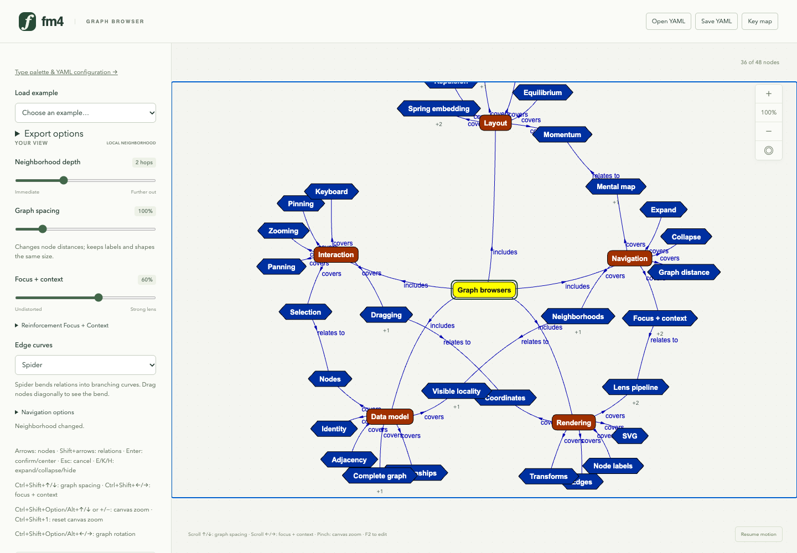

# Freshmind 4

**Author and maintainer:** Gregor Heinrich.

**Freshmind 4** (`fm4`) is a partial port of Java Freshmind to TypeScript and JavaScript, with a browser demo and an ESM library. It combines graph browsing, typed nodes and curved relations, keyboard navigation, editing and YAML persistence with the original TouchGraph spring layout and viewing lenses.



The graph-browser example with Reinforcement Focus+Context (RFC) enabled on its center node. [Explore the 30-step flipbook](docs/flipbook/index.html).

## Background and motivation

The original Freshmind was developed by Gregor Heinrich in several waves between 2002 and 2014.

The purpose of this partial port is to demonstrate Freshmind's concepts in a modern browser environment. Some of these concepts have aged well and may still be valuable more than a decade later. Freshmind 4 carries selected functionality forward and adds new capabilities for exploring these ideas.

Freshmind 4 reimplements and extends the original Reinforcement Focus+Context idea from [Gregor Heinrich’s 2005 paper](docs/literature/rfc@3ia05compact.pdf). RFC reinforces selected neighborhoods while retaining their surrounding context. Extensions include explicit focal target lengths, persistent tree/DAG/cluster definitions and reproducible layout comparisons.

## Progress

| Area | Current status |
| --- | --- |
| TouchGraph foundation | Ported graph/locality APIs, spring layout and lenses, with scoped Java compatibility checks. |
| Freshmind browser features | Ported types, labeled curves, navigation, overlay editors with label/weight commands, content popups and native YAML persistence. |
| Reinforcement Focus + Context | Implemented planned mechanisms: multiple foci, stored structures, clustering, importance weights, optional region exclusion and reversible type filtering/leaf aggregation, with reproducible synthetic comparisons. |
| Research and future views | Application/library survey and pre-2024 appendix completed; radius-two view designed, implementation proposed. |
| Assurance | Intent, usage constraints, architecture and evidence approach proposed in [PR #36](https://github.com/gregoryyy/freshmind/pull/36); implementation-wide audit remains pending. |
| Readability | Measured node-label separation with pinned/focus protection and overlap counts; automatic relation-label placement near clear curve positions. |
| Graph visual search | Working lexical/LDA prototype: queries, tags, node similarity and feedback. Next: elasticlunr literal retrieval and FM 2014 LDA feature parity; embeddings deferred. |
| Application research and alternative views | Literature/application review and radius-two design/mockup complete; production implementation and evaluation remain pending. |
| System assurance | Intent, usage constraints, architecture and deterministic verification approach documented for review. Implementation mapping, risk assessment and conformance checks remain pending. |

See the [roadmap](docs/TODO.md) for agreed scope and the [implementation record](docs/DONE.md) for verification and compatibility limits. Feature delivery is distinct from conformance to the [assurance baseline](docs/assurance/README.md); that audit has not been completed. Experiments use small synthetic graphs and corpora; they do not establish general convergence, perceptual benefit or retrieval quality. The layout uses point-based forces, so labels can overlap, and pairwise repulsion is quadratic in visible nodes. **View → Label spacing** offers paused node separation and automatic relation-label placement; see the [readability guide](docs/readability.md).

## Run the browser

Use the repository's `just` recipes:

```sh
just install
just dev
```

Open the localhost address printed by Vite. `/` is the graph browser; `/freshmind.html` explores the type palette and live YAML configuration. **Load example** offers synthetic RFC graphs, public networks and the approved Berry/NIPS-FM datasets.

Try **RFC → Research community showcase** to compare a plain graph, viewing lens, one/two RFC foci and hybrid aggregation. See the [showcase guide](docs/rfc-showcase.md) or [six-view flipbook](docs/rfc-showcase/index.html).

Graph search uses elasticlunr for literal retrieval and local LDA for semantic retrieval. Choose distance or likelihood ranking and save/load topic models separately from graph files. See the [browser guide](docs/graph-search.md) and [FM 2014 parity record](docs/fm2014-retrieval-parity.md) for supported operations, verification and intentional differences. Embeddings are deferred.

RFC starts enabled on the main browser’s center node. Open **Reinforcement Focus + Context** to choose other centers or adjust its settings. Point at the graph to give the centered node keyboard control; explicit control/editor focus takes priority. Use **Key map**, **?** or **F1** for controls, or follow the [walkthrough](docs/flipbook/README.md).

**View → Layout motion → Adaptive damping** starts enabled and suppresses oscillation with or without RFC. See the [damping guide and experiment](docs/layout-damping.md).

The other common recipes are:

```sh
just build          # Library and TypeScript declarations
just build-demo     # Production demo
just preview        # Build and serve the production demo
just flipbook       # Production walkthrough: screenshots, Markdown and HTML
just check          # Type checking, core tests and demo build
just check-all      # Also run Java parity and browser tests
just pdf README.md  # PDF beside one Markdown source
just pdfs docs      # PDFs for Markdown files under docs
just --list         # All recipes, including experiments and example conversion
```

PDF recipes use Pandoc and Google Chrome; `CHROME` selects another Chrome executable. Experiment and conversion instructions are in the detailed documents linked below.

## Use the library

Build with `just build`. Give the graph container an explicit height, for example `600px`:

```ts
import { FreshmindPanel, FreshNode, FreshEdge } from "fm4/fm";

const panel = new FreshmindPanel(document.querySelector<HTMLElement>("#graph")!);
const person = panel.addNode(new FreshNode("person-1", "Ada", { type: "person" }));
const paper = panel.addNode(new FreshNode("paper-1", "A paper", { type: "paper" }));
panel.addEdge(new FreshEdge(person, paper, {
  id: "authored-1", type: "authored", label: "wrote"
}));
await panel.focusNode(person, 1);
panel.getRfc().setFocus(person); // Library applications opt in to RFC.

// Call panel.destroy() when removing the browser.
```

`fm4` / `fm4/tg` expose the TouchGraph browser API. `fm4/core` / `fm4/tg/core` and `fm4/fm/core` provide headless entry points without D3, DOM rendering or YAML parsing. `fm4/ir` provides independent headless information retrieval, including `fm4/ir/topics`. The [module map](src/README.md) documents the three source domains, short feature imports and dependency boundaries; the [feature design](docs/fm_port-design.md) describes the model, configuration, editing and persistence contracts.

## Detailed documentation

| Topic | Reference |
| --- | --- |
| System intent, constraints and assurance | [Assurance approach and baseline](docs/assurance/README.md) |
| Application research and future layouts | [ROAD: use cases, related work and libraries](docs/ROAD.md), [radius-two view design](docs/radius-two-view.md) |
| Browser controls and examples | [Key map](docs/KEYMAP.md), [walkthrough](docs/flipbook/README.md) |
| Freshmind models, types, navigation, editing and YAML | [Feature design](docs/fm_port-design.md) |
| Source modules and package entry points | [Module map](src/README.md) |
| RFC forces, activation, interaction and damping | [RFC design](docs/rfc-design.md) |
| Trees, DAGs, clustering and cluster forces | [Substructures](docs/rfc-substructures.md), [clusters](docs/rfc-clusters.md) |
| Importance and focal-region exclusion | [Importance contract](docs/rfc-importance.md), [exclusion contract](docs/rfc-exclusion.md) |
| Reversible filtering and leaf aggregation | [Structural focus + context](docs/structural-focus-context.md) |
| Graph readability | [Node separation and relation-label placement](docs/readability.md) |
| Graph visual search | [Integration and scope](docs/search-module-integration.md), [browser guide](docs/graph-search.md), [FM 2014 parity](docs/fm2014-retrieval-parity.md) |
| Scientific analysis and experiments | [Second draft paper](docs/papers/rfc-revisited-draft2.md), [follow-up reports](docs/experiments/rfc-followup/README.md) |
| Example data, provenance and conversion | [Public networks](examples/public/README.md), [approved Java examples](examples/fm2014/README.md), [fictional search library](examples/search/README.md) |
| Java reference and compatibility | [FM 2014 source analysis](docs/fm2014_analysis.md), [compatibility audit](docs/DONE.md#compatibility-audit) |

## Development and verification

```sh
just typecheck
just test
just test-java       # Requires a JDK.
just build-demo
just test-browser
```

XML conversion checks require Python 3. Browser checks need a Playwright browser or Google Chrome. To use installed Chrome, run `PLAYWRIGHT_CHANNEL=chrome just test-browser`; set `PLAYWRIGHT_PORT` if the default port 4173 is occupied.

`just flipbook` regenerates the production walkthrough; `just flipbook --help` lists capture options. Current verification results are recorded in [DONE.md](docs/DONE.md).

## Source and licensing

Freshmind sources marked Apache-2.0 retain [Apache 2.0](licenses/LICENSE-APACHE-2.0). The LDA sampler port retains [GPL 3 or later](licenses/LICENSE-GPL-3.0); combined builds including it use that license. The Cokus MT19937 generator retains its upstream [GNU Library GPL 2 or later](licenses/LICENSE-LGPL-2.0) notice. TouchGraph-derived components retain their original terms. See [LICENSE](LICENSE) and [NOTICE](NOTICE) for scope, pinned Java references and dependency attribution; distribute these notices and license texts with the sources.

This product includes software developed by TouchGraph LLC (http://www.touchgraph.com/).

This product includes software developed by TouchGraph (http://www.touchgraph.com/).
