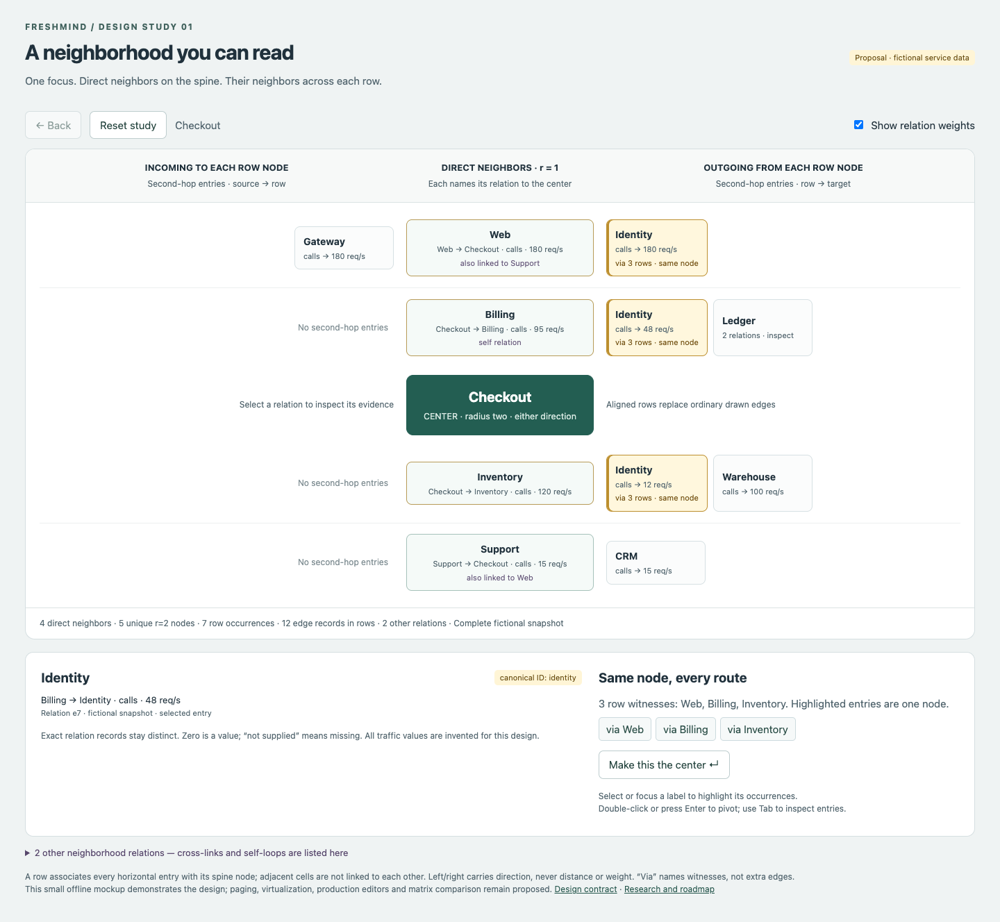

# Freshmind: applications and research roadmap

Research snapshot: **2026-10-24**. This document proposes the next direction;
[TODO.md](TODO.md) tracks delivery and [DONE.md](DONE.md) records completed work.
The radius-two view below is a design, with a standalone mockup, rather than an
implemented browser feature.

[Appendix A](#appendix-a-related-work-before-2024) extends the literature review
to work published before 2024, distinguishing RFC comparisons, visual retrieval
workflows and adjacent graph-query/representation techniques.

Freshmind makes relationships navigable: find an item, understand its immediate
context, and follow useful connections without losing the question that brought
you there. The modern opportunity is an inspectable interface to existing graph
and retrieval systems. Readable names, relationship meaning, evidence and fast
navigation matter more here than drawing the largest possible whole graph.
This extends the original RFC and visual-search ideas; reproducing the 2005
figures is outside scope.

## Recommended direction

Build a **radius-two adjacency view** alongside the current RFC node-link view:
the center and its direct neighbors share a vertical spine; each neighbor gets
a horizontal row of its own neighbors. Alignment and relationship labels carry
the connections. Repeat a shared second-hop node in each relevant row, retaining
its identity and showing its other routes explicitly.

Start with **software dependency and change-impact investigation** as a practical
application, and **research/evidence exploration** as a second demonstration.
Both can use attributable public inputs and concrete questions. Data lineage is
a promising next integration when a source of lineage events is available.
These are prioritization judgments, not measured demand or revenue forecasts.

Keep retrieval in `ir`, behind document/result contracts. Following this survey,
the user requested **elasticlunr** literal retrieval and **LDA** semantic retrieval
for FM 2014 parity; embeddings are deferred. The [integration plan](search-module-integration.md)
and [parity record](fm2014-retrieval-parity.md) describe that implementation;
this survey itself does not establish retrieval quality.

## Applications worth testing

“High value” means helping a person make an expensive, consequential or repeated
decision. The sources below establish real workflows and data models; the
proposed Freshmind contribution and priority are our hypotheses. Existing
products already serve these markets: a new drawing alone is insufficient.

| Priority / application | User, question and graph | Proposed contribution and a useful trial | Main obstacle / existing alternative |
| --- | --- | --- | --- |
| **1. Software dependencies and change impact** | Maintainer/security engineer: “Which services depend on this component, through which packages?” Nodes are repositories, package versions and services; typed edges describe dependencies and ownership. GitHub exposes dependency review and SBOM endpoints. [GitHub API](https://docs.github.com/en/rest/dependency-graph) | Search a package/version, compare direct consumers vertically and their consumers horizontally; show version constraints and source manifests beside each relationship. Trial: a public repository dependency export with manually checked routes; measure correct affected-consumer identification. | SBOM completeness, version identity and build/runtime conditions. A dependency route alone does not establish exploitability. Existing dependency tools are the baseline; the local view also needs a path query for longer chains. |
| **2. Data and AI pipeline lineage** | Data engineer/governance analyst: “What feeds this dataset, and what will a schema change affect?” OpenLineage models datasets, jobs and runs and explicitly supports root-cause and impact analysis. [OpenLineage](https://openlineage.io/) | Put upstream/downstream relationships on opposite sides, retain run/time and column-level evidence. Trial: one pipeline snapshot, source dataset → transformation → consumer; compare impact and missing-input investigations with the incumbent lineage view. | A two-hop radius may stop at a job rather than a downstream dataset. Schema-level and run-level graphs differ; never collapse them silently. Connect to an existing lineage backend rather than build a catalog. |
| **3. Inspectable AI retrieval and agent memory** | Knowledge worker/AI application engineer: “Why was this source retrieved? Which entity and evidence connect these claims?” GraphRAG combines entity neighborhoods with source text; Graphiti adds temporal relationships and hybrid retrieval. [GraphRAG query modes](https://microsoft.github.io/graphrag/query/overview/), [Graphiti documentation](https://help.getzep.com/graphiti/getting-started/welcome) | Inspect query → entity → source/claim, distinguish extracted, asserted and inferred relations, expose the supporting passage and validity time. Trial: a small licensed corpus with recorded retrieval results and independently checked source passages. Measure successful evidence verification and correction. | Extraction errors, ambiguous identity, stale facts and access permissions. A graph-shaped explanation is not proof. Keep raw source access and uncertainty visible; integrate a supplied retrieval engine. |
| **4. Incident and service dependency investigation** | SRE: “Which caller or dependency changed when this service degraded?” Tempo derives directed service graphs and traffic/error/latency measurements from traces. [Tempo service graphs](https://grafana.com/docs/tempo/latest/metrics-from-traces/service_graphs/) | Center the affected service; compare callers and dependencies without moving labels. Show time window and metric units on each relation. Trial: a recorded incident with known trace evidence, measuring correct dependency localization and time to supporting trace. | Sampling, unpaired spans and uninstrumented services make observed topology incomplete. Two hops do not establish root cause. Grafana/APM tools already offer service graphs; compete on the investigation interaction. |
| **5. Identity and access review** | Defender/identity administrator: “How can this identity reach this resource, and which permission creates the route?” BloodHound OpenGraph supports cross-platform attack-path analysis. [SpecterOps OpenGraph](https://specterops.io/opengraph/) | An inspectable permission neighborhood, with principal → group/role → resource and exact grant/policy evidence. Trial: a synthetic permission graph and independently verified access-review tasks; require a separate path view for multi-hop escalation. | Conditional permissions, deny rules, time and paths longer than two hops. Access adjacency must not be described as effective authorization without policy evaluation. Existing BloodHound analysis is a stronger baseline than a generic force graph. |
| **6. Fraud and entity-resolution investigation** | Analyst: “Why are these records associated; what is shared across these entities?” Linkurious exposes matched/possible records and WHY/WHY NOT explanations. [Entity-resolution results](https://doc.linkurious.com/admin-manual/latest/entity-resolution-results/) | Entity → record → shared attribute/account, with match reason and provenance; shared-node emphasis helps compare witnesses. Trial on synthetic or explicitly licensed records; measure correct separation of evidence from suspected matches. | Sensitive data, false matches, entity resolution and analyst case management dominate integration effort. Defer a full product until a data partner and repeatable investigation task exist. |
| **7. Scientific literature and biological evidence** | Researcher: “Which papers support this idea, and what connects these authors/results?” OpenAlex provides citation relations, with documented matching gaps; ProtEGOnist demonstrates two-hop exploration of protein interactions. [OpenAlex citations](https://help.openalex.org/data/works/citations/), [ProtEGOnist paper](https://doi.org/10.1111/cgf.15078) | Citation/author/topic neighborhoods with readable titles; for biological data, separate experimental evidence and association confidence. Trial: an attributed public citation snapshot and known bridge-paper/common-reference questions. | Citation is not endorsement and missing references are common. Biological associations need domain interpretation. This is a research exploration use case, not a clinical decision claim. |

For the first application, keep the pilot narrow: import one dependency snapshot,
search by exact package/version, inspect one and two hops, follow longer paths,
and export a small evidence-backed finding. Interview maintainers before building
continuous ingestion or an alerting platform. If source access proves difficult,
use a public citation graph to evaluate the interaction first rather than making
up an enterprise integration.

## State of the art: RFC and graph exploration

RFC means **Reinforcement Focus+Context**, not reinforcement learning. Its
distinctive operation is to impose recognizable local structure inside a more
general graph layout. Viewing distortion, selecting a subgraph, changing its
layout and ranking search results are separate operations.

| Work / approach | Relevant contribution | Limitation and implication for Freshmind |
| --- | --- | --- |
| [Heinrich, RFC (2005)](literature/rfc@3ia05compact.pdf) and [our current implementation](rfc-design.md) | Reinforce focal structural primitives within surrounding context; combine with structural reduction and viewing lenses. Our implementation adds explicit target lengths, stored structures, multiple foci and weights. | Soft competing forces do not guarantee nonoverlap, convergence or perceptual benefit. Our synthetic experiments demonstrate mechanisms, not usability on production graphs. Keep RFC for spatial context; evaluate the new view independently. |
| [Search, Show Context, Expand on Demand (van Ham & Perer, 2009)](https://research.ibm.com/publications/search-show-context-expand-on-demand-supporting-large-graph-exploration-with-degree-of-interest) | Search seeds, degree of interest and bounded contextual expansion offer an alternative to whole-graph overviews. | This is selective exploration, so omitted context must be explained. Adopt explicit query scope, budgets and expansion rather than suggesting radius two is always small. |
| [fCoSE (2022)](https://github.com/iVis-at-Bilkent/cytoscape.js-fcose) and [User-Guided Force-Directed Graph Layout (Balci & Luna, 2025)](https://arxiv.org/abs/2506.15860) | Compound layouts with fixed, alignment and relative-placement constraints; the latter extracts guidance from user sketches and reports small/medium graph evaluation. | Constraint satisfaction and user intent are modern comparison points for RFC. They do not supply our repeated-identity neighborhood interface. Compare equivalent tasks and input constraints, rather than force coefficients alone. |
| [CMGV (online 2025; 2026 issue)](https://doi.org/10.1177/14738716251383173), with [Cytoscape implementation](https://github.com/iVis-at-Bilkent/cytoscape.js-complexity-management) | Coordinates complexity-management operations on compound graphs instead of treating filtering, hiding and collapsing as independent changes. | Strong precedent for explicit visible/hidden state. Its compound-graph approach does not automatically preserve our locality/semantic-owner contracts; study operation composition before adapting it. |
| [CoRe-GD (ICLR 2024)](https://arxiv.org/abs/2402.06706), [large-neighborhood search for layered layouts (2025)](https://dunne.dev/pubs/Wilson2025FastReadableLayered/), [Graphviz sfdp](https://www.graphviz.org/docs/layouts/sfdp/) | Learned hierarchical stress optimization, bounded-time local crossing optimization, and multilevel force layout address different global layout costs. | These are useful global-layout baselines, not evidence that labels, stable pivots or relationship comprehension are solved. Avoid replacing local interaction design with a faster whole-graph solver. |
| [Same Quality Metrics, Different Graph Drawings (GD 2025)](https://doi.org/10.4230/LIPIcs.GD.2025.7) and [ego-representation study (2024)](https://doi.org/10.1016/j.cag.2024.104123) | The former demonstrates how similar metric values can accompany different drawings. The latter compares straight, radial, layered and matrix ego views, finding matrices worse on its studied tasks/data and no notable performance difference among the three node-link layouts. | Neither low stress nor removing crossings establishes user benefit. The ego study does not test our adjacency-list design; include label/direction/weight and path tasks in a new evaluation. |

The opportunity is a combination of recognizable local structure, stable
navigation, explicit relationship evidence and bounded data access. This survey
does **not** establish that RFC has no successors or that our proposed combination
is novel. Relevant work uses several names: constrained layout, ego networks,
degree of interest, complexity management, adjacency lists and exploratory search.

## State of the art: visual search

Three meanings need separate contracts and evaluation:

| Meaning | Current reference points | Consequence / unresolved problem |
| --- | --- | --- |
| **Find content/entities, then explore their graph context** | [PivotPaths (2012)](https://mariandoerk.de/pivotpaths/) supports faceted exploration with pivots and animated relations. Hybrid retrieval combines lexical and semantic candidates; [rank fusion](https://www.elastic.co/docs/reference/elasticsearch/rest-apis/reciprocal-rank-fusion) is one documented combination strategy. | Preserve retrieval provenance, query scope and a ranked list alongside context. Similar embedding positions are not semantic edges. Raw lexical, vector and graph scores need explicit interpretation; do not treat them as calibrated probabilities. This is Freshmind's immediate direction. |
| **Construct a structural query or retrieve matching subgraphs** | [Envisage (VIS 2025 / TVCG 2026)](https://wenxiaolin.com/_pages/envisage.html) combines parameterized query construction, verification, progressive execution and result analysis; its evaluation includes two cases and interviews with 14 analysts. [Difference Views (2025 preprint)](https://arxiv.org/abs/2508.05314) shows changes in evolving queries and results. | These query patterns, not a text corpus. Do not promise pattern matching from an embedding search adapter. Result differences, query validation and inspectable matches are useful later interaction ideas; a query engine and its semantics remain necessary. |
| **Retrieve graph/text evidence to generate an answer** | [GraphRAG](https://microsoft.github.io/graphrag/query/overview/) separates local, global, DRIFT and basic search; [Graphiti](https://help.getzep.com/graphiti/getting-started/welcome) addresses changing facts and temporal graphs. [GraphTrials (2025)](https://doi.org/10.1109/TVCG.2025.3577533) studies the distinct idea of visual certificates for graph assertions. | Generated answers, extracted relations and retrieved passages require distinguishable provenance. GraphRAG's global search is resource intensive according to its documentation. A browser should expose what supported an answer and what was omitted; showing a neighborhood does not certify arbitrary assertions. |

Current visual search is therefore a workflow, not one layout algorithm:
**query → ranked seeds → local context → inspect a relation/source → pivot or
refine → compare results**. Keep the existing query/context/result separation.
Measure retrieval quality independently of interface speed and correctness.
Use the explicitly requested elasticlunr/LDA direction; embeddings are deferred.
See the [integration plan](search-module-integration.md).

## Available libraries and their shortcomings for this project

These are source/documentation comparisons, **not a local benchmark or a complete
maintenance/security audit**. Licenses listed are the projects' stated licenses
at the research date; commercial terms and extension licenses need checking for
the actual package/version if adopted. “Fit gap” is our engineering assessment,
unless the source explicitly documents the limitation.

| Library / role | Useful capability and stated license | Flaw or fit gap; suggested role |
| --- | --- | --- |
| [Cytoscape.js](https://js.cytoscape.org/#performance) + [fCoSE](https://github.com/iVis-at-Bilkent/cytoscape.js-fcose) | Rich graph model, styling, algorithms and layout extensions; constraint/compound support in fCoSE. MIT. | Cytoscape documents the cost of labels, complex styles and curved multiedges. Adopting its graph model as a second authority would conflict with TG ownership. Strong comparison implementation or isolated renderer adapter; the proposed view still needs occurrence identities and virtualization. |
| [WebCola](https://github.com/tgdwyer/WebCola) | Constraint-based graph layout integrated with web graphics. MIT. | A solver, not a browser/navigation/search system. Its README documents a D3-v3-style interface, so integration assumptions need inspection. Useful RFC constraint baseline; solving forces is unnecessary for fixed rows. |
| [ELK / elkjs](https://github.com/kieler/elkjs), [license](https://github.com/kieler/elkjs/blob/master/LICENSE.md) | Layered layouts, ports, nested graphs and worker execution. EPL-2.0. | Computes geometry, not rendering. Its FAQ calls out incremental layout and module/worker integration issues. Candidate for a path/DAG detail view; label sizes, stable pivots and accessibility still belong to the host. |
| [Sigma.js](https://www.sigmajs.org/) / [repository](https://github.com/jacomyal/sigma.js) | WebGL graph renderer built on Graphology; MIT for Sigma. | High drawing throughput does not make thousands of labels readable. Custom chips/editors and an accessible document structure still need work. Graphology should remain a detached adapter, not become a new semantic owner. Candidate for a future global overview, not the first row-view dependency. |
| [AntV G6](https://github.com/antvis/G6) | TypeScript graph engine with custom elements, behaviors, layout/plugins and Canvas/SVG/WebGL options. MIT. | Broad framework adoption would duplicate current rendering, interaction and lifecycle responsibilities. Custom orthogonal semantics, shared-node occurrences and bounded querying remain application work. Evaluate a small adapter before considering migration. |
| [cosmos.gl](https://github.com/cosmosgl/graph) | GPU force simulation/rendering with indexed buffers and WebGL2; MIT. | Shader/buffer integration is a different engineering model from editable text rows. A large point/link demonstration is not a label-readability benchmark. Candidate for a large overview; preserve CPU canonical IDs and an accessible text view. Distinguish this open-source engine from the separate Cosmograph product. |
| [D3 force](https://d3js.org/d3-force/simulation), [repository/license](https://github.com/d3/d3-force) | Composable force simulation, ISC; D3 rendering/interaction modules are already used here. | The simulation mutates supplied nodes, as documented. Passing TG nodes directly would violate coordinate ownership. Its stock forces do not provide RFC semantics or our row layout; keep custom presentation simple and use detached data for any force comparison. |
| [React Flow](https://github.com/xyflow/xyflow), [performance guide](https://reactflow.dev/learn/advanced-use/performance) | Custom node interfaces and editing ecosystem; MIT core. | Adds a React/state integration to this native ESM/SVG application. Its guide warns about repeated renders and recommends limiting expanded content. Useful workflow editor; not an automatic answer to large exploratory graphs. A bounded HTML row view needs no framework conversion. |
| [yFiles for HTML](https://docs.yworks.com/yfiles-html/dguide/layout-incremental_layout/), [labeling](https://docs.yworks.com/yfiles-html/dguide/label_placement/), [licensing](https://www.yworks.com/products/yfiles-for-html/license-types) | Incremental/partial layouts and integrated/generic labeling. Commercial. | Commercial SDK/domain/deployment terms and migration cost. Generic label placement cannot always avoid overlaps; integrated placement may change geometry. A serious paid baseline if product requirements justify it, not a prerequisite for this design. |
| [Ogma](https://doc.linkurious.com/ogma/latest/examples/grouping-large.html), [plugins](https://doc.linkurious.com/ogma/latest/plugins/), [availability](https://doc.linkurious.com/ogma/latest/download.html) | Large-graph grouping, cards, timelines and annotations. Commercial product. | Commercial integration and another graph/view abstraction; proposed identity/row semantics still need design. The [6.0.4 changelog](https://doc.linkurious.com/ogma/latest/changelog.html) records limitations for endpoint text on self-loops/curves; check the chosen release rather than assuming every label form works. |
| [elasticlunr](https://github.com/weixsong/elasticlunr.js) | Browser/offline field search, boosting and Boolean configuration; MIT. | Lexical retrieval only; Lucene compatibility and semantic retrieval must not be assumed. The maintainer asks for maintenance help in the README, so inspect actual release/API/test behavior when needed. The user selected pinned npm 0.9.5 for literal retrieval; our adapter preserves a bounded grammar and repairs its strict-module alias declaration. LDA provides semantics separately. |

**Selection:** prototype the adjacency view with the existing graph contracts and
ordinary HTML/SVG. No physics engine is needed to assign rows and horizontal
slots. Use Cytoscape/fCoSE or WebCola as constrained-layout comparisons, ELK for a
possible path detail experiment, and Sigma/cosmos only if measured overview needs
justify GPU rendering. Benchmark the actual workload before any migration.

## Radius-two design

Open the [interactive design](design/radius-two/index.html) locally. It uses only
fictional data and runs offline. Select an entry to inspect its exact relation,
see all occurrences of the same node and its “via” routes; pivot to another node
and return with history. The preview illustrates the default view, not a
production screenshot or a large-graph performance result.

The [full design contract](radius-two-view.md) specifies:

- A center on the vertical spine, unique r=1 rows above/below it and horizontally
  arranged r=2 entries on each row. In the directed default, left means incoming
  **to that row's r=1 node**, right means outgoing from it. Order and distance do
  not encode weight. Undirected and reciprocal relations have explicit policies.
- A relation phrase, direction and exact weight/unit beside each entry; multiple
  relations expand to individual edge records. The center-to-r=1 relation is
  named in the row header. Node importance and retrieval score stay separate.
- Shared r=2 identities repeated as proxies, with “via Billing, Inventory, Web”,
  linked highlighting and an optional unique-node comparison matrix. Repeated
  entries never increase the distinct-node count.
- Explicit back/cross/self relations and a supplementary relation list for
  r=2–r=2 connections. The main rows are a path-based presentation of the
  neighborhood, not a complete induced-graph drawing.
- Bounded, paged queries and virtual rows/cells for hubs. Always distinguish
  displayed entries, distinct nodes, relation counts and known/unknown totals.

### Closest prior art and what changes

| Prior work | Similarity | Difference / useful lesson |
| --- | --- | --- |
| [Visual Adjacency Lists for Dynamic Graphs (Hlawatsch, Burch & Weiskopf, 2014)](https://doi.org/10.1109/TVCG.2014.2322594), [author manuscript](https://www.profitippliga.de/papers/59.pdf) | The closest geometric precedent: orthogonal node/link axes, compact asymmetric neighbor lists, labels/colors and size encoding for weights. | Our proposal selects one radius-two ego, puts its r=1 neighbors on a central spine, and makes typed path witnesses and shared identities explicit. The 2014 study addresses dynamic/weighted graphs; it does not establish usability of this proposed interaction. |
| [TreePlus (2006)](https://www.cs.umd.edu/projects/hcil/treeplus/) and [Juniper (2018/2019)](https://pmc.ncbi.nlm.nih.gov/articles/PMC6785378/) | Seed-based graph exploration; tree projection, readable rows, attributes and disclosure of non-tree links. Juniper adds an adjacency matrix and attribute table. | A spanning tree chooses a parent; our default retains each r=1 witness with repeated r=2 proxies. Hidden-link hints and matrix detail are essential precedents, not optional embellishments. Avoid claiming a new invention of graph-as-table browsing. |
| [GeneaQuilts (2010)](https://aviz.fr/geneaquilts) and [BioFabric (2012)](https://biofabric.systemsbiology.net/) | Relations can be communicated by matrix incidence or orthogonal rows/columns rather than conventional point-to-point curves. | GeneaQuilts exploits genealogy structure; BioFabric still draws edges as vertical lines. Neither is the same two-hop typed-label view. Both illustrate why positional semantics and ordering must be taught explicitly. |
| [ProtEGOnist (2024)](https://doi.org/10.1111/cgf.15078) | Two-level ego neighborhoods, aggregation, shared-node comparisons and interaction-only edge disclosure. | Uses radial glyphs and overlap bands rather than text rows; its comparison groups are limited to three egos. Our focus is exact names and edge attributes, with potentially many r=1 witnesses. Evaluate whether repeated labels are understandable rather than assuming they are. |

The proposed contribution is a particular interaction and information design,
not a claim to have invented adjacency lists, ego browsing, duplicated nodes or
edge-free representations. Its main weaknesses are repeated-node confusion,
screen area for high-degree nodes, less immediate global topology, and extra
work to inspect cycles and relationships outside the row structure.

## Delivery sequence and evaluation gates

The proposed implementation tasks are listed as **6.3–6.8** in
[TODO.md](TODO.md#6-applications-and-radius-two-exploration). Keep each increment
reviewable and open its PR against main.

| Step | Deliverable | Gate before proceeding |
| --- | --- | --- |
| **6.1–6.2 Research/design — complete** | This application/library survey, design contract and interactive mockup. | Source links, explicit alternatives, inspectable geometry and relation semantics. This does not complete implementation. |
| **6.3 Projection contract** | Deterministic radius-two data projection with stable node/edge IDs and separate occurrence IDs; correctness fixtures. | Shared descendants, triangles, parallel/reciprocal/undirected edges, loops, filters, incomplete pages and graph replacement behave as specified. Source data/coordinates remain unchanged. |
| **6.4 Bounded browser view** | Opt-in view switch, measured rows/cells, paging/virtualization, selection/pivot/history and keyboard access; shared overlay editor. | Hubs stay usable with bounded mounted elements. Direction, counts and truncation are explicit. Switching views preserves graph identity and editor behavior. |
| **6.5 Retrieval connection** | Elasticlunr/LDA results and stable result IDs can seed/pivot the view through the existing IR adapter. | Stale jobs and source replacement cannot attach wrong results. Query links, semantic relations and relevance remain distinct. No speculative IR replacement. |
| **6.6 Evaluation** | Public/attributed dependency or citation snapshot plus synthetic stress fixtures; compare adjacency view, ordinary ego node-link, current RFC, and a simple list/tree baseline. Add a matrix baseline for shared-neighbor tasks. | Report direction/weight/path/common-neighbor correctness, task time/errors, label reading, duplicates, pivot continuity and measured browser costs. Keep retrieval quality separate. No “better” claim based solely on overlap counts. |
| **6.7–6.8 Application pilot** | Maintainer/researcher task sessions, then one evidence-backed application adapter if useful. | Agree the data source and task; demonstrate that the view improves a repeated decision. If pilots show no benefit, revise the representation before expanding integrations. |

For performance, vary **source graph size, visible r=1 degree, total queried
incidences, repeated occurrences and mounted cells separately**. Radius two can
still contain a huge neighborhood. Use sparse, hub-heavy, dense/shared and
long-label cases. Record device/browser, cold versus cached pivots, p50/p95 query
and render times, memory and input stalls. A provisional target is a cached
bounded pivot within 100 ms and visible progress for slow queries; these are
design targets to test, not achieved measurements.

For usability, test “which node?”, “via which neighbor?”, “in which direction?”,
“what exact relation/weight?” and “is anything hidden?” as distinct questions.
Counterbalance views and task order, use the same semantic subgraph and record
incomplete or incorrect answers. Test keyboard and non-hover interactions. A
small pilot helps refine the design; general performance claims require a
properly designed study.

## Interaction UX review

Requested follow-up, **2026-10-25**; [TODO milestone 9](TODO.md#9-interaction-ux-review).
Review the interaction as a whole across **pointer, keyboard, touch and their
combinations**, starting with the control panel. This is planned review work,
separate from the radius-two application pilot and its domain-task questions.

| Priority | Review questions |
| --- | --- |
| **Control panel first** | Can users find the relevant setting, acquire its actual clickable surface and change it on the first gesture? Review sliders, radios and multiple selection, grouping, feedback, precise adjustment, collapse/reopen behavior, scrolling, focus return and narrow-screen reach. Retain the requested control choices unless evidence supports a change. |
| **In-place node and edge editing** | How far must users travel to acquire a label, and how large/stable is its effective target? Compare in-place and overlay task paths while the layout moves and lenses/zoom change. Examine caret placement, text selection, relation targets, body dragging, commit/cancel, IME, touch selection handles and the on-screen keyboard. |
| **Input handoffs** | Does a selected/focused item remain the intended command target when switching from pointer to keyboard, graph to panel/editor, or touch to a hardware keyboard? Review modifiers, pan/drag/selection conflicts, wheel/pinch ownership, cancellation and document replacement. Touch tasks must not depend on hover. |

Use these complementary foundations as questions to test, rather than automatic
proof that a design is good:

- **Fitts' law:** target distance and effective width for acquiring labels and
  controls. Measure real hit regions, including label-to-control associations,
  rather than just painted bounds. Treat moving graph labels as an additional
  experimental condition; do not assume a stationary-target model predicts them.
  [Fitts (1954)](https://doi.org/10.1037/h0055392).
- **Choice and steering:** assess the effort of finding a command among choices,
  and constrained pointer paths where relevant. Inspect grouping and recognition
  as well as the number of options; count actions and hand movements between
  keyboard and pointer for representative tasks.
  [Hick (1952)](https://journals.sagepub.com/doi/pdf/10.1080/17470215208416600),
  [Accot & Zhai (1997), Beyond Fitts' Law](https://citeseerx.ist.psu.edu/document?doi=c55bfa1f5f3c8aa97a102ef88dba0026041c38b7&repid=rep1&type=pdf).
- **Interaction heuristics and accessibility:** visibility of state, consistency,
  direct manipulation, error prevention/recovery, recognition rather than recall,
  keyboard operation, visible/unobscured focus, target size, concurrent input
  mechanisms and alternatives to dragging.
  [Nielsen's heuristics](https://www.nngroup.com/articles/ten-usability-heuristics/),
  [WCAG 2.2](https://www.w3.org/TR/WCAG22/).

Deliver an interaction/state matrix and prioritized findings tied to reproducible
tasks. Record device/browser, input combinations, novice/experienced use, target
acquisition, action counts, task time, errors, assistance and unintended edits.
Use deterministic tests for hit surfaces, focus routing, gesture ownership and
commit/cancel; use actual participant observations for comprehension and effort.
Implement scoped fixes with regression checks, then repeat the tasks. Preserve
graph information and make unresolved tradeoffs explicit; neither model-based
estimates nor automated event playback establish usability or accessibility
conformance by themselves.

## Research scope and open decisions

The survey searched the original RFC concept and adjacent work on constrained
layout, ego networks, visual adjacency lists, graph-as-tree/table exploration,
visual queries and graph-backed retrieval, checking primary papers, author
pages, official repositories and documentation. It includes relevant 2024–2026
work as well as the pre-2024 review in Appendix A; it is a targeted survey, not an
exhaustive literature review. Bibliographic years above follow the paper or
venue, not a search engine's crawl date. Links were consulted on 2026-10-24;
moving library documentation describes an observed snapshot, not a pinned API.

Open decisions are the first pilot's data source, domain meaning of weights,
whether stable row repetition or a unique-node matrix better supports shared
neighbors, and how much non-tree detail should be permanently visible. Resolve
these with the mockup and task evidence before fixing a new public API.

## Appendix A. Related work before 2024

### A.1 Scope and interpretation

This historical extension considers publications **before 2024-01-01**, with
sources checked on **2026-10-24**. It supplements the current survey rather than
replacing it. Search terms included reinforcement focus/context, constrained
graph layout, local structural primitives, degree of interest, search-seeded
graph exploration, associative browsing and visual query/result context. The
review follows relevant references and checks papers, author project pages and
institutional/publisher records. It is selective, not a systematic review or a
complete citation genealogy; no entry for a year means no selected paper, not
that no related work exists.

Our two historical anchors have different purposes. [Heinrich's RFC paper
(2005)](literature/rfc@3ia05compact.pdf) embeds recognizable local structures in
a surrounding graph layout. The [community-browser description (2011),
pp. 212–213](literature/gheinrich-phd-thesis_p212.pdf) makes a query part of the
graph, links retrieved items to it, preserves ordinary semantic relations, and
supports radius-two navigation, node-based similarity queries, annotations and
removal of irrelevant result links as a possible feedback mechanism. The
retrieval model used in that example does not define the interaction concept:
elasticlunr literal and LDA semantic retrieval are our current direction, with
embeddings deferred.

The contribution and reported scope columns below describe the sources. The
comparison column is our assessment, not a defect claimed by their authors.
Similarity of mechanisms does not establish influence or direct descent from
RFC. A graphical query language and a graph interface to retrieved content also
solve different problems.

### A.2 Focus/context and reinforcement through layout

| Work | Contribution and reported scope | Relationship to RFC / comparison to make |
| --- | --- | --- |
| **Furnas (1986), Generalized Fisheye Views**, CHI. [Paper](https://courses.ischool.berkeley.edu/i247/f05/readings/Furnas_GeneralizedFisheyeViews_CHI86.pdf) | Formalizes degree of interest through a priori importance and distance from a focus; selects detail while retaining important context. | A foundation for choosing what to show. It does not specify RFC's reinforcement of local trees/circles; distinguish structural selection from changing layout geometry. |
| **Sarkar & Brown (1991 technical report; CHI 1992), Graphical Fisheye Views of Graphs**. [Author-institution report](https://cs.brown.edu/research/pubs/techreports/reports/CS-91-61.html) | Combines geometric transformations with structural information for graph viewing and browsing. | A viewing-distortion comparison. Magnifying a region and imposing a recognizable local arrangement should be evaluated separately, including whether either makes labels readable. |
| **Ryall, Marks & Shieber (1997), An Interactive Constraint-Based System for Drawing Graphs**, UIST. [Author-hosted paper](https://www.eecs.harvard.edu/shieber/Biblio/Papers/ryall-uist-97.pdf) | GLIDE lets users specify visual organization constraints and manipulate a continuously simulated drawing. Its stated target is diagrams of 50 nodes or fewer. | A close earlier mechanism: high-level organization becomes spring-like forces. RFC's focus/context policy is more specific, but adding forces for visual structure is not itself new. Its small-diagram scope is not evidence for large-graph exploration. |
| **Dwyer, Koren & Marriott (2006), IPSep-CoLa**, TVCG 12(5), 821–828. [Institutional record / DOI](https://research.monash.edu/en/publications/ipsep-cola-an-incremental-procedure-for-separation-constraint-lay/) | Adds minimum horizontal/vertical separation constraints to stress-based layout, supporting direction, label nonoverlap and grouping. | A constraint-solving alternative to soft reinforcement. Compare explicit separation requirements and feasible/infeasible cases; extra repulsion alone does not establish body clearance. |
| **Dwyer et al. (2008), Exploration of Networks Using Overview+Detail with Constraint-Based Cooperative Layout**, TVCG 14(6), 1293–1300. [Author-hosted paper](https://users.monash.edu/~mwybrow/papers/dwyer-infovis-2008.pdf) | Uses different, cooperating layouts for an overview and a focal detail view; the detailed layout supports user constraints and edge routing. | Closely related in objective: improve a local region while retaining context. Separate overview/detail views differ from RFC's embedding in one drawing; compare orientation and transitions as well as local aesthetics. |
| **Dwyer (2009), Scalable, Versatile and Simple Constrained Graph Layout**, Computer Graphics Forum 28(3), 991–998. [Publisher paper](https://onlinelibrary.wiley.com/doi/abs/10.1111/j.1467-8659.2009.01449.x) | Extends incremental constrained layout to inequalities/equalities on Euclidean distances using a position-based constraint response. | A useful numerical baseline for maintaining local shape. Its solver contribution does not supply query/result semantics or validate a particular browsing workflow. |
| **Wang et al. (InfoVis 2017; TVCG 2018), Revisiting Stress Majorization as a Unified Framework for Interactive Constrained Graph Visualization**, 24(1), 489–499. [Author project](https://www.yunhaiwang.net/infovis17/vectormds/index.html), [institutional publication record](https://graphics.uni-konstanz.de/publikationen/Wang2018RevisitingStressMajorization/index.html) | Reformulates stress using edge vectors and lengths; explicitly demonstrates local **star, circle, path and cluster-separation constraints**, including selected ego-network regions. | **One of the closest comparisons to RFC's structural-primitives idea in this review.** Compare local shape, context disruption, overlap, interactive changes and numerical behavior. Similar functionality is established here; direct influence from RFC is not established by this survey. |
| **Balcı & Dogrusoz (online 2021; TVCG 2022), fCoSE: A Fast Compound Graph Layout Algorithm with Constraint Support**, 28(12), 4582–4593. [Paper](https://yoksis.bilkent.edu.tr/pdf/files/15807.pdf) | Combines spectral initialization and compound spring embedding with placement constraints and nonuniform node dimensions; evaluates small to medium graphs. | A modern pre-2024 comparison for constraints and node-body treatment. Nested compound structure differs from our overlapping focal memberships, and a layout solver does not provide the complete search/navigation interface. |

This history changes the comparison set: RFC should be evaluated against
interactive constrained layouts, especially Wang et al.'s local primitives, as
well as against ordinary force layout and lenses. Quiet motion, low stress,
local shape and readable labels are separate outcomes. The present review does
not establish a large literature explicitly named “Reinforcement Focus+Context”;
it does establish substantial related work under constrained graph layout.

### A.3 Visual retrieval and associative graph exploration

| Work | Contribution and reported scope | Relationship to our visual-search concept |
| --- | --- | --- |
| **van Ham & Perer (2009), Search, Show Context, Expand on Demand**, TVCG. [IBM publication](https://research.ibm.com/publications/search-show-context-expand-on-demand-supporting-large-graph-exploration-with-degree-of-interest) | Starts from a node of interest, selects contextual subgraphs using degree of interest, and supports bounded expansion. Demonstrates browsing a large legal-citation database. | A close search-first interaction comparison. Radius and degree-of-interest budgets both omit context; our view must explain omissions and retain the query that led to a result. |
| **Chau, Kittur, Hong & Faloutsos (2011), Apolo**, CHI. [Author-hosted paper](https://www.cs.cmu.edu/~dchau/apolo/apolo.pdf) | Combines incremental network exploration with exemplar-based belief propagation to identify relevant nodes. Reports a 12-participant related-paper study. | Closely related to node-based similarity search and interactive refinement. Its graph inference differs from literal/embedding retrieval; compare the interaction independently of ranking quality, using equivalent inputs and judgments. |
| **Dörk, Henry Riche, Ramos & Dumais (2012), PivotPaths**, TVCG 18(12), 2709–2718. [Author project and publication](https://mariandoerk.de/pivotpaths/) | Shows relations among faceted items and supports lightweight pivots with gradual transitions; evaluated through interviews and a two-week deployment. | A close precedent for moving between retrieved items and their relational context. Faceted paths are not arbitrary semantic graph edges; compare pivot comprehensibility and continuity without assuming identical data models. |
| **Kairam, Henry Riche, Drucker, Fernandez & Heer (2015), Refinery**, Computer Graphics Forum 34(3), 301–310. [Author-hosted paper](https://idl.cs.washington.edu/files/2015-Refinery-EuroVis.pdf) | Uses heterogeneous sets of nodes as queries, computes random-walk degree-of-interest scores, and visualizes query nodes within result subgraphs. Reports a study with 12 academic researchers. | **A particularly close comparison for query/result context embedded in a graph.** Its queries comprise existing graph nodes; our browser can also create dedicated term/tag query nodes. Neither that difference nor a different retrieval backend establishes novelty or superiority. |
| **Nguyen et al. (2016), SenseMap: Supporting Browser-Based Online Sensemaking through Analytic Provenance**, VAST. [Institutional paper](https://openaccess.city.ac.uk/15530/1/SenseMap-final.pdf) | Captures browsing actions in a history map and supports curated knowledge maps. Its exploratory five-person task study reports successful engagement for three participants and negative experiences for two. | Adjacent evidence for preserving exploration history and source provenance, rather than a matching retrieval algorithm. It also cautions against treating a visual map as an automatic improvement over ordinary browsing. |

Apolo and Refinery are stronger historical workflow comparisons than a generic
whole-graph viewer. The common idea is iterative retrieval and exploration with
visible context; the exact mechanisms differ. We should compare finding a useful
new item, explaining its connection to a query, rejecting a result and returning
to an earlier context. Their reported studies concern their own systems/tasks,
not evidence that Freshmind improves those outcomes. None requires reviving LDA
or adopting its particular inference algorithm.

### A.4 Adjacent representations and structural queries

These works help delimit the proposal; they are not additional direct RFC or
content-retrieval implementations.

| Work | Relevance and boundary |
| --- | --- |
| **Lee et al. (2006), TreePlus: Interactive Exploration of Networks with Enhanced Tree Layouts**, TVCG. [Microsoft Research publication](https://www.microsoft.com/en-us/research/publication/treeplus-interactive-exploration-networks-enhanced-tree-layouts/) | Incremental graph-as-tree exploration prioritizes readable labels and reveals omitted graph structure through interaction. Its controlled 28-participant comparison is relevant to our local exploration tasks; a tree projection must still account for cross-links. It is an important baseline for the proposed radius-two view. |
| **Haag, Lohmann, Siek & Ertl (2015), Visual Querying of Linked Data with QueryVOWL**, ESWC workshop. [Workshop paper](https://ceur-ws.org/Vol-1556/paper6.pdf) | A graphical query notation mapped to SPARQL, with prototypes and qualitative evaluation. This is querying graph structure, distinct from placing a content query and its retrieved results in a graph. It is relevant only if a structural-query backend and explicit matching semantics are added. |
| **Nobre, Streit & Lex (preprint/online 2018; TVCG 2019), Juniper: A Tree+Table Approach to Multivariate Graph Visualization**, 25(1), 544–554. [Paper](https://pmc.ncbi.nlm.nih.gov/articles/PMC6785378/), [institutional publication record](https://research.jku.at/en/publications/juniper-a-treetable-approach-to-multivariate-graph-visualization/) | Extracts a query-selected subgraph, linearizes a spanning tree and combines it with attributes and adjacency information. This is a close representation baseline for readable rows and retained non-tree relations. Our repeated second-hop occurrences differ from its spanning-tree/table design; test shared identity and route comprehension rather than claiming a new graph-as-table idea. |

### A.5 Consequences for the research plan

The closest selected comparisons are **Wang et al. (2018)** for local structural
primitives, **Apolo / Refinery** for visual search workflows, and **TreePlus /
Juniper** for the proposed radius-two representation. This is a comparison
shortlist, not a requirement to port those systems or reproduce their figures.

For RFC, measure maintained local structure, body overlap, settling time and
context movement independently. For visual search, separate backend retrieval
quality from task accuracy, result explanation, feedback and navigation cost.
For radius two, compare shared-neighbor and relationship-reading tasks with
simple lists/trees and an ordinary ego graph. The current implementation's
synthetic experiments do not replace these comparisons.

The defensible claim is that Freshmind reimplements and extends its historical
ideas in a modern browser. This review identifies meaningful related work but
does not establish an unbroken RFC lineage, the absence of other close systems,
novelty of the combined interface, or superiority over these alternatives.
