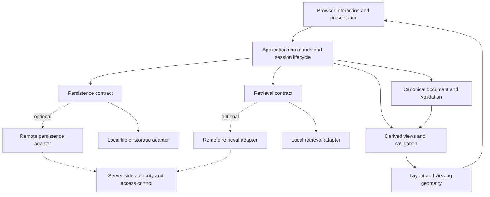

# 3. Architectural requirements

Part of the [assurance baseline](README.md), version 0.1, 2026-10-24. This is a
logical architecture derived from the [intent](01-intent.md) and
[usage constraints](02-usage-constraints.md). It does not prescribe the current
repository's modules, inherit its implementation limitations or select a new
framework. Any mapping to actual code must be assessed separately.

## Responsibilities and information flow

Arrows show logical dependencies/data flow, not required classes or deployment
units. Both local and remote adapters report results through the application
boundary. Their replies are untrusted until validated and checked for freshness.
The local baseline does not require a running server.

## Required boundaries

**ARC-01 — One authoritative semantic document per revision.** The document
owns canonical node/relation identities, endpoints and accepted semantic
properties. Views can repeat an item or show a projection without creating a
second semantic identity. Complete membership and loaded/presented membership
are distinct. A remote, partially loaded graph must carry scope/completeness
metadata: a local cache must not claim to be the entire server graph.

**ARC-02 — Validated command boundary.** User edits, imports and accepted
retrieval associations change the document through explicit operations with
validation, revision/source checks and an atomic success/failure result. Renderer,
layout, worker and service callbacks cannot independently write arbitrary
semantic state. Error paths preserve the last accepted document. Drafts and
durability status have separate owners and lifetimes.

**ARC-03 — Derived views retain provenance.** Filtering, aggregation, focal
selection and alternative layouts produce views of source records. Every
occurrence/aggregate has an explicit mapping to its source identities and
relations; every omission has a defined policy. Navigation and editing resolve
the intended canonical item. Changing the view does not rewrite graph topology
or delete hidden data. Undo/history policies distinguish navigation from edits.

**ARC-04 — Separate semantic, layout and screen coordinates.** Layout positions,
view transforms, canvas pan/scale and measured presentation geometry have
declared meanings. Shared geometry contracts support drawing, picking, selection
and editors, with tested forward/inverse mappings where required. Coordinate
changes do not alter semantic relations or retrieval relevance. Saving layout or
view preferences is explicit and separate from semantic document preservation.

**ARC-05 — Bounded layout with explicit constraints.** Layout consumes a
declared projection and settings and owns its numerical state. Reinforcement,
collision handling, damping and viewing distortion have separate contracts;
settling does not certify separation or equilibrium. Honor fixed/dragged/editing
movement policy and report unsatisfied constraints where required. Make
randomness, integration steps, clocks and budgets controllable for verification.
Rendering dimensions must enter through an explicit geometry contract when
layout promises body-aware separation; do not infer them from point positions.

**ARC-06 — Retrieval behind a document-independent contract.** Retrieval takes
explicit content snapshots/query context and returns stable source IDs, scores,
provenance and completeness. Algorithms/providers do not own graph objects or
mutate the browser. An application adapter maps eligible content to a corpus and
validated results to query/result associations. This permits a local engine, a
supplied semantic module or a remote provider without changing graph ownership.
Index freshness and feedback effects are explicit. It does not require LDA,
embeddings or any particular library.

**ARC-07 — Explicit session and asynchronous ownership.** Associate each job
with document identity, source revision, request identity and its owner's
lifetime. Validate all of them before applying results. Cancellation and disposal
release owned resources and invalidate later callbacks. Define conflicts between
multiple views or jobs at the application boundary. Scheduling, worker/transport
failures and stale replies must be reproducible using controlled substitutes.

**ARC-08 — Local effects isolated from network effects.** Persistence and
retrieval have separate provider contracts and declared capabilities. Local
adapters work without network services and may only access user-selected or
application-owned storage within their permission model. Remote adapters make
all transfer paths explicit; domain/layout/rendering code must not open hidden
connections. Credentials belong to a scoped transport/session boundary and must
not enter graph exports, query records or logs. Export and save results describe
what was written and which revision was persisted.

**ARC-09 — Validate at trust boundaries.** File decoding, rich-content
presentation, URLs, configuration and service replies each pass through a
bounded validation boundary. Core document validation cannot depend solely on
UI form checks. Presentation treats plain labels as text and exposes a declared
safe subset for rich content; data cannot supply executable hooks or override
security policy. Validate once at each relevant boundary, and preserve the
validated meaning when passing between modules.

**ARC-10 — Future remote authority is versioned and scoped.** Define a remote
protocol with stable identity, revisions, authorized scope, partial-result
metadata, errors and retry/idempotency rules. The server owns authorization and
accepted shared revisions; the client owns explicit local drafts/cache state.
Reads, writes and retrieval must obey the same access scope. A rejected or
conflicting write cannot silently become a success. Cross-client concurrency,
merge policy and offline synchronization are new contracts, not automatic
consequences of replacing local storage with HTTP.

**ARC-11 — Verifiable dependency and effect boundaries.** Keep domain rules,
validation, projection and retrieval contracts usable without a mounted UI or a
live service. Dependencies follow explicit contracts, avoid runtime cycles and
do not create duplicate owners of state. Browser, filesystem, network, clock,
randomness and scheduling effects enter through narrow boundaries. This is a
testability requirement; it does not require a dependency-injection framework
or an interface around every pure function.

**ARC-12 — Inspectable composition and distribution.** The delivered build
identifies its configured capabilities, dependency versions and relevant notices.
Importing a reusable component must not silently start background work, transfer
data or take ownership of unrelated page resources. Mounting/unmounting has
explicit lifecycle behavior. Evaluate the actual integrated build against its
requirements, including packaged licensing material and configured providers.

## Deployment profiles

| Profile | Source of authority | Extra requirements before use |
| --- | --- | --- |
| Local document | Accepted in-memory revision, with explicit durable local save/export | Storage semantics, unsaved-work policy, resource limits and demonstrated absence of document transfer in local operations. |
| Local document with remote retrieval | Local semantic document; provider controls only its declared retrieval output | Declared corpus/query transfer, provider trust/retention policy, scoped credentials, cancellation and validated result provenance. |
| Server-held graph | Server's authorized/versioned graph; client has an explicitly partial cache and drafts | Server authorization, version/conflict rules, paging/completeness, failure handling and explicit local export scope. |
| Collaborative/offline-sync application | To be specified | Separate concurrency/merge and durable queue protocols, permissions and recovery evidence. Not assumed by the initial baseline. |

An initial release can support only the first profile. Optional profiles must not
weaken its local information-preservation or privacy requirements. There is no
requirement to introduce a server abstraction that performs work before there
is a real server integration to implement.

## Mapping and decisions still required

The next assessment should map each `ARC-` requirement to actual owners, APIs,
imports, side effects and tests, recording gaps rather than renaming current
modules to imply conformance. Before a remote extension, decide the first
deployment profile, authorization model, authoritative revision scheme, storage
and retention policy, conflict behavior and how partial graphs are represented.
Before claiming deterministic numerical behavior, define the supported execution
environment, input ordering and tolerances. These decisions belong in the
baseline's change/evidence record.
