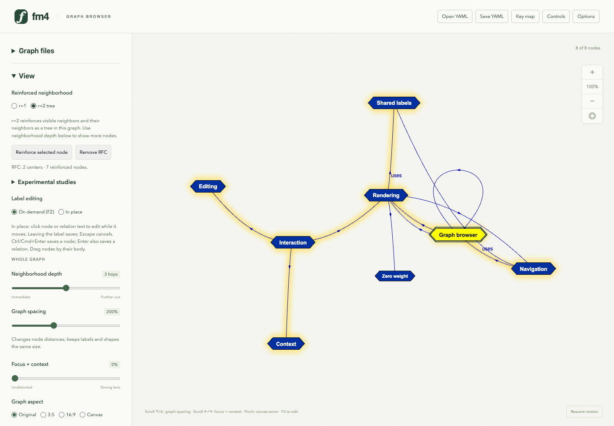

# Automatic two-level RFC neighborhoods

In **View → Reinforced neighborhood**, choose **r=2 tree**. The existing graph
reinforces each ordinary center's visible neighbors and their neighbors; the
nodes, edges, keyboard navigation and editing stay in the graph. Use **Reinforce
selected node** to activate or transfer reinforcement explicitly. The status
directly below the controls identifies the current center or multiple centers.

This surfaces the existing automatic two-level RFC tree, without first saving a
substructure or switching displays. In **Reinforcement Focus + Context**, **Add RFC center** retains
other centers; their trees can share the original node and relation objects.
Choose **r=1** to return to the immediate-neighbor behavior.
The initial setting remains one level for compatibility with existing views and
recorded comparisons. The choice applies to current and subsequently added
ordinary centers in the current panel session.

The radius controls reinforcement inside the visible locality. **Neighborhood
depth** controls which nodes are shown; use at least two hops to see hidden
grandchildren. Existing explicit type filters, stored structures and search-result
scope retain their own rules. The separate **View → Experimental studies →
Neighbor table (experimental)** is retained for research; it is not required for
radius-two graph reinforcement. While that table is open, changing the graph's
reinforcement radius or choosing **Reinforce selected node** returns to the graph.

This example contains parallel relations, a cycle, a shared descendant and
third-hop context. Yellow halos show the union of reinforced members; ordinary
relations remain available even when they are outside the selected trees.
The zero-weight context node stays visible without reinforcement.

## Projection contract

- Work within the current visible locality, considering both ends of a relation.
  Semantic arrow direction is preserved in the graph, but does not restrict this
  layout neighborhood. Zero-strength relations and zero-importance nodes do not
  propagate reinforcement.
- Breadth-first traversal assigns direct neighbors before grandchildren. Process
  neighbors by stable node ID, then relation ID; shared grandchildren take the
  first parent in that order. Parallel relations select the first eligible ID.
  Self-loops and already visited vertices do not add tree constraints.
- Other cycle/cross/parallel relations remain ordinary semantic relations. This
  transient tree is a layout choice, not an assertion that the graph is a tree or
  that a causal/dependency path has a particular direction.
- Recompute from live objects after locality, topology or weight changes. Hidden
  centers suspend independently; deleting a center removes its activation.
  Graph replacement clears activations while retaining the panel's depth choice.
- Stored tree/DAG/cluster memberships retain their explicit definitions. Search
  result focus retains its explicit one-level result star, so context nodes and
  result neighbors do not become results through this option. Explicitly
  reinforcing that same node as an ordinary or stored center replaces the search
  activation and releases its invisible result disk.

Multiple trees use the existing deduplicated radial constraints and shared-member
angular ownership. They remain deformable: members are not pinned or copied, and
ordinary TouchGraph forces still act. Two levels can grow rapidly around a high
degree center; this option neither reveals hidden graph regions nor promises
collision-free labels. Use locality, the viewing lens and the readability tools
for larger neighborhoods. No general convergence or readability claim follows
from this synthetic example.

## Ownership and verification

`RfcController.setNeighborhoodDepth(1 | 2)` changes automatic projection policy,
separately from numerical force presets. `getState().neighborhoodDepth` exposes
it. `projectFocus(node, locality)` projects an active center into a supplied
read-only locality, allowing structural aggregation to protect grandchildren
from the unfiltered source. Explicit type filters continue to take precedence.
A search constraint follows its specific explicit-star activation, identified by
`getFocusEdgesToken(node)`, and releases when that activation is replaced even if
the center ID is unchanged. No settings, structures or synthetic relations are
written into graph files.

The default controller and `projectRfcStructure` retain their original one-level
path. Tree incidence is built once for angular stars rather than rescanning all
edges for each member. New headless oracles specify exact members and tree edges
for reversed insertion order, backward arrows, parallel relations, a diamond,
loops, zero weights and third-hop context. A separately specified stored tree
provides the force oracle. Other checks cover shared centers, suspension, live
edits, aggregation, graph replacement, teardown and unchanged serialized data.
Browser checks exercise the option, halos, multiple centers, settings updates,
search-result scope and physical motion independent of viewing transforms.

The preview is generated by `just rfc-neighborhoods-preview` from the
[synthetic native graph](automatic-rfc/example.fm.yaml). Layout advances by fixed
batches, then the shipped label-separation command and viewport fitting prepare
the capture. The screenshot is an interaction illustration, not an experiment
ranking against earlier RFC layouts. Historical experiment records are unchanged.
