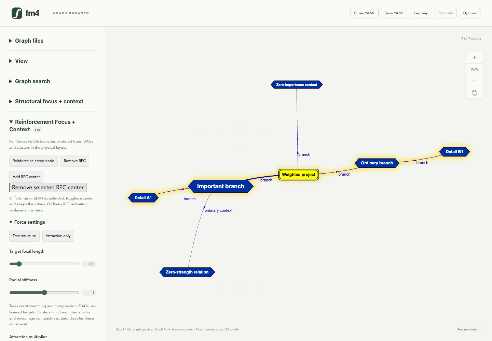
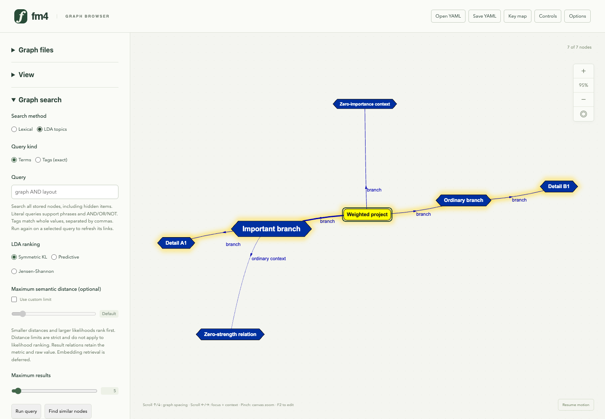
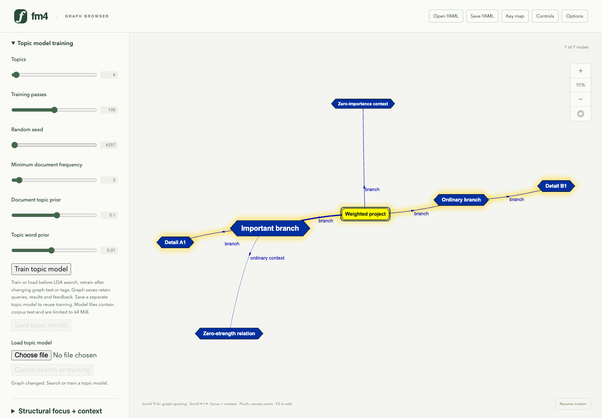
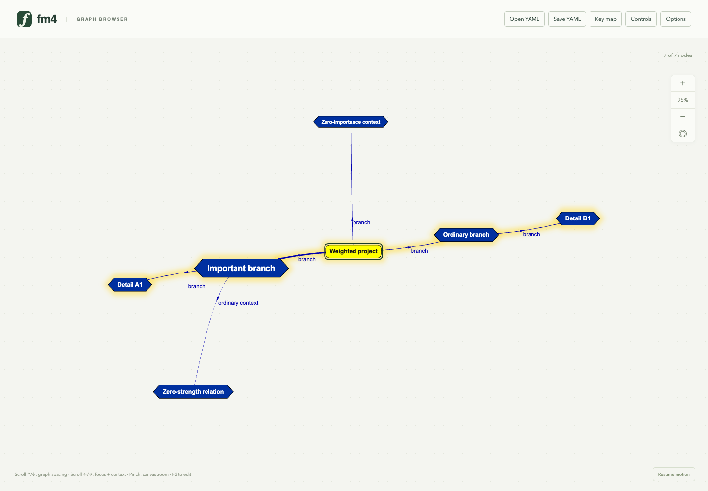

# Freshmind 4 control panel

Generated by `just controls-showcase` from [the tour](../../scripts/flipbook/controls.mjs). Edit the tour to change the steps and captions, then regenerate.

[Open the HTML flipbook](index.html). 4 production-browser views show layout/search sliders, horizontal setting choices, local topic-model controls and the retractable panel. The weighted-tree graph is paused, separated and fitted for readability. [Control guide](../control-panel.md).

## 1. Layout controls as sliders and horizontal choices

The weighted-tree example is paused and its measured labels separated with the shipped readability command. RFC settings use sliders with live values. Short choices use horizontal radio groups; large example/substructure inventories keep menus. These are presentation controls over the existing graph and configuration owners.

## 2. Search methods, metrics and result limits

Lexical/LDA and term/tag choices are directly visible. The LDA metric names remain available to assistive technology and on hover. An unchecked custom-distance limit retains the engine defaults; selecting a metric or moving a slider keeps the existing retrieval boundary.

## 3. Topic-model settings remain local and inspectable

Topics, passes, random seed, vocabulary frequency and priors use sliders and live values. Wide magnitude ranges use logarithmic scales; integer arrows retain exact increments, including the random seed. The graph is not searched or retrained for this control demonstration.

## 4. Retract the controls and keep the document

Controls hides the panel and gives the graph its width. Settings, open sections and scroll position remain available when it reopens; quick search reveals its query field. Collapsing changes viewport geometry, preserving physical node coordinates and semantic data. The preference is session-only.
