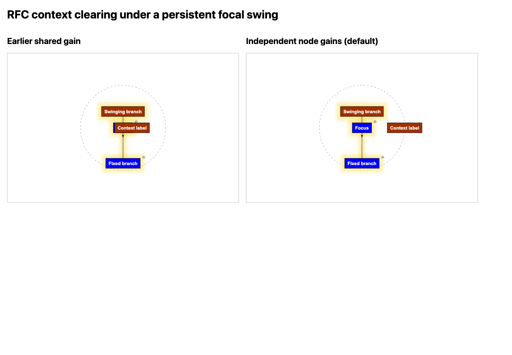

# Experiment L: damping without stalling context

A prescribed focal swing exposes cross-talk from the original shared gain. The context node either receives a unit outward impulse or moves under the real RFC region-exclusion force. The new default assigns independent gains and recovery to each node.

Regenerate with `just damping-context-experiment`. [Generator](../../../scripts/damping-context-experiment.mjs) · [synthetic fixture](../../../tests/fixtures/context-clearing.mjs) · [full records](results.json) · [damping guide](../../layout-damping.md).

## Protocol

Twelve matched runs cross two fixtures, inherited TG cooling off/on, and extra damping off/shared/node-local. Each run receives 1000 integrations at a virtual 2 ms cadence. Initial coordinates and force settings are recorded. Root (0,0) and branch (0,100) are fixed; a focal branch is prescribed to swing between (0,-50) and (0,-46), requesting a four-unit y response. The context label begins at (20,0), with zero pair repulsion to isolate damping. Unit-drift runs request dx=1 per step. RFC runs enable exclusion with strength 0.01 and padding 20, giving a known, fixed radius of 120; its ordinary spring/RFC callbacks remain active. The prescribed branch is an experimental input, not a production force.

The context x coordinate measures progress. Clearance is x−120 in the RFC fixture; negative values are inside. The final-window response is the maximum applied oscillator displacement during steps 901–1000, excluding the imposed positional jump. Off/shared/node-local runs use identical inputs.

## Rendered comparison

This separate browser capture comes from the [rendered regression](../../../tests/browser/layout-damping.spec.mjs); the headless record generator leaves it unchanged. Both views use the same starts, settings and prescribed focal swing. The test independently measures label rectangles, without relying on the screenshot as its oracle.

## Results

| Fixture | TG cooling | Extra damping | Context x | Clearance | Late oscillator response |
| --- | --- | --- | ---: | ---: | ---: |
| Unit drift | off | off | 1020.000000 | — | 4.000e+0 |
| Unit drift | off | graph | 27.000009 | — | 4.000e-8 |
| Unit drift | off | node | 1020.000000 | — | 4.000e-8 |
| Unit drift | on | off | 970.050000 | — | 3.640e+0 |
| Unit drift | on | graph | 26.993227 | — | 0.000e+0 |
| Unit drift | on | node | 970.248700 | — | 3.641e-8 |
| RFC exclusion | off | off | 120.000000 | -2.685e-7 | 4.000e+0 |
| RFC exclusion | off | graph | 25.515831 | -9.448e+1 | 4.000e-8 |
| RFC exclusion | off | node | 120.000000 | -2.685e-7 | 4.000e-8 |
| RFC exclusion | on | off | 119.999998 | -2.016e-6 | 3.640e+0 |
| RFC exclusion | on | graph | 25.513432 | -9.449e+1 | 3.641e-8 |
| RFC exclusion | on | node | 119.999998 | -2.000e-6 | 3.641e-8 |

The shared gain stalls context near its initial position despite a continuing outward force. Independent gains leave coherent motion available while suppressing the swinging node's response. In the RFC cases, context approaches the independently specified boundary within 0.001 units under both inherited-cooling settings. Native stiff-star suppression, fixed/dragged nodes, independent recovery, replacement and browser geometry have separate regression checks.

## Limits and historical scope

These controlled inputs establish damping isolation, not arbitrary-graph convergence or perceptual benefit. Region exclusion remains a soft, center-based force; body/label collision handling is separate. A node that itself oscillates can still be attenuated, inherited TG cooling can stop residual motion, and conflicting/pinned constraints may remain unsatisfied. The optional earlier-cooling response remains global and is not the node-local condition in this table.

[Experiment K](../layout-damping/README.md) retains its original shared-gain data, settings and figures. Its generator now explicitly selects graph scope for replay; its records are not replaced by these results.
