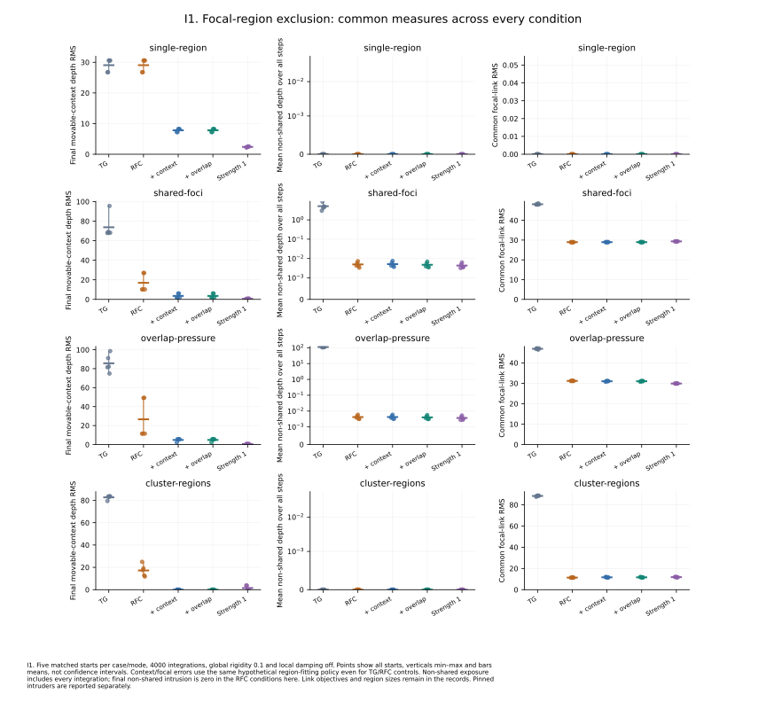
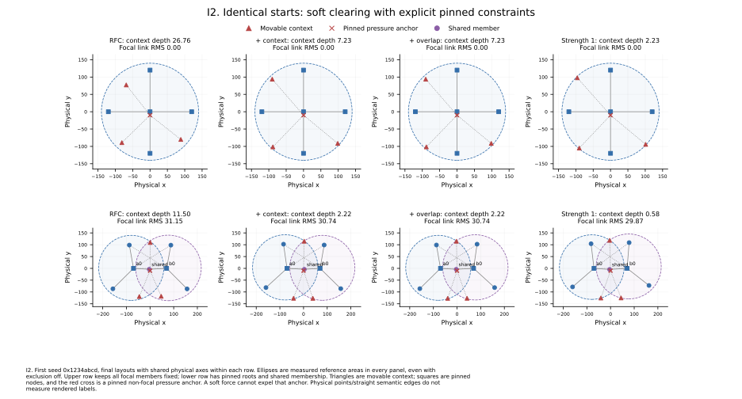
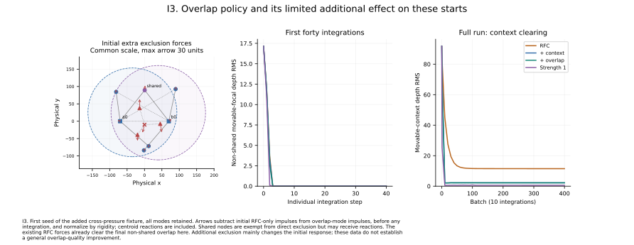

# Experiment I: focal-region and overlap exclusion

**100 matched runs; 0 failures.** Four synthetic cases × five fixed seeds × five modes. Each run observes all 4000 integrations, with global rigidity 0.1 from the first step and experimental local damping off. Initial coordinates, graph relations, pinned nodes and focal definitions are identical across modes; the runner audits 20 matched starts.

## Cases and controls

- **single-region:** a fixed four-branch focal tree and three movable context nodes. A pinned interior pressure anchor pulls context inward through ordinary relations; it cannot itself be expelled.
- **shared-foci:** two three-branch trees with one shared member and pinned roots. Non-shared branches initially enter foreign focal regions.
- **overlap-pressure:** retains that shared-foci graph and adds three ordinary relations: a root bridge and short cross-pressure links. This added stress case is retained alongside the simpler control; no seed is discarded. It still does not maintain final non-shared intrusion under the chosen RFC preset.
- **cluster-regions:** two square cliques sharing an edge, with ordinary boundary links and the same interior-pressure setup. The force regions are ellipses, distinct from the browser's rounded cluster enclosures.

**baseline** has plain TG forces; **rfc** reinforces the stored memberships with exclusion off; **context** adds exclusion but globally exempts focal members; **overlap** additionally excludes non-shared members from foreign regions; **strong** uses that full policy at strength 1 instead of 0.25. Padding is 20, coordinate weights (1,1), tree length 120 and the standard tree/cluster settings. No mode changes or deletes semantic relations. Identical hypothetical ellipses are measured from the current member coordinates in every mode, including TG/RFC controls.

## Results

Single-region mean movable-context penetration falls from **29.06** with RFC only to **7.81** at exclusion strength 0.25 and **2.40** at strength 1. The fixed focal geometry keeps radius 140 in every mode. The pinned non-focal anchor remains an intruder in all runs; this is a deliberate feasibility limit, not a failed expulsion test.

Cluster-region mean penetration is **17.22** under RFC alone, **0.00** with the default exclusion setting, and **1.49** with strength 1. Stronger exclusion is therefore not uniformly better in the finite-budget coupled layout. Common link error, region radii, tail motion and a final undamped force diagnostic are retained alongside occupancy.

*I1. Final context penetration, all-step non-shared exposure and common link error across every seed and condition.* [PDF](figures/01-exclusion-comparison.pdf) · [PNG](figures/01-exclusion-comparison.png)

The overlap rule has direct analytical/force tests, but these layouts provide limited comparative evidence for its added benefit: RFC alone already gives zero final movable non-shared intrusion. All-step exposure and first-forty-step records retain the small transient differences rather than claiming a final-quality improvement. Larger or differently constrained cases remain future evaluation.

*I2. Matched final layouts with fitted reference ellipses and explicit fixed/context/shared markers.* [PDF](figures/02-exclusion-layouts.pdf) · [PNG](figures/02-exclusion-layouts.png)

*I3. Initial added force directions, individual startup steps and full-run context observations.* [PDF](figures/03-overlap-response.pdf) · [PNG](figures/03-overlap-response.png)

## Measurements and limits

Penetration is `max(0, -regionClearance)` in weighted physical units, taking the greatest applicable foreign-region depth for each node. RMS includes zero-depth candidates, so the denominator is unchanged. Movable context, movable non-shared focal nodes and fixed intruders are separate. Shared members are exempt from their own regions; reactions from forces on other nodes may still move them. All-step exposure averages depth RMS over every integration, not ten-step net displacement. Tail motion uses the last hundred integrations. The final force probe clears momentum, prevents motion and evaluates existing callbacks, divided by global rigidity; it never changes saved coordinates or motion totals.

Fitted regions change with the layout. Radius and common focal-link error are therefore reported so apparent clearing cannot be assessed without its geometric cost. Region fitting measures point centers, and the drawings use straight physical relations; neither measures browser body/label collision, human readability, general convergence or large-graph performance. The approximate escape direction and refitted maximum radius are not a conservative energy gradient or a hard non-overlap constraint. Cooling and opposing context forces can retain penetration; fixed nodes cannot be expelled. See the [force contract](../../rfc-exclusion.md).

## Load and reproduce

Run `just rfc-exclusion-experiment` to rebuild records, all four native YAML inputs and the report/diagrams. `just rfc-exclusion-figures` redraws the existing records without rerunning layout. Python plotting requires Matplotlib/NumPy. [results.json](results.json) retains all conditions/failures, per-step startup observations, initial impulses and geometry; [summary.md](summary.md) gives complete condition means, with min/max in JSON. Exact replay is checked in the recorded Node/platform/architecture; other environments check repeated local runs.

The main browser offers **RFC → Focal-region exclusion**. Pause motion, load it, then under **Substructures** reinforce **A tree** followed by **B tree**. Open **RFC → Focal regions** and enable **Keep context outside focal regions**. Toggle the overlap option and adjust strength/padding; dashed outlines show the physical regions through the current lenses. Enable experimental damping separately if desired. To match the research force scale programmatically, set `panel.tgLayout.setRigidity(0.1)`; the ordinary TG API queues it until the next batch. The research runner primes it before measured motion. YAML stores geometry/membership, not these transient activation/settings.

Other native inputs: [single region](single-region.fm.yaml), [shared foci](shared-foci.fm.yaml), [overlap pressure](overlap-pressure.fm.yaml) and [cluster regions](cluster-regions.fm.yaml). All are synthetic. The [fixture/observer](../../../scripts/lib/rfc-exclusion-fixture.mjs), [runner](../../../scripts/rfc-exclusion-experiment.mjs) and [plot/report source](../../../scripts/rfc-exclusion-figures.py) define the reproducible protocol. Earlier experiments remain unchanged with exclusion disabled.
