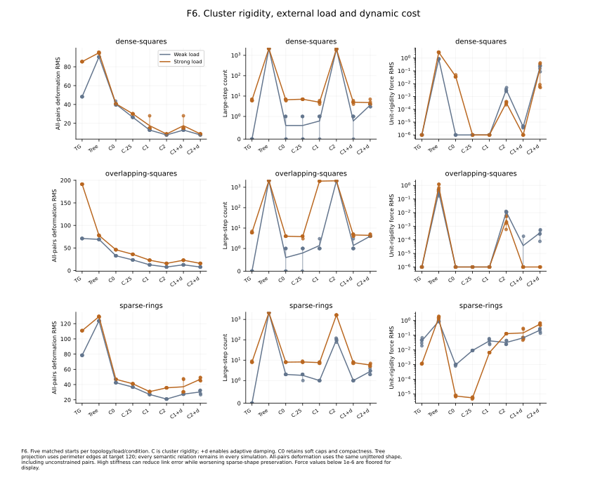
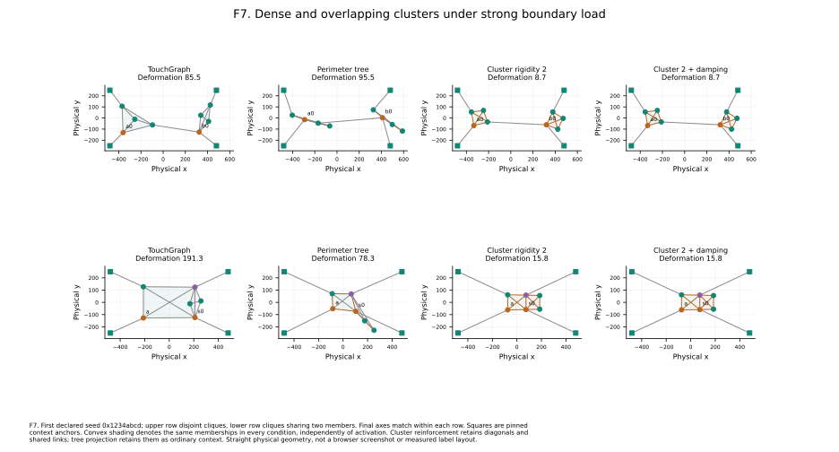
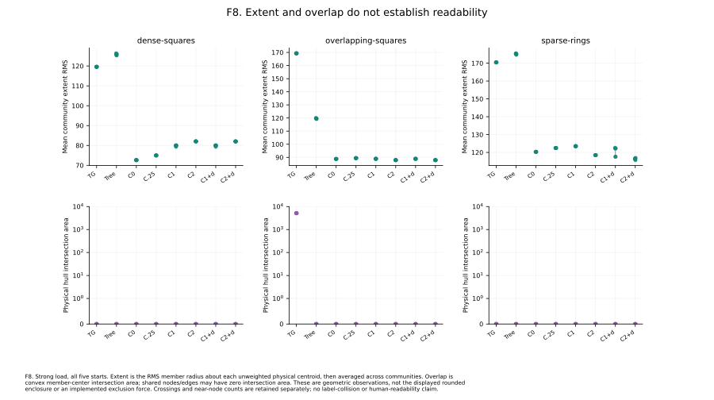

# Experiment H: compact clusters versus tree projections

**240 runs; 0 failures.** Three community geometries × five starts × weak/strong external load × eight reinforcement conditions. Every condition retains the complete semantic graph, identical initial coordinates and the same pinned context anchors. Node/relation importance stays at its neutral defaults.

## Fixtures and comparable objectives

- **Dense squares:** two separate four-node cliques, with one ordinary bridge.
- **Overlapping squares:** two cliques sharing two members and their connecting relation. Shared constraints are retained once by the existing controller.
- **Sparse rings:** two six-member rings with one diameter chord each, plus an ordinary bridge. These are deformable subgraphs with fewer constraints on shape.

The unjittered reference shapes have perimeter sides 120. Actual starts add uniform coordinate jitter in [-20,20), using the declared seeds. Internal semantic lengths are their analytic reference distances rounded to positive integers, as required by TG (square diagonals round to 170). The deformation reference retains the exact analytic distances; therefore link and pair-distance metrics differ slightly even on a perfect reference. Four pinned anchors create two outward loads per community. Weak/strong load changes only the boundary attraction denominator from 180 to 30; those ordinary links remain active in every condition.

The conditions are **plain TG**, **perimeter spanning-tree RFC**, and **cluster rigidity 0, 0.25, 1, 2**, plus **cluster 1/2 with local damping**. C0 retains cluster caps and centroid compactness. The tree projection selects only perimeter relations, whose preferred lengths are 120, while remaining internal relations still exert ordinary forces. Its angular targets favor tree regularity. Clusters reinforce all internal relations toward semantic-length-scaled targets and have no angular template. These objectives differ deliberately; common observables always evaluate the same full community geometry.

The existing one-sided internal-link cap at focal length **120 remains active at every cluster rigidity**, alongside the semantic-length springs. Thus a diagonal targeted at 170 or diameter targeted at 240 is also pulled toward the shorter cap while extended. The analytic reference does not minimize every active term simultaneously, even before context/repulsion is considered. These are comparisons of the complete implemented cluster primitive, not isolated rigid-bar constraints; residual deformation can reflect this competing objective as well as sparse flexibility and solver dynamics.

**All-pairs deformation RMS** compares every member pair's distance to the unjittered reference, including pairs without reinforced links, and combines equal-weight community RMS values. This is invariant to translation/rotation/reflection but measures the selected reference shape, not a universal ideal drawing. **Common link error** includes all unique internal relations in every mode. Extent, boundary-link error, convex hull area/intersection, crossings and near-node counts are also retained.

## Strong-load results

Means across five starts. Damping is off except in rows marked +d.

| Topology | Mode | Common link RMS | Pair deformation RMS | Large steps | Force RMS |
| --- | --- | --- | --- | --- | --- |
| dense-squares | TG | 85.43 | 85.46 | 6.4 | 5.04e-10 |
| dense-squares | Tree | 94.82 | 94.88 | 2153.2 | 2.82 |
| dense-squares | C0 | 40.89 | 40.77 | 6.6 | 0.0373 |
| dense-squares | C0.25 | 30.15 | 30.07 | 7.0 | 8.95e-15 |
| dense-squares | C1 | 17.51 | 17.44 | 5.0 | 1.29e-14 |
| dense-squares | C2 | 8.73 | 8.66 | 2014.0 | 0.000325 |
| dense-squares | C1+d | 17.51 | 17.44 | 5.0 | 3.12e-08 |
| dense-squares | C2+d | 8.78 | 8.71 | 4.8 | 0.16 |
| overlapping-squares | TG | 196.03 | 191.35 | 6.2 | 1.8e-11 |
| overlapping-squares | Tree | 80.72 | 77.71 | 2132.6 | 0.799 |
| overlapping-squares | C0 | 47.98 | 46.03 | 4.0 | 5.7e-11 |
| overlapping-squares | C0.25 | 37.52 | 35.96 | 3.8 | 8.77e-15 |
| overlapping-squares | C1 | 23.80 | 22.82 | 2007.4 | 1.29e-07 |
| overlapping-squares | C2 | 16.45 | 15.80 | 2079.2 | 0.00306 |
| overlapping-squares | C1+d | 23.80 | 22.82 | 4.6 | 2.6e-09 |
| overlapping-squares | C2+d | 16.45 | 15.80 | 4.4 | 1.52e-07 |
| sparse-rings | TG | 92.27 | 110.83 | 8.2 | 0.00115 |
| sparse-rings | Tree | 149.51 | 129.29 | 2160.4 | 1.6 |
| sparse-rings | C0 | 48.88 | 46.93 | 8.0 | 7.2e-06 |
| sparse-rings | C0.25 | 39.61 | 41.07 | 8.2 | 5.36e-06 |
| sparse-rings | C1 | 25.24 | 30.76 | 7.6 | 0.0065 |
| sparse-rings | C2 | 16.94 | 35.74 | 1639.0 | 0.127 |
| sparse-rings | C1+d | 25.04 | 37.11 | 7.6 | 0.143 |
| sparse-rings | C2+d | 17.16 | 47.01 | 5.8 | 0.572 |

Dense clique geometry is preserved much better by stronger cluster springs than by the tree projection in these fixtures. This comes with stiffness costs: C2 without damping produces many transient large steps. Damping often suppresses them with similar dense-clique error, but does not uniformly preserve sparse shape. On the strongly loaded rings, C2 reduces selected-link error relative to C1 while **increasing all-pairs deformation**; adding damping increases deformation further. A sparse spring graph is not a rigid body.

*F6. Both boundary loads and every condition, including seed ranges and final force balance.* [PDF](../figures/06-cluster-sweep.pdf) · [PNG](../figures/06-cluster-sweep.png)

*F7. Dense and shared cliques retain their semantic diagonals across all conditions.* [PDF](../figures/07-cluster-layouts.pdf) · [PNG](../figures/07-cluster-layouts.png)

## Extent, overlap and drawing proxies

| Topology | Mode | Mean extent RMS | Hull overlap area | Straight crossings | Pairs <30 |
| --- | --- | --- | --- | --- | --- |
| dense-squares | TG | 119.57 | 0.0 | 1.0 | 0.0 |
| dense-squares | Tree | 125.82 | 0.0 | 4.0 | 0.0 |
| dense-squares | C1 | 79.86 | 0.0 | 2.0 | 0.0 |
| dense-squares | C2 | 82.06 | 0.0 | 2.0 | 0.0 |
| overlapping-squares | TG | 169.32 | 5143.7 | 2.0 | 0.0 |
| overlapping-squares | Tree | 119.62 | 0.0 | 4.0 | 0.0 |
| overlapping-squares | C1 | 88.87 | 0.0 | 2.0 | 0.0 |
| overlapping-squares | C2 | 87.89 | 0.0 | 2.0 | 0.0 |
| sparse-rings | TG | 170.45 | 0.0 | 1.0 | 0.0 |
| sparse-rings | Tree | 175.17 | 0.0 | 3.8 | 0.0 |
| sparse-rings | C1 | 123.49 | 0.0 | 1.0 | 0.0 |
| sparse-rings | C2 | 118.48 | 0.0 | 1.0 | 0.0 |

The prescribed square with both diagonals has one straight crossing per clique. Returning toward that reference can increase the crossing count even while deformation improves. This is a concrete reason not to equate the regularity metric with readability. Physical hull intersection may be zero for communities sharing only an edge. Zero area does not mean no shared membership, no label overlap or an implemented exclusion force.

*F8. Member extent and physical hull intersection under strong load, all five starts.* [PDF](../figures/08-cluster-extent.pdf) · [PNG](../figures/08-cluster-extent.png)

## Finding and limits

Retaining cyclic internal links gives a materially different reinforcement primitive from a spanning tree. Independent rigidity improves dense shape preservation in these tests; sparse subgraphs can still flex or fold while keeping selected lengths. External forces, inherited cooling and competing constraints remain relevant. These are manually specified communities: Louvain detection quality, arbitrary graphs, perceptual readability and boundary exclusion have not been evaluated here. Smooth displayed enclosures remain a rendering feature, independent of these physical hull measurements.

## Measurement and reproducibility

Each condition runs 400 batches × 10 integrations, with a deterministic virtual clock of 2 ms per integration. The five seeds are `0x1234abcd`, `0x05eeda11`, `0x00c0ffee`, `0xdecafbad` and `0x9e3779b9`. No seed is discarded or retuned. All data is synthetic; no proprietary graph is used. Every integration is observed, including movements that cancel over a batch.

**Large steps** count integrations with any movable node travelling more than 29.9 units. **Clipped steps** independently count an axis movement of at least 30−1e-9. Tail motion covers the last 100 integrations. Trace records describe batch 1 and each tenth batch; their motion maxima/RMS cover that particular ten-step batch, while cumulative counts cover the entire run. The full records retain initial/final coordinates, all semantic edges, memberships, settings, detector states/events, transition observations and per-structure metrics.

**Unit-rigidity force RMS** probes the final coordinates after clearing momentum, disabling local attenuation and setting global motion to zero. It uses the existing TG+RFC callbacks, divides force by global rigidity and excludes pinned-node reactions from the RMS. No probe movement or integration is included in the reported run. This separates cooling from force balance; a small force residual does not imply feasible target geometry, a minimum, or stability after a disturbance.

Straight-segment crossings and movable-node pairs closer than 30 are retained as limited geometry proxies. They do not measure the browser's curved edges, actual label dimensions, task performance or human readability. Means and min/max ranges describe five designed starts, not confidence intervals or population estimates. Exact archived replay is checked in the recorded Node/platform/architecture; other runtimes check repeated local runs rather than assuming identical nonlinear floating-point trajectories. No convergence, performance or universal parameter recommendation follows from this finite study.

Run `just rfc-followup-experiment` for all three comparisons and figures. `just rfc-followup-figures` redraws recorded data; `just rfc-followup-report` rebuilds this narrative and its numeric tables. See [results.json](results.json), the [complete condition summary](summary.md) and [CSV](summary.csv). Matplotlib and NumPy are required for plotting. Previous Experiments A–E and the historical detector comparison remain separate and unchanged.
