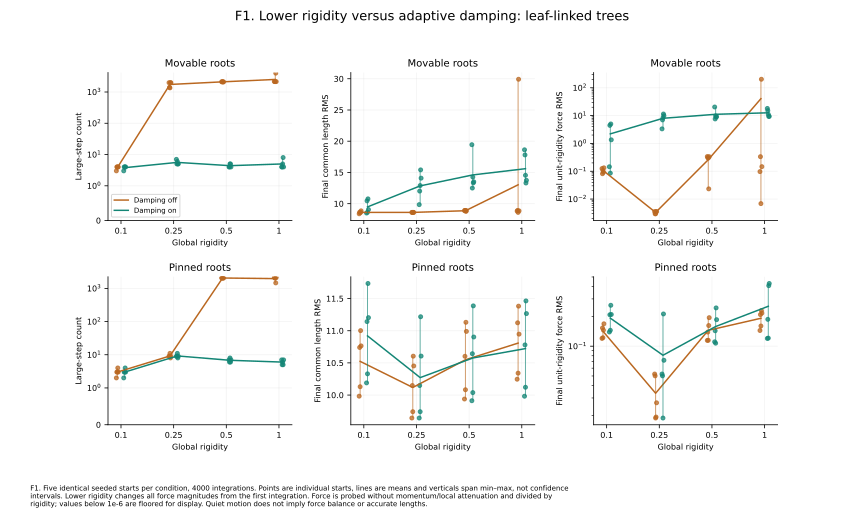
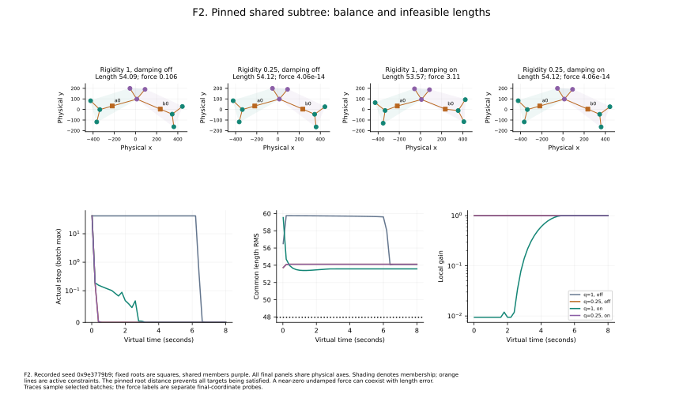

# Experiment F: damping versus lower rigidity

**240 runs; 0 failures.** Three recorded two-tree topologies × movable/pinned roots × five starts × global rigidity `1`, `0.5`, `0.25`, `0.1` × local damping off/on. Both trees are reinforced throughout; tree force settings, topology and initial coordinates are matched. The original fixed-force [120-run comparison](../../rfc-multifocus/README.md) is retained.

## Protocol

The tree preset remains target 120, radial stiffness 1, angular stiffness 10000 and attraction multiplier 1, with coordinate weights (1, 1). Lower **global rigidity** scales ordinary TG and RFC forces together, changing integration dynamics without changing their relative strengths. This differs from reducing only RFC spring strength. TG's queued rigidity is primed on an empty graph, so the first measured integration already uses the declared value. No measured graph is warmed up.

Each matched condition retains the same roots, even where pinned roots make lengths infeasible. The controller's v2 detector is used when damping is enabled; the inherited global cooler remains on in every run. The independent coincidence RNG is also seeded. Identical starting coordinates/semantic edges are audited across all conditions, producing **30 matched start groups**.

## Leaf-linked trees: motion, geometry and balance

The table reports means across the five movable-root starts. Geometric length error always includes the same original tree-edge union, with target 120. A zero-motion tail is reported separately from the final force diagnostic.

| Global rigidity | Local damping | Large steps | Tail step RMS | Common length RMS | Unit-rigidity force RMS |
| --- | --- | --- | --- | --- | --- |
| 1 | off | 2523.6 | 7.9339 | 13.017 | 40.5802 |
| 1 | on | 5.0 | 0.0000 | 15.600 | 12.6073 |
| 0.5 | off | 2114.8 | 0.0000 | 8.865 | 0.2601 |
| 0.5 | on | 4.4 | 0.0000 | 14.602 | 11.1365 |
| 0.25 | off | 1743.0 | 0.0000 | 8.596 | 0.0033 |
| 0.25 | on | 5.6 | 0.0000 | 12.846 | 8.0018 |
| 0.1 | off | 3.8 | 0.0000 | 8.600 | 0.1075 |
| 0.1 | on | 3.8 | 0.0000 | 9.477 | 2.2079 |

At rigidity 1, adaptive damping limits mean large steps to **5.0**, but leaves mean length RMS **15.60** and force RMS **12.61**. Rigidity 0.1 without local damping yields **3.8** large steps, length RMS **8.60** and force RMS **0.108**. This supports lowering force scale as a useful separate control on these starts. It does not establish one optimum: rigidity 0.25 has an even smaller final force residual but many more transient large steps. Suppressing motion quickly and reaching force balance within the budget are different objectives.

*F1. All five leaf-linked starts, with root constraints separated; motion, geometric residual and force balance.* [PDF](../figures/01-damping-rigidity.pdf) · [PNG](../figures/01-damping-rigidity.png)

## Shared subtree: infeasibility survives successful balancing

For the previously oscillating pinned-root seed `0x9e3779b9`, rigidity 0.25 without local damping has **3** large steps and force RMS **4.1e-14**, but length RMS remains **54.12**. The root-distance lower bound is **47.96**. This is a force-balanced compromise with incompatible targets, not a failure of detection or evidence that the length objective has been achieved. Per-tree and merged-neighborhood angular errors are retained because shared angular targets can also conflict.

*F2. The recorded pinned shared-subtree start under matched rigidity/damping conditions.* [PDF](../figures/02-shared-subtree.pdf) · [PNG](../figures/02-shared-subtree.png)

## Finding and limits

Local damping remains useful for stopping violent transient motion, but recovery of local gain cannot undo global cooling. Lower rigidity often improves the resulting balance; it also changes the finite-time route through a nonlinear, clipped system. The current experiment does not implement a timestep-aware integrator, automatically select rigidity, reopen cooling during recovery, or establish general stability. No production force or default was changed.

## Measurement and reproducibility

Each condition runs 400 batches × 10 integrations, with a deterministic virtual clock of 2 ms per integration. The five seeds are `0x1234abcd`, `0x05eeda11`, `0x00c0ffee`, `0xdecafbad` and `0x9e3779b9`. No seed is discarded or retuned. All data is synthetic; no proprietary graph is used. Every integration is observed, including movements that cancel over a batch.

**Large steps** count integrations with any movable node travelling more than 29.9 units. **Clipped steps** independently count an axis movement of at least 30−1e-9. Tail motion covers the last 100 integrations. Trace records describe batch 1 and each tenth batch; their motion maxima/RMS cover that particular ten-step batch, while cumulative counts cover the entire run. The full records retain initial/final coordinates, all semantic edges, memberships, settings, detector states/events, transition observations and per-structure metrics.

**Unit-rigidity force RMS** probes the final coordinates after clearing momentum, disabling local attenuation and setting global motion to zero. It uses the existing TG+RFC callbacks, divides force by global rigidity and excludes pinned-node reactions from the RMS. No probe movement or integration is included in the reported run. This separates cooling from force balance; a small force residual does not imply feasible target geometry, a minimum, or stability after a disturbance.

Straight-segment crossings and movable-node pairs closer than 30 are retained as limited geometry proxies. They do not measure the browser's curved edges, actual label dimensions, task performance or human readability. Means and min/max ranges describe five designed starts, not confidence intervals or population estimates. Exact archived replay is checked in the recorded Node/platform/architecture; other runtimes check repeated local runs rather than assuming identical nonlinear floating-point trajectories. No convergence, performance or universal parameter recommendation follows from this finite study.

Run `just rfc-followup-experiment` for all three comparisons and figures. `just rfc-followup-figures` redraws recorded data; `just rfc-followup-report` rebuilds this narrative and its numeric tables. See [results.json](results.json), the [complete condition summary](summary.md) and [CSV](summary.csv). Matplotlib and NumPy are required for plotting. Previous Experiments A–E and the historical detector comparison remain separate and unchanged.
