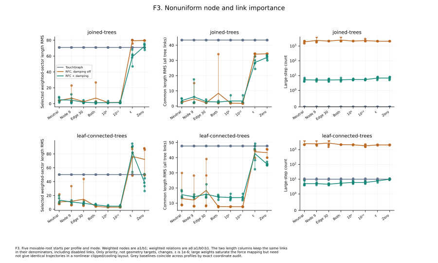
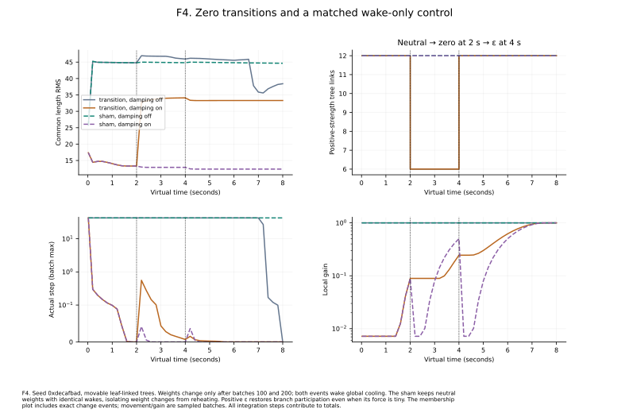
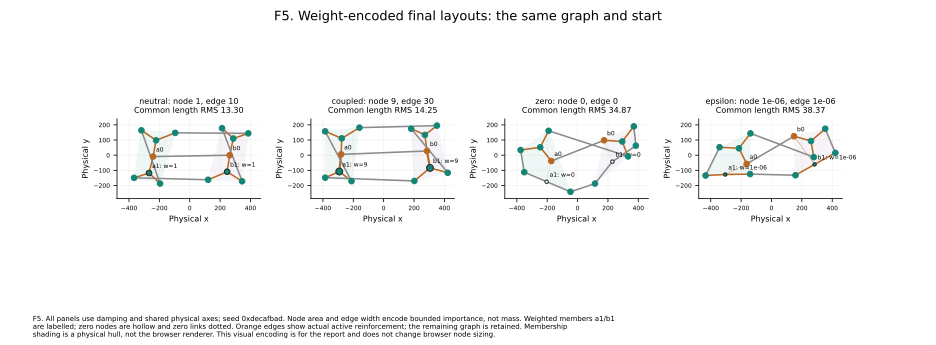

# Experiment G: nonuniform node and relation importance

**300 runs; 0 failures.** Joined and leaf-linked trees × five movable-root starts × ten weight profiles × plain TG / RFC with damping off / RFC with damping on. Profiles and conditions are declared before running; identical physical starts and semantic topology are audited.

## Protocol

Only nodes **a1 and b1**, and relations **a0:a1 and b0:b1**, receive the profile values below. Every other node/edge retains its default (1/10). Their own non-root incident RFC links also depend on node importance. The model, tree definitions, preferred length 120 and global rigidity 1 remain fixed. The weight mapping is the implemented [bounded importance contract](../../../rfc-importance.md): `s(w;d)=2w/(w+d)` and `q(e)=sqrt(s(u;1))*sqrt(s(v;1))*s(e;10)`.

| Profile | Node weight | Relation weight |
| --- | --- | --- |
| neutral | 1 | 10 |
| nodes | 9 | 10 |
| edges | 1 | 30 |
| coupled | 9 | 30 |
| saturated | 1000000 | 1000000 |
| extreme | 1000000000000 | 1000000000000 |
| epsilon | 1e-06 | 1e-06 |
| zero | 0 | 0 |
| transition | 1 | 10 |
| sham | 1 | 10 |

Saturated/extreme values apply to both listed nodes and relations. With the other endpoint at default importance, the selected relation coefficient approaches `2 sqrt(2)`, rather than growing without limit. Zero removes eligible branches; epsilon retains their angular slots. No semantic IDs are deleted. Transition begins neutral, changes to zero after batch 100 (2 seconds), and to epsilon after batch 200 (4 seconds). Both changes explicitly wake TG. **Sham** retains neutral weights with identical wakes, so reheating is a controlled factor.

All static-profile plain-TG final coordinates are exactly identical per start; transition/sham baselines are also exactly identical under their shared wake schedule. These audits verify that importance does not change ordinary TG forces. Numeric geometry is compared on all original selected-tree links, including disabled links. A separate q-weighted RMS is reported alongside it.

## Weighted-sector accuracy and common error

Means below use the five leaf-linked starts with local damping off. The priority column uses only the two explicitly weighted relations; the common column retains all twelve original tree links.

| Profile | Priority-link RMS | Common length RMS | q-weighted length RMS | Large steps |
| --- | --- | --- | --- | --- |
| neutral | 10.574 | 13.017 | 13.017 | 2523.6 |
| nodes | 11.550 | 12.060 | 12.169 | 2462.0 |
| edges | 14.536 | 18.437 | 18.348 | 2768.0 |
| coupled | 4.163 | 7.703 | 7.277 | 2167.2 |
| saturated | 3.016 | 7.660 | 6.864 | 2132.8 |
| extreme | 3.047 | 7.644 | 6.848 | 1821.6 |
| epsilon | 76.309 | 43.934 | 3.640 | 2075.2 |
| zero | 72.149 | 43.341 | 3.166 | 2077.4 |

Stronger selected constraints improve those links on these starts, but not monotonically across every seed or metric. The saturated and extreme mappings are close, while fixed-budget trajectories can differ because clipping, branch ordering and global cooling are nonlinear. Saturation bounds a coefficient; it does not bound total coupled curvature or guarantee matching layouts.

The zero/epsilon rows show the measurement trap: q-weighted error can be small while the common error and disabled-sector distortion remain large. Dropping low-weight terms from the denominator would hide that cost.

*F3. Profile responses across both topologies, all starts and all three simulation modes.* [PDF](../figures/03-weight-sweep.pdf) · [PNG](../figures/03-weight-sweep.png)

## Zero transitions and the wake-only control

The neutral-to-zero change reduces the positive-strength tree union from twelve to six links; epsilon restores twelve without restoring full force strength. The complete saved memberships remain unchanged. Per-transition records retain metrics and projected center membership immediately before and after each edit. This exposes the discrete eligibility change rather than treating epsilon as equivalent to zero.

| Schedule | Mode | Large steps | Tail step RMS | Common length RMS |
| --- | --- | --- | --- | --- |
| transition | baseline | 10.0 | 0.000 | 47.721 |
| transition | both | 3917.8 | 23.276 | 39.960 |
| transition | damped | 8.2 | 0.000 | 32.537 |
| sham | baseline | 10.0 | 0.000 | 47.721 |
| sham | both | 4000.0 | 40.486 | 38.632 |
| sham | damped | 5.0 | 0.000 | 14.275 |

The wake-only control itself can sustain large movement when damping is off. Weight-transition outcomes therefore cannot be attributed solely to zero eligibility. The paired records separate an edit's force/topology effect from the explicit reheat used by the application.

*F4. The recorded leaf-linked seed with exact membership-change events and matched wake schedules.* [PDF](../figures/04-weight-transitions.pdf) · [PNG](../figures/04-weight-transitions.png)

*F5. Matched final layouts explicitly encode node and relation importance in the report.* [PDF](../figures/05-weight-layouts.pdf) · [PNG](../figures/05-weight-layouts.png)

## Finding and limits

Weights provide local priority, with finite saturation and a discrete zero boundary. They can improve selected constraints and shift error to other parts of the graph. The figures encode importance for evaluation; the browser's node-size/weight visualization remains a separate UI gap. This study does not change mass, preferred lengths, ordinary forces or production rendering. It covers two small tree topologies, not DAGs, clusters, all weighting patterns or perceptual benefit.

## Measurement and reproducibility

Each condition runs 400 batches × 10 integrations, with a deterministic virtual clock of 2 ms per integration. The five seeds are `0x1234abcd`, `0x05eeda11`, `0x00c0ffee`, `0xdecafbad` and `0x9e3779b9`. No seed is discarded or retuned. All data is synthetic; no proprietary graph is used. Every integration is observed, including movements that cancel over a batch.

**Large steps** count integrations with any movable node travelling more than 29.9 units. **Clipped steps** independently count an axis movement of at least 30−1e-9. Tail motion covers the last 100 integrations. Trace records describe batch 1 and each tenth batch; their motion maxima/RMS cover that particular ten-step batch, while cumulative counts cover the entire run. The full records retain initial/final coordinates, all semantic edges, memberships, settings, detector states/events, transition observations and per-structure metrics.

**Unit-rigidity force RMS** probes the final coordinates after clearing momentum, disabling local attenuation and setting global motion to zero. It uses the existing TG+RFC callbacks, divides force by global rigidity and excludes pinned-node reactions from the RMS. No probe movement or integration is included in the reported run. This separates cooling from force balance; a small force residual does not imply feasible target geometry, a minimum, or stability after a disturbance.

Straight-segment crossings and movable-node pairs closer than 30 are retained as limited geometry proxies. They do not measure the browser's curved edges, actual label dimensions, task performance or human readability. Means and min/max ranges describe five designed starts, not confidence intervals or population estimates. Exact archived replay is checked in the recorded Node/platform/architecture; other runtimes check repeated local runs rather than assuming identical nonlinear floating-point trajectories. No convergence, performance or universal parameter recommendation follows from this finite study.

Run `just rfc-followup-experiment` for all three comparisons and figures. `just rfc-followup-figures` redraws recorded data; `just rfc-followup-report` rebuilds this narrative and its numeric tables. See [results.json](results.json), the [complete condition summary](summary.md) and [CSV](summary.csv). Matplotlib and NumPy are required for plotting. Previous Experiments A–E and the historical detector comparison remain separate and unchanged.
