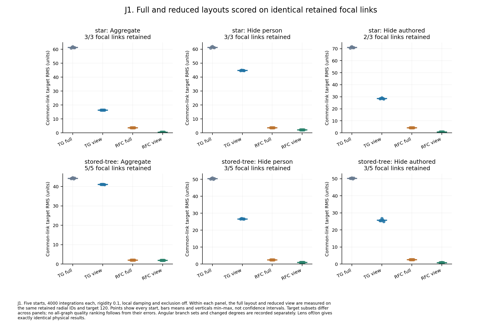
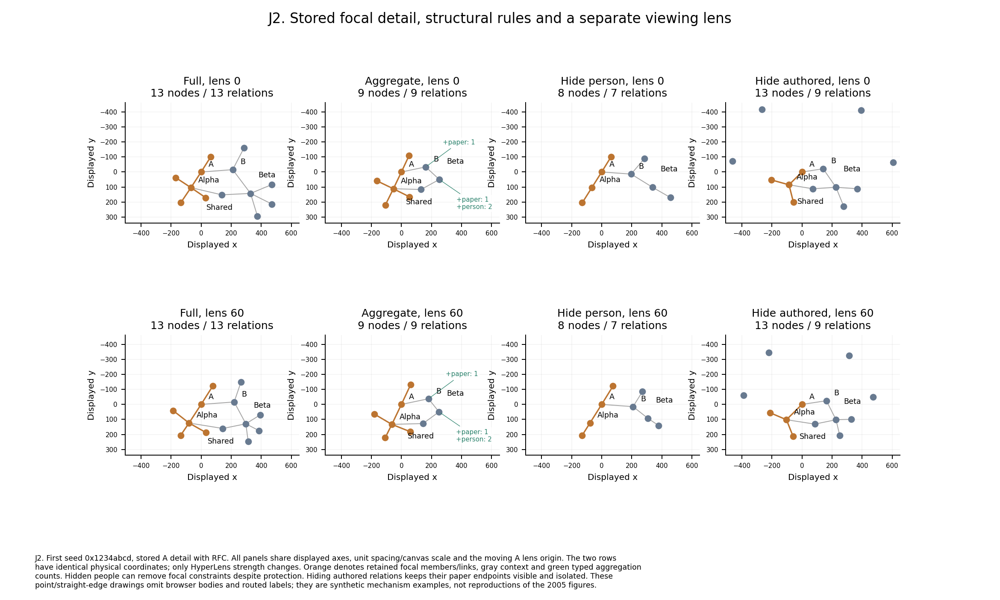
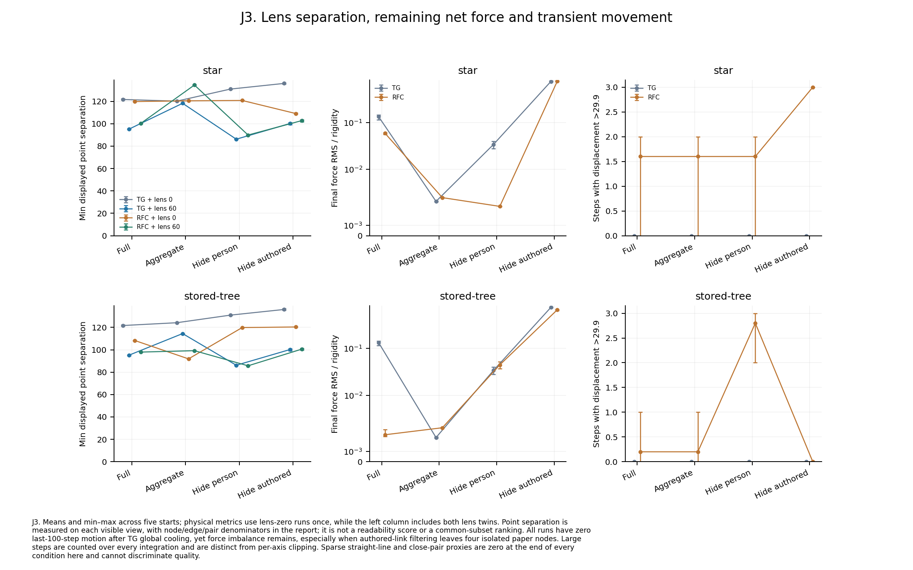

# Experiment J: matched hybrid focus + context

Task **3.4.2**, 24 October 2026. This compares reversible structural rules with TG, RFC and the viewing lens on the existing synthetic typed example. It completes the planned hybrid comparison; reproducing the 2005 paper's figures is outside the agreed scope.

## Reproduce and inspect

```sh
just rfc-hybrid-experiment
just rfc-hybrid-figures  # Redraw/report from recorded JSON only.
```

The first recipe builds the library, runs all 160 conditions and generates this report, the tables, CSV, native input and three SVG/PDF/PNG figures. Python 3 with matplotlib/numpy is needed for drawing. The [protocol](../../../scripts/lib/rfc-hybrid-fixture.mjs) uses production structural/RFC controllers; [the runner](../../../scripts/rfc-hybrid-experiment.mjs) declares and audits the matrix. [results.json](results.json) includes every condition and runtime, all starting/final coordinates, complete semantic topology and stored definitions, settings, visible/filtered/aggregated IDs, typed groups, nominal/retained constraints, traces and common-subset scores. [runs.csv](runs.csv) and [complete mean/range tables](summary.md) expose all conditions and denominators. There are **0 failed runs**.

Load **RFC → Structural focus + context** in the browser for the unjittered graph, or open [matched-start.fm.yaml](matched-start.fm.yaml) for the first recorded start. Pause before comparing membership. Choose the Project A star, or reinforce **A: stored detail**. In **Structural focus + context**, choose Person and Paper for aggregation, hide Person nodes, or hide Authored relations as separate conditions. Enable rules with detail radius 1. RFC uses the tree preset; the lens is 0 or 60, graph/canvas scale one and pan/rotation zero. Native YAML preserves the complete graph and definitions, while rules/RFC activation are transient. Browser layout timing and its coincidence RNG are interactive; the headless recipe specifies exact batch counts, initial rigidity and seeded randomness for replay. The matched TG controls deliberately retain the nominated RFC detail even with the added force omitted; simply switching RFC off in the browser also releases that protection and is a different condition.

## Protocol and retained detail

The declared matrix is **two focal structures × four structural views × TG/RFC × lens off/on × five starts = 160 runs**. Every run retains the same 13-node/13-relation complete graph, two saved trees and unit/default importance. Starts jitter the documented coordinates by ±20 units per axis with five fixed seeds. Each layout receives 400 batches of ten integrations with rigidity 0.1 active from the first measured step. Local experimental damping and focal-region exclusion are off; ordinary TG global cooling remains on. Every actual integration is observed, including the tenth step of each batch. The force probe clears momentum and stops global movement at the final coordinates; it is excluded from observations.

TG controls use the same source-based focal protection as RFC controls, while omitting the RFC force callback. This holds membership constant when testing the force factor. Explicit filters still take precedence. All **80 lens pairs have exactly identical physical coordinates, motion traces and final force diagnostics**. All 40 TG/RFC membership pairs match. Five common starting states are shared across every condition. Hidden nodes receive no integration and remain at their stored coordinates; they do not follow moving parents or supply aggregate mass/repulsion.

| Focus | Rule | Nodes / relations | Aggregated | Filtered nodes / relations | Focal links retained | Focal members retained | Angular degrees, source → view |
| --- | --- | ---: | ---: | ---: | ---: | ---: | --- |
| star | Full | 13 / 13 | 0 | 0 / 0 | 3/3 | 4/4 | project-a: 3 → project-a: 3 |
| star | Aggregate | 6 / 6 | 7 | 0 / 0 | 3/3 | 4/4 | project-a: 3 → project-a: 3 |
| star | Hide person | 8 / 7 | 0 | 5 / 6 | 3/3 | 4/4 | project-a: 3 → project-a: 3 |
| star | Hide authored | 13 / 9 | 0 | 0 / 4 | 2/3 | 3/4 | project-a: 3 → project-a: 2 |
| stored-tree | Full | 13 / 13 | 0 | 0 / 0 | 5/5 | 6/6 | project-a: 2, alpha: 4 → project-a: 2, alpha: 4 |
| stored-tree | Aggregate | 9 / 9 | 4 | 0 / 0 | 5/5 | 6/6 | project-a: 2, alpha: 4 → project-a: 2, alpha: 4 |
| stored-tree | Hide person | 8 / 7 | 0 | 5 / 6 | 3/5 | 4/6 | project-a: 2, alpha: 4 → project-a: 2, alpha: 2 |
| stored-tree | Hide authored | 13 / 9 | 0 | 0 / 4 | 3/5 | 4/6 | project-a: 2, alpha: 4 → alpha: 3 |

Aggregation is a conservative leaf pass: the shared collaborator remains a bridge. Nominated focal detail remains visible. Filtering Person explicitly removes Alice/Amir and other people even when they are focal members. Filtering Authored keeps every node but drops four attachment relations; the four paper nodes become isolated and remain visible. Complete graph data and saved membership IDs are preserved in all cases.

For each rule, the full control and reduced layout are evaluated on **the same retained radial edge IDs, angular branch sets, visible node pairs and semantic edges**. These subsets and their denominators are recorded; hidden frozen coordinates never enter the scores. Radial error uses the added RFC target of 120; the ordinary TG length parameter 90 is an attraction denominator, not a rest length. Angular RMS uses equal gaps for the retained degree. If filtering changes that degree, the common-subset score on the full layout differs from its original full-star objective. It is a comparison on a defined subset, not a claim that deleted constraints were satisfied. The complete tables retain both nominal and retained branch sets.

## Results



RFC has lower retained focal-length error than TG in these conditions. Aggregating seven context leaves around the star changes mean RFC error from **3.64 to 0.54**, retaining all three focal links. For the stored tree, aggregation keeps all five focal links but removes four context leaves; mean error changes only **2.11 → 1.94**. Neither result establishes a general benefit of reduction. Node or relation filtering removes two of the stored tree's five focal links and changes angular degrees. Figure J1 and the tables compare each full control on exactly the remaining subset, instead of comparing incompatible all-link scores.



The lens changes only displayed point positions. It does not regularize physical focal geometry or alter the force/motion results. Minimum displayed point separation can increase or decrease, depending on spatial allocation. All final conditions have zero point pairs below 30 and zero proper intersections of nonincident straight semantic edges, so those sparse proxies do not discriminate quality here. The tables record pair/intersection denominators and minimum separation, including lens twins. Figure J2 uses shared displayed axes without per-panel fitting, and draws typed counts separately from retained focal links.



Every condition has zero motion over its final 100 integrations after global cooling. Remaining net force is not necessarily zero: for stored-tree RFC, the mean unit-rigidity force diagnostic is **0.003** with all relations and **0.663** after authored-link filtering. Removing those links leaves four isolated repelling papers. A cooled, motionless graph is not evidence of force equilibrium or convergence. Some RFC starts contain transient movements above 29.9 units, despite the low rigidity; all starts and per-axis clipping counts remain in the records.

## Limits

This is one small synthetic semantic graph, two nominated focal structures and five jittered starts, not a dataset population or human evaluation. It isolates discrete membership, reinforcement and display transforms. It does not test changing rules during motion, recursive/community aggregation, aggregate-force roll-up, inferred type priorities, multiple simultaneous RFC centers, exclusion/damping interactions or large-graph performance. Explicit filtering may discard useful detail; typed aggregation counts do not preserve its physical effect. Common-subset errors cannot quantify the value of omitted information. Point centers and straight segments omit browser body/label extents, routed curves and picking. Neither lower target error nor zero point-proxy conflicts establishes readability, perceptual benefit or general convergence.
