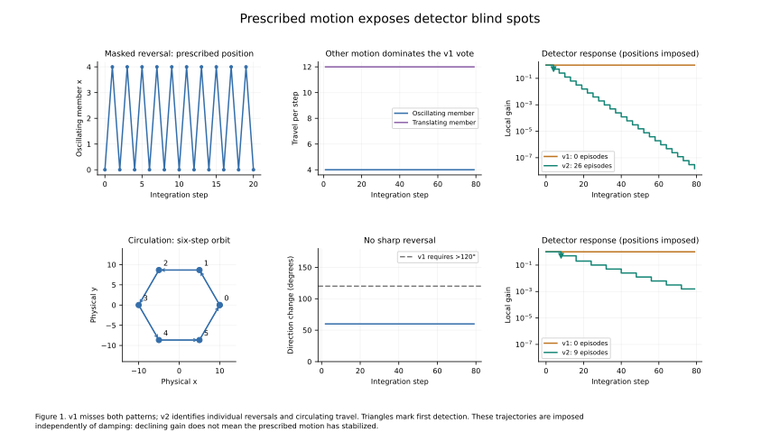
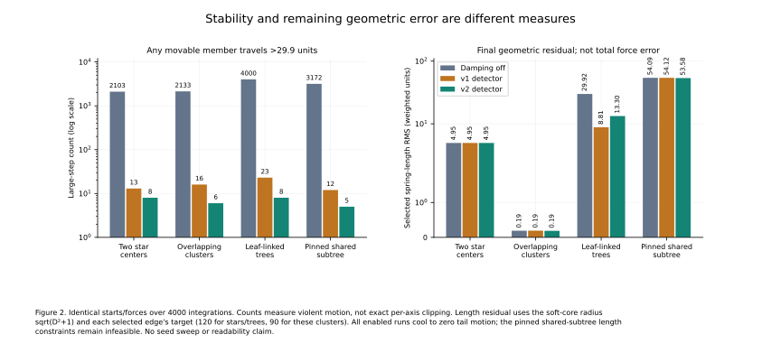
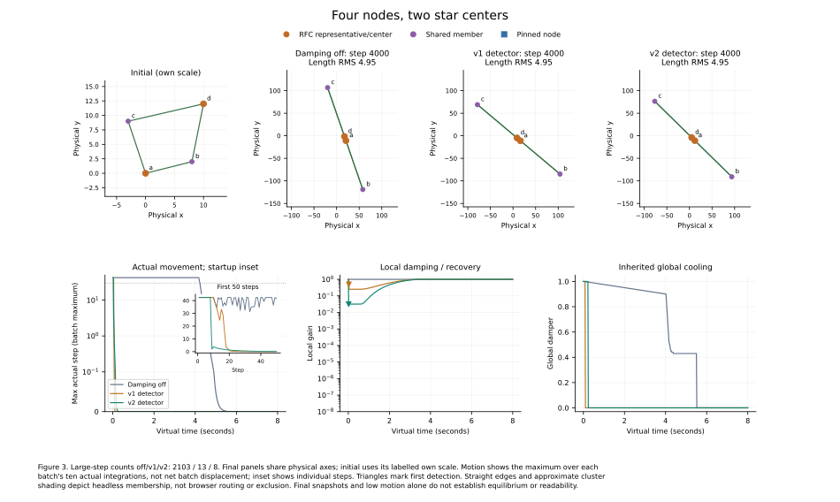
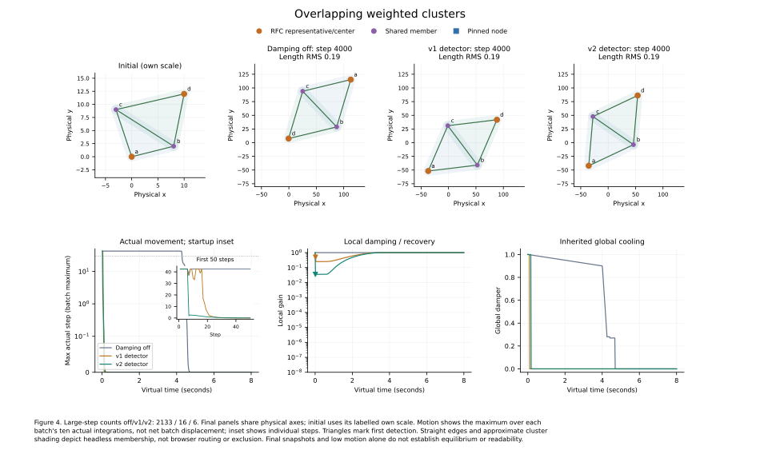
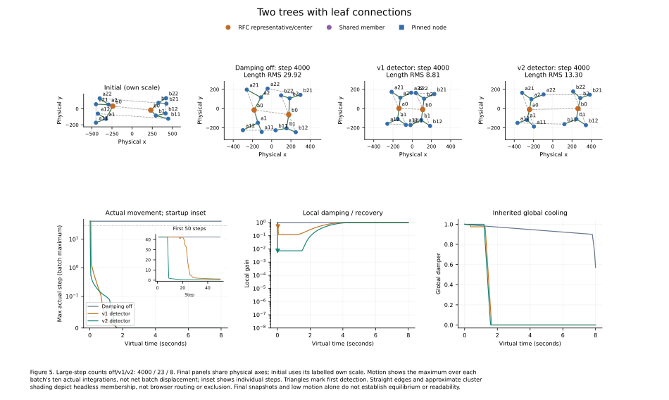
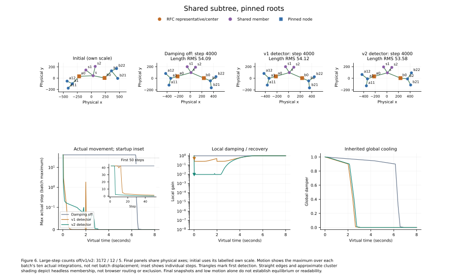

# RFC stability: detector blind spots and two-center response

The first oscillation detector could miss an individual unstable member when other centers contributed more motion energy. It also required turns sharper than 120°, missing circulating paths with gentler turns. These probes isolate detection; layout runs separately measure the feedback response. Both detectors remain opt-in. The current browser explicitly reports when detection is disabled.

## Prescribed motion

- **Masked reversal:** one member alternates between x=0 and x=4, while another translates twelve units per step. v1 records zero episodes because the reversing motion never wins the union's energy vote. v2 identifies `oscillating` independently of `translating`.
- **Circulation:** a member follows a radius-ten, six-step orbit. v1 records zero episodes because consecutive directions turn only 60°. v2 recognizes persistent low net displacement relative to travel.

Each probe runs eighty prescribed steps with a two-millisecond virtual clock. Both v2 probes trigger. Positions are imposed independently of attenuation, so repeated episodes/gain reductions are **not** evidence of feedback stability in these probes. Unit tests also cover periods twelve/twenty-four, smaller reversals, translation, negligible jitter and rapidly decaying controls.

*Figure 1. Prescribed positions/travel, direction changes and detector gains. The motion is imposed; gain reduction is not a closed-loop stability result.* [PDF](figures/01-detector-probes.pdf) · [PNG](figures/01-detector-probes.png)

## Matched layout response

Each run starts from the same coordinates and weights for damping off/v1/v2, with 400 batches × ten integration steps and a virtual two milliseconds per step. No force setting is retuned between detector conditions. A **large step** is an integration step on which at least one movable focal member travels more than **29.9 physical units**. This is a diagnostic for violent motion, not an exact per-axis clipping count: the inherited limiter caps each axis at thirty, while the recorded distance is Euclidean.

| Scenario | Movable nodes | Damping off: large steps | v1 on | v2 on |
| --- | ---: | ---: | ---: | ---: |
| small-two-centers | 4 | 2103 | 13 | 8 |
| small-cluster-pair | 4 | 2133 | 16 | 6 |
| leaf-connected-trees | 14 | 4000 | 23 | 8 |
| shared-subtree | 9 | 3172 | 12 | 5 |

- `small-two-centers`: four closely spaced movable nodes, two implicit centers, two shared neighbors, default tree forces and neutral importance.
- `small-cluster-pair`: two overlapping triangles over four movable nodes, node weight nine, relation weight thirty and cluster rigidity two. This tests the additional weighted/two-sided stiffness rather than asserting default clusters are rigid bodies.
- `leaf-connected-trees`: the recorded movable-root, two-tree start with seed `0xdecafbad`, fourteen members and additional ordinary leaf links.
- `shared-subtree`: the recorded pinned-root start with seed `0x9e3779b9`, nine movable members and incompatible root-separation/target-length constraints. Reduced motion cannot remove this geometric infeasibility.

All enabled runs reach zero motion in the final hundred sampled steps under the inherited global cooling. Without local damping, the leaf-connected start retains tail step RMS **39.6688**. The diagrams additionally report selected spring-length error, independently of motion. This is the unweighted RMS of `sqrt(D²+1) − target` over unique reinforced semantic edges: target 120 for these stars/trees, and 90 for these clusters. It is not a total force residual or a readability score.

*Figure 2. Large-step counts and remaining spring-length error. The count axis is logarithmic; the residual axis has a linear region near zero and logarithmic tails.* [PDF](figures/02-stability-and-residuals.pdf) · [PNG](figures/02-stability-and-residuals.png)

The figures expose a trade-off: for the leaf-linked start, v2 reduces large steps from 23 to 8 relative to v1, but its final length RMS is **13.30**, versus **8.81** with v1. Both stop moving. The pinned shared-subtree remains near RMS 54 under all three conditions because its targets are infeasible. Less motion does not necessarily mean a more accurate layout.

## Layouts, movement and damping over time

Each figure shows the actual initial coordinates and final off/v1/v2 snapshots, followed by actual motion, local gain and inherited global cooling. Final panels within a case share axes; the initial panel has its explicitly labelled own scale so short starting spans remain visible. Motion curves are maxima over all ten integrations in a batch, with individual startup steps in the inset. These avoid the cancellation of a ten-step net displacement. Triangles mark first detection; time is the experiment's virtual clock, not a runtime measurement.

The diagrams use straight semantic edges and point labels in physical coordinates. Cluster shading indicates membership, not a measured exclusion region or the browser's routed geometry. An off-condition final snapshot can still be moving.

### Four nodes with two star centers

*Figure 3. Short initial spans and two movable centers, compared at identical force settings.* [PDF](figures/03-small-two-centers.pdf) · [PNG](figures/03-small-two-centers.png)

### Overlapping weighted clusters

*Figure 4. Shared members, node/link importance and two-sided internal springs. The local gain recovers while global cooling can already have stopped motion.* [PDF](figures/04-small-cluster-pair.pdf) · [PNG](figures/04-small-cluster-pair.png)

### Trees with leaf connections

*Figure 5. Persistent off-condition motion versus both damping responses. v2 calms sooner but retains greater length error than v1 on this start.* [PDF](figures/05-leaf-connected-trees.pdf) · [PNG](figures/05-leaf-connected-trees.png)

### Shared subtree with pinned roots

*Figure 6. Pinned roots are squares; shared members are purple. Quiet motion cannot repair incompatible length targets.* [PDF](figures/06-shared-subtree.pdf) · [PNG](figures/06-shared-subtree.png)

## Current detector and response

Detection uses each member's own history. Three persistent reversal votes within eight steps trigger a backoff; the amplitude threshold is 0.1 and the new movement must retain at least 80% of the previous magnitude. A normalized dot product below −0.1 supplies the direction test. Separate 8/16/32-step windows detect persistent circulation when each half's mean travel exceeds 0.1, the latter half retains at least 80% of travel, and net movement is below 35% of path travel.

Each episode halves the gain. A triggering swing of ten units or more additionally targets a next raw requested displacement of two units, subject to a numerical gain floor of 1e-8. This addresses impulses concealed by positional clipping; it is not a permanent hard step bound. Attenuation still applies once to accumulated impulses over the contributing member union, leaving configured force constants unchanged. Fixed, dragged and context-only nodes are excluded. Dragging one member no longer bypasses monitoring of the other centers.

After 500 ms of quiet movement, gain recovers over three seconds. Movement above 0.1 during recovery rolls back immediately to the gain at recovery's start, rather than retaining an unstable partially restored gain. State/UI expose gain, last trigger, affected IDs and recovery backoffs. This does not guarantee stability for all stiffness, weights or coupled structures; it remains an experiment.

## Why a small graph can be unstable

Node count is not an integration stability criterion. Angular curvature grows roughly with angular stiffness divided by squared branch radius, so short spans can be extremely stiff. A movable center adds coupled modes; multiple centers, importance-weighted links and cluster rigidity add further coupling. Even a two-node spring can have a relative mode twice as stiff as a spring with one endpoint fixed. The [paper's local recurrence](../../papers/rfc-revisited-draft2.md#4-oscillations-and-damping) requires `0 < d κ < 2 + d` for a smooth positive-curvature mode at constant damper, before clipping and other nonlinear effects. The new detector reduces symptoms of unstable modes; it does not make incompatible constraints feasible or replace a timestep-aware solver.

## Reproduce and scope

Run `just rfc-stability-experiment` to regenerate records and all six figures, or choose another output folder. Run `just rfc-stability-figures` to redraw existing records without rerunning layout. Matplotlib and NumPy are required; figures are exported as SVG, PDF and PNG. [v1/results.json](v1/results.json) and [v2/results.json](v2/results.json) contain settings, counts, tail motion, detector/probe traces, initial/final/intermediate node positions, topology, batch motion/residuals and the first hundred individual steps. Gain samples are paired with the force used for that integration, avoiding a one-step event offset in the passive observer. [scripts/rfc-stability-figures.py](../../../scripts/rfc-stability-figures.py) draws these recorded observations. [scripts/rfc-stability-experiment.mjs](../../../scripts/rfc-stability-experiment.mjs) defines the synthetic cases and imports the pinned tree fixtures. The default command uses v2; pass `--historical` after the output directory for v1.

v1 is frozen from commit `d0fa69a` in [the research fixture](../../../tests/fixtures/rfc-stabilization-v1.mjs). It is not a compatibility branch in the production controller. Original Experiment B and its Figure 7 continue using that fixture and replay unchanged via `just rfc-experiment`; current browser/library code uses v2. Fixed-force single/multiple-tree results are unaffected.

These are targeted reproductions, not a large parameter sweep or a claim that all oscillations are detected. Longer-period/drifting modes, mixed motion, transient damping and global-cooling artifacts remain limits. Lower-rigidity comparisons, residual analysis and solver alternatives remain separate roadmap work.
