# Freshmind 4 walkthrough

Generated by `just flipbook` from [the tour](../../scripts/flipbook/tour.mjs). Edit the tour to change the steps and captions, then regenerate.

[Open the HTML flipbook](index.html). Screenshots show the production build at 1440 × 1000. Layout is paused for capture; the RFC pair uses identical synthetic initial coordinates and batch counts. The tour uses synthetic graphs, the attributed public Florentine network and the approved Berry/NIPS-FM examples.

## 1. Graph browser

The main browser opens a local neighborhood. Select nodes to inspect their connections; dragging, pinning and neighborhood controls use the same graph model.

## 2. Reveal the complete graph

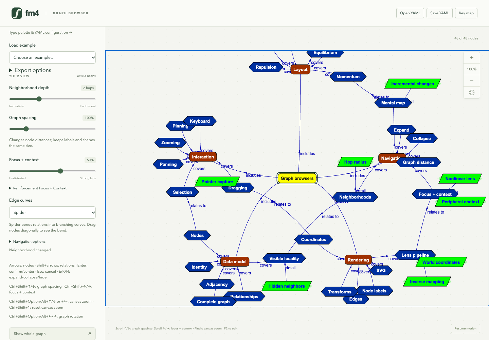

Show whole graph reveals stored nodes beyond the current neighborhood. Expansion, collapse and hiding change the visible graph while retaining the complete graph for editing and export.

## 3. Graph spacing, canvas zoom and viewing lens

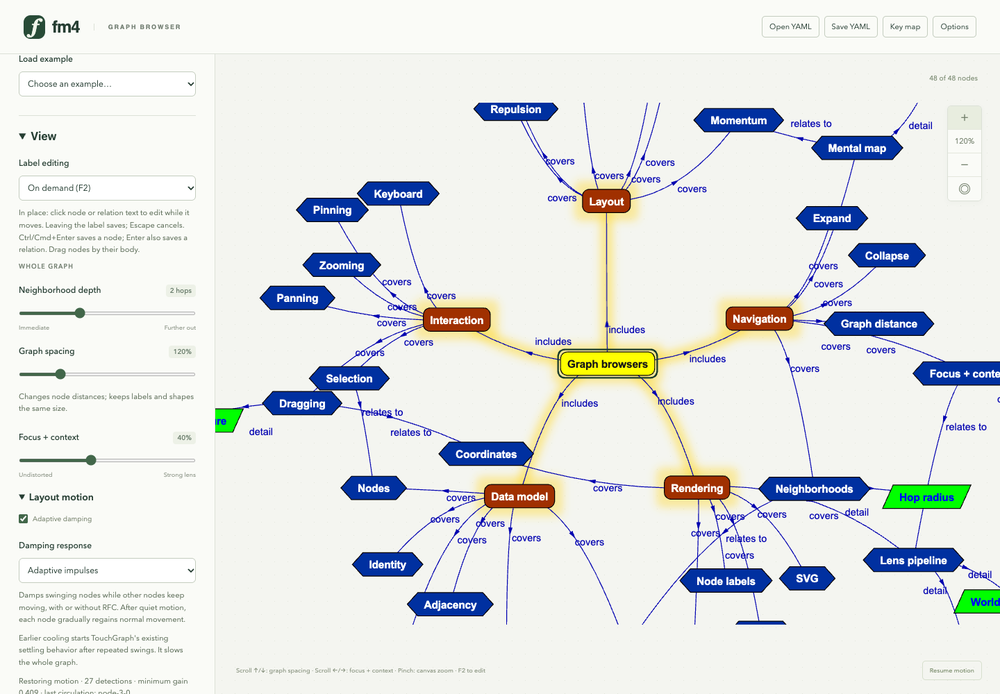

Graph spacing changes node distances. Canvas zoom scales shapes, labels and strokes together. The focus + context slider applies the independent nonlinear viewing lens.

## 4. User key map

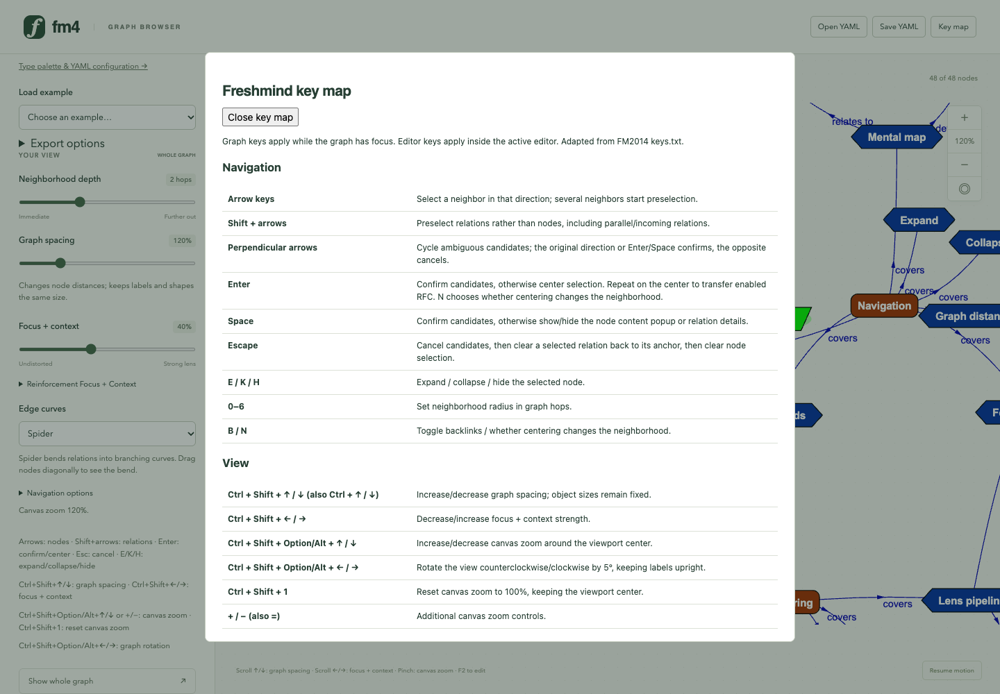

The help dialog and docs/KEYMAP.md share the same implemented command definitions, including graph spacing, canvas zoom, navigation, editing and file shortcuts.

## 5. Node types and curved relations

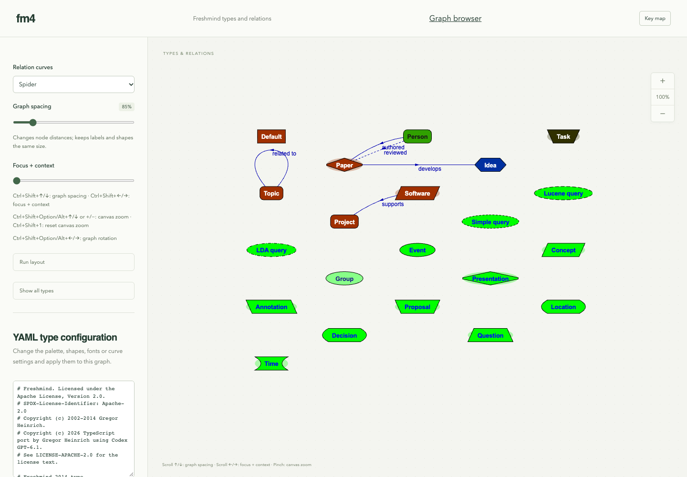

The palette page shows all 21 configured Freshmind node types, labeled curved relations, parallel edges and a self-loop. Its YAML editor applies semantic and visual configuration to the existing graph.

## 6. Open the approved Berry example

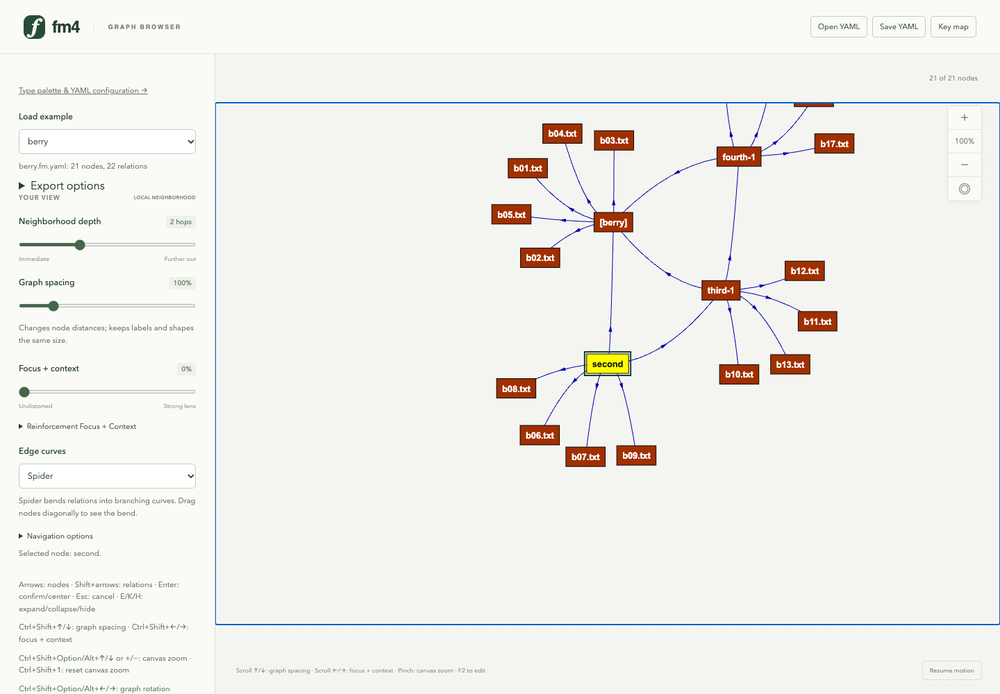

Berry is one of the two approved migrated datasets. The native YAML graph retains 21 nodes and 22 relations, annotations and original linked-resource paths.

## 7. Florentine families

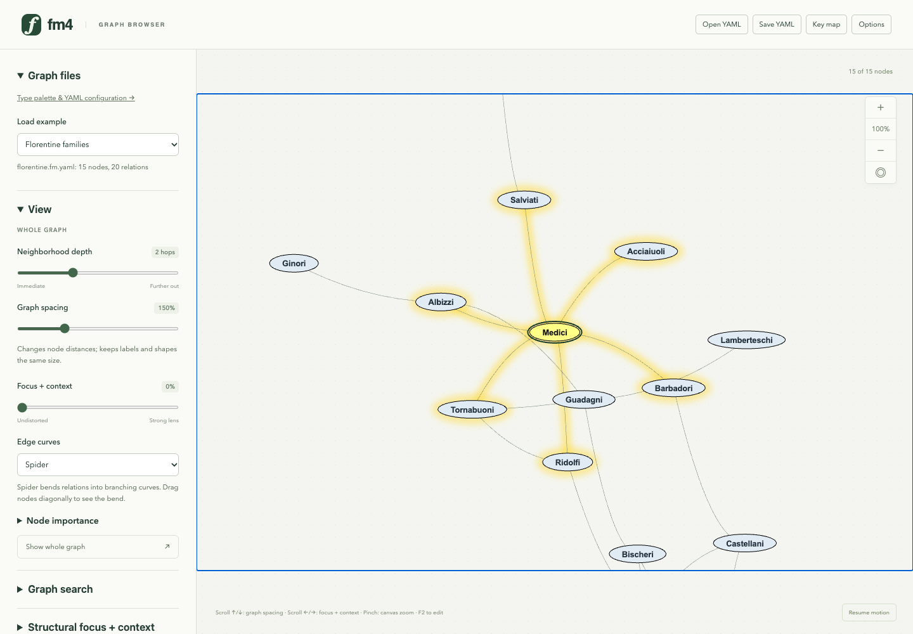

This public example has 15 families and 20 undirected marriage links. Node content contains graph-derived summaries and links to the connected families, with source attribution retained in the document.

## 8. Edit a multiline node label

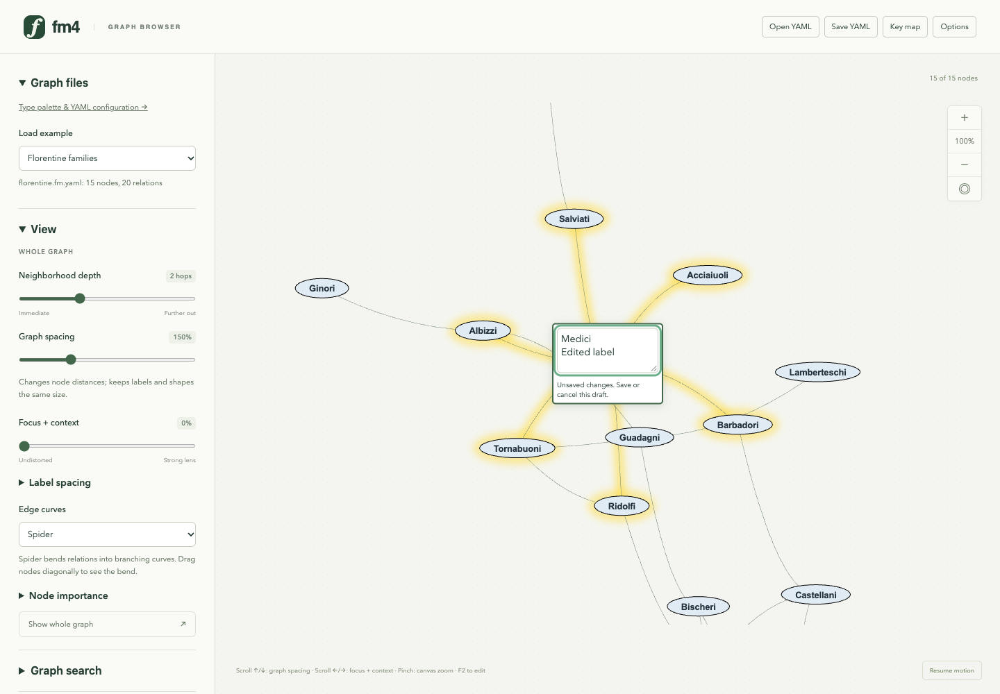

F2 opens an inline label editor on the selected node. A draft stays separate from the model until committed; node identity, relations and annotations are retained.

## 9. Annotations and item details

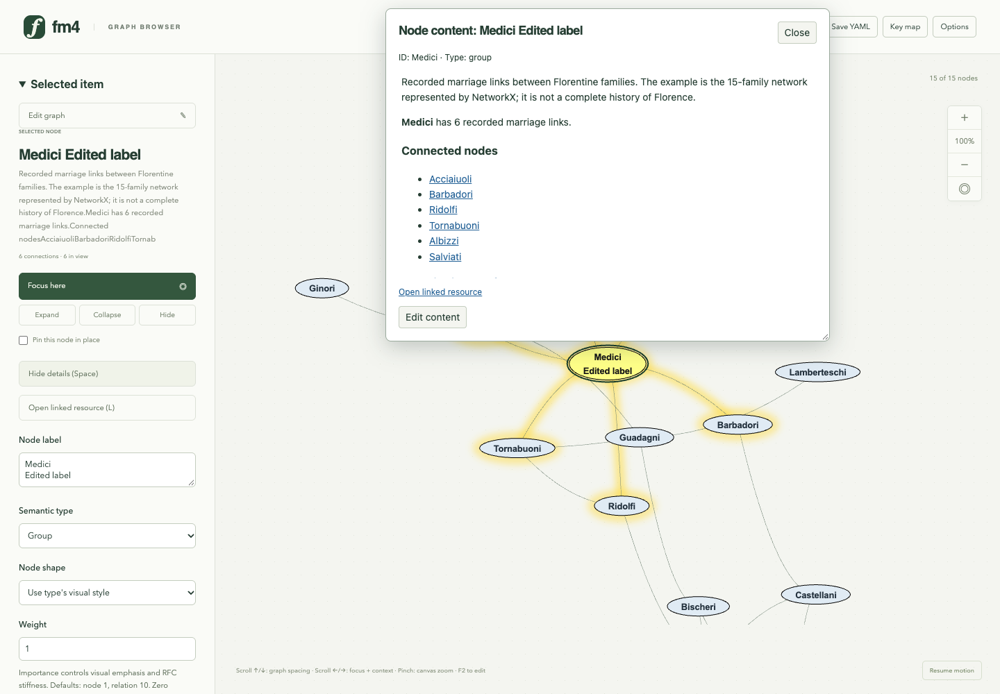

Ctrl+Enter commits the label. Space or Show details opens the selected node's content in a separate, resizable popup. Internal links navigate to connected nodes; Edit content delegates to the annotation inspector.

## 10. Save the complete graph as YAML

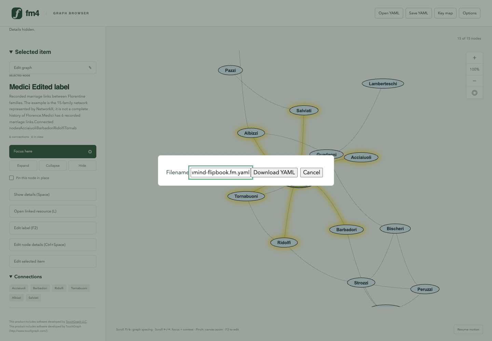

Ctrl+Shift+S opens the filename dialog. Saving downloads the complete stored graph, including hidden nodes, with optional layout/view state and embedded or companion type configuration.

## 11. Single-focus comparison: ordinary layout

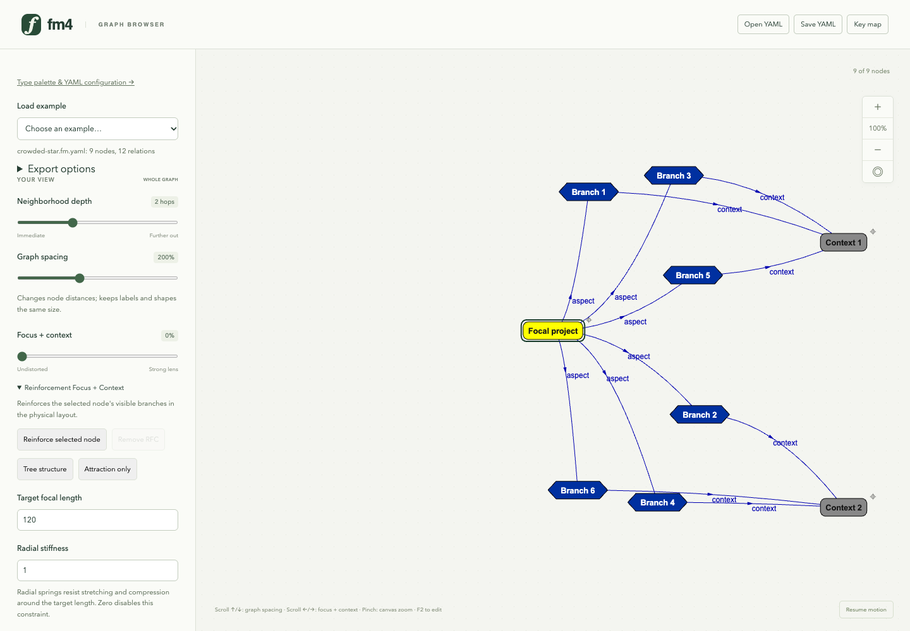

The synthetic crowded-star fixture uses a fixed center and fixed context anchors. This is the ordinary TouchGraph layout after 250 batches from the saved initial coordinates; RFC is off. Both comparison views use 200% graph spacing and 100% canvas zoom for readability.

## 12. Single-focus comparison: attraction reinforcement

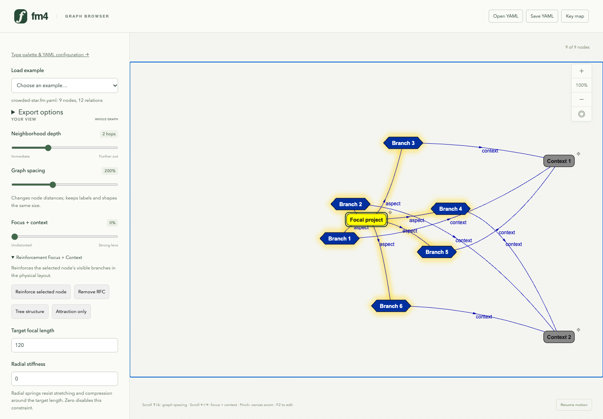

Reload the identical graph, choose Attraction only and run 250 batches. This earlier preset combines attraction multiplier 3 with angular stiffness 300, without a target-length spring. Soft yellow halos identify the reinforced nodes and relations; semantic graph records remain unchanged.

## 13. Single-focus comparison: length-constrained tree

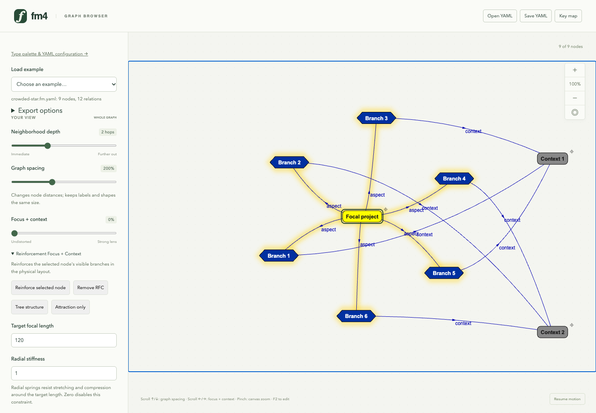

The default Tree structure preset combines target focal length 120, radial stiffness 1 and angular stiffness 10000. From the same starting graph and after 250 batches, the focal star is more regular. Both stronger angular constraints and the new length spring contribute. RFC halos fade away without a rim; focal-region exclusion remains later work.

## 14. Weighted RFC for horizontally extended labels

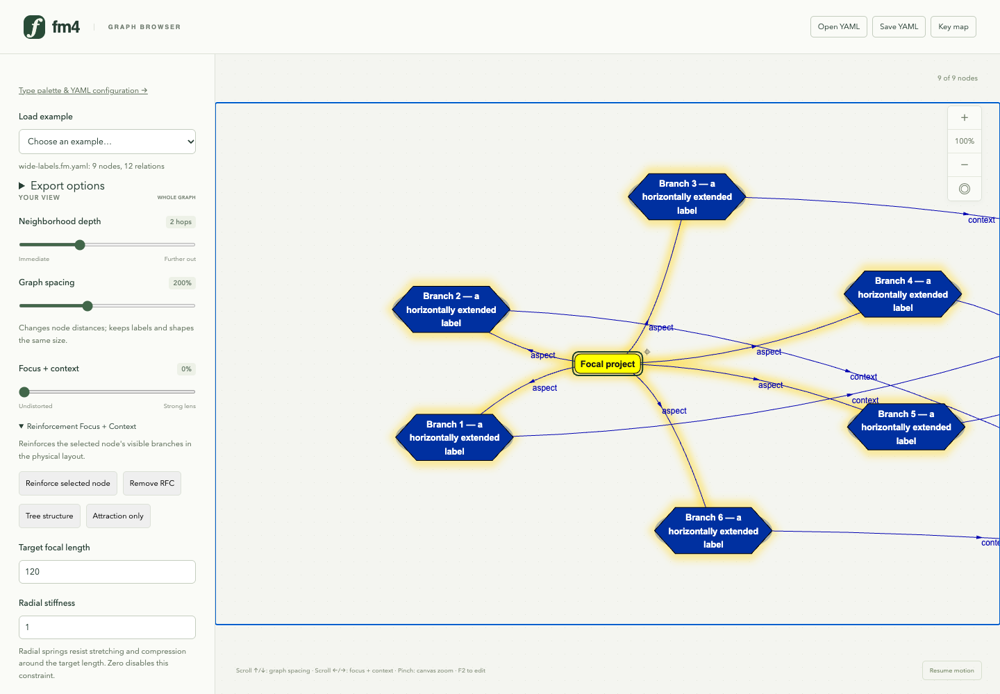

The wide-label fixture uses horizontal coordinate weight 0.25 and vertical weight 1. Equal angles are measured in weighted physical coordinates, permitting a wider focal layout while the viewing lens and both zooms stay independent. Ordinary context springs still compete with reinforcement; the metric alone does not guarantee clear space or eliminate label overlaps.

## 15. Browse the approved NIPS dataset

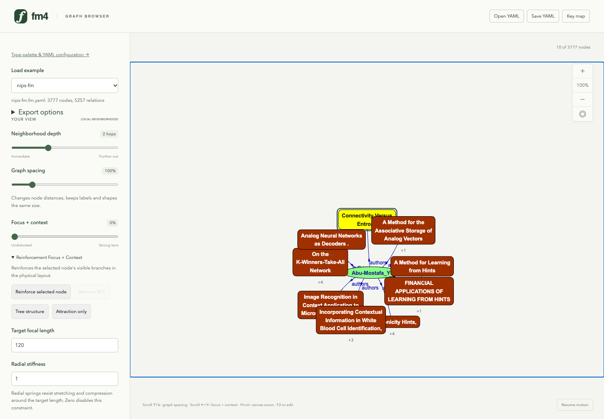

NIPS-FM contains 3,777 nodes and 5,257 relations. Opening it starts with a bounded neighborhood; the full graph remains stored for subsequent navigation and export.
