# Freshmind 4 walkthrough

Generated by `just flipbook` from [the tour](../../scripts/flipbook/tour.mjs). Edit the tour to change the steps and captions, then regenerate.

[Open the HTML flipbook](index.html). 39 production-browser views at 1440 × 1000 cover exploration, search, files/content, focus + context, readability and editing. The 9-view search chapter follows query entry, ranked literal/tag results, local LDA training, similarity, feedback and query cleanup. Jump to a chapter below or follow the complete tour. Layout is paused for capture; the three single-focus comparisons use identical synthetic initial coordinates and batch counts. Search uses a fictional topic library; other examples include synthetic graphs, the attributed Florentine network and the approved Berry/NIPS-FM examples.

## Chapters

- [Explore — 4 views](index.html#browser)
- [Search — 9 views](index.html#search-library)
- [Files and content — 7 views](index.html#types)
- [Focus + context — 10 views](index.html#rfc-baseline)
- [Readability — 4 views](index.html#label-overlap)
- [Editing and keyboard — 4 views](index.html#label-weight)
- [Layout motion — 1 view](index.html#layout-damping)

## 1. Graph browser with RFC on the center node

**Explore**

The graph-browser example opens with Reinforcement Focus+Context active on its central Graph browsers node. Yellow halos identify the reinforced center and its five immediate branches; the surrounding graph retains its ordinary connections and forces.

## 2. Reveal the complete graph

**Explore**

Show whole graph reveals stored nodes beyond the current neighborhood. Expansion, collapse and hiding change the visible graph while retaining the complete graph for editing and export.

## 3. Graph spacing, canvas zoom and viewing lens

**Explore**

Graph spacing changes node distances. Canvas zoom scales shapes, labels and strokes together. The focus + context slider applies the independent nonlinear viewing lens.

## 4. User key map

**Explore**

The help dialog and docs/KEYMAP.md share the same implemented command definitions, including graph spacing, canvas zoom, navigation, editing and file shortcuts.

## 5. A searchable research library

**Search**

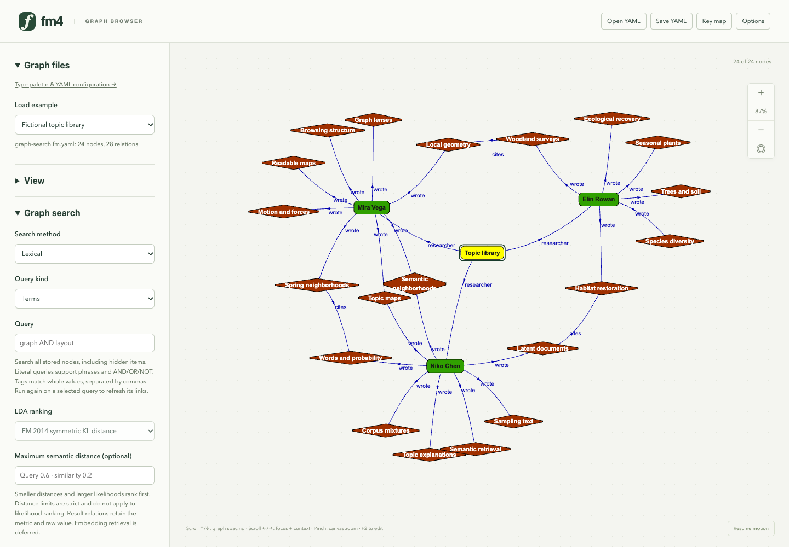

This fictional graph contains 24 nodes and 28 semantic relations: three researchers, eighteen papers, two bridge papers and a collection. Labels, annotations and exact tags are searchable, including hidden items. The library starts without reinforcement; successful searches activate RFC around their query or similarity source.

## 6. Start a search directly on the graph

**Search**

Select Mira Vega and press Ctrl+F. A query node appears immediately, linked to Mira as context, with its text editor on the graph. Type spring layout and press Enter to retrieve. The empty draft is excluded from the search corpus; ordinary typing and text deletion keep their normal meaning.

## 7. A term query joins its context

**Search**

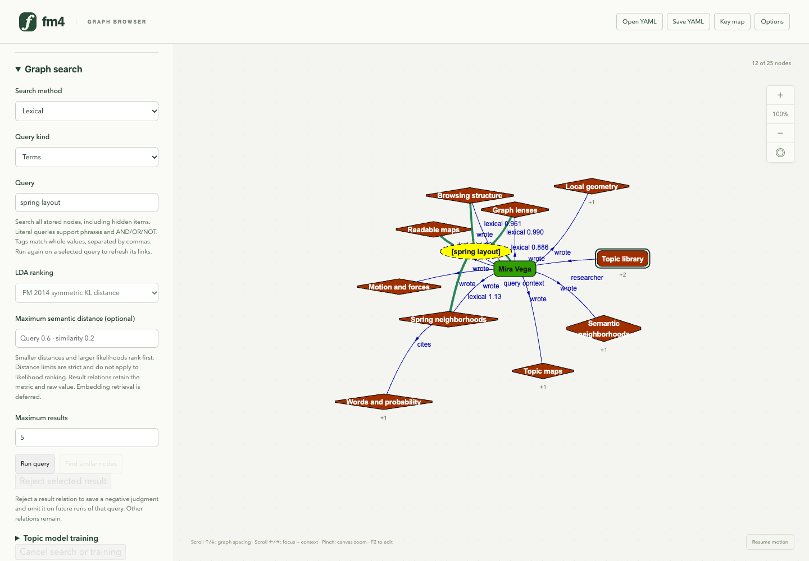

Enter runs the literal query and reinforces its neighborhood around the query node. Solid green links show compact ranks (#1, #2, …); the dashed green link identifies context. Blue semantic relations remain. Hover a result for the exact engine/score. F2 edits and reruns the query without duplicating it.

## 8. Whole-tag retrieval

**Search**

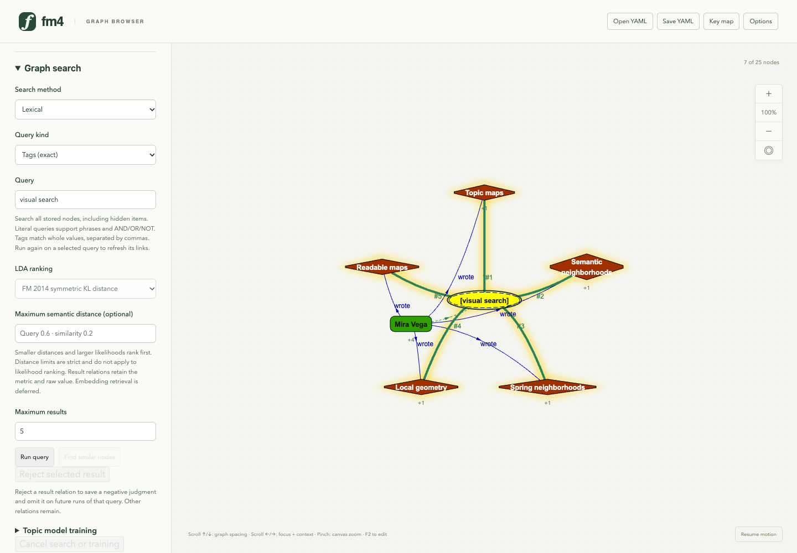

The same query node now retrieves exact visual search tags. Tags are explicit metadata and work without topic training. The query replaces its earlier result links while retaining context and manual semantic relations.

## 9. Train and inspect topics

**Search**

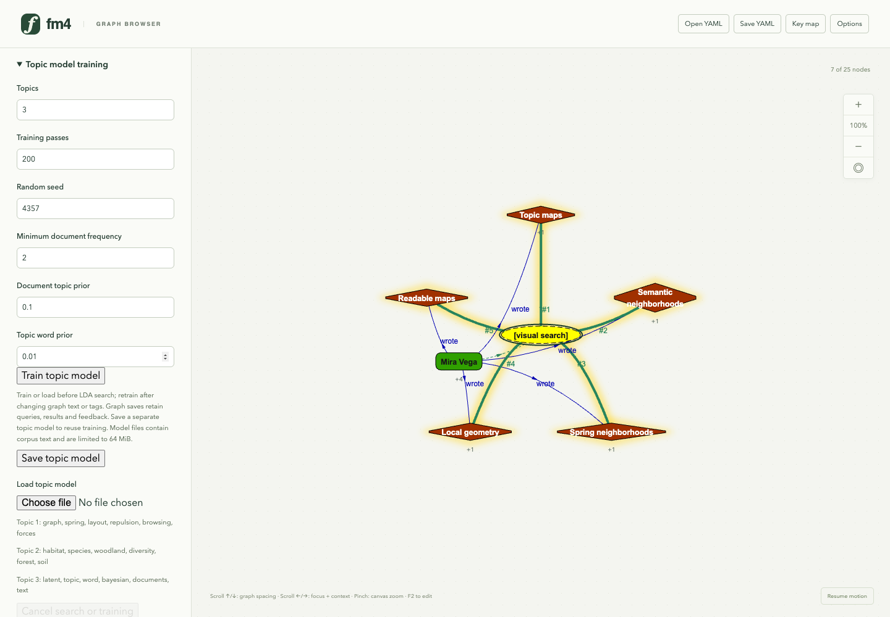

Three topics are trained locally for 200 serial Gibbs passes with seed 4357, alpha 0.1, beta 0.01 and minimum document frequency 2. Separate local JSON files can save/reload the model and its corpus. The most probable words make the fitted topics inspectable. This deliberately separated synthetic corpus does not establish general retrieval quality.

## 10. Retrieve by inferred topics

**Search**

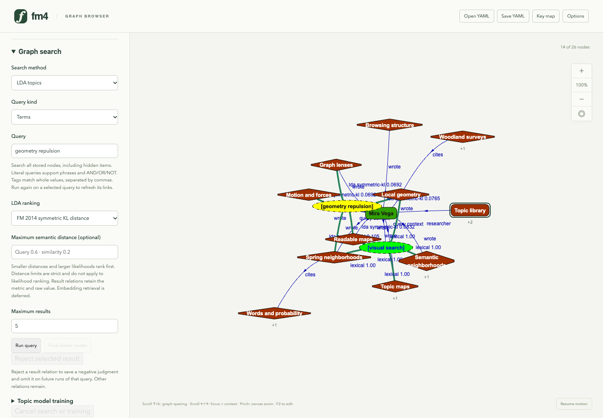

Ctrl+Shift+F starts a separate LDA query. Enter submits geometry repulsion and moves RFC to this query. Green rank labels stay short; hovering reveals symmetric KL distance in bits (lower is better, default limit 0.6). The earlier tag query stays available. Relevance does not change node importance or RFC stiffness.

## 11. Use an existing paper as the query

**Search**

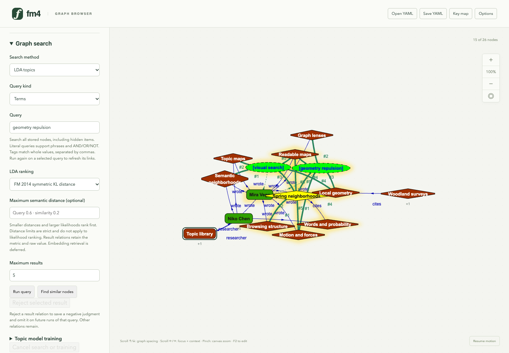

Select Spring neighborhoods and press Ctrl+Shift+R to retrieve topic similarities and reinforce a neighborhood around this paper. Ctrl+R provides literal similarity. Compact green ranked links stay distinct from existing blue authored/citation relations. No separate results page is needed.

## 12. Retain a negative judgment

**Search**

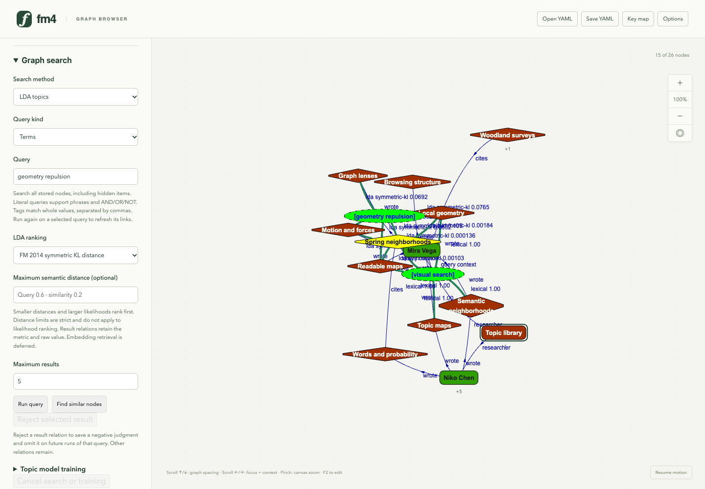

Rejecting a selected green result relation removes that link and saves its source, target, query, engine and corpus provenance. Repeating the same query omits that item. Native YAML saves queries, remaining links and feedback; model JSON is saved separately through the training controls. Feedback learning remains future work.

## 13. Remove a query and keep the source graph

**Search**

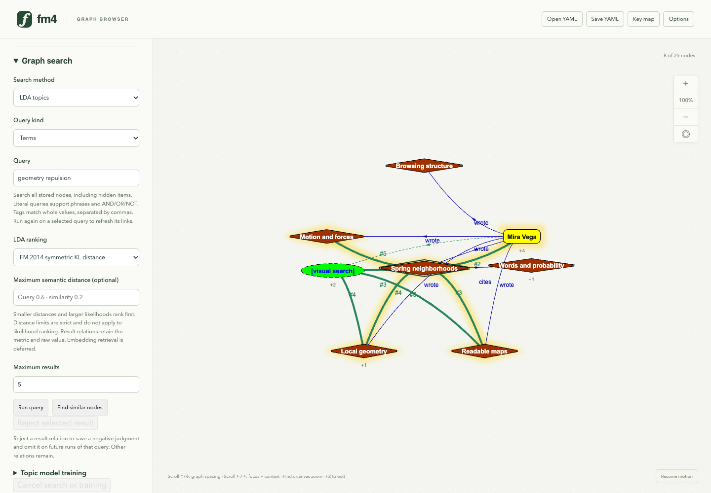

Select the LDA text-query node and press Ctrl+Backspace (or Ctrl+Delete) while graph focus is active. Only that query and its incident associations disappear; retrieved papers, original semantic relations, the earlier tag query and the paper-based similarity search remain. Native YAML can retain the queries and rejection judgments you choose to keep.

## 14. Node types and curved relations

**Files and content**

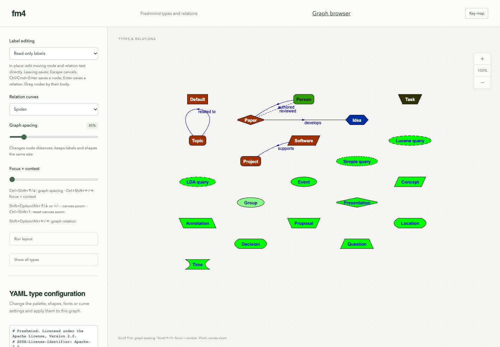

The palette page shows all 21 configured Freshmind node types, labeled curved relations, parallel edges and a self-loop. Its YAML editor applies semantic and visual configuration to the existing graph.

## 15. Open the approved Berry example

**Files and content**

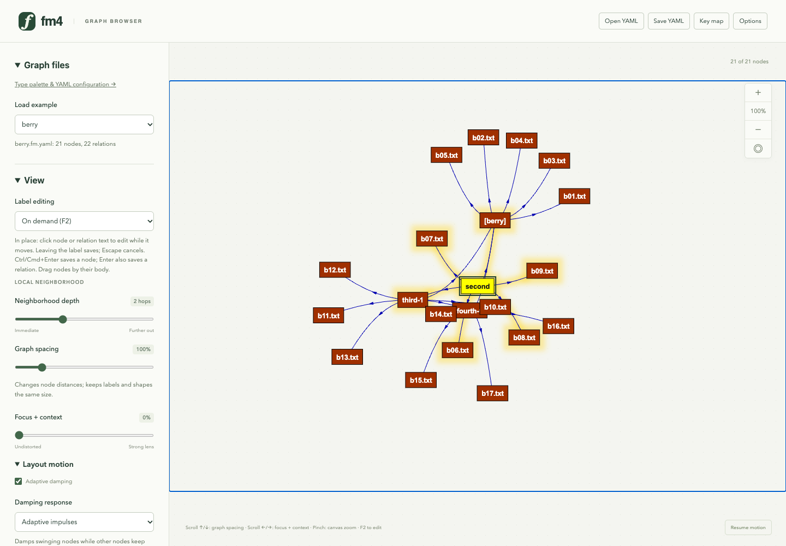

Berry is one of the two approved migrated datasets. The native YAML graph retains 21 nodes and 22 relations, annotations and original linked-resource paths.

## 16. Browse the approved NIPS dataset

**Files and content**

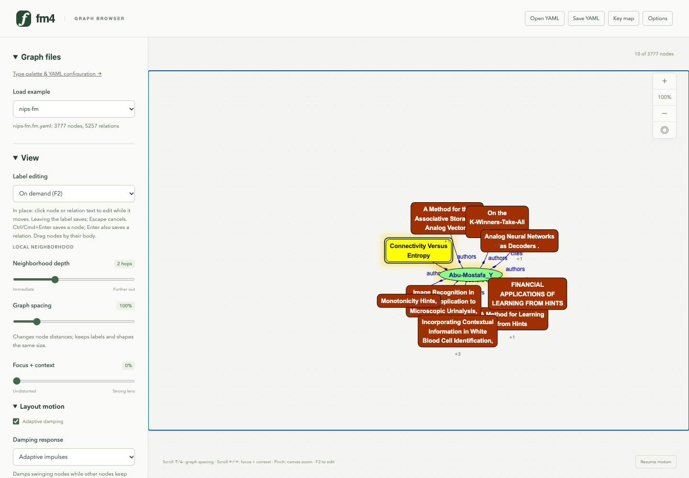

NIPS-FM contains 3,777 nodes and 5,257 relations. Opening it starts with a bounded neighborhood; the full graph remains stored for subsequent navigation and export.

## 17. Florentine families

**Files and content**

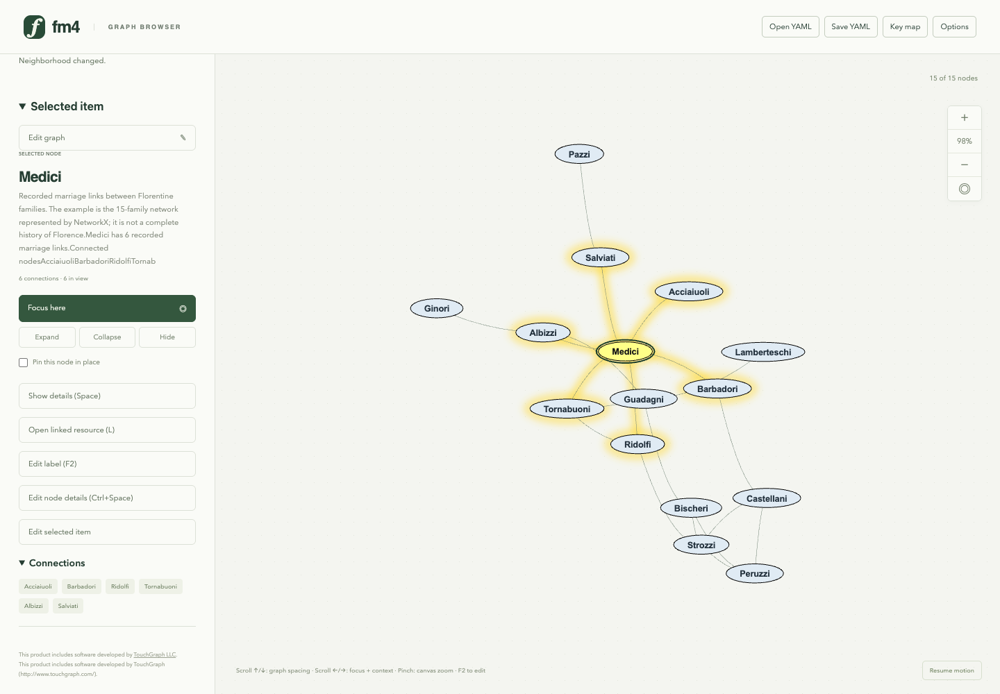

This public example has 15 families and 20 undirected marriage links. Node content contains graph-derived summaries and links to the connected families, with source attribution retained in the document.

## 18. Edit a multiline node label

**Files and content**

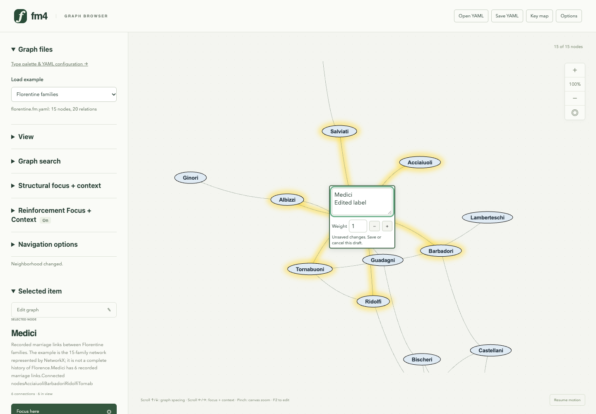

F2 opens an inline label editor on the selected node. A draft stays separate from the model until committed; node identity, relations and annotations are retained.

## 19. Annotations and item details

**Files and content**

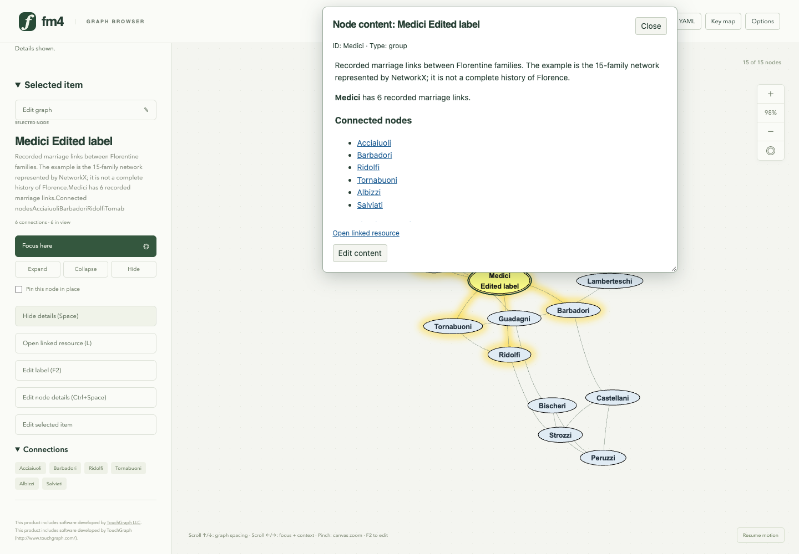

Ctrl+Enter commits the label. Space or Show details opens the selected node's content in a separate, resizable popup. Internal links navigate to connected nodes; Edit content opens the annotation overlay.

## 20. Save the complete graph as YAML

**Files and content**

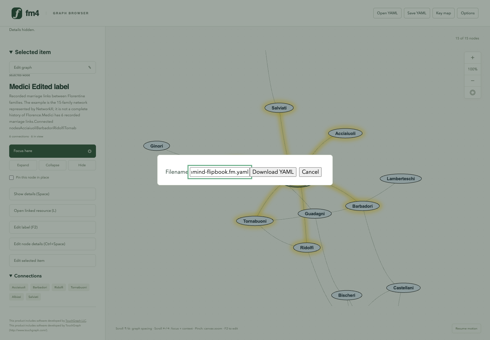

Ctrl+Shift+S opens the filename dialog. Saving downloads the complete stored graph, including hidden nodes, with optional layout/view state and embedded or companion type configuration.

## 21. Single-focus comparison: ordinary layout

**Focus + context**

The synthetic crowded-star fixture uses a fixed center and fixed context anchors. This is the ordinary TouchGraph layout after 250 batches from the saved initial coordinates; RFC is off. Adaptive damping is off throughout the fixed-force comparison. Both comparison views use 200% graph spacing and 100% canvas zoom for readability.

## 22. Single-focus comparison: attraction reinforcement

**Focus + context**

Reload the identical graph, choose Attraction only and run 250 batches. This earlier preset combines attraction multiplier 3 with angular stiffness 300, without a target-length spring. Soft yellow halos identify the reinforced nodes and relations; semantic graph records remain unchanged.

## 23. Single-focus comparison: length-constrained tree

**Focus + context**

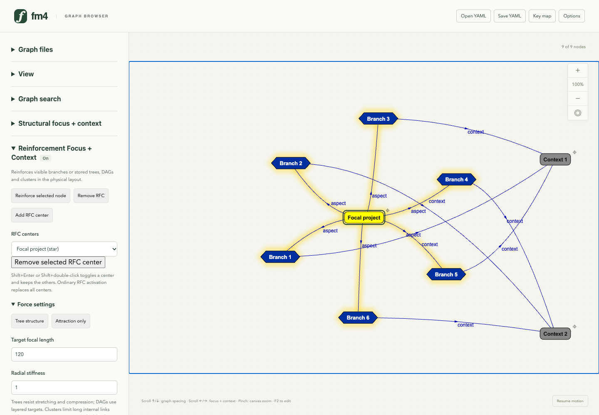

The default Tree structure preset combines target focal length 120, radial stiffness 1 and angular stiffness 10000. From the same starting graph and after 250 batches, the focal star is more regular. Both stronger angular constraints and the new length spring contribute. Yellow halos show reinforcement; optional focal-region exclusion is demonstrated separately below.

## 24. Weighted RFC for horizontally extended labels

**Focus + context**

The wide-label fixture uses horizontal coordinate weight 0.25 and vertical weight 1. Equal angles are measured in weighted physical coordinates, permitting a wider focal layout while the viewing lens and both zooms stay independent. Ordinary context springs still compete with reinforcement; the metric alone does not guarantee clear space or eliminate label overlaps.

## 25. Reinforce multiple stored trees

**Focus + context**

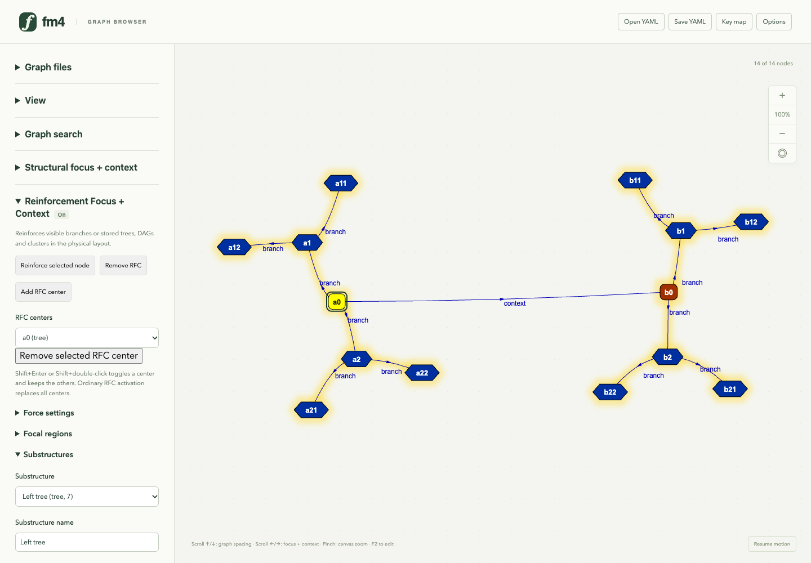

Two saved tree definitions reinforce deeper neighborhoods at the same time. Their context relations remain ordinary graph edges. Stored membership survives YAML export; active RFC centers are temporary view state. Shift+Enter can also add or remove an individual center.

## 26. Overlapping clusters and their boundaries

**Focus + context**

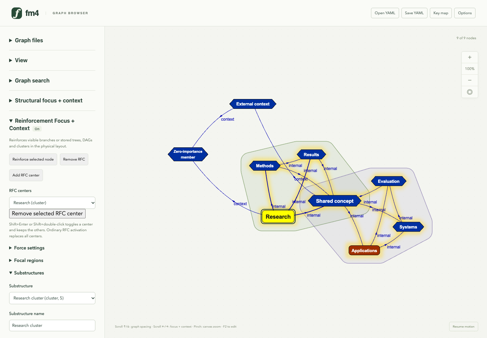

RFC can reinforce cyclic clusters as well as trees. These two stored clusters share a member, retain their internal relations and show translucent boundaries. Cluster rigidity controls resistance to deformation; the representative selects the group without becoming a physical anchor.

## 27. Optional focal-region exclusion

**Focus + context**

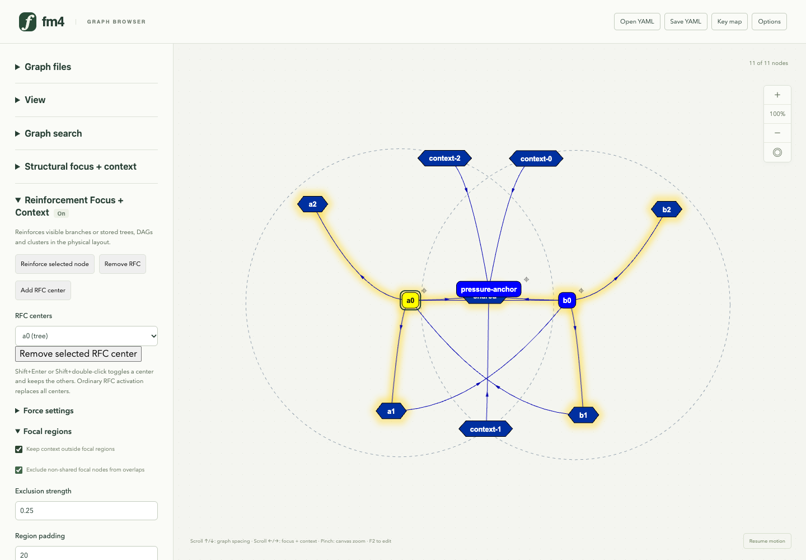

Dashed physical regions show the space reserved around two reinforced structures. Optional exclusion pushes context and non-shared focal nodes away from those regions while shared members remain exempt from their own regions. The forces are soft; pinned nodes and labels can still overlap.

## 28. Node importance and exact weight values

**Focus + context**

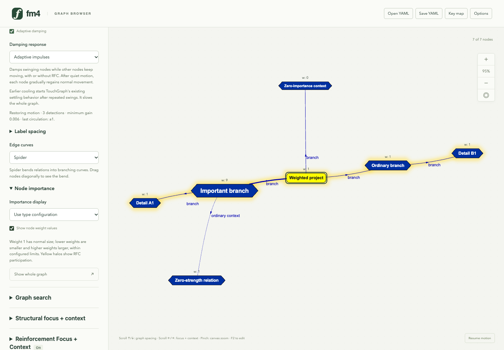

Node weight scales body and label size within configured limits. Weight 1 keeps normal size and weight 0 remains visible. Optional values make weights explicit when labels differ in length. Size shows importance; yellow halos independently show RFC participation.

## 29. Combine RFC with structural aggregation

**Focus + context**

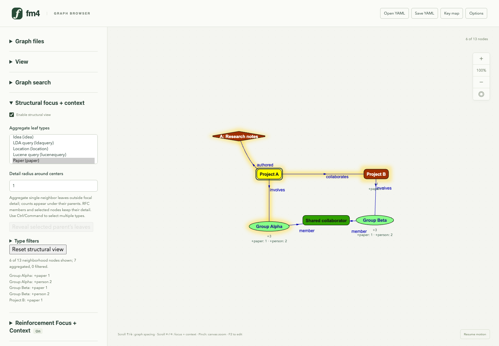

The structural focus + context example combines a viewing lens, RFC and reversible Person/Paper leaf aggregation. Six of thirteen nodes remain visible, with seven aggregated leaves counted under their parents. The shared collaborator stays visible because it connects two semantic neighbors. The complete graph remains intact.

## 30. Reveal aggregated detail without losing context

**Focus + context**

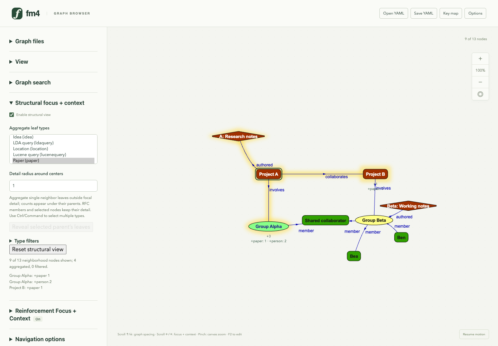

Select Group Beta and reveal its leaves to restore detail while retaining the current graph, focal center and lens. Nine nodes are now visible. E also reveals a selected parent's leaves; Reset structural view restores the current neighborhood without deleting semantic data.

## 31. Inspect overlapping node labels

**Readability**

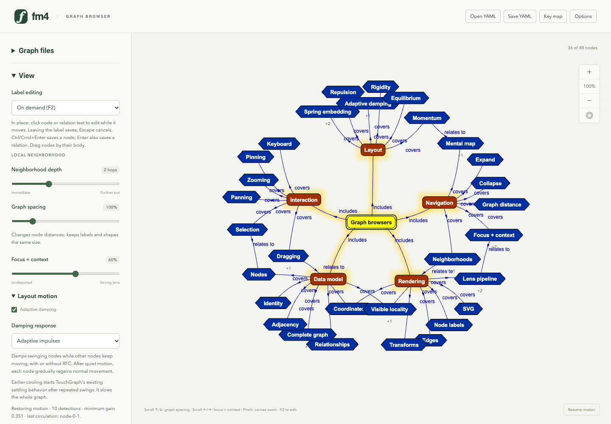

The graph-browser example retains RFC on its center node. Point-based layout can leave wide node labels intersecting even when their centers are apart. Label spacing uses the measured visible bodies, including multiline labels and importance scaling.

## 32. Separate overlapping nodes

**Readability**

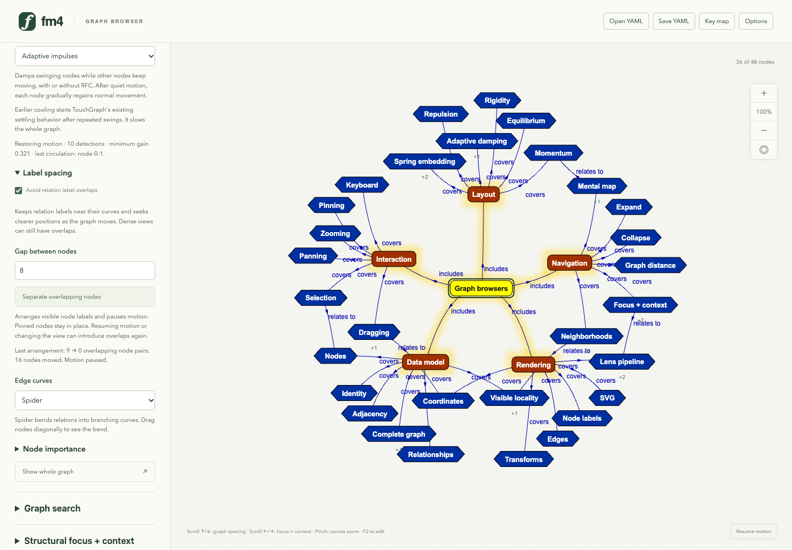

Separate overlapping nodes arranges visible bodies with a requested gap and pauses motion. Pinned nodes and the viewing focus stay in place; semantic relations, RFC, hidden nodes and viewing settings are retained. The status reports remaining intersections. Resuming motion or changing the view can introduce new overlaps; relation labels and crossings are separate concerns.

## 33. Inspect original relation-label positions

**Readability**

With node bodies already separated and motion paused, turn off Avoid relation label overlaps to inspect the original midpoint-and-offset anchors. Relation text can still intersect node bodies or other relation labels. The following view uses these exact node positions and curves.

## 34. Place relation labels near clear curve positions

**Readability**

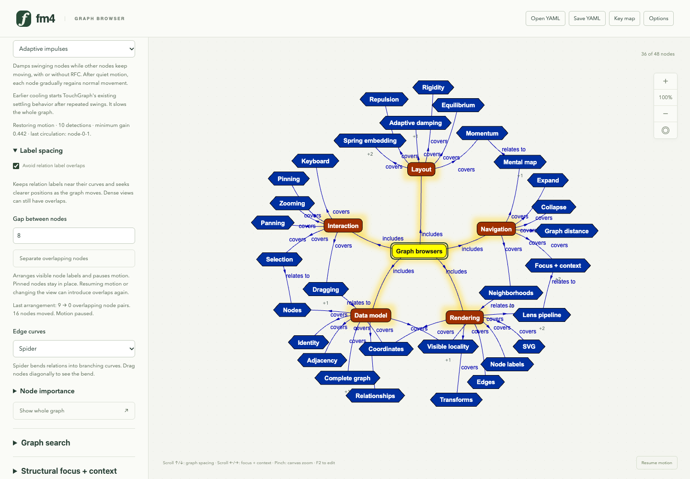

Avoid relation label overlaps measures SVG text and tries nearby positions along each curve and its normal. The browser enables this bounded presentation pass by default. It reduces label–node and label–label intersections in this view while retaining every label, node position and curve. Dense views can still overlap; toggling off restores original anchors.

## 35. Edit labels and weights together

**Editing and keyboard**

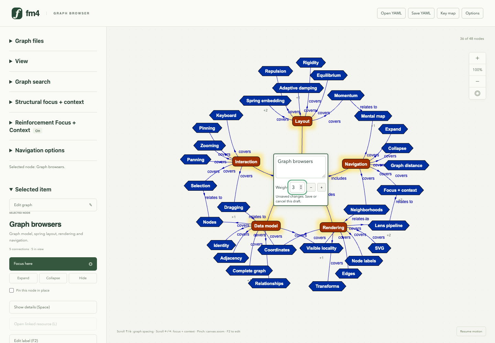

F2 opens a graph-anchored label overlay with weight controls for either a node or a relation. Ctrl+G/H adjusts the shared draft; a numeric suffix such as Graph browsers =3 also sets absolute weight on Save. The draft leaves the graph unchanged until committed; Escape cancels both label and weight.

## 36. Edit node details directly in an overlay

**Editing and keyboard**

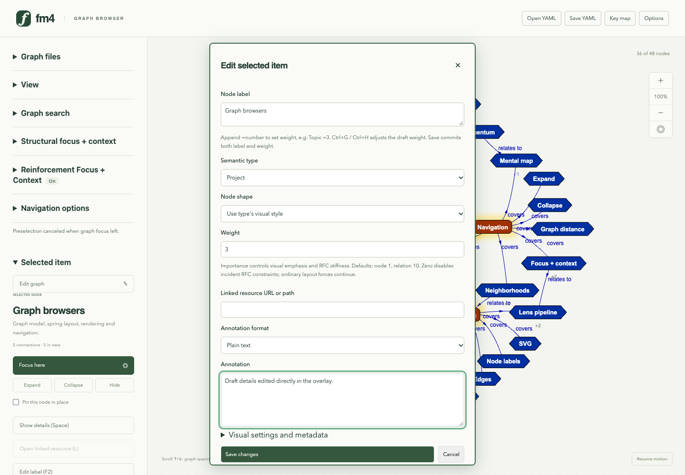

Ctrl+Enter commits the weight. Ctrl+Space or Shift+F2 then opens the full modeless editor at the node annotation, outside the side pane. It also exposes types, visual settings, URLs and metadata. Close retains a per-item draft; Save commits and Escape cancels. The annotation shown here is still a draft.

## 37. Point at the graph to control its center

**Editing and keyboard**

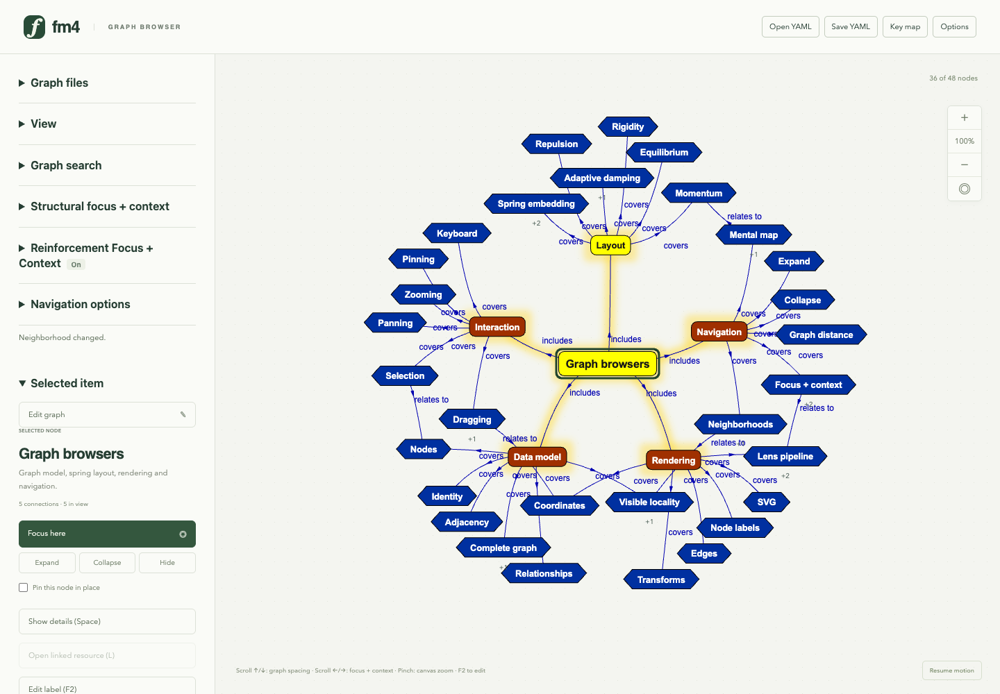

Close the editor, clear selection and move the pointer over a branch without clicking. Keyboard control resumes at the node in the viewport center, independently of the hovered branch. Enter acts immediately on that centered target; arrow navigation then continues from the selected node.

## 38. Explicit control focus takes priority

**Editing and keyboard**

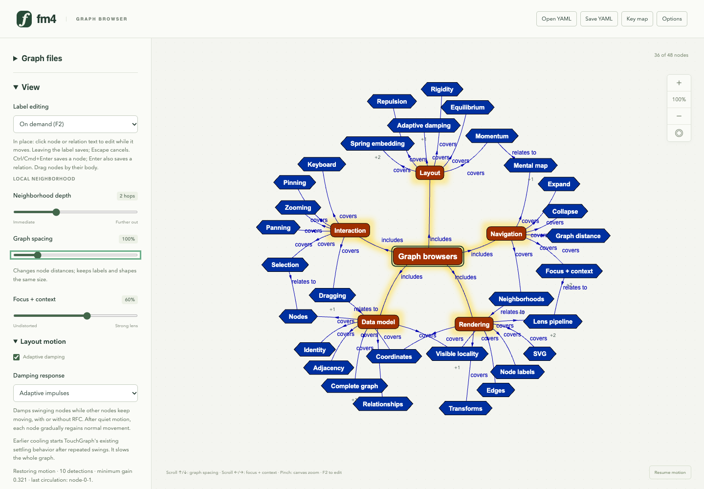

Focus Graph spacing in the side pane, then point back at the graph. The input keeps focus and Enter belongs to that control. Editors, buttons and summaries have the same protection. Click or Tab into the graph when ready to return keyboard control.

## 39. Suppress oscillation with or without RFC

**Layout motion**

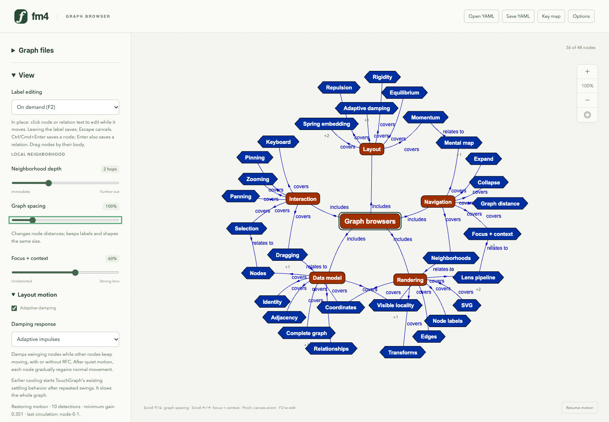

View → Layout motion enables general adaptive damping by default. It watches all movable visible nodes, including when RFC is off as shown here. Adaptive impulses attenuates repeated swings and gradually restores gain; Earlier TouchGraph cooling instead starts the inherited fast cooling phase after detected cycles. The status makes the active setting visible.
