# Freshmind 4 walkthrough

Generated by `just flipbook` from [the tour](../../scripts/flipbook/tour.mjs). Edit the tour to change the steps and captions, then regenerate.

[Open the HTML flipbook](index.html). Screenshots show the production build at 1440 × 1000. Layout is paused for capture; the three single-focus comparisons use identical synthetic initial coordinates and batch counts. The tour includes multiple RFC centers, clusters, focal regions, node importance, reversible structural aggregation and before/after node/relation-label placement, alongside synthetic graphs, the attributed Florentine network and the approved Berry/NIPS-FM examples.

## 1. Graph browser with RFC on the center node

The graph-browser example opens with Reinforcement Focus+Context active on its central Graph browsers node. Yellow halos identify the reinforced center and its five immediate branches; the surrounding graph retains its ordinary connections and forces.

## 2. Reveal the complete graph

Show whole graph reveals stored nodes beyond the current neighborhood. Expansion, collapse and hiding change the visible graph while retaining the complete graph for editing and export.

## 3. Graph spacing, canvas zoom and viewing lens

Graph spacing changes node distances. Canvas zoom scales shapes, labels and strokes together. The focus + context slider applies the independent nonlinear viewing lens.

## 4. User key map

The help dialog and docs/KEYMAP.md share the same implemented command definitions, including graph spacing, canvas zoom, navigation, editing and file shortcuts.

## 5. Node types and curved relations

The palette page shows all 21 configured Freshmind node types, labeled curved relations, parallel edges and a self-loop. Its YAML editor applies semantic and visual configuration to the existing graph.

## 6. Open the approved Berry example

Berry is one of the two approved migrated datasets. The native YAML graph retains 21 nodes and 22 relations, annotations and original linked-resource paths.

## 7. Florentine families

This public example has 15 families and 20 undirected marriage links. Node content contains graph-derived summaries and links to the connected families, with source attribution retained in the document.

## 8. Edit a multiline node label

F2 opens an inline label editor on the selected node. A draft stays separate from the model until committed; node identity, relations and annotations are retained.

## 9. Annotations and item details

Ctrl+Enter commits the label. Space or Show details opens the selected node's content in a separate, resizable popup. Internal links navigate to connected nodes; Edit content opens the annotation overlay.

## 10. Save the complete graph as YAML

Ctrl+Shift+S opens the filename dialog. Saving downloads the complete stored graph, including hidden nodes, with optional layout/view state and embedded or companion type configuration.

## 11. Single-focus comparison: ordinary layout

The synthetic crowded-star fixture uses a fixed center and fixed context anchors. This is the ordinary TouchGraph layout after 250 batches from the saved initial coordinates; RFC is off. Both comparison views use 200% graph spacing and 100% canvas zoom for readability.

## 12. Single-focus comparison: attraction reinforcement

Reload the identical graph, choose Attraction only and run 250 batches. This earlier preset combines attraction multiplier 3 with angular stiffness 300, without a target-length spring. Soft yellow halos identify the reinforced nodes and relations; semantic graph records remain unchanged.

## 13. Single-focus comparison: length-constrained tree

The default Tree structure preset combines target focal length 120, radial stiffness 1 and angular stiffness 10000. From the same starting graph and after 250 batches, the focal star is more regular. Both stronger angular constraints and the new length spring contribute. Yellow halos show reinforcement; optional focal-region exclusion is demonstrated separately below.

## 14. Weighted RFC for horizontally extended labels

The wide-label fixture uses horizontal coordinate weight 0.25 and vertical weight 1. Equal angles are measured in weighted physical coordinates, permitting a wider focal layout while the viewing lens and both zooms stay independent. Ordinary context springs still compete with reinforcement; the metric alone does not guarantee clear space or eliminate label overlaps.

## 15. Reinforce multiple stored trees

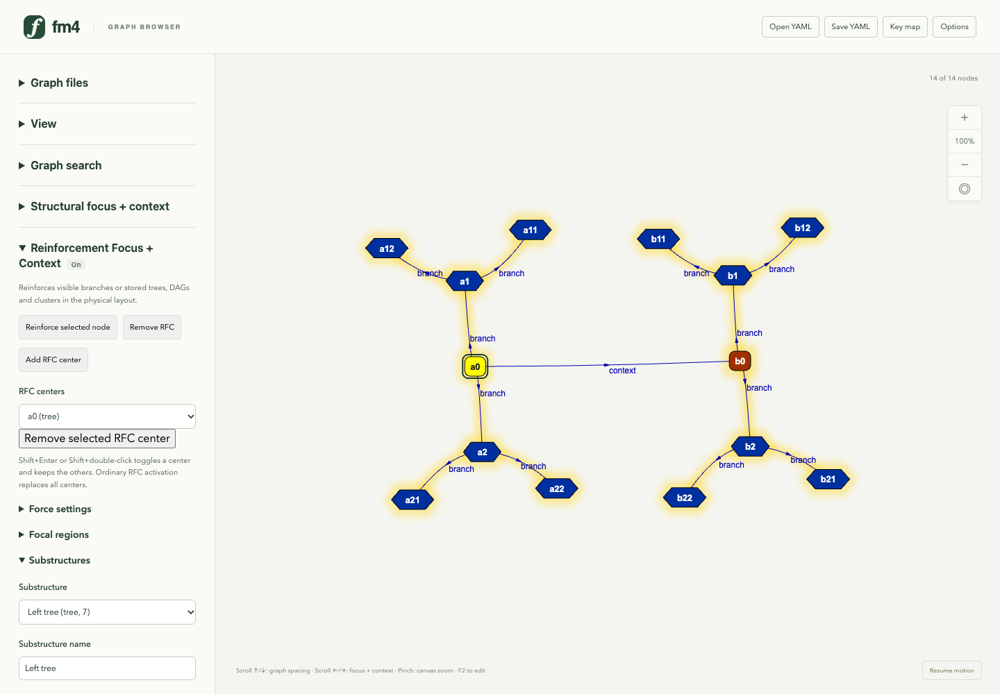

Two saved tree definitions reinforce deeper neighborhoods at the same time. Their context relations remain ordinary graph edges. Stored membership survives YAML export; active RFC centers are temporary view state. Shift+Enter can also add or remove an individual center.

## 16. Overlapping clusters and their boundaries

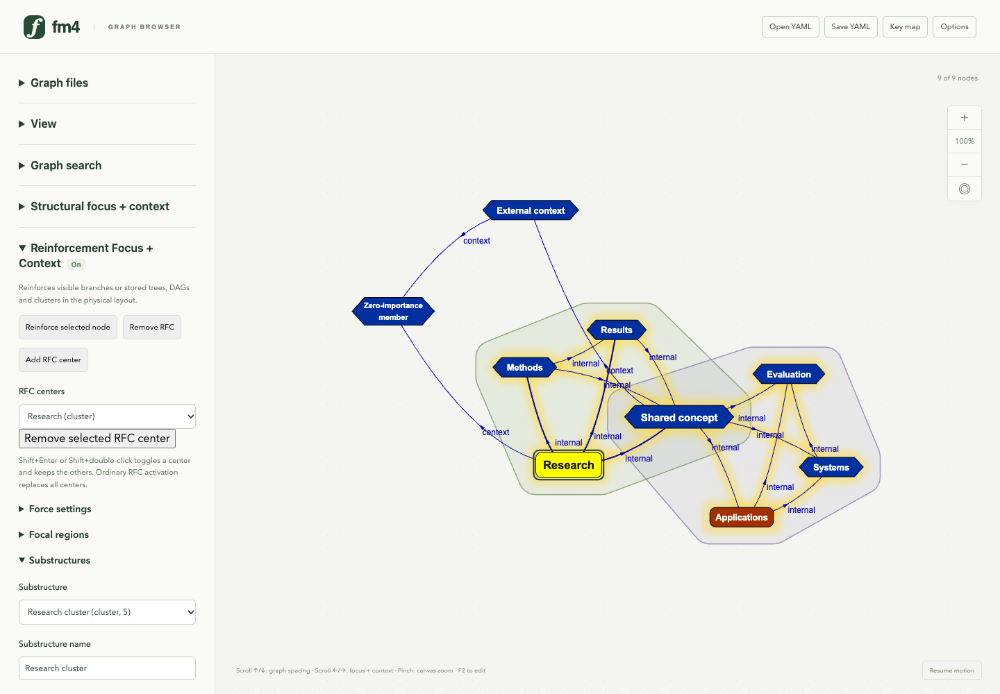

RFC can reinforce cyclic clusters as well as trees. These two stored clusters share a member, retain their internal relations and show translucent boundaries. Cluster rigidity controls resistance to deformation; the representative selects the group without becoming a physical anchor.

## 17. Optional focal-region exclusion

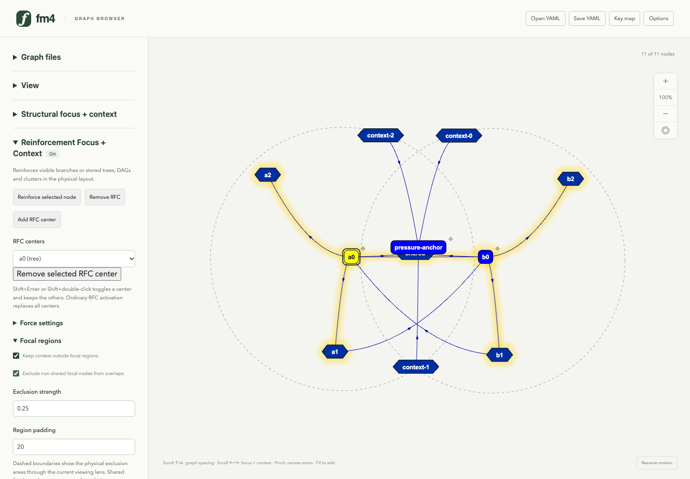

Dashed physical regions show the space reserved around two reinforced structures. Optional exclusion pushes context and non-shared focal nodes away from those regions while shared members remain exempt from their own regions. The forces are soft; pinned nodes and labels can still overlap.

## 18. Node importance and exact weight values

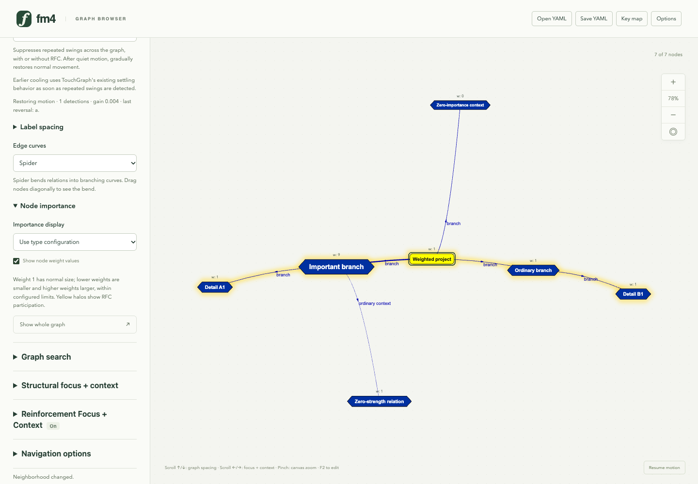

Node weight scales body and label size within configured limits. Weight 1 keeps normal size and weight 0 remains visible. Optional values make weights explicit when labels differ in length. Size shows importance; yellow halos independently show RFC participation.

## 19. Combine RFC with structural aggregation

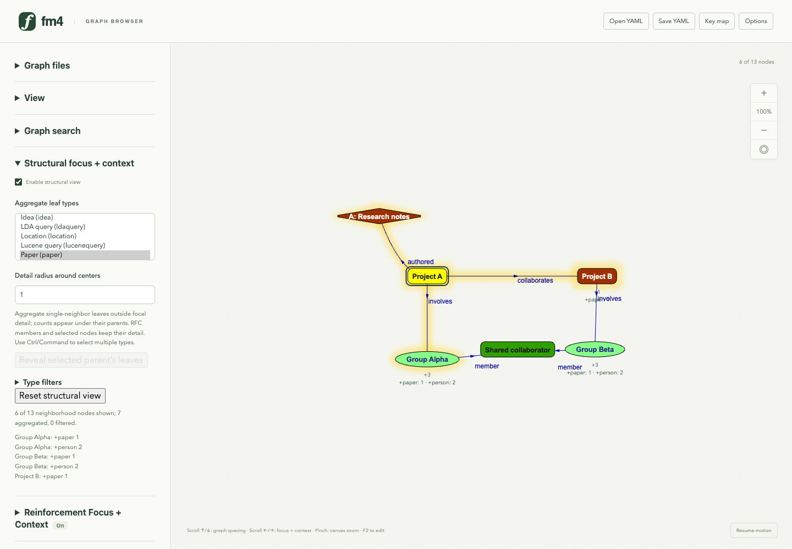

The structural focus + context example combines a viewing lens, RFC and reversible Person/Paper leaf aggregation. Six of thirteen nodes remain visible, with seven aggregated leaves counted under their parents. The shared collaborator stays visible because it connects two semantic neighbors. The complete graph remains intact.

## 20. Reveal aggregated detail without losing context

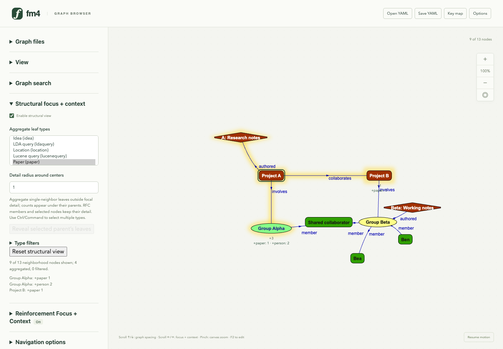

Select Group Beta and reveal its leaves to restore detail while retaining the current graph, focal center and lens. Nine nodes are now visible. E also reveals a selected parent's leaves; Reset structural view restores the current neighborhood without deleting semantic data.

## 21. Browse the approved NIPS dataset

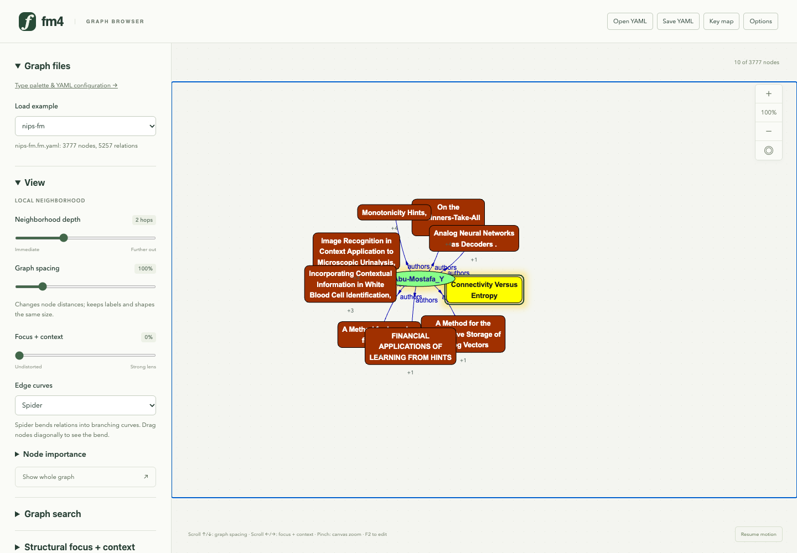

NIPS-FM contains 3,777 nodes and 5,257 relations. Opening it starts with a bounded neighborhood; the full graph remains stored for subsequent navigation and export.

## 22. Inspect overlapping node labels

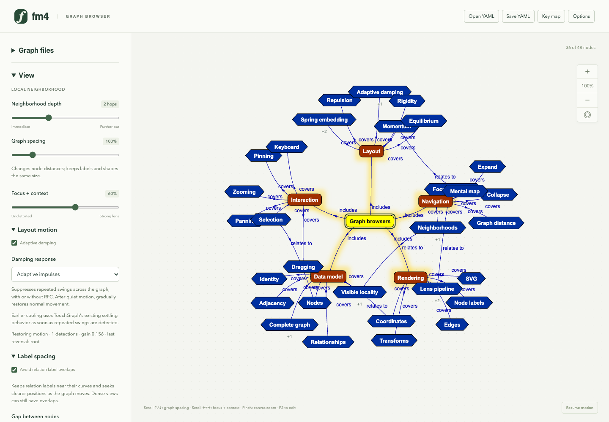

The graph-browser example retains RFC on its center node. Point-based layout can leave wide node labels intersecting even when their centers are apart. Label spacing uses the measured visible bodies, including multiline labels and importance scaling.

## 23. Separate overlapping nodes

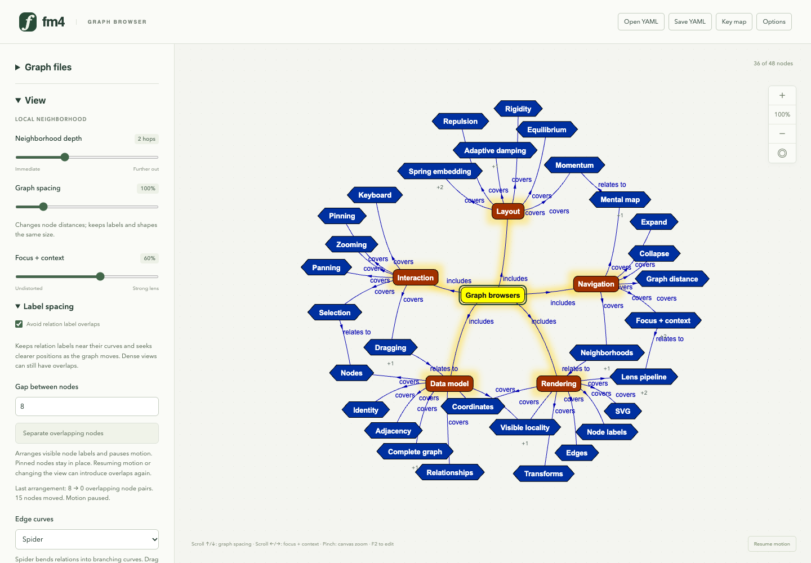

Separate overlapping nodes arranges visible bodies with a requested gap and pauses motion. Pinned nodes and the viewing focus stay in place; semantic relations, RFC, hidden nodes and viewing settings are retained. The status reports remaining intersections. Resuming motion or changing the view can introduce new overlaps; relation labels and crossings are separate concerns.

## 24. Inspect original relation-label positions

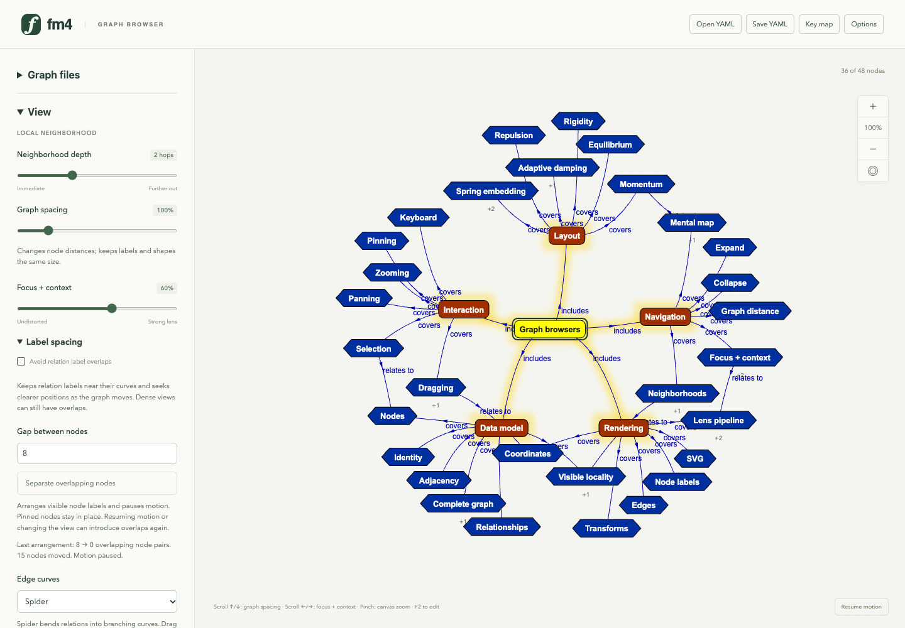

With node bodies already separated and motion paused, turn off Avoid relation label overlaps to inspect the original midpoint-and-offset anchors. Relation text can still intersect node bodies or other relation labels. The following view uses these exact node positions and curves.

## 25. Place relation labels near clear curve positions

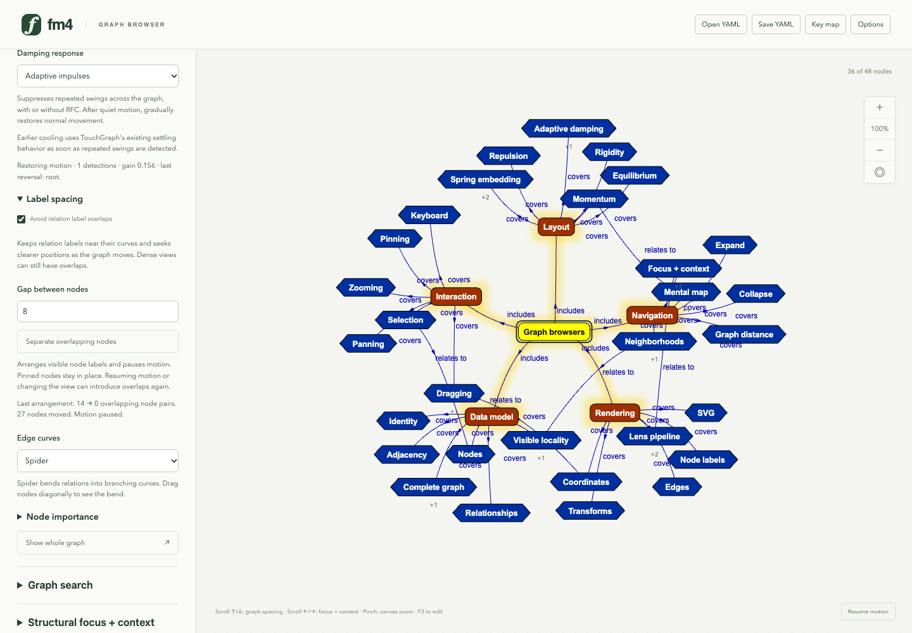

Avoid relation label overlaps measures SVG text and tries nearby positions along each curve and its normal. The browser enables this bounded presentation pass by default. It reduces label–node and label–label intersections in this view while retaining every label, node position and curve. Dense views can still overlap; toggling off restores original anchors.

## 26. Edit labels and weights together

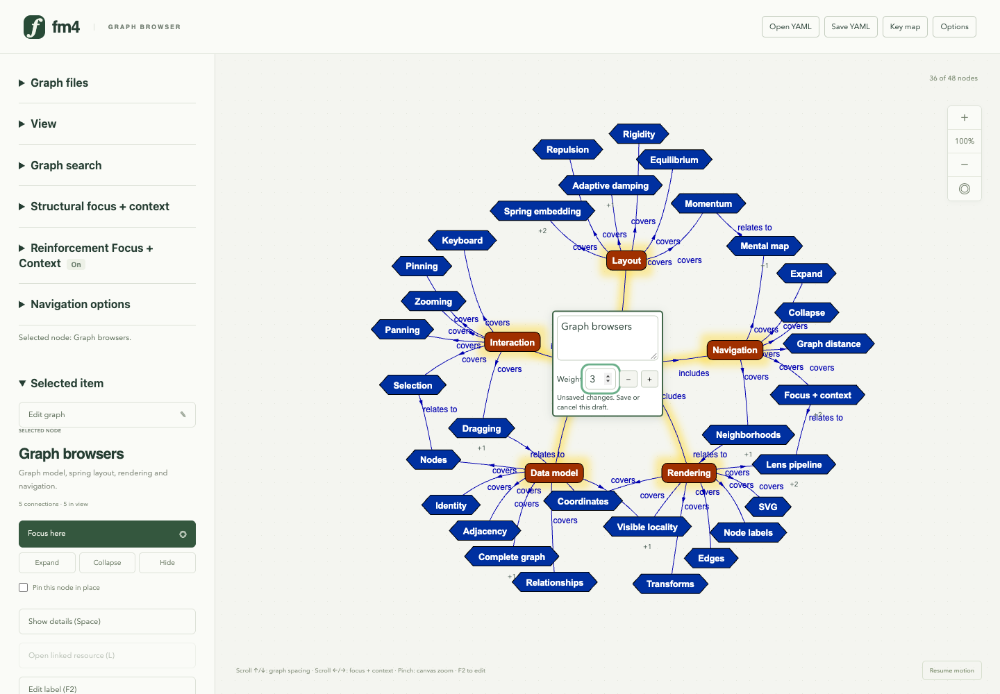

F2 opens a graph-anchored label overlay with weight controls for either a node or a relation. Ctrl+G/H adjusts the shared draft; a numeric suffix such as Graph browsers =3 also sets absolute weight on Save. The draft leaves the graph unchanged until committed; Escape cancels both label and weight.

## 27. Edit node details directly in an overlay

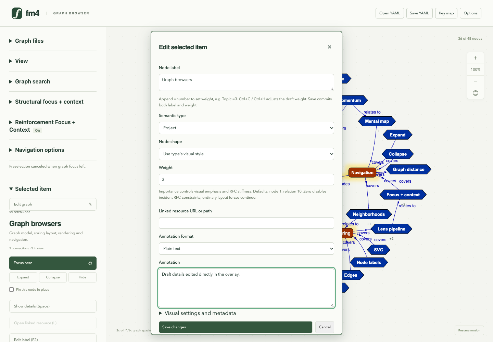

Ctrl+Enter commits the weight. Ctrl+Space or Shift+F2 then opens the full modeless editor at the node annotation, outside the side pane. It also exposes types, visual settings, URLs and metadata. Close retains a per-item draft; Save commits and Escape cancels. The annotation shown here is still a draft.
