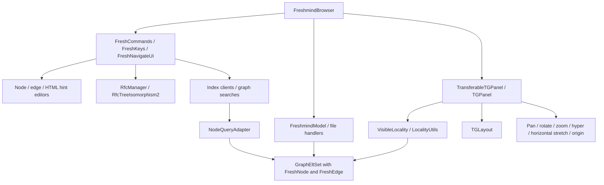

# FM 2014 reference analysis

Reviewed **2026-10-22** for Freshmind 4 milestone **2.1**; wording revised **2026-10-23**. Reference project: `../knowceans/knowceans-freshmind-2014/`, relative to the Freshmind 4 root. Freshmind 4 starting point: `fda482a`; analysis branch: `freshmind4/reference-analysis`.

The Java prototype is the **feature reference** for Freshmind 4: labels and presentation, editing, navigation, search, file I/O and their interactions. This analysis identifies how those features were implemented, which paths are active, and where behavior needs to be completed or corrected during the TypeScript port. Rebuilding the Java application provides additional evidence where useful.

**Development context:** the 2014 snapshot is the most feature-complete version of Java Freshmind, captured during an unfinished effort to consolidate several earlier versions. Those versions evolved through research experiments and periods of development under time pressure. Design flaws, incomplete refactorings and uneven abstractions are therefore expected consequences of that history. The code records both the intended features and the experiments through which they emerged; the findings below should be interpreted in that context.

**Porting approach:** Freshmind 4 uses AI-assisted analysis and implementation with Codex (GPT-6.1 Sol, high reasoning effort) to recover feature intent, trace interactions across the codebase and turn that understanding into a maintainable TypeScript extension. The aim is to make this work systematic and verifiable: ground decisions in the source and research papers, preserve established behavior through compatibility checks, and validate corrections explicitly. The analysis provides a basis for those decisions; the benefits of the approach should be demonstrated by the resulting implementation and its validation.

Freshmind's features are built on a modified TouchGraph fork. The main application uses `TGLayout`; the similarly named `FMLayout` has no call sites in the reviewed source. Freshmind 4 retains the existing TouchGraph design as its foundation, adding features through clean extensions while preserving the validated plain-layout baseline.

**RFC decision:** rebuild Reinforcement Focus + Context from the [2005 paper](literature/rfc@3ia05compact.pdf). The paper defines the mechanism; the Java RFC package documents an implementation experiment. Use the existing plain TouchGraph physics as the comparison baseline.

The [Freshmind feature design](fm_port-design.md) specifies model and visual types, YAML type configuration, labeled curved relations, navigation and editors as extensions to TouchGraph's graph/locality structure, panel, layout and lenses. Native persistence will use YAML, with batch conversion of the Java examples. The legacy-format findings below inform that migration.

## Scope and evidence

The review inventories all Java packages, traces application construction and feature entry points, and examines the model, layout, lenses, navigation, editors, file handlers, RFC and search integration. Each finding distinguishes what is implemented and connected in source from what was verified at runtime. Historical TODO comments are checked against the current implementation before drawing conclusions about completeness.

The source tree has **178 Java files / 34,694 lines**, including generated parser code, plus a JavaCC grammar. The `tg` subtree contains **43 Java files**. The directory has no Git metadata, so its name is not a version identifier. For identification, the Java source-tree SHA-256 is:

```text
39f6d9c8c1d8495c7ca12e1b91e735173622c031717e2c90c0266e11407150c4
```

This hashes each Java file in sorted relative-path order as `UTF8(path) + NUL + raw file bytes + NUL`, with paths relative to the reference root. It excludes jars, compiled classes, resources, and sample data.

| Package, under `org.knowceans.freshmind` | Java files | Responsibilities |
| --- | ---: | --- |
| `tg`, `tg.graphelements`, `tg.interaction` | 15 + 9 + 19 | Modified TouchGraph model, locality, layout, painting, lenses and interaction handlers. |
| Root package, `keyboard`, `editors` | 18 + 4 + 9 | Freshmind model extensions, application, commands, navigation, label and annotation editors. |
| `io`, `io.parser` | 22 + 7 | File dispatch, graph formats, importers, clipboard/transfer support and generated parser. |
| `ir.index`, `ir.index.sandbox` | 11 + 8 | Graph indexing, Lucene/LDA integration and experiments. |
| `ir.search`, `ir.semantic` | 19 + 12 | Query/result graph interaction, ranking, topic models and a partly migrated LDA implementation. |
| `rfc` | 6 | Reinforcement edges, local structure construction and an unfinished tree search. |
| `cluster` | 8 | Chinese Whispers, Markov clustering and supporting matrices/maps. |
| `spatial`, `sandbox` | 4 + 7 | Experimental 3D projection and layout support, canvas/media experiments. |

Source links in this report resolve through the sibling reference directory. Line numbers refer to the reviewed snapshot; the report remains readable without that directory.

## Application structure and active paths



[FreshmindBrowser] constructs the panel, lenses, active editors, preselection controller and model, initializes the view, then constructs `RfcManager` (lines 208–268). Its active UI is `FreshNavigateUI` (lines 721–726). [TGPanel] creates and starts `TGLayout` (lines 188–212). No other source file references `FMLayout`.

Several classes combine model, presentation and application responsibilities: `FreshGraphItem` includes AWT painting; `FreshNode` constructs a Swing `Hint` and accesses `TGPanel.getInstance()`; search adapters mutate the panel directly. In the TypeScript port, Freshmind subclasses and helpers can preserve the observable behavior while keeping graph data independent of DOM/SVG rendering and application services.

## TouchGraph fork: additions and compatibility implications

The fork retains TouchGraph's `Node`/`Edge` model, complete/visible graph distinction, locality animation and lens pipeline. The table below identifies the Freshmind-specific additions and their implications for the port.

| Area | Reference behavior | Consequence for Freshmind 4 |
| --- | --- | --- |
| Graph identity | `GraphEltSet` requires non-null unique IDs; adds `getUniqueID`, `changeNodeID`, first-node handling and edge-label lookup. `TGPanel` coordinates some ID changes between complete and visible sets. | Keep stable identity separate from editable labels; review ID changes as an atomic model operation. |
| Selection | Node selection, edge selection, a vector of preselected candidates and a keyboard-selected candidate coexist. The panel repaints preselected items above ordinary items. | Add explicit edge/candidate selection state. Milestone 1's single node selection is insufficient for Freshmind commands. |
| Layout | `TGLayout` starts with ordinary rigidity `10`, pending rigidity `1`, RFC rigidity `100`; distinguishes `RfcEdge` in 2D attraction. Point repulsion and locality movement weighting remain. | Compare these deliberate fork changes separately from the already tested plain TouchGraph engine. Weight-based repulsion experiments are commented out. |
| 3D | `Node` adds `z`, `dz`, draw depth; layout has a separate 3D branch. Mouse/key projection controls are conditionally installed when static `is3d` is true; default is false. | Experimental, outside the present 2D milestones. Its existing hooks mean the old “hook to graph” TODO is not a reliable completeness indicator. |
| Edge rendering | Curves are enabled by default. `Edge.setMiddle` supports lens-transformed midpoints and a “spider” curve mode; Freshmind draws relation labels around that midpoint. | Restore curved/labeled relations as a rendering feature. Curve geometry, arrow direction, label placement and hit testing must agree. |
| Edge hit testing | `distFromPoint` still approximates the straight endpoint segment, despite curved painting. | Preserve navigation intent while correcting the geometry mismatch; do not use this as an exact curve picking specification. |
| Viewing lens | Freshmind composes pan → rotation → zoom → nonlinear lens → horizontal stretch (`x × 1.5`) → origin. The nonlinear lens has a configurable fixed radius. | Add a Freshmind view configuration and verify inverse dragging through the whole composition. A viewing stretch is distinct from weighted distances in RFC physics. |

Evidence: [GraphEltSet] lines 98–182, 325–340, 452–474; [TGPanel] lines 363–392, 678–695, 1181–1190, 1269–1364; [TGLayout] lines 83–92, 113–155, 263–308, 524–540; [Edge] lines 89–94, 210–241, 262–359, 378–413; [FreshmindBrowser] lines 331–352.

The nonlinear lens also contains two defects to address explicitly. [HyperScroll] computes `getValue() / getMaximum() * 100` using integer division (line 120); its scrollbar's maximum is 115 and its reachable value is at most 107, so this intermediate value is always zero. The outer fade still changes with the slider. Also, `setMaxDist` only assigns the radius (lines 301–303), while the inverse lookup table depends on it; the browser changes it on resize without rebuilding that table. Neither defect should redefine the existing plain TouchGraph lens baseline.

## Freshmind model, presentation and interaction

**Implemented and wired in source:**

- `FreshNode` extends `Node` with semantic type, URL, annotation/hint, weight, shape, multiline label measurements, cluster ID, marking/preselection flags and a change listener. `NodeTypes` defines 21 names, including paper, person, idea, task, topic and three query types. Type styles supply shapes, fonts and colors.
- `FreshEdge` extends `Edge` with a relation label, stroke, integer weight and selection flags. Weight controls rendered stroke width; ordinary node/edge weights are not active force multipliers in `TGLayout`.
- `FreshCommands`, `FreshKeys`, `Direction` and `Preselection` implement directional “compass” navigation, candidate cycling/confirmation, recentering, radius/backlink controls, expansion, collapse, hide, editing and query creation. Preselection has a 2.5-second timeout, defaulting to clearing candidates rather than committing them.
- `FreshNodeMultilineEditor`, `FreshEdgeEditor` and `HintFrameHtmlEditor` are instantiated by the browser. Node editing parses type/style shorthand; edge editing parses label/stroke/weight shorthand. HTML annotation viewing/editing, URL launching, clipboard operations and SVG export have application entry points.
- Radius and degree limits are forwarded to locality browsing, with the backlink checkbox controlling directed traversal. Hidden-edge counts are painted by `FreshNode`.

Evidence: [FreshNode] lines 88–176, 201–218, 345–358, 850–914; [FreshEdge]; [NodeTypes]; [FreshCommands]; [Preselection] lines 27–41, 90–144; [FreshmindBrowser] lines 243–253, 728–744; [FreshNodeMultilineEditor] lines 64–124; [FreshEdgeEditor] lines 59–96.

**Incomplete abstractions and porting considerations:**

- `FreshNode.getType()` overrides TouchGraph's shape-type API with a semantic category. Freshmind separately carries `typeShape` and `shape`. A literal override in TypeScript would make the current SVG renderer interpret semantic categories as geometric shapes. Separate semantic type, explicit shape override and resolved style, with compatibility adapters where needed.
- `EdgeTypes` declares an edge-type registry but has no external source references and initializes only its default entry. Existing relation semantics are primarily free-text `FreshEdge.label` values. Preserve those labels; do not describe the Java code as a completed typed-edge schema.
- `ModelFilters` contains dataset-specific, destructive graph transformations, not a general reversible aggregation mechanism. Its only call sites are commented out in `TxtFileHandler`. The shared `aggEdges` field is evidence of an experiment, not a completed structural focus/context feature.
- Alternate editors, linked media objects and `TransformScroll` coexist with the active paths. `TransformScroll` currently performs scalar zoom rather than a general affine transform and is not instantiated by the application. `CanvasTransformer` is a separate singleton used by panel painting and mouse coordinates.

For milestone 2, these findings guide extensions to the existing TouchGraph model and browser behavior. Define explicit contracts for styles, rendering and commands, with browser equivalents for the Swing interactions.

## Persistence and available fixtures

[FreshmindModel] dispatches loads by extension (lines 47–73). Its normal save path only chooses XML for `.xml`, otherwise the older text format (lines 161–167). Existence of a file-handler `save()` method therefore does not imply that normal application saving invokes it.

| Input | Source implementation | Export / completeness |
| --- | --- | --- |
| `.xml` | `XmlFileHandler`: graph/node records, IDs, labels, hints, URLs, semantic type, shape, weight; relations with destination, label stored as `type`, direction, stroke and weight. | Java read/write support, with confirmed defects below; primary migration input for native YAML. |
| `.txt` | `TxtFileHandler`: older label-based text syntax, types, hints and relations. | Saves through `FreshmindModel.toString`; not equivalent to XML metadata preservation. |
| `.fmg` | `FmgFileHandler` invokes `FreshmindParser`; both generated Java and `io/parser/FreshmindParser.jj` are present. | Handler export throws `NotImplementedException`. It assigns the parsed graph to the handler field without updating the model's graph, another incomplete integration. |
| `.tree` | `TreeTxtFileHandler` constructs nodes/edges from indented text; model changes the destination filename to `.xml`. | Direct handler export throws `NotImplementedException`. |
| `.db` | `DbFileHandler` reads connection settings. Actual database graph construction is commented out. | No functioning graph import in the active body; handler export throws `NotImplementedException`. |
| `.index` | `LuceneIndexHandler` constructs document nodes and similarity links from an existing Lucene index. | An import/reconstruction operation, not lossless graph storage. |
| `.corpus` | `TermCorpusHandler` constructs a graph from topic/corpus data and similarities. | Explicitly experimental; its own `save()` reruns LDA rather than exporting graph records. |
| `.owl` | `Owl2FileHandler` uses OWLAPI to construct nodes/relations from ontology content. | Its `save()` writes Freshmind `<graph>` XML, not an OWL ontology; ordinary model saving instead falls back to text. |

### Confirmed serialization problems

1. **Node weight overwrites semantic type on reload.** [XmlFileHandler] writes a non-default node weight into a second `<type>` element (lines 254–259), while the loader expects `<weight>` (lines 107–111). The later numeric type decodes to default. A headless save/load probe with a `person` node of weight `50` returned type `0`, weight `1.0`.
2. **Bare isolated nodes disappear on save.** The XML writer only appends a node when its `valid` flag becomes true. An isolated node whose ID equals its label and has no metadata never qualifies. The same probe started with two nodes and reloaded only the weighted node. Shape/weight writing alone does not set `valid` either. Text output has a similar conditional omission.
3. **XML relation styling is element-order dependent.** The loader constructs each edge when it encounters `<destination>`, using only stroke/weight/type fields seen so far. The writer emits destination last, but an equivalent XML document with destination first loses later properties. Loading should collect a relation record before constructing the edge.
4. **Text export has a narrower schema.** `FreshmindModel.toString()` emits labels, semantic types, hints and outgoing labeled destinations by label. Stable IDs, explicit URLs, shapes and weights have no dedicated output fields. It also omits self-loops through its `!w.to.equals(n)` test; XML uses the same outgoing-edge test.
5. **Backup handling renames twice.** `FreshmindModel.save(true)` calls `renameTo` twice for the same source/target and uses the second result for status reporting (lines 151–158). This is a defect in save orchestration, not a format contract.

The first two findings were reproduced using the original model/serializer classes after only the temporary compilation adaptations described below. Findings 3–5 follow from the inspected source; broader round trips have not been established.

The original review inventoried seven top-level XML examples. Migration and distribution are now restricted to the following **two approved datasets**; the other reference datasets are proprietary and excluded from port fixtures and example conversion.

| File | Node records | Relation records | Use |
| --- | ---: | ---: | --- |
| `berry.xml` | 21 | 22 | Small untyped import/navigation fixture. |
| `nips-fm.xml` | 3,777 | 5,257 | Larger locality fixture; `group`/`project` types. |

Both approved datasets have been converted under milestone 2.5. Their reports include input hashes, record counts and retained unavailable resource paths. The historical writer defects described above are tested with synthetic fixtures rather than proprietary source data. Backups, index directories and external resources are not migration inputs.

## RFC: rebuild from the paper

The Java RFC prototype is connected to application commands: `FreshKeys` invokes `FreshCommands.doRfc()` / `undoRfc()`, the former constructs `RfcTreeIsomorphism2`, and `RfcManager` adds/removes reinforcement edges. `TGLayout` gives `RfcEdge` a separate attraction multiplier, and `RfcEdge.paint()` is deliberately empty.

It does not establish the complete mechanism described by the paper:

- `RfcTreeIsomorphism` duplicates the center's incident edges as reinforcement struts. It does not recognize a general tree structure.
- The active `RfcTreeIsomorphism2` sorts neighbors by **draw-coordinate** angle, adds a chain of ordinary `Edge` objects directly to the graph plus one closing `RfcEdge`, and returns an empty reinforcement-edge list. It supplies neither the paper's angle-dependent force law nor its full focal-region treatment.
- `RfcManager` tests `Hashtable.contains(center)`, which tests values rather than center keys. Repeated activation is not prevented.
- `TreeSearch.search()` returns `null`. Its `public void TreeSearch(...)` declaration is a method, not a constructor, and no application code uses the class.
- No implementation of the complete anisotropic distance, elliptical exclusion, shared-focus handling or reversible structural aggregation mechanism was identified in these active paths. Horizontal viewing stretch and dataset-specific filters are separate experiments.

A headless fixture with a center and two neighbors confirmed: edge count **2 → 4** during isomorphism construction, **0** tracked reinforcement edges, duplicate `setRfc` accepted, and edge count still **4** after undo. Constructing the active isomorphism around an isolated node throws `IndexOutOfBoundsException`. The added ordinary edges can also conflict with code that assumes every application edge is a `FreshEdge`.

For milestone 3, derive focal-tree selection and force equations from the paper. Represent reinforcement constraints separately from persistent semantic relations; turning RFC on/off must not change user graph data, search indexes or exported relations. Add deterministic single/multiple-focus experiments against the unchanged plain TouchGraph baseline, including isolated nodes, repeated activation, shared branches and disable/re-enable behavior. Evaluate the rebuild against the paper's mechanism and examples, using the Java prototype to understand the earlier experiment.

Evidence: [FreshCommands] lines 631–642; [RfcTreeIsomorphism]; [RfcTreeIsomorphism2] lines 28–46; [RfcManager] lines 35–70; [RfcEdge]; [TreeSearch].

## Search, topic models and dependencies

The prototype includes integrated simple, Lucene and LDA search. Application construction and commands use **`ir.search`**; `FreshmindModel.indexLda()` uses **`ir.index.IndexLdaClient`**. The active indexing/query path imports the bundled **`org.knowceans.dirichlet.lda`** classes. The available simple-LDA sources described below belong to a later implementation generation.

`NodeQueryAdapter` turns ranked results into graph edges, scales edge weight/stroke width from scores while retaining the default edge length, builds result annotations, and reacts to node changes. Similarity searches use the existing node as a query and add result links; labels such as `vecsim = ...`, `ldasim = ...` and `query context` encode relation roles. These are useful interaction requirements, but explicit query/result metadata would be less fragile than parsing display labels.

The **`ir.semantic`** package contains overlapping implementations from an incomplete migration. Parts remain in active use: `ir.search.LdaSimilaritySearch` imports `LdaSimilaritiesFm` from it. `IndexLdaClientFm` explicitly requests migration to `org.knowceans.topics.lda.simple`; no application call site instantiates it. Its parameter-to-Markov-state reconstruction overload prints “Not fully implemented yet” and accesses arrays it does not allocate. Both similarity implementations retain a “wrong indexing” FIXME in query mutual-likelihood ranking. Verify the mathematics of these branches before reusing them.

The search classes extend `Thread`; optional spawning calls `start()` on the same instance for subsequent searches, which Java cannot repeat. Normal constructors generally default to synchronous execution, so the defect is conditional. `NodeQueryAdapter.startSearch()` also registers its listener on every invocation without removing it. Port search lifecycle, cancellation, progress and result application as explicit services; keep expensive work off the browser UI thread. Removal of result edges exists, but a persistent relevance-feedback training loop is not established by the inspected integration.

Evidence: [FreshmindModel] lines 78–126; [FreshCommands] lines 648–669; [NodeQueryAdapter] lines 74–179, 200–254; [IndexLdaClient]; [IndexLdaClientFm]; `ir/search/LdaSearch.java` lines 43–56, 107–113; `ir/search/LdaSimilaritySearch.java` lines 65–103; `ir/semantic/LdaMarkovStateFm.java` lines 111–147.

| Bundled dependency | Use in reference | Port treatment |
| --- | --- | --- |
| Java AWT/Swing | Painting, text metrics, input, timers, windows, clipboard. | Adapt to SVG/DOM and browser services; retain Java-style model APIs where useful. |
| Lucene `3.0.2-dev` | Analyzers, indexed fields, term vectors, query parsing, document IDs and similarity. A `3.0.3-dev-src` jar is also present. | Define analyzer/query/scoring and ID contracts before selecting or implementing a JS backend. Index files are a migration concern, not portable JS objects. |
| `knowceans-corpus-base`, `knowceans-corpus` | Corpora, document/vocabulary mapping and the older `dirichlet.lda` implementation. | Map the existing search interfaces to the available LDA/corpus sources and select the subset required for milestone 4. |
| `knowceans-tools` | Utility, random sampling, array I/O, configuration and map/ranking classes. | Port only reachable numerical/serialization behavior; replace generic collections/config with TypeScript equivalents where compatible. |
| `knowceans-indexing` | Linked-resource text extraction and document filters. | Optional boundary after graph-only search; browser fetching and file access need their own service. |
| Xerces / XML serializer | DOM parsing and graph serialization, currently ISO-8859-1 output. | Use an explicit graph-format codec and encoding policy; retain compatibility fixtures. |
| Batik | Drawing the AWT panel into SVG for export. | Reuse the browser's SVG representation for export rather than porting Batik. |
| OWLAPI | Ontology import and IRI mapping. | Keep an optional importer, separate from the core graph and XML codec. |
| Kunststoff | Bundled Swing look and feel. | No browser port responsibility. |

There are **17 jars** under `lib`, including source jars. Jar inspection confirms old `dirichlet/lda` classes in `knowceans-corpus.jar` and map classes in `knowceans-tools.jar`. The author confirms that sources for the LDA libraries used by the prototype are available. Source availability is established; matching source generations to the older binary interfaces remains an integration task.

### Available LDA source projects

The local source projects include:

| Project, relative to Freshmind 4 | Confirmed source locations | Role in the port |
| --- | --- | --- |
| `../knowceans/knowceans-lda-simple/` | [`src/org/knowceans/topics/simple`](../../knowceans/knowceans-lda-simple/src/org/knowceans/topics/simple), including `LdaGibbs`, `LdaTopics`, `ISimpleGibbs` and `ISimpleQueryGibbs`; also corpus sources. | Source reference for the planned simple-LDA framework port. Select the required sampler, query and ranking behavior from the available variants. |
| `../knowceans/knowceans-ilda/` | [`src/org/knowceans/topics/simple`](../../knowceans/knowceans-ilda/src/org/knowceans/topics/simple), with LDA/ILDA implementations, plus `org/knowceans/corpus` and `org/knowceans/util` sources. | Additional source reference with corpus, array I/O, random sampling and numerical utilities. |

The actual package declaration is **`org.knowceans.topics.simple`**. The roadmap's earlier `knowceans.lda.simple` label and the old Java TODO's `org.knowceans.topics.lda.simple` spelling should be mapped to these existing sources, rather than treated as missing libraries. The project [readme](../../knowceans/knowceans-lda-simple/readme.txt) describes serial and parallel sampler variants; the ILDA [readme](../../knowceans/knowceans-ilda/readme.txt) describes the LDA/HDP implementation lineage. This review locates the sources and entry points; a full numerical/dependency audit belongs to milestone 4.

Clustering has active command entry points (`doChineseWhispers`, `doMarkovWhispers`) but is additional scope, not a prerequisite for milestone 2 or rebuilt RFC.

## Supplementary Java build and verification status

The Eclipse classpath describes Java 8 and bundled jars. `build.xml` packages the existing `bin/` classes; it has no source compilation target. Its legacy applet/distribution paths refer to a sibling indexing project. The shipped jar and compiled classes therefore do not prove that current source rebuilds or matches those binaries. Ant packaging, GUI launch, network indexing and database operations were not run.

All compilation/probe outputs were written to temporary directories; reference sources, data and indexes were left unchanged.

| Check | Result | Meaning |
| --- | --- | --- |
| Unmodified 178-source compilation, bundled jars, JDK 11.0.16, `--release 8` | Fails while reading `batik.jar`: malformed manifest classpath containing literal backslashes. | Build metadata blocker before Java source checking. |
| Same compilation with only the aggregate `batik.jar` omitted | Fails with six diagnostics: unavailable import and exception constructor in each of `DbFileHandler`, `FmgFileHandler`, `TreeTxtFileHandler`. | Three handlers use internal `sun.reflect...NotImplementedException`, outside the Java 8 supported API exposed by `--release`. |
| Diagnostic compilation with three temporary source copies replacing those exceptions with `UnsupportedOperationException`, aggregate Batik jar still omitted | All 178 Java sources compile; deprecation/unchecked warnings remain. | A bounded compatibility probe, **not** a successful unmodified build or feature-completeness claim. |
| Headless original model/XML/RFC behavior after those compilation adaptations | Reproduces weight/type loss, isolated-node omission, untracked RFC edges, ineffective undo, repeated activation and isolated-center failure. | Concrete evidence for the reported defects. No algorithm/model changes were made for the probe. |
| XML parsing of seven top-level examples | All parsed during the historical review; only the two approved counts are retained above. | Syntax/record inventory only, not successful Freshmind import or round-trip validation. |

To reproduce the first source compilation from the reference root, using a JDK with `--release 8` support:

```sh
audit_dir="$(mktemp -d /tmp/fm2014-audit.XXXXXX)"
mkdir "$audit_dir/classes"
rg --files src -g '*.java' > "$audit_dir/sources.txt"
audit_cp="$(rg --files lib -g '*.jar' | paste -sd: -)"
javac --release 8 -encoding UTF-8 -cp "$audit_cp" \
  -d "$audit_dir/classes" @"$audit_dir/sources.txt"
```

The diagnostic variant removes `lib/batik.jar` from that classpath. The behavioral fixture creates an isolated default node plus a `person` node of weight `50`, saves/loads XML, then activates/deactivates RFC on a center with two neighbors. Reported outcomes were reproduced on JDK 11; the small probe harness also ran on JDK 25. No GUI navigation, full search/index cycle, clustering quality or large-graph performance was validated in this review.

## Proposed implementation order

1. **Milestone 2.2 — model contracts.** Add Freshmind node metadata and labeled relation metadata, explicit semantic types and style resolution. Preserve IDs independently of label edits. Add node/edge factories or equivalent extension points so imports and edit commands create the correct model objects. Keep data headless and serialization independent of view state.
2. **Milestones 2.3–2.4 — browser behavior.** Add edge selection, directional candidate navigation, typed shapes, multiline labels, relation labels/curves, URL and annotation details, and editors. Reuse existing locality/lenses; add the documented Freshmind lens composition explicitly. Verify hidden-count focus bounds remain correct.
3. **Milestone 2.5 — native YAML and converted fixtures.** Define a versioned YAML graph format and YAML type configuration, then build a standalone batch converter restricted to the approved `berry` and `nips-fm` XML examples; exclude the proprietary datasets. Cover duplicate labels with distinct IDs, forward references, isolated nodes, self-loops, direction, metadata, Unicode and relation element ordering. Record legacy corruption and explicit recoveries in conversion reports. Validate native YAML round trips; legacy XML/text/FMG/OWL/database runtime I/O is outside this design.
4. **Milestone 3 — RFC rebuild.** Implement the paper's focal structures and force mechanism as optional constraints, with no synthetic edges in persistent user data. Validate single/multiple-focus behavior and reversible activation against the plain engine.
5. **Milestone 4 — retrieval contracts and LDA.** Preserve graph-query interaction, replace string-encoded relation roles with explicit metadata, select the required implementation from the available `knowceans-lda-simple` / `knowceans-ilda` sources, and verify numerical ranking with small matrices before end-to-end experiments. Map the old bundled-library interfaces to that source subset. Keep backend selection and optional resource extraction separate from graph rendering.

This source analysis completed milestone **2.1**. The subsequent **2.2–2.5** implementation is recorded in [DONE.md](DONE.md); RFC and retrieval remain later milestones. The review itself did not change the Java reference or its build.

[FreshmindBrowser]: ../../knowceans/knowceans-freshmind-2014/src/org/knowceans/freshmind/FreshmindBrowser.java
[TGPanel]: ../../knowceans/knowceans-freshmind-2014/src/org/knowceans/freshmind/tg/TGPanel.java
[TGLayout]: ../../knowceans/knowceans-freshmind-2014/src/org/knowceans/freshmind/tg/TGLayout.java
[GraphEltSet]: ../../knowceans/knowceans-freshmind-2014/src/org/knowceans/freshmind/tg/graphelements/GraphEltSet.java
[Edge]: ../../knowceans/knowceans-freshmind-2014/src/org/knowceans/freshmind/tg/Edge.java
[HyperScroll]: ../../knowceans/knowceans-freshmind-2014/src/org/knowceans/freshmind/tg/interaction/HyperScroll.java
[FreshNode]: ../../knowceans/knowceans-freshmind-2014/src/org/knowceans/freshmind/FreshNode.java
[FreshEdge]: ../../knowceans/knowceans-freshmind-2014/src/org/knowceans/freshmind/FreshEdge.java
[NodeTypes]: ../../knowceans/knowceans-freshmind-2014/src/org/knowceans/freshmind/NodeTypes.java
[FreshCommands]: ../../knowceans/knowceans-freshmind-2014/src/org/knowceans/freshmind/FreshCommands.java
[Preselection]: ../../knowceans/knowceans-freshmind-2014/src/org/knowceans/freshmind/keyboard/Preselection.java
[FreshNodeMultilineEditor]: ../../knowceans/knowceans-freshmind-2014/src/org/knowceans/freshmind/editors/FreshNodeMultilineEditor.java
[FreshEdgeEditor]: ../../knowceans/knowceans-freshmind-2014/src/org/knowceans/freshmind/editors/FreshEdgeEditor.java
[FreshmindModel]: ../../knowceans/knowceans-freshmind-2014/src/org/knowceans/freshmind/io/FreshmindModel.java
[XmlFileHandler]: ../../knowceans/knowceans-freshmind-2014/src/org/knowceans/freshmind/io/XmlFileHandler.java
[RfcTreeIsomorphism]: ../../knowceans/knowceans-freshmind-2014/src/org/knowceans/freshmind/rfc/RfcTreeIsomorphism.java
[RfcTreeIsomorphism2]: ../../knowceans/knowceans-freshmind-2014/src/org/knowceans/freshmind/rfc/RfcTreeIsomorphism2.java
[RfcManager]: ../../knowceans/knowceans-freshmind-2014/src/org/knowceans/freshmind/rfc/RfcManager.java
[RfcEdge]: ../../knowceans/knowceans-freshmind-2014/src/org/knowceans/freshmind/rfc/RfcEdge.java
[TreeSearch]: ../../knowceans/knowceans-freshmind-2014/src/org/knowceans/freshmind/rfc/TreeSearch.java
[NodeQueryAdapter]: ../../knowceans/knowceans-freshmind-2014/src/org/knowceans/freshmind/ir/search/NodeQueryAdapter.java
[IndexLdaClient]: ../../knowceans/knowceans-freshmind-2014/src/org/knowceans/freshmind/ir/index/IndexLdaClient.java
[IndexLdaClientFm]: ../../knowceans/knowceans-freshmind-2014/src/org/knowceans/freshmind/ir/semantic/IndexLdaClientFm.java
