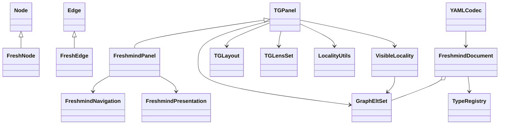

# Freshmind feature design

Design drafted **2026-10-22**, updated **2026-10-24**. This specifies milestones **2.2–2.5** in [TODO.md](TODO.md). Milestones **2.2–2.5 are implemented**: types, navigation, metadata/inline editors, native YAML persistence and approved example conversion. The YAML examples are supported contracts. See [DONE.md](DONE.md) for implementation notes and [KEYMAP.md](KEYMAP.md) for user controls. The [Java reference analysis](fm2014_analysis.md) supplies the feature inventory and development context.

Freshmind 4 provides typed and visually distinct nodes, labeled curved relations, keyboard browsing with preselection, and label/annotation editing. Its native persistence is a versioned YAML graph format. Only the approved `berry` and `nips-fm` Java examples are migrated; the remaining datasets are proprietary.

The Java code captures the intended features of an experimental application developed under time pressure. Use it to recover those features and distinctive interactions. **Keep the TouchGraph design in place and add Freshmind features as clean extensions to it.** Its model, graph/locality structure, panel, layout and lens pipeline remain the foundation. RFC is implemented separately in milestone 3. Milestone 4 now awaits Gregor's supplied literal and semantic search module; the [integration plan](search-module-integration.md) is current, while the [earlier audit](visual-search-design.md) and [prototype guide](graph-search.md) retain the superseded lexical/LDA implementation history.

## 1. Responsibilities and integration



| Responsibility | Proposed implementation boundary |
| --- | --- |
| Graph and physics | Retain `GraphEltSet`, `Locality`, `VisibleLocality`, `LocalityUtils`, `TGLayout` and the existing lenses in their current roles. Freshmind metadata does not change their force equations. |
| Freshmind data | `FreshNode extends Node` and `FreshEdge extends Edge` add metadata and behavior. A document aggregates the existing complete `GraphEltSet`, type registry and document metadata. Model objects work without a DOM. |
| Panel | `FreshmindPanel extends TGPanel` installs Freshmind factories, presentation and interaction extensions while reusing the panel's graph, locality, layout, lens and lifecycle operations. |
| Commands | Shared editing/navigation operations delegate to the existing panel/model APIs. Editors, mouse, keyboard and search adapters invoke these operations. |
| Presentation | `FreshmindPresentation` supplies types, multiline labels and curved/labeled geometry through narrow panel rendering hooks. The panel retains SVG mounting, updates, dragging and lifecycle management. |
| Navigation | Extend the existing node selection with edge selection and temporary candidates. Use the panel's visible membership, selection/focus operations and draw coordinates. |
| Persistence | Parse YAML to transfer records, validate references and construct Freshmind subclasses inside the existing graph structure. Export the complete graph, independently of the current neighborhood. |
| Legacy migration | Standalone batch converter producing native YAML plus a conversion report. It can use Python or another suitable language. |

### Extension rules

Keep adjacency, identity, coordinates, visible membership, selection and lifecycle state in their existing TouchGraph owners. Freshmind subclasses and helpers add the state needed for their features. `FreshmindDocument` is an aggregate around the existing graph; YAML records are transfer objects. Avoid duplicating the live graph or synchronizing a second node-selection model.

Add base-class extension points only where a concrete Freshmind feature requires them:

- **Creation hooks:** protected node/edge factories used by panel creation overloads and edit gestures. Their defaults construct ordinary `Node` and `Edge`; Freshmind overrides construct the subclasses. Loading may supply those same subclasses through the existing graph APIs.
- **Presentation hooks:** protected methods or small strategies for node presentation and edge geometry/drawing. Default implementations retain current rendering. Freshmind overrides add types, shapes, multiline labels and labeled curves within the existing panel render lifecycle.
- **Interaction hooks:** scoped dispatch methods for graph/item input, plus existing selection and graph notifications. Freshmind handles its shortcuts and edge/preselection behavior through these hooks while delegating dragging, locality and view operations to the existing machinery.

Keep these hooks narrow, default-compatible and reusable. Freshmind YAML parsing, type registries, editors and graph-search adapters belong in the extension layer. Retrieval algorithms, topics and worker/model lifecycle live in the independent `ir` domain; see the [module map](../src/README.md). The existing public APIs and plain-panel defaults continue to work. The headless entry point remains usable without D3, DOM, file-picker APIs or a YAML parser dependency.

New features should first use existing methods and subclassing/composition. Add a hook when that feature needs access the current classes do not expose; there is no prerequisite rewrite of the TouchGraph classes. RFC integrates as an optional layout extension through `TGLayout`, with the ordinary layout retained as the baseline.

## 2.2 Model types, visual types and labeled relations

Implemented under `src/fm/`, extending `src/tg/`. See the [source boundaries](../src/README.md), [canonical type configuration](../config/fm2014.types.yaml), and [implementation record](DONE.md#milestone-22-freshmind-types-and-labeled-curves--2026-10-23). The main `/` browser now integrates Freshmind nodes, labeled curves, curve controls and a basic selection editor. The standalone `/freshmind.html` page exercises the complete palette and live configuration.

### Data contract

Use **string IDs** for semantic types and visual types. Node identity remains independent of its label. Every node and edge has a unique, nonempty ID within its respective collection; labels may repeat. Endpoints reference node IDs. Parallel relations and self-loops are valid model data.

| Record | Fields and meaning |
| --- | --- |
| Node | `id`, `label`, semantic `type` (default `default`), optional `visual`, `annotation`, `url`, `weight` (default `1`), `position`, `fixed` (default `false`), `data` and `extensions`. |
| Relation | `id`, `from`, `to`, semantic `type` (default `default`), independent `label` (default empty), optional `visual`, `weight` (default `10`), `length` (default `40`), `data` and `extensions`. Direction runs from `from` to `to`. |
| Annotation | `{format: text | html, text: string}`. Retain the source content, including legacy HTML. Plain text is the default for new annotations. |
| Visual override | `{type?: string, style?: object}`. `type` selects a named visual definition; `style` overrides its presentation fields for this item. |
| Position | `{x: number, y: number}` in physical layout coordinates. No draw coordinates or velocities are persisted. A fixed node must have an explicit position. |
| Data / extensions | JSON-compatible mappings. `data` holds application metadata; `extensions` holds namespaced additions and migration provenance. |

`FreshNode.getType()` must keep the existing TouchGraph shape contract. Add a separate semantic accessor such as `getSemanticType()` and a visual-type accessor. The Freshmind renderer obtains its resolved shape from the style resolver. This avoids the Java override that conflates semantic category and geometric shape.

Keep node weight, relation weight, retrieval score and physical length distinct. Node weight drives bounded body/label size by default; relation weight controls stroke width. These presentation rules leave ordinary TouchGraph forces unchanged. Optional RFC reads model weights through its separate [stiffness contract](rfc-importance.md). A search result relation stores its query ID, result role, backend and score in explicit data fields, while its human label remains editable. Query node types may declare a query kind; execution is provided by milestone 4's search controller and worker.

For the initial profile, a relation's stroke width is its configured base width times `max(0.5, weight / 10)`, retaining fractional widths rather than Java's integer truncation. Node styles support `importance: {mode: size, minScale: 0.85, maxScale: 1.5}` with inherited type/item/state overrides. Weight 1 retains normal size and zero stays visible; glyphs and measured bodies receive the same bounded scale. Uniform and legacy modes are available, as are optional exact values. The legacy halo uses width factor `sqrt(f)` and height factor `f`, with `f = min(1000, max(weight, 10) / 10)`. Geometry picking uses the measured body, while halos and values remain separate decorations. See the [display mapping and API](rfc-importance.md#node-importance-display).

### YAML type configuration

The first configuration is [fm2014.types.yaml](design/examples/fm2014.types.yaml). It records all **21 canonical Java node type names**, their palette and intended shapes. It also demonstrates `authored` and `cites` as new relation type definitions; the Java application primarily used free-text relation labels.

The configuration has `format: freshmind-types`, `version: 1`, a stable `id`, defaults, `nodeTypes`, `relationTypes`, `nodeVisuals` and `edgeVisuals`:

- Semantic definitions name a visual definition and provide a display label. Optional `queryKind` distinguishes simple, Lucene and LDA queries without encoding behavior in colors.
- Visual definitions describe shape, fill, text, stroke, interaction states and decoration. Edge visuals additionally describe curve mode, arrow placement and relation-label placement.
- A visual can name one parent through `extends`, within the same visual kind. Resolve inheritance recursively, merging mappings by key and replacing arrays/scalars. Reject cycles, missing parents and cross-kind inheritance before applying the configuration.
- Resolve the visual selected by the item, or otherwise by its semantic type, over the configured default. Apply item style overrides, then interaction-state styling. Defaults and inherited styles are resolved before rendering, not on every simulation step.
- Unknown semantic/visual IDs retain their exact strings and produce diagnostics while using default presentation. Invalid definitions fail validation. A failed reload leaves the current document/configuration intact.
- Loading/changing a configuration updates presentation and editor choices. It must not rewrite IDs, labels, semantic types or physical coordinates.

The initial shape vocabulary is rectangle, rounded rectangle, ellipse, circle, right/left parallelogram, horizontal/vertical double trapezoid, convex/concave rectangle, trapezoid and inverted trapezoid. YAML uses the explicit hyphenated names shown in the example. The Java convex/concave drawing paths were unfinished and fell back to rectangles; drawing those named shapes is a completion in this port. Legacy numeric shape and stroke identifiers belong to the converter.

Interaction styling should distinguish ordinary, hover, selected, fixed, preselected and active-candidate states. Active candidates receive a strong outline as well as a color change. Use overlays where states coexist: a selected/fixed node must still show its pin, and keyboard focus must remain visible. Render halos and hidden-edge badges as separate decorations outside the focusable node body, preserving the existing focus-outline fix.

Merge applicable state styles in this order: fixed → hover → selected → preselected → active candidate. Later states override only the fields they specify. Pins, the neighborhood-focus marker and the native keyboard outline are independent decorations, so color precedence cannot erase them.

### Labeled and curved relations

Curved relations are a required Freshmind visual feature in **2.2**, together with their labels. Port the Java renderer's geometry deliberately; a generic curve between transformed endpoints would not reproduce its appearance.

Let `T` be the complete world-to-draw lens pipeline, physical endpoints be `P0=(x0,y0)`, `P1=(x1,y1)`, draw endpoints be `A=T(P0)`, `Z=T(P1)`, and their draw-coordinate midpoint be `M=(A+Z)/2`.

| Curve mode | Quadratic Bézier control point `Q` | Relation to Java |
| --- | --- | --- |
| `spider` | `Q=T(((x0+x1)/2, y0))` | Default `drawCurves` mode. Java first computes `B=(Q+M)/2`, then reconstructs `Q=2B-M`. The source endpoint's physical y coordinate gives the distinctive bend. |
| `lens` | `B=T((P0+P1)/2)`; `Q=2B-M` | Java `drawHyperbolic` mode: the curve passes through the transformed physical midpoint. |
| `straight` | `Q=M` | Straight-edge alternative. |

For a quadratic path, `C(t)=(1-t)^2 A + 2(1-t)t Q + t^2 Z`. Its midpoint is `C(0.5)=(M+Q)/2`. Freshmind's initial visual profile puts the direction arrow there and the horizontal relation label at offset `(2,12)`, matching the Java placement. Orient the arrow using the path tangent. At `t=0.5` that tangent is parallel to `Z-A`, agreeing with the reference's midpoint arrow orientation for ordinary nondegenerate paths. The plain TouchGraph profile retains its endpoint arrows.

One geometry result supplies the SVG path, arrow, label anchor, hit testing, selected-edge highlight and editor anchor. Clip the visible path at node boundaries, retaining midpoint placement from the original curve; handle coincident endpoints without division by zero. Self-loops use explicit loop paths. Offset parallel/reciprocal curves in deterministic edge-ID order, with the first ordinary edge retaining the reference curve. Keep these routing adjustments separate from layout physics.

Use a transparent, wider stroke on the same path for pointer selection; keyboard candidates remain the incident relations toward their remote endpoints. Any programmatic distance picking uses the curve geometry too. Label or halo bounds must not enlarge the node's keyboard outline. Font/layout changes invalidate geometry; pan, rotation, nonlinear lens changes and node movement refresh all anchors together.

Source: Java `tg/Edge.setMiddle`, `getDoubleBisection`, `paintArrow`, and `FreshEdge.paint`. Capture geometry fixtures for both curve modes under neutral, rotated and nonlinear lenses, plus visual examples showing their difference from straight edges.

## 2.3 Navigation, keyboard preselection and selection

Implemented in `src/fm/navigate/`: headless candidate geometry and controller. The graph-scoped DOM adapter lives in `src/fm/browser/navigation.ts`. `FreshmindPanel.getNavigation()` exposes shared commands/settings and state subscriptions; `getNeighborhoodFocus()` records the locality origin separately from the inherited viewing-lens focus. Main-browser controls and keyboard input use the same controller. See the [completion record](DONE.md#milestone-23-freshmind-navigation--2026-10-23).

### State and commands

Extend the existing panel state for:

- **Neighborhood focus:** node around which radius/backlink/degree filtering operates.
- **Navigation anchor:** node from which arrow-key neighbor choices are calculated.
- **Committed selection:** one node or one edge. Selecting an edge keeps its originating node as the navigation anchor; selecting a node replaces the anchor and clears edge selection.
- **Preselection:** a temporary candidate kind, originating anchor, direction, ordered candidate IDs and active candidate. Committed selection stays unchanged until confirmation.
- **DOM focus:** the graph's keyboard input target. Editors and other controls receive their normal input while focused.

The existing panel remains authoritative for node selection and neighborhood focus. Freshmind adds edge selection and preselection; its effective selected item is the edge when one is selected, otherwise the panel's selected node. During edge selection that node serves as the navigation anchor. Commands call the panel's selection methods, and graph/locality notifications clear invalid extension state.

Ordinary selection does not automatically change the neighborhood. `centerSelection` pans to the anchor and, with `moveToCenter` enabled (initial default), makes it the neighborhood focus. With that option disabled, panning retains the existing neighborhood. Radius/backlink/degree-limit changes apply through the same commands as mouse controls. Expand, collapse and hide retain graph data; delete edits the complete graph.

### Directional candidates

Match the Java feature: consider **visible adjacent nodes**, or **visible incident edges** for edge navigation, in the selected screen direction. Exclude hidden memberships, the anchor itself and degenerate coincident directions. Deduplicate node candidates when parallel edges reach the same node; retain distinct edge candidates. Incoming and outgoing visible relations both participate, with direction shown visually.

Use four screen-space sectors centered on the arrow directions, each 90° wide. Assign exact diagonal boundaries consistently to one sector, covering all noncoincident directions; this corrects the Java `<45°` boundary gaps. Choose the candidate closest to the sector axis, then distance, then stable ID. Store the alternatives in clockwise angular order, with the initial active index pointing to that best candidate.

Freeze this ordering when preselection begins so spring motion cannot reshuffle choices. Remove candidates that become hidden/deleted; cancel if the anchor disappears or the neighborhood is replaced. Empty candidate sets leave the committed selection unchanged. With no anchor, the first directional key selects the visible focus node, or the first visible node, as an initial anchor and returns.

| Input / situation | Behavior |
| --- | --- |
| Arrow, no preselection | Navigate among neighboring nodes in that direction. One candidate commits immediately; several start preselection; none leaves selection unchanged. |
| Shift+Arrow, no preselection | Same operation for incident edges. |
| Same directional key during preselection | Confirm the active candidate. Ignore key-repeat events for this confirmation to avoid accidental commits. |
| Clockwise / counterclockwise directional key | Cycle forward/backward through the frozen candidate list, wrapping around. |
| Opposite directional key | Cancel preselection; retain committed selection. |
| Enter or Space during preselection | Confirm the active candidate only. A second action can then center it or open details. |
| Enter without preselection | Run `centerSelection`, following `moveToCenter` as described above. |
| Space without preselection | Toggle details/annotation for the selected item. Expansion remains available through `E` and the UI. This is the Freshmind profile; the plain panel retains its existing Space behavior. |
| Escape | First cancel preselection; otherwise clear an edge selection and restore its anchor node selection, or clear a node selection. |
| `E`, `K`, `H`; `0`–`6`; `B` | Expand, collapse, hide; set neighborhood radius; toggle backlinks. |
| `N` | Toggle `moveToCenter`. |
| Ctrl+Shift+↑ / Ctrl+Shift+↓ (also Ctrl+↑ / Ctrl+↓) | Increase/decrease graph spacing by a factor of 1.2 through the panel limits (0.15–5). |
| Ctrl+Shift+← / Ctrl+Shift+→ | Decrease/increase focus + context strength by five percentage points, clamped to 0–100. |
| Shift+Option/Alt+↑ / Shift+Option/Alt+↓ | Increase/decrease whole-canvas scale by a factor of 1.2, independently of graph spacing. |
| Shift+Option/Alt+← / Shift+Option/Alt+→ | Rotate counterclockwise/clockwise by 5° through the existing rotation lens; labels stay upright. |
| Ctrl+Shift+1 | Reset canvas scale to 100%, retaining the viewport center. |
| Vertical scroll / pinch | Vertical scrolling changes graph spacing; pinch (Ctrl+wheel) scales the canvas around the pointer. Horizontal scrolling changes focus/context. |
| F2 | Edit the selected label. |

Changing between node and edge navigation clears the previous preselection and builds the requested kind from the anchor. Repeated arrow commands within that kind use the relative directions above. Keep the Java default **2,500 ms inactivity timeout**, which cancels candidates; make it configurable and allow disabling it. No automatic confirmation on timeout in the initial profile.

Mouse selection cancels preselection. Clicking a node selects it; clicking the selected node clears selection and anchor. Clicking an edge selects it, retaining an existing incident anchor or choosing its source as anchor; clicking it again restores the anchor node selection. Background click clears selection, anchor and candidates. Changes to view geometry refresh highlights while preserving candidate order.

Double-clicking a node in Freshmind navigation mode selects and centers it through `centerSelection`, following `moveToCenter`. It does not perform the plain panel's expansion gesture. Keyboard and viewing-focus frames reuse the resolved node outline; keyboard frames live outside the focusable group so hidden-link counts do not affect their bounds. Highlight colors belong to YAML; the bundled profile supplies dark labels on bright fills and checks at least 4.5:1 text contrast across state combinations.

Pointer entry/movement over the graph resumes keyboard control without a click when the page body has passive focus. The default target is the visible node closest to the current viewport center, accounting for all lenses and canvas transforms; ties prefer the viewing focus, then stable IDs. `FreshmindPanel.getCenteredNode()` exposes this query without panning, changing locality or moving physical nodes. The node under the pointer is not selected by hovering. Once graph navigation has focus, pointer movement preserves its selected node/edge and candidates. If selection was cleared, the next Enter/arrow can restore the centered target and execute the command in the same key press; Space and label/details editing also regain that target.

Explicit side-pane inputs, buttons, summaries, overlays and other focused controls keep their keyboard focus while the pointer is over the graph. Click or Tab into the graph to leave those controls. Body-targeted keys can recover graph focus with a stationary pointer after DOM/graph replacement; routing remains scoped to the hovered SVG and is removed on disposal. Touch entry does not claim hover focus. Empty graphs have no default node. Other browser shortcuts and text entry remain available elsewhere. Do not bind Tab to candidate cycling: it must reach other controls. Announce candidate position and label through an accessible status region, while node/edge accessible names expose type, label and direction. The candidate set is temporary navigation state, not a persistent multiple selection.

Registered Ctrl view chords work without a selection and permit key repeat, preserving committed selection, locality and frozen candidates while restarting candidate inactivity expiry. Lens values remain owned by the panel; controls read `getHyperbolic()` after view changes rather than storing another strength value. Optional editing/search actions add their documented graph-scoped chords; unsupported chords, including Ctrl+←/→, pass through. The requested Ctrl view mappings replace those in the 2014 Java snapshot, which used Alt+↑/↓ for zoom and Alt+←/→ for fisheye strength.

Browser adaptation: Tab can focus a node/relation without selecting it. Enter on a different DOM-focused item first activates that item, preserving accessible item activation; subsequent Enter centers its anchor. Space continues to act on committed selection. Leaving the SVG cancels temporary candidates. Sidebar connection links can explicitly reveal a hidden neighbor even when pan-only centering is enabled; ordinary selection and Enter retain the neighborhood in that mode.

The new TouchGraph API `centerOn(node, updateFocus = false)` centers a stored node through the existing default lenses without selecting it or changing locality. Narrow protected double-click and tooltip hooks let Freshmind describe and override its interaction profile while plain-panel defaults remain unchanged. Custom lens chains retain ownership of their viewport transforms. Candidate sectors use draw coordinates after the complete lens chain; exact diagonals belong clockwise to the next sector (NE → right, SE → down, SW → left, NW → up). Symmetric axis scores use absolute vector components so floating-point modulo rounding cannot defeat distance/ID tie-breaking. Superseded asynchronous locality operations cannot clear the latest requested neighborhood origin.

## 2.4 Labels, details and editors

Retain multiline node labels, semantic-type styling, relation labels, annotation details, URLs and hidden-link counts. Wrap node text to a configurable width and measure the resulting lines to size the actual shape. Store the original label string; visual line wrapping does not rewrite it.

Node content uses a modeless, resizable popup, restoring the intent of FM2014's hint frame. Space opens it for the selected node, and selection changes update it while open. Escape or Space in the content closes it and restores graph focus; buttons and links retain native keyboard activation. It displays committed plain text or allowlisted HTML and the stored resource URL/path, with internal links delegated to graph navigation. It anchors near the node on opening, clamps to the viewport and stays still during layout motion so text remains readable. Relation details remain in the inspector. The reusable `bindNodeDetails` UI lives under `src/fm/ui/`, with caller-owned editing and navigation callbacks and explicit cleanup.

Provide focused node and relation editors backed by commands. Node editing exposes label, semantic type, visual type/override, URL, weight and annotation. Relation editing exposes label, semantic type, endpoints/direction, visual settings, weight and length. Offer reverse as an explicit operation. Editing labels leaves IDs unchanged and duplicate labels are valid.

On-demand label editing uses a multiline control for nodes and a text control for relation labels, with an absolute weight field and increase/decrease controls. F2 opens this overlay by default. The full item editor also lives in a modeless overlay, opened by **Edit selected item**; Ctrl+Space or Shift+F2 opens it directly at the node annotation. Ctrl/Cmd+Enter commits a multiline edit, Enter commits a single-line relation edit, and Escape cancels label and weight together. Closing the full overlay retains its draft. Clicking away must not silently apply an invalid edit; retain the draft with a clear field error. Pause directional navigation while editing. Apply a valid edit atomically, notify subscribers and restore keyboard focus to the graph.

**View → Label editing → In place** enables a second presentation/input mode,
independent of structural Edit graph mode. Every visible label becomes a stable
HTML text component inside its existing SVG group: textarea for multiline nodes,
input for relations, including empty labels, loops and parallel relations. The
components move with the graph and shared curve-label geometry through lenses,
canvas transforms and label placement. Repaints preserve the focused control,
text selection and IME composition; typing does not drag the graph or pause
layout. Drag nodes using their bodies. F2 focuses the moving label rather than
opening an extra overlay. Full item/details editing still uses its overlay.

Changes preview in the rendered label/body measurements while model text and
weights remain committed values. Blur or Ctrl/Cmd+Enter saves; Enter also saves a
relation, and Escape restores committed text. Numeric suffixes and Ctrl+G/H use
the same nonnegative model-weight rules. `applyLabelEdit()` changes only label
and optional weight, preserving styles, endpoints, IDs and other metadata.
Invalid or externally conflicting drafts remain marked and announced. A failed
mode change retains the current mode for correction. Leaving in-place mode
commits valid pending labels; hiding/deleting an item, replacing the graph or
destroying the panel discards detached drafts. No stale blur callback writes to
the new graph. Commits also update the full overlay's label/weight fields while
retaining its unrelated drafts.

Library hosts configure `new FreshmindPanel(host, {labelEditing: "in-place"})`,
`setLabelEditingMode("in-place")` / `setLabelEditingMode("on-demand")`,
`focusLabelEditor(item)` and
`addLabelEditListener(listener)`. `bindLabelEditingControls()` binds a caller-owned
select/status pair. The library default stays `on-demand`; the preference stays
with the panel across graph loads and is not written into graph YAML. The palette
page offers the same in-place mode. This adds one HTML control per visible label;
it is intended for editing manageable local views, not a claim of virtualized
large-graph editing.

Place inline relation editors using the shared curve label anchor, map that anchor through the canvas transform and reposition on graph/view/resize changes. Node inline editors use the transformed body center. The full overlay retains per-item drafts when selection changes and keeps long annotation editing still while the graph moves. During document replacement its fields are temporarily disabled, then the existing file-control focus restoration can return to the active editor. An empty graph leaves disabled fields and an accessible close button. Display plain annotations as text and render HTML through an inert-template formatting/link allowlist while preserving its original source for export. No source attributes, active elements, styles or resource-loading elements are copied. Supported web/mail links open only on user action; old file paths remain editable data. Internal node links use IDs; imported file paths and URLs remain data until the user opens them. Preserve unavailable legacy targets and report them during conversion.

A changed label can end in a numeric `=weight` command, for example `Topic =3` or `related =0.5`. A space before `=` distinguishes it from ordinary equations; only a trailing numeric command is interpreted. Values are absolute model weights (node default 1, relation default 10), finite and nonnegative; fractions and scientific notation are allowed. The command is removed from the committed label. Programmatic/persisted labels are never parsed, and an unchanged imported label such as `Equation =3` stays literal during a details edit. `parseWeightedLabel()` is a pure `fm4/fm/edit` helper; the application invokes it on editor commit. Other legacy shape/type suffixes retain explicit fields. Ctrl+G/H opens or updates the weight draft in steps of 0.1 for nodes and 1 for relations, clamped at zero; Save applies it and Escape discards it. This deliberately avoids the Java command's immediate mutation.

The command boundary should support a later undo history without coupling editors directly to SVG or graph adjacency. Milestone 4 search adapters validate corpus/source snapshots and apply owned results through shared graph commands. Editors preserve query metadata; query edits during worker execution prevent stale results from attaching.

## 2.5 Native YAML graph format

Use UTF-8 **`.fm.yaml`** files with `format: freshmind` and integer `version: 1`. The root holds optional `title`, type configuration, ordered `nodes` and `edges`, optional `view`, `data` and `extensions`. [feature-demo.fm.yaml](design/examples/feature-demo.fm.yaml) is a complete, small example of the proposed contract.

A graph can either embed the complete type configuration under `types` or refer to a companion configuration with `typesFile`, resolved relative to the document. These are mutually exclusive. With neither present, use the packaged Freshmind profile. A single-file browser export embeds the effective configuration; a companion-file export writes both files. The document loader receives file contents through a caller-supplied resolver, allowing a browser file selection or a filesystem batch tool to use the same codec. Missing required companions produce a diagnostic before replacing the current document.

| Persistence rule | Contract |
| --- | --- |
| Schema/version | Validate `format`, supported version, record field types, numeric bounds, unique IDs and endpoint/view references before construction. A future incompatible version requires an explicit migration. |
| Strings | IDs, labels, URLs and type IDs are strings, including strings that resemble numbers, dates or booleans. The writer quotes ambiguous values and uses block scalars for long/multiline text. |
| YAML subset | JSON-compatible scalar values, sequences and mappings. Reject duplicate mapping keys, custom tags, merge keys and aliases. Use the parser's core schema, not implicit date or language-object constructors. |
| Unknown data | Preserve unknown semantic type IDs and namespaced extension data with warnings. Reject unknown ordinary fields to catch misspellings; future additions live under `extensions` until versioned into the schema. |
| Numbers | Finite coordinates; finite nonnegative weights; positive integer edge length. Reject malformed values instead of coercing them. |
| Graph contents | Save all nodes and relations, including isolated nodes, hidden items, parallel edges and self-loops. Empty labels/annotations remain valid values. |
| View | Optional focus node, radius, backlinks, degree limits, `wholeGraph`, graph zoom/hyperbolic strength/rotation/lens pan, canvas zoom/pan and `moveToCenter`. Physical positions are optional; fixed-node positions are always retained. The old draft horizontal-stretch setting is not part of version 1: the port has no such lens. |
| Transient state | Do not save velocity, damping, hover, selection, preselection, locality animation flags, derived geometry or RFC constraints. |
| Atomicity | Parse and validate into temporary records, then construct/swap the complete document. Saving serializes a consistent snapshot; a failed load leaves the active document intact. |
| Round trips | Preserve document semantics and supported extension data. Whitespace, YAML comments and the exact scalar style are not part of the round-trip contract. Emit stable field and record ordering. |

These are native graph files. Browser support does not require Java XML/text/FMG/OWL/database readers or writers. Additional importers can be separate tools or adapters later.

### Batch migration of the existing examples

The migration input is restricted to **`berry.xml` and `nips-fm.xml`**. Other reference datasets are proprietary and must not be converted, copied into fixtures, offered in the demo or distributed. The batch driver uses an explicit allowlist rather than directory scanning; the Python reader also rejects unapproved filenames. Converted files are in `examples/fm2014/`, with a shared `fm2014.types.yaml`, source hashes and a machine-readable conversion report. The small `docs/design/examples/` files remain hand-authored format examples.

The standalone converter uses Python standard-library XML parsing and a Node driver that validates and writes through the native TypeScript codec. It does not run Java, rebuild indexes, open linked resources or modify inputs. Invocation:

```sh
just convert-fm2014
# Rerun intentionally: just convert-fm2014 --overwrite
just validate-examples
just validate-examples --source-dir ../knowceans/knowceans-freshmind-2014
```

Conversion proceeds as follows:

1. Parse the XML using its declared encoding. Inventory explicit node/relation records and diagnose duplicate IDs before generating output. Do not launch Java or rebuild its indexes.
2. First collect all node records, preserving explicit IDs or using the legacy label-derived ID where absent. Resolve references in a second pass. A destination without a full node record creates a labeled placeholder with that exact ID and an entry in the report. Ambiguous duplicates fail that file for review rather than silently merging distinct nodes.
3. Map labels, hints, URLs, semantic types, weights and shapes into their separate fields. Preserve HTML hint source. Map legacy numeric shape/stroke codes to named visual overrides. Keep all relation records; generate deterministic edge IDs by source relation order and swap endpoints for `direction="backward"`. A legacy relation `<type>` becomes its free-text label; do not infer a semantic relation type from that text automatically.
4. Diagnose numeric node `<type>` values produced by the Java writer's weight defect. By default retain the ambiguous values in migration extensions and report them. The explicit `--recover-type-weights` batch option promotes a numeric value to `weight`, retains a valid semantic type from another element if present, otherwise uses `default`, and records the original elements and recovery. A genuine `<weight>` wins over inferred weight. Conflicting numeric values fail recovery for review.
5. Preserve unsupported/unknown source fields and ordering-sensitive duplicates in namespaced migration extensions. Preserve absolute legacy resource paths verbatim and report unresolved targets; do not assume the referenced files are still available or rewrite them silently.
6. Record input filename/hash, record counts, output graph counts, generated placeholders, mappings, warnings and recoveries. Write outputs to a new destination and require an explicit overwrite option for reruns. Leave source files unchanged; processing continues for other files, with a failing exit status if any file fails.
7. Validate every YAML document against the native schema. Compare full normalized node/relation records and mapped source fields, not just counts. Parse → write → parse must preserve IDs, endpoints, labels, annotations, metadata and extensions. Explicit record counts can differ from final node counts because of placeholders.

The Java-migration part of the demo example selector contains only `berry` and `nips-fm`; public networks and newly authored synthetic examples are listed separately. Berry covers small editing/rendering flows; NIPS opens a bounded neighborhood over its complete graph. Backups, search indexes, external resource corpora and all proprietary datasets are excluded. `just convert-fm2014` and `just validate-examples` provide migration and validation recipes. The optional source audit independently compares every original ID, label, hint, URL, type, endpoint and stroke in these two datasets; ordinary validation requires only the committed YAML.

## Implementation sequence and completion evidence

1. Add `FreshNode` / `FreshEdge` subclasses, type-registry validation and style resolution. Add narrow creation hooks to `TGPanel` where required and validate the two draft YAML examples as the contracts settle.
2. Add `FreshmindPanel` and its presentation extension for named shapes, multiline measurements, labeled quadratic relations and shared hit/editor geometry, retaining the existing panel lifecycle.
3. Extend selection with edge/preselection state and its controller, then integrate mouse/keyboard behavior and editors through commands that delegate to TouchGraph APIs.
4. Implement the YAML codec and browser open/save flow. The batch converter can proceed independently once the schema is fixed; migrate only `berry` and `nips-fm` and wire them into the demo.

Milestone 2 is complete when typed/styled nodes and labeled curves work together, keyboard preselection behaves deterministically, edits retain identity/metadata, and native YAML round trips preserve the complete graph. The existing plain TouchGraph API, defaults and physics must continue to pass their compatibility checks with no Freshmind extensions installed. Verify extension contracts with focused model/geometry tests and browser flows covering ambiguous navigation, edge editing, lens changes and annotations. Re-run the existing TouchGraph physics comparisons when shared model/layout code changes. Use the converted examples to verify import semantics and the distinctive curve appearance; large-graph performance claims require a separate measurement.
