# Reinforcement Focus+Context revisited: local structure, radial constraints and stable interaction

**Gregor Heinrich** · Freshmind 4 · 24 October 2026

**Second draft — implementation study and analytical extensions; not peer reviewed**

## Abstract

Reinforcement Focus+Context (RFC), introduced in 2005, makes selected graph neighborhoods resemble recognizable structural primitives while retaining their connections to the surrounding graph. This draft reviews that proposal and examines its re-implementation in Freshmind 4, a TypeScript port and extension of concepts developed in Java Freshmind between 2002 and 2014. We distinguish increased attraction, direct angular reinforcement, the original longitudinal approximation, and an added spring with an explicit preferred focal radius. Three deterministic synthetic examples and controlled ablations show that angular regularity and radial regularity require separate controls. We derive the discrepancy of the 2005 chord approximation for unequal radii and analyze oscillation using the actual TouchGraph integration equations. A movable six-branch center introduces a radial mode four times stiffer than the corresponding pinned-center mode. Recorded runs illustrate how lowering force rigidity suppresses a persistent large-amplitude oscillation. An initial local damping experiment detects repeated movement reversals and gradually restores motion after a quiet interval. A subsequent general layout controller also handles native TouchGraph oscillations without RFC, with completed-swing tracking for slower motion. A controlled mixed-motion comparison motivates independent node gains so focal oscillation does not throttle steadily moving context. Three further experiments compare multiple depth-two tree foci, additional leaf relations and shared subtrees across 120 matched runs. They expose context costs, clipped-motion outliers and infeasible pinned-root length targets. Companion studies add 780 matched damping/rigidity, importance and cluster comparisons, distinguishing quiet motion, force balance and shape preservation. Subsequent exclusion and hybrid-view studies add 100 and 160 matched runs respectively; the hybrid controls preserve nominated detail and score common retained constraints. These are mechanism tests and local stability calculations; they do not establish perceptual benefit, general convergence or performance on large graphs.

## 1. Reviewing the 2005 proposal

The original [Reinforcement Focus+Context paper](../literature/rfc@3ia05compact.pdf), especially Section 2.2 and Figures 1–3, separates three ways of emphasizing graph content: selecting or aggregating structure, distorting displayed geometry, and reinforcing a recognizable local arrangement. RFC belongs to the third category. Its focal tree remains embedded in a graph whose other relations continue to exert layout forces. A viewing lens can subsequently magnify the region, and structural aggregation can simplify its surroundings.

This distinction remains useful in a modern interactive environment. Canvas zoom changes all displayed objects together; graph spacing changes displayed distances; a fisheye lens changes the spatial allocation of screen area. None of these operations alone regularizes the underlying physical arrangement of a focal neighborhood. RFC does so by modifying the embedding forces.

The paper proposes stronger focal springs and an angular moment between cyclically neighboring branches. Its equation (1) makes the moment proportional to the difference between the current gap and $2\pi/N$. Equation (2) offers a longitudinal neighbor-to-neighbor approximation, using a weighted distance to accommodate horizontally extended labels. It also discusses exclusion of non-focal vertices from an elliptical region, multiple foci, reduced reinforcement for shared branches, and combinations with structural aggregation. Its observations for moderate degree, approximately $2<N<15$, are qualitative. The figures demonstrate the concept but do not supply a controlled numerical comparison, convergence study, force constants or user study.

The initial numerical reconstruction uses one visible, depth-one focal star. Experiments C–E below extend the comparison to two depth-two tree foci, ordinary leaf links and shared subtrees. Companion Experiments F–H (§6.6) evaluate damping versus lower rigidity, nonuniform importance and compact clusters. DAG templates remain outside the numerical comparisons. A subsequent optional exclusion reconstruction and Experiment I (§7.1) address context and non-shared intersection vertices. A subsequent rule-based hybrid view and Experiment J (§7.2) combine reversible leaf aggregation/type filtering with matched RFC and viewing-lens controls. Reproduction of the original figures is outside the agreed implementation scope. The Java implementation was experimental and developed under time pressure; it is useful evidence of intended features, rather than a complete algorithmic specification. This draft therefore separates the original concepts, explicit reconstruction choices, and new extensions.

Force-directed drawing provides the broader setting: Fruchterman and Reingold describe a spring-embedding heuristic seeking regular edge lengths ([1991](https://doi.org/10.1002/spe.4380211102)). The actual TouchGraph equations used here are specified below; they should not be inferred from that general description. Label geometry is a separate issue. Harel and Koren examine the difficulties of treating non-uniform vertices as points and propose shape-aware extensions ([2002](https://www.weizmann.ac.il/math/harel/sites/math.harel/files/users/user56/non_uniform_avi_acm.pdf)). A weighted coordinate metric alone is a weaker provision than explicit shape collision avoidance.

## 2. Reconstructing the forces

Let $v_i=x_i-x_0$ be the displacement from focal center $x_0$ to branch $i$. Define

$$
W=\operatorname{diag}(\lambda_x,\lambda_y),\qquad
D_i=\sqrt{v_i^T Wv_i},\qquad
\theta_i=\operatorname{atan2}(\sqrt{\lambda_y}v_{iy},\sqrt{\lambda_x}v_{ix}).
$$

Weights are positive metric coefficients. The configuration $(0.25,1)$ stretches an ideal equal-radius arrangement horizontally by two relative to its vertical radius. Viewing transforms do not enter these expressions. Node and link importance weights are independent quantities. Experiments A–F use their neutral defaults. A subsequent [implementation extension](../rfc-importance.md) scales added constraint stiffness through bounded importance factors while retaining those default results; companion Experiment G evaluates nonuniform values separately.

### 2.1 Increased attraction is not a preferred length

For unit weights, TouchGraph's ordinary edge force on a branch is

$$
F_{\mathrm{TG}}=-\frac{q}{100\ell}r v,\qquad r=\|v\|,
$$

where $q$ is layout rigidity and $\ell$ is the edge's physical length parameter. Despite its name, $\ell$ is a denominator controlling attraction, not a Hookean rest length. The vector force grows quadratically in radius. Increasing its multiplier therefore pulls more strongly toward zero radius; it does not hold a selected nonzero radius more firmly. For an isolated pair with repulsion magnitude $qQ/r$, equilibrium gives $r^3=100\ell Q/m$: the common rigidity factor cancels. Increasing attraction multiplier $m$ therefore changes radius proportionally to $m^{-1/3}$. This pair calculation illustrates shrinkage, rather than predicting the equilibrium of a complete star.

The earlier Freshmind 4 preset adds

$$
F_{\mathrm{extra}}=-\frac{(m-1)q}{100\ell}D Wv.
$$

This is the negative gradient of $(m-1)qD^3/(300\ell)$. With unit weights the representative focal edge has total attraction multiplier $m$. Ordinary semantic edges keep their original forces, including parallel relations.

### 2.2 Direct angular reinforcement

Sort branches cyclically by weighted angle. Let $g_i$ be their successive gaps, including the wraparound gap, and let $t=2\pi/N$. Away from a small central soft core, use

$$
E_\theta=\frac{a q}{2}\sum_i(g_i-t)^2.
$$

The resulting pair moments have magnitude $a q(g_i-t)$, following the 2005 equation (1). Conversion of a moment $M$ to physical force uses the derivative of the weighted angle:

$$
F_\theta=M\sqrt{\lambda_x\lambda_y}
\frac{(-v_y,v_x)}{\max(1,D^2)}.
$$

The determinant factor is required; applying an unweighted tangent to a weighted angle would implement a different force. Each branch contribution has an opposite reaction on the center, before TouchGraph's established/newly-visible mobility weighting. Fixed or dragged nodes retain their positions through the existing integrator. Branch order is recomputed each step; tie breaking uses stable node IDs. A regular star can have unequal radii and still have zero angular force.

### 2.3 Extension: an explicit focal length

To make the tree primitive more prominent, introduce a separate preferred weighted radius $L$, radial stiffness $k$, and soft radius $\rho=\sqrt{D^2+\varepsilon^2}$, with $\varepsilon=1$ layout unit:

$$
E_r=\frac{kq}{2}(\rho-L)^2,\qquad
F_r=-kq\frac{\rho-L}{\rho}Wv.
$$

Unlike increased attraction, this spring pushes a compressed branch outward and pulls an extended branch inward. The isolated zero-force metric radius is $\sqrt{L^2-1}$, about $119.996$ for $L=120$. Context, repulsion and other edges shift the final balance. Exactly coincident points have zero gradient; the original randomized repulsion separates them.

The default **Tree structure** preset uses $m=1$, $k=1$, $L=120$, $a=10000$. **Attraction only** retains the previous $m=3$, $k=0$, $a=300$; its name distinguishes the radial mechanism, and it still includes angular reinforcement. Strong-angle and length-only ablations below separate these effects. These parameter values are tuning choices, not recovered constants from 2005.

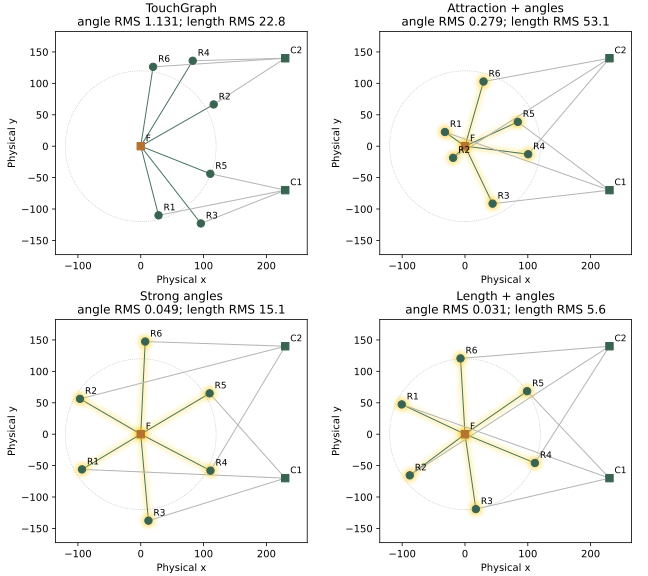

*Figure 1. Recorded layouts of the same crowded star after 250 batches. F is the fixed focus, R1–R6 its branches, and C1–C2 fixed context anchors. All panels share physical axes; the dotted circle has radius 120. Yellow shading denotes reinforced membership, independently of selection.*

### 2.4 Reviewing the longitudinal approximation

In the weighted plane, the 2005 equation (2) uses target neighbor distance

$$
c_{05}=(r_i+r_j)\sin(\pi/N).
$$

The exact chord at desired angle $2\pi/N$ is

$$
c_*^2=(r_i-r_j)^2+4r_i r_j\sin^2(\pi/N).
$$

Subtracting the squared expressions yields the analytical extension

$$
c_*^2-c_{05}^2=(r_i-r_j)^2\cos^2(\pi/N)\geq0.
$$

Thus the approximation is exact for equal radii, and for $N=2$, but otherwise requests a shorter chord than equal angles require. For $N=6$, $r_i/r_j=4$, and $r_j=1$, the original target is $2.5$, below the geometrically feasible minimum chord $|r_i-r_j|=3$; the equal-angle chord is $\sqrt{13}\approx3.606$. Fixed radii cannot satisfy that target. Movable radii can respond by deforming the star. This derivation identifies a limitation, without asserting that every use of the approximation fails. An explicit length constraint makes equal-radius assumptions more plausible. Freshmind 4 currently uses direct angular moments, rather than implementing equation (2).

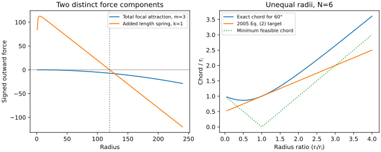

*Figure 2. Left: total focal attraction for m=3, physical edge parameter 60 and rigidity 1, compared with the added length spring k=1, L=120. These are individual force components; repulsion and other graph forces are omitted. Right: exact and approximate chords for N=6, including the feasibility lower bound.*

## 3. Controlled implementation experiments

Three synthetic graphs each contain nine nodes, twelve semantic relations, six focal branches, and two competing context anchors. The crowded-star example has mildly unequal initial radii; unequal-radii also varies physical focal edge parameters from 20 to 120. Wide-labels stretches the initial geometry and context horizontally, uses long labels, and sets coordinate weights to $(0.25,1)$. Physics still treats vertices as points: the long text itself adds no collision force.

Each method starts from identical coordinates within its fixture. The seeded random source is `0x1234abcd`; it is used only for coincident-node separation. Each run executes 250 batches of ten TouchGraph integration steps. Main comparisons fix the center and context anchors; separate runs release the center. Baseline forces use unweighted physical coordinates, while reported RFC gap and length errors use each fixture's stated metric. The baseline's metric is only a measurement convention. These three configurations are examples, not independent statistical replications.

Angular error is RMS deviation of cyclic weighted gaps from $2\pi/6$. Length error is RMS deviation of weighted focal radius from 120. Coordinates, traces, semantic endpoints and settings are retained in [the experiment records](../experiments/rfc-single-focus/results.json). The controlled ablations keep $m=1$: strong angles use $(k,a)=(0,10000)$; length only uses $(1,0)$; the combined tree uses $(1,10000)$.

| Fixture | Earlier attraction + angles: angle / length RMS | Strong angles: angle / length RMS | Length + angles: angle / length RMS |
| --- | ---: | ---: | ---: |
| Crowded star | 0.2793 / 53.07 | 0.0488 / 15.08 | 0.0309 / 5.56 |
| Unequal radii | 0.2903 / 54.31 | 0.0324 / 59.25 | 0.0310 / 6.97 |
| Wide labels | 1.3571 / 12.13 | 0.1777 / 70.89 | 0.1973 / 27.68 |

Angles are in radians; lengths are weighted layout units. The combined method has much lower angular error than the earlier preset in all three examples. The ablation prevents attributing this change entirely to radial stiffness: stronger angular reinforcement alone already explains much of it. Adding the length spring mainly controls radial irregularity, particularly in unequal-radii. Length-only reinforcement keeps radii close to target but leaves angular errors of approximately 1.17, 1.17 and 1.54 radians. Both controls matter.

The wide-label result preserves a tradeoff. The earlier layout's low length error accompanies tightly bunched branches. Spreading them around the center increases competition with fixed context anchors, so its combined length error increases relative to that earlier preset, while remaining lower than the strong-angle ablation. Smaller error in one metric is not a complete quality ranking.

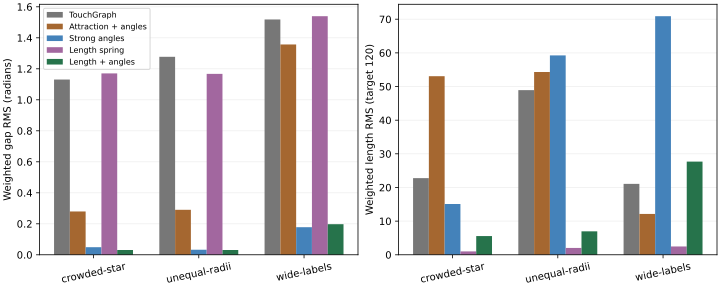

*Figure 3. Five-method ablation on the three fixtures. Separate panels avoid combining quantities with different units. Length regularity alone does not produce evenly spaced branches.*

A 48-run sweep crosses radial stiffness $0.25,0.5,1,2$ with angular stiffness $300,3000,10000,30000$. At angular stiffness 10000, increasing radial stiffness lowers length error in all three pinned-center examples. This does not justify choosing the stiffest setting: releasing the focal center changes both the available geometry and the numerical modes.

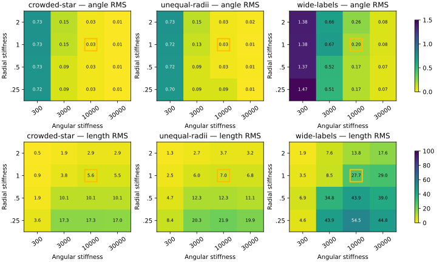

*Figure 4. Pinned-center stiffness sweep; the yellow square marks the default. Color scales are shared within each metric, with distinct scales for angle and length. These are final errors at a fixed computation budget, not convergence guarantees.*

## 4. Oscillations and damping

### 4.1 The actual discrete update

Oscillation depends on the solver as well as the force model. TouchGraph retains half the last damped displacement as momentum, adds new forces, multiplies by an adaptive damper, and caps each coordinate's displacement to 30. Its stored quantity is not a velocity with an explicit physical timestep.

Consider a smooth scalar mode near equilibrium, with error $e_t$, force $-\kappa e_t$, retained momentum $p_t$, constant damper $0<d\leq1$, no cap, and an unfixed coordinate. One actual integration step becomes

$$
\begin{pmatrix}e_{t+1}\\p_{t+1}\end{pmatrix}=
\begin{pmatrix}1-d\kappa&d\\-d\kappa/2&d/2\end{pmatrix}
\begin{pmatrix}e_t\\p_t\end{pmatrix}.
$$

The determinant is $d/2$ and the trace is $1+d/2-d\kappa$. Requiring both eigenvalues to lie inside the unit circle gives

$$
0<d\kappa<2+d.
$$

This is a local stability condition for a positive-curvature mode, not a proof for the nonlinear graph. At full damper, stability requires $\kappa<3$. Complex roots occur when $(1+d/2-d\kappa)^2<2d$; their modulus is $\sqrt{d/2}$. At $d=1$, the oscillatory interval is approximately $0.0858<\kappa<2.9142$. Oscillation is therefore compatible with decay. The problematic case is a root whose magnitude exceeds one, producing growth or, after clipping, a persistent bounded cycle.

### 4.2 Why a movable center changes the result

For an ideal regular star with unit metric and no other forces, ignore the negligible one-unit soft core. With a pinned center, the radial spring's branch curvature is $kq$. With a freely moving center, form the matrix of radial edge derivatives $B$, with one row per branch. For six equally spaced unit directions collected in $U$, $BB^T=I+UU^T$, and $U^TU=3I$. The nonzero radial Hessian eigenvalues are therefore $kq$ four times and $4kq$ twice. Translation and other unconstrained modes remain zero. Releasing the center introduces coupled modes with four times the curvature.

At $k=2$, $q=1$, a curvature estimate of 8 exceeds the full-damper bound of 3. The scalar condition requires $d<2/7\approx0.286$. At $k=1$, the corresponding estimate is 4 and requires $d<2/3$. These estimates omit ordinary attraction, repulsion, angular coupling and unequal geometry, but explain why pinned-center tuning can hide a numerical problem. For angular reinforcement alone on a pinned regular equal-radius star, nonzero tangent-mode curvatures are

$$
\kappa_j=\frac{4aq}{L^2}\sin^2(\pi j/N).
$$

At $N=6$, $L=120$, $a=10000$, the largest is about 2.778; raising $a$ to 30000 yields about 8.333. Shorter radii increase this stiffness quadratically. Anisotropic metric coefficients and center coupling change the spectrum further.

### 4.3 Recorded oscillation and a conservative remedy

The movable-center crowded-star runs retain the original adaptive damping and all ordinary forces. Only radial stiffness and, in one case, overall rigidity change:

| Radial k | Rigidity q | Final angle RMS | Final length RMS | Maximum net displacement in final batch | Final damper |
| ---: | ---: | ---: | ---: | ---: | ---: |
| 1 | 1 | 0.00745 | 1.307 | 0.5921 | 0.2605 |
| 2 | 1 | 0.22670 | 33.576 | 29.3014 | 0.9149 |
| 2 | 0.25 | 0.01475 | 0.837 | 0.0229 | 0.7786 |

The stiff run retains large movement. Lowering rigidity to 0.25 reduces the isolated radial curvature estimate from 8 to 2, inside the full-damper bound, and substantially reduces observed movement. `setRigidity()` applies after the first ten-step batch, so the low-rigidity run shares the initial full-rigidity batch. This is a recorded experiment, not a new default damping algorithm or an RFC control exposed in the UI. The existing default instead uses moderate radial stiffness 1.

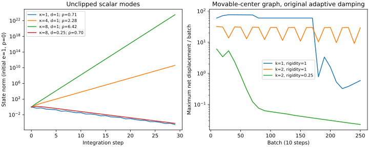

*Figure 5. Left: exact scalar recurrence without clipping or adaptive damping, illustrating stable oscillation, instability and stabilization by a smaller damper. Right: measured net movement per sampled batch in the full movable-center graph. Lower rigidity reduces the stiff run's motion. The two panels use different measures and are not fitted to each other.*

### 4.4 Practical damping choices

First, choose length, angular stiffness and force scale separately. Increasing all strengths can make a pattern visually convincing while undermining integration. Reducing global rigidity scales ordinary and RFC forces together, preserving their relative strength and, outside regularization/discrete effects, their equilibrium. Reducing only radial stiffness changes the competing equilibrium. A smaller damper reduces both force response and retained momentum. It can stabilize a stiff mode, but may freeze an inaccurate intermediate layout if driven to zero prematurely.

Second, distinguish force residual, actual displacement, clipping frequency and kinetic-like state. TouchGraph's `maxMotion` includes uncapped accumulated displacement even for pinned nodes. It is therefore not the maximum actual movement of movable vertices. Its adaptive rule only decreases the damper under certain motion-ratio conditions; persistent alternating motion can keep it high. The experiment reports actual net position changes across ten-step batches, which can still alias rapid oscillations. Future diagnostics should sample every integration step, track velocity sign changes and count clipped updates.

Third, stiffness-aware scaling could estimate a local Hessian bound $\Lambda$ and choose force scale $s$ with a safety margin under $ds\Lambda<2+d$. A row-sum bound or a small focal-block eigensolve could be practical, but it must include context coupling and weighted geometry. A changing branch order, a repulsion cutoff and newly-local mobility weights limit the applicability of smooth Hessian analysis. This proposal is not yet implemented or validated.

Finally, an optional solver with explicit timestep and consistent velocity damping could subdivide stiff steps or use an implicit treatment of the length constraints. Merely repeating the current loop or dividing forces without rescaling momentum is not equivalent to integrating smaller physical timesteps. Likewise, reducing the retained-momentum fraction is not by itself a stability guarantee: for retention $\beta$, the same derivation gives $d\kappa<2+2\beta d$. Solver experiments should live behind an extension, preserving the faithful TouchGraph baseline.

### 4.5 Weighted geometry

Coordinate weights also affect physical geometry and the curvatures encountered by the integrator. Equal angles in weighted coordinates produce an ellipse in physical coordinates. Figure 6 illustrates the ideal geometry, rather than a simulated equilibrium; it does not establish stability or label separation.

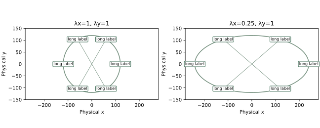

*Figure 6. Ideal weighted stars with L=120. The second metric doubles horizontal radius while retaining equal angles in transformed coordinates. This analytical drawing is not an experimental layout or a guarantee against overlapping labels.*

## 5. Experiment B: adaptive damping and annealed recovery

This section retains the original v1 detector and recorded results. Its reference implementation is frozen in `tests/fixtures/rfc-stabilization-v1.mjs` for reproducibility. A subsequent [detector-robustness comparison](../experiments/rfc-stability/README.md) addresses masked individual oscillations and circulation, adds stronger response and recovery rollback, and reports small/multiple-center cases separately. Those results are not substituted into Figure 7 or the table below.

### 5.1 Original local detector

The force and rigidity comparisons above explicitly disable adaptive RFC damping. This second experiment retains the chosen force model and adds a local controller that responds to observed movement. It was opt-in in the original browser and remains opt-in through the RFC-local library API. The current browser instead enables general damping independently of RFC, as evaluated separately in §5.4; the historical results below are retained.

At each force callback, the detector compares the current positions with those observed at the preceding integration step. Fixed vertices are excluded. A reversal requires displacement vectors separated by more than 120°, both longer than 0.5 physical layout units, with current magnitude at least 80% of the previous magnitude. A step votes for oscillation when such reversals account for more than half the movable focal members' displacement energy. Three votes within eight steps trigger damping. These heuristic thresholds reject steady translation, negligible jitter and rapidly decaying reversals in regression tests; they are not a spectral classifier and can miss slower or smaller oscillations.

Each detection halves local gain $g$, down to $1/256$. After RFC forces have been accumulated, this gain multiplies the movable focal members' accumulated impulses, including retained momentum and previously accumulated ordinary forces. Thus configured angular/radial constants remain unchanged. Scaling only added RFC forces would instead change their competition with the rest of the graph. In an isolated focal mode the effective damper becomes $d'=dg$, giving the local condition $0<dg\kappa<2+dg$. The complete graph includes undamped context modes and nonlinear coupling, so this remains an explanation rather than a guarantee.

### 5.2 Quiet-time recovery

Recovery requires every sampled movable focal member to move at most 0.1 layout units per step for 500 ms of observed integration. It then follows a three-second cubic easing:

$$
g(t)=g_0+(1-g_0)(3u^2-2u^3),\qquad u=\min\left(1,\frac{t}{3000\,\mathrm{ms}}\right).
$$

The gain has zero slope at both ends of an uninterrupted recovery. Larger movement interrupts recovery and requires another quiet interval; new oscillation halves the current gain again. Dragging a focal member bypasses damping and discards detector history. Each sample contributes at most 50 ms to the recovery clock. A gap longer than 250 ms discards quiet/recovery history while preserving the current gain, so pausing cannot complete an anneal. An optional extension-activity hook keeps the existing runner sampling until recovery finishes, even if global cooling would otherwise make it sleep; it never restarts an explicitly stopped layout. No separate timers run. Focus changes/removal and suspension clear learned damping; configuration/topology changes start a fresh observation window. The detector is physical-coordinate based and independent of zoom or the viewing lens.

### 5.3 Recorded protocol and results

For reproducibility, each off/on pair uses the same initial graph, movable center, fixed context anchors, radial stiffness 2, angular stiffness 10000 and global rigidity 1. Runs last 400 ten-step batches. An injected monotonic clock advances two milliseconds per integration step, corresponding to eight simulated seconds. This convention models the normal 20 ms batch cadence without requiring wall-clock delays; it is not a performance measurement. Browser recovery uses actual monotonic time observed during integration. Records are in [adaptive-damping.json](../experiments/rfc-single-focus/adaptive-damping.json).

| Fixture | Damping | Tail motion RMS | Final angular RMS | Final length RMS | Detections | Final local gain |
| --- | --- | ---: | ---: | ---: | ---: | ---: |
| Crowded star | off | 6.69492 | 0.01463 | 0.833 | 0 | 1.000 |
| Crowded star | on | 0.00591 | 0.01476 | 0.836 | 5 | 0.713 |
| Unequal radii | off | 0.92606 | 0.00610 | 1.623 | 0 | 1.000 |
| Unequal radii | on | 0.29569 | 0.00847 | 1.548 | 4 | 1.000 |
| Wide labels | off | 0.15915 | 0.02786 | 5.656 | 0 | 1.000 |
| Wide labels | on | 0.00000 | 0.02089 | 6.405 | 4 | 0.978 |

Tail motion is RMS of the ten sampled net batch displacements at batches 310–400; it is not the last batch alone. The detector samples each integration step, while the report retains its last observed per-step maximum at each recorded point. Off runs can also cool eventually under the inherited global damper. The on runs reduce tail movement in all three fixtures; the unequal-radii case gains less than the crowded star. Angular and length errors do not improve uniformly. At the cutoff, crowded-star and wide-labels are still recovering their local gain; only unequal-radii has fully restored it. The inherited global damper can already have frozen positions during that recovery.

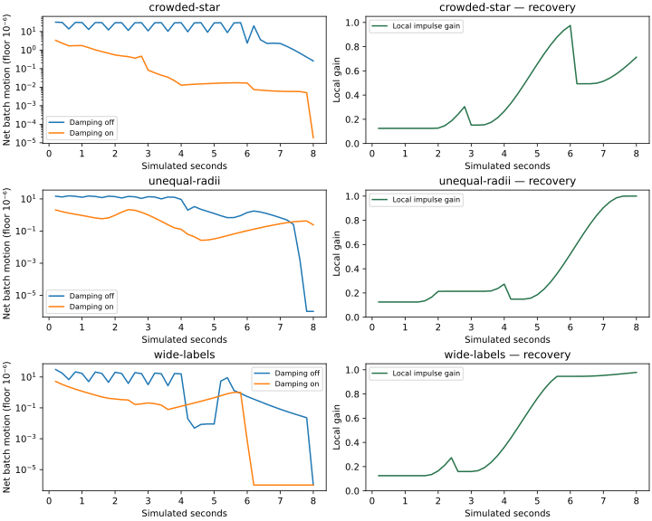

*Figure 7. Separate damping experiment. Left: net sampled batch movement, floored at 10⁻⁶ for the logarithmic display. Right: local impulse gain with detection backoffs and gradual recovery. Identical force settings are used within each off/on pair; all centers are movable.*

This experiment supports adaptive suppression of visible oscillation on these fixtures, not general convergence. A positive gain preserves the underlying zero-force equations in the local idealization, but changes the trajectory and can select a different local arrangement. The finite gain floor, movement thresholds, context coupling, observation cadence and inherited cooling remain limitations. Future comparisons should include per-step spectra, clipping counts, alternative recovery durations and larger/multiple focal structures. Hessian-based stiffness control remains a separate, unimplemented alternative.

### 5.4 General layout damping and Experiment K

Oscillation is not specific to reinforcement. Native attraction, repulsion and retained momentum can also produce persistent alternating motion. A controller gated on active RFC cannot respond to that case. At the Experiment K checkpoint, the browser enabled adaptive damping as a general layout setting, independently of RFC. Its owner is `TGLayout`: after all force callbacks and before integration, that version observed every movable visible vertex and scaled the accumulated impulses by a common positive gain. The current independent-gain correction is evaluated separately in §5.5. Fixed and dragged vertices are excluded. The optional RFC-local API retains its earlier sampling behavior and numerical records; the browser leaves that separate controller disabled to avoid double attenuation. Library defaults continue to reproduce the original TouchGraph update unless general damping is explicitly enabled.

The general controller retains v2's per-member fast reversal votes and circulation windows, avoiding the original union-energy vote that could mask one unstable member. It adds completed-swing tracking for slower motion. For each coordinate axis, a return greater than 0.2 physical units confirms a turning point. Four alternating extrema define three excursions. Each of the last two axis amplitudes must retain at least 80% of its predecessor, and net Euclidean displacement between the first and last extrema must be below 35% of the three-leg Euclidean path. Only four points per axis are retained, so slowly sampled cycles need not fit into a fixed step window. This detects persistent inefficient motion rather than estimating an eigenfrequency. Small prominence, drift, irregular trajectories and rapidly changing membership remain limitations.

[Experiment K](../experiments/layout-damping/README.md) separates the added cycle test from general application of the earlier detector. Its prescribed probes impose amplitude-0.5 oscillations of periods 80 and 320 integration steps, and a radius-0.5 orbit of period 320. Individual movements remain below the earlier 0.1 threshold. Frozen v2 detection misses all three throughout four cycles. The current general detector confirms the slow swings after 2.15 cycles and the orbit after 1.90 cycles. Translation, amplitude-0.05 jitter and a signal decaying by a factor 0.6 per half-cycle trigger neither detector. Since these positions are imposed, the probes establish detection latency in cycles, not closed-loop settling time.

Sixteen further runs cross four small graphs with extra damping off, v2 detection applied generally, historical v3 general impulse damping, and detection-triggered earlier TG cooling. Each uses 4000 integrations, ordinary TG cooling and an injected two-millisecond clock; starts, edges, rigidity and any RFC parameters are identical within a graph. The native stress star uses a movable root and six links with TG length parameter 1, deliberately making native attraction strong; an ordinary control uses parameter 40 and a further stress control pins the root. The RFC case reuses the crowded-star fixture with movable center and radial stiffness 2. No force coefficient is weakened to obtain the damping result.

| Case | Extra damping | Large actual steps | First detection (s) | Last movement >0.1 (s) | First full gain recovery (s) |
| --- | --- | ---: | ---: | ---: | ---: |
| Native stiff star, RFC off | off | 2050 | — | 4.138 | — |
| Native stiff star, RFC off | v3 general | 6 | 0.014 | 0.300 | 3.802 |
| Native stiff star, RFC off | earlier TG cooling | 20 | 0.014 | 0.102 | — |
| Stiff RFC, movable center | off | 3092 | — | 7.416 | — |
| Stiff RFC, movable center | v3 general | 5 | 0.012 | 1.774 | 5.276 |
| Stiff RFC, movable center | earlier TG cooling | 148 | 0.012 | 1.460 | — |

A large step means any movable vertex travels more than 29.9 physical units. Every integration is observed; plotted batch maxima do not cancel alternating steps. The v2-general and v3-general trajectories coincide on these fast-instability cases, so this improvement comes from general observation rather than the new slow-cycle test. Neither detector triggers on the ordinary native star or pinned stress control, and those trajectories match the extra-damping-off runs exactly. All times in this table are virtual cadence measurements, not measured browser latency; the last-movement statistic is limited to the fixed eight-second horizon.

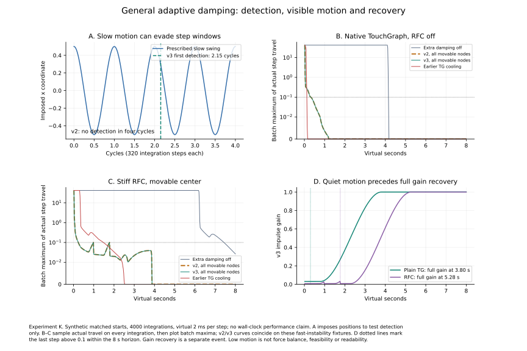

*Figure 12. General layout damping. A: a prescribed slow swing and its first v3 detection; v2 remains inactive. B–C: actual per-step movement, summarized by batch maxima, with native TG or stiff RFC forces. V2/v3 impulse curves coincide in these fast cases; the red curve uses earlier inherited cooling. D: general impulse gain; dotted lines mark the last movement above 0.1 in each impulse-damped run. Quiet motion precedes full gain recovery. The experiment report supplies the full protocol, controls and all sixteen runs.*

The conservative alternative addresses a delay already present in TouchGraph. For persistent large motion, its existing cooling rule decreases $d$ by only 0.0001 on steps whose motion ratio is at most 0.001, until $d<0.9$; it then decreases by 0.01. Thus cooling is active during the apparent delay, but can take seconds to reach its faster phase. Confirmed oscillation can instead cap $d$ at 0.89, leaving the rest of that rule intact. This response introduces no extra impulse multiplier, respects explicitly disabled inherited cooling and performs no annealed reheating. In the native/RFC stress cases, the faster phase starts at 0.014/0.012 s instead of 4.000/5.894 s. The browser exposes both responses; adaptive impulses remain its default.

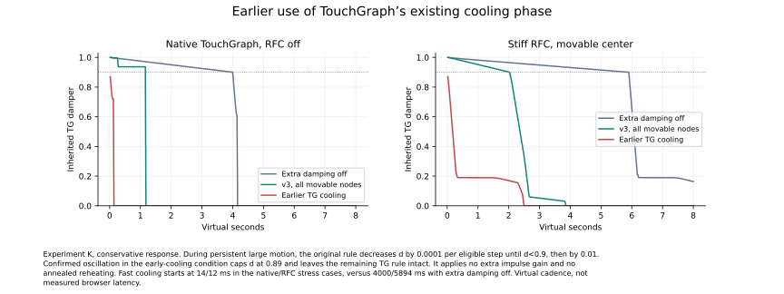

*Figure 13. The inherited TG damper under extra damping off, adaptive impulse suppression and earlier inherited cooling. The latter moves directly into the existing fast cooling phase after confirmed oscillation. The 0.9 threshold is shown dotted. These are virtual-cadence trajectories with matched forces and starting coordinates.*

Earlier cooling permits more large transient steps than impulse suppression, despite reaching the last substantial movement sooner on these starts. A raw-force diagnostic at the final coordinates further distinguishes quietness from balance. It disables extra attenuation, clears momentum and uses a zero global damper to prevent movement during the force evaluation:

| Case | Extra damping off: force RMS | General impulses: force RMS | Earlier TG cooling: force RMS |
| --- | ---: | ---: | ---: |
| Native stiff star | 0.000141 | 0.00813 | 0.000465 |
| Stiff RFC | 0.130 | 2.30 | 0.0678 |

The conservative response has less final imbalance than impulse suppression on both stress starts, but the native off control has a smaller residual still. These measurements do not establish a universally preferable response; transient motion, time to quietness and remaining force error are separate objectives.

Damping onset, suppression and recovery must be distinguished. These runs become quiet well before gain is fully restored. The 500 ms quiet gate and three-second easing regulate reintroduction of normal movement; shortening them would not solve a missed detection and can re-excite motion. For a constant common gain, the smooth-mode calculation in §4.1 substitutes $d'=dg$, giving $0<dg\kappa<2+dg$. The positive multiplier preserves the idealized zero-force equations, but adaptive gain, caps, thresholds and inherited cooling do not establish convergence or small residual force. One unstable component also slows the entire visible movable graph. These small synthetic stress cases support the new ownership and detection behavior, not a universal latency bound, force-balance guarantee, improved geometric accuracy or perceptual benefit. Earlier Experiments A–J remain separate rather than being silently rerun under the new browser default.

### 5.5 Independent node gains and context progress (Experiment L)

A shared adaptive gain can suppress useful motion along with an unstable mode. In particular, an oscillating focal vertex can drive that gain toward its floor while a non-focal vertex is still moving outward under region exclusion. The non-focal vertex need not have oscillated at all. Recovery gated on the maximum motion of the whole graph can also let one component block another's recovery. Low movement in this situation is a stalled response, not evidence that the focal area has cleared.

The current default instead retains a detector, gain and recovery state for each movable visible vertex. Every integration samples one common clock, after all registered forces. A vertex with no confirmed cycle retains unit extra gain while another vertex is attenuated. Quiet-time recovery is likewise independent; removing, hiding, fixing or dragging a vertex releases its local history. Reported minimum gain is a diagnostic, not a common multiplier. The original shared mode remains explicitly selectable for historical replay, and Experiment K's records/figures are unchanged. Earlier inherited cooling remains a global response.

[Experiment L](../experiments/damping-context/README.md) crosses two controlled fixtures, inherited cooling off/on, and extra damping off/shared/independent, giving twelve matched runs of 1000 integrations. A focal branch has a prescribed persistent swing and requests a four-unit response. This isolates response cross-talk rather than relying on a chosen unstable solver trajectory. Context begins at (20,0). In one fixture it receives unit x impulses; in the other the actual RFC exclusion callback acts against a known radius-120 region with fixed root/outer branch and exclusion strength 0.01. Pair repulsion is zero in these fixtures. Starts, force settings and the imposed input match across modes; times use a virtual 2 ms cadence.

| Controlled case | Shared-gain context x | Independent-gain context x | Independent late oscillator response |
| --- | ---: | ---: | ---: |
| Unit drift, inherited cooling off | 27.000009 | 1020.000000 | 4.00 × 10⁻⁸ |
| RFC exclusion, inherited cooling on | 25.513432 | 119.999998 | 3.64 × 10⁻⁸ |

The shared controller leaves the RFC context vertex about 94.49 units inside the region. With independent gains it approaches the boundary within 0.001 units under both inherited-cooling settings, while the imposed oscillator's late applied response remains small. The corresponding rendered-browser regression independently checks label rectangles: context overlaps the focal label under the shared gain and clears it under the default independent gains. Native stiff-star suppression, independent recovery and fixed/dragged/replacement behavior have separate regression checks.

This is a mechanism correction with deliberately controlled inputs. Different per-vertex gains change coupled trajectories; the scalar common-gain substitution in §5.4 is not a general stability proof for this update. A vertex that itself oscillates can still be attenuated, inherited cooling can leave residual forces, and pinned/conflicting constraints may remain infeasible. Region exclusion is a soft center-based force; these results do not establish collision-free labels, arbitrary-graph convergence, user benefit or real-time latency bounds.

## 6. Experiments C–E: multiple tree foci

### 6.1 Matched protocol and observables

We now examine stored trees with descendants, retaining the same force laws and integration scheme. Each tree has one root, two intermediate vertices and four leaves. Angular constraints apply at every tree vertex of degree at least two, including the parent relation at intermediate vertices. All selected tree edges receive the length spring. An ordinary semantic relation outside a definition continues to exert its original embedding force, without becoming a reinforcement constraint.

Three topology families are crossed with four activation conditions (neither tree, left only, right only, both), two root conditions (movable or pinned), and five starting layouts: **120 runs of 250 ten-step batches**. Each starting layout perturbs nominal coordinates independently by uniform offsets in $[-40,40)$ using a recorded seeded LCG. Conditions share the same initial positions; pinning changes only the roots' fixed flags. All runs use unit coordinate weights, target length 120, radial stiffness 1, angular stiffness 10000 and attraction multiplier 1. Experimental adaptive RFC damping is **off**; the inherited TouchGraph damper remains active. These runs test the existing multiple-center mechanism rather than a new solver or tuned parameter search.

We score both stored trees in every condition, even when one or both are inactive. Tree angle RMS includes every cyclic gap at every degree-two-or-higher vertex, weighted by the number of gaps. Tree length RMS measures endpoint-distance errors against 120 on its six selected edges. The union metrics deduplicate shared edges and use the combined local neighborhoods, giving a fixed comparison observable across activation conditions. They need separate interpretation where trees overlap. Tail motion is measured across the **last 100 individual integration steps**, over movable vertices, rather than across net ten-step batches. A passive observer reads positions before integration and at each batch end; no force or integration hook is changed. Full coordinates, per-tree measurements, min/max summaries, traces and seeds are in the [multi-focus records](../experiments/rfc-multifocus/results.json).

The table reports means across five initializations for movable roots. Means are descriptive; five designed perturbations do not support population confidence claims. Figures 8–10 show the first recorded seed, 0x1234abcd, rather than a selected best run. Complete pinned-root comparisons and the right-only controls remain in the [experiment report](../experiments/rfc-multifocus/README.md).

| Topology | Active foci | Left angle RMS | Right angle RMS | Union angle RMS | Union length RMS |
| --- | --- | ---: | ---: | ---: | ---: |
| Joined trees | Neither | 0.8610 | 0.8611 | 0.8610 | 43.36 |
| Joined trees | Left | 0.0134 | 0.9751 | 0.6896 | 36.69 |
| Joined trees | Both | 0.0254 | 0.0253 | 0.0254 | 2.42 |
| Leaf-connected trees | Neither | 0.6872 | 0.6872 | 0.6872 | 47.72 |
| Leaf-connected trees | Left | 0.0379 | 0.7328 | 0.5189 | 38.52 |
| Leaf-connected trees | Both | 0.1852 | 0.0861 | 0.1466 | 15.97 |
| Shared subtree | Neither | 0.7714 | 0.7714 | 0.3934 | 39.88 |
| Shared subtree | Left | 0.0035 | 0.9624 | 0.3731 | 34.47 |
| Shared subtree | Both | 0.4707 | 0.4707 | 0.0214 | 3.41 |

### 6.2 Experiment C: two trees joined by context

Two disjoint seven-member trees are joined by one ordinary root-to-root relation, giving a complete graph with 14 vertices and 13 edges. Thus the entire graph, as well as each focal definition, is a tree. A single focus substantially reduces its own angular error while increasing the other tree's error. With movable roots, left-only changes left/right RMS from 0.8610/0.8611 to 0.0134/0.9751. Right-only gives the corresponding reversed pattern. This is a measurable context cost that would disappear in a metric restricted to the active tree.

Activating both makes both trees regular while retaining the connecting context edge: mean union angle RMS becomes 0.0254 and length RMS 2.42. Pinned roots also permit a regular result in this topology, with mean union angle RMS 0.0181 and length RMS 2.25. Movable-root tail step RMS ranges from zero to 0.1446; low shape error is therefore not synonymous with a stationary embedding. Neither condition imposes separation of the two focal regions.

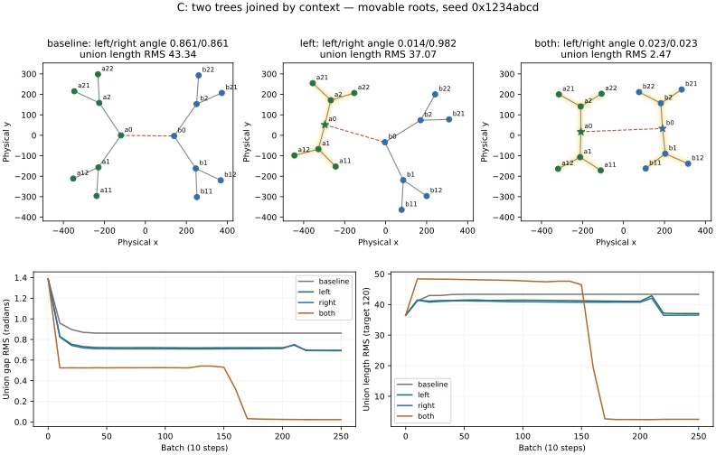

*Figure 8. Experiment C, one fixed recorded initialization with movable roots. Green/blue denote tree membership; stars mark active roots and yellow bands identify reinforced edges. The dashed red relation is ordinary context. The three layouts use common physical axes. Lower plots include all four activation conditions and measure the union of the two stored trees. Links are drawn as straight endpoint segments to expose physical geometry, independently of the SVG edge-form setting.*

### 6.3 Experiment D: trees with additional leaf connections

The same two definitions are retained, adding one leaf-to-leaf relation within each tree and two between trees: 14 vertices and 17 semantic edges. These four relations remain ordinary context. This is a graph containing reinforced trees, without forcing its additional cycles into a tree representation.

For movable roots, baseline union length RMS is 47.72; with both foci it is 15.97. Mean union angle RMS falls from 0.6872 to 0.1466. However, these averages include a persistent large-motion case. Four both-focus runs have tail step RMS between 0.0249 and 0.0871; seed 0xdecafbad reaches **42.0850**, with maximum displacement $30\sqrt{2}\approx42.4264$, the inherited per-axis clipping limit. Its eligible displacement reversal fraction is 0.518. We retain this run rather than presenting only the four quieter layouts. The sign statistic detects substantial reversals but is not a spectral estimate.

All five pinned-root, both-focus runs have tail step RMS below 0.004. Their mean angle/length RMS values are 0.0766/10.81. Pinning changes the feasible geometry and coupled modes as well as dynamics, so this does not isolate a damping effect. Additional leaf links can make the default multi-focus configuration sensitive to starting layout even where four nearby starts appear satisfactory. Experiment B's adaptive damping is not enabled as an unreported remedy.

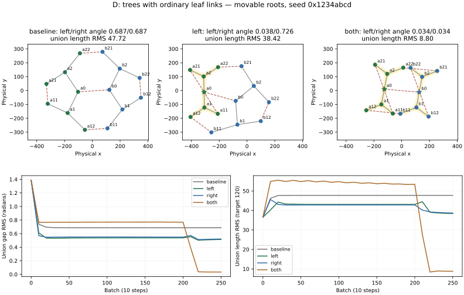

*Figure 9. Experiment D uses the same two stored trees, with four added ordinary leaf relations shown dashed red. This first-seed layout is one of the quieter runs; it must be read with Figure 11, which retains the oscillatory initialization. The bottom traces measure union gap and length errors under each activation condition.*

### 6.4 Experiment E: overlapping tree membership and feasibility

The trees now share one intermediate vertex and its two leaves. Their union has 11 vertices and 10 edges and remains a tree. Each definition still has seven vertices and six edges. The controller applies shared radial constraints once, merges local angular neighborhoods and attenuates angular moments according to shared membership. Purple vertices in Figure 10 belong to both trees.

With movable roots and both foci, mean union gap RMS is 0.0214 and length RMS 3.41. Individual-tree gap RMS remains approximately 0.4707. This is not contradictory: the shared vertex has degree four in the union but degree three in either stored tree. Four equal union gaps are 90°; removing one neighbor leaves gaps of 90°, 90° and 180°, rather than the individual tree's 120°. Their local RMS deviation from 120° is $\pi/(3\sqrt{2})$. In a seven-member tree there are eight scored gaps (two at the root and three at each intermediate vertex). If all other local gaps were exact, this single merged vertex would contribute

$$
\sqrt{\frac{3}{8}}\,\frac{\pi}{3\sqrt{2}}=\frac{\pi}{4\sqrt{3}}\approx0.4534
$$

to that tree's overall RMS. This calculation explains why demanding a zero individual-tree score would misjudge a regular merged neighborhood. It is an ideal geometric reference, not a bound on arbitrary layouts or proof of the controller's optimality.

Pinning adds a distinct obstruction. The two roots reach the shared vertex through two selected edges of preferred length $L=120$. If their fixed separation is $D>2L$, triangle inequality prevents both edges from attaining their target. More generally, for a path of $q$ selected edges among $M$ unique tree edges, triangle inequality and Cauchy–Schwarz imply

$$
\mathrm{RMS}_{\mathrm{length,union}}\ \geq\ \frac{\max(0,D-qL)}{\sqrt{qM}}.
$$

Here $q=2$, $M=10$, so the bound is $\max(0,D-240)/\sqrt{20}$. Each run records this feasibility bound. With roots pinned, both-focus mean union length RMS is 48.96, compared with 3.41 when roots can move. Four pinned runs cool to negligible movement despite substantial geometric residuals; the fifth, seed 0x9e3779b9, has tail step RMS 36.0468 and reversal fraction 0.833. Cooling, feasibility and dynamic instability are separate issues. The first cannot certify success, and the geometric lower bound cannot explain away a persistent clipped oscillation.

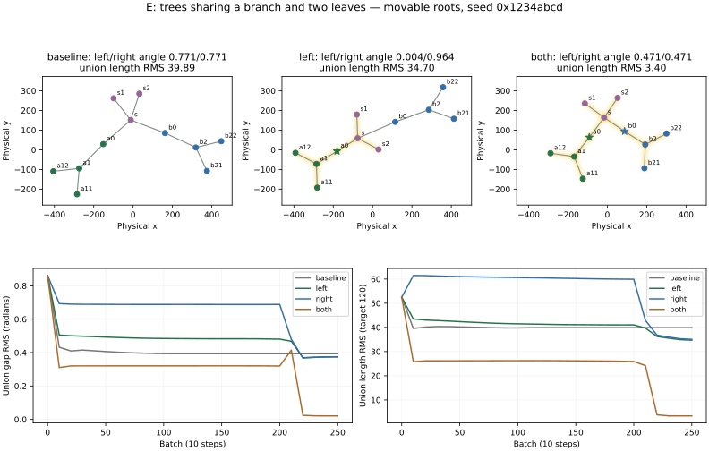

*Figure 10. Experiment E, movable roots and a shared subtree. Purple vertices belong to both stored trees. Shared radial edges are reinforced once. The both-focus union approaches a regular degree-four shared neighborhood while either individual tree retains a nonzero angle score. The first-seed traces also show that the finite-budget evolution need not be smooth or monotonic.*

### 6.5 What these additional experiments establish

The comparisons support coexistence of multiple reinforced trees, show a context cost under a single focus, and expose two constraints on extensions: added leaf relations can excite persistent motion, and overlapping memberships change local angular targets. Shared pinned roots can make preferred lengths infeasible before any solver is considered. Multiple centers therefore require observables for each member structure, their union and actual per-step motion.

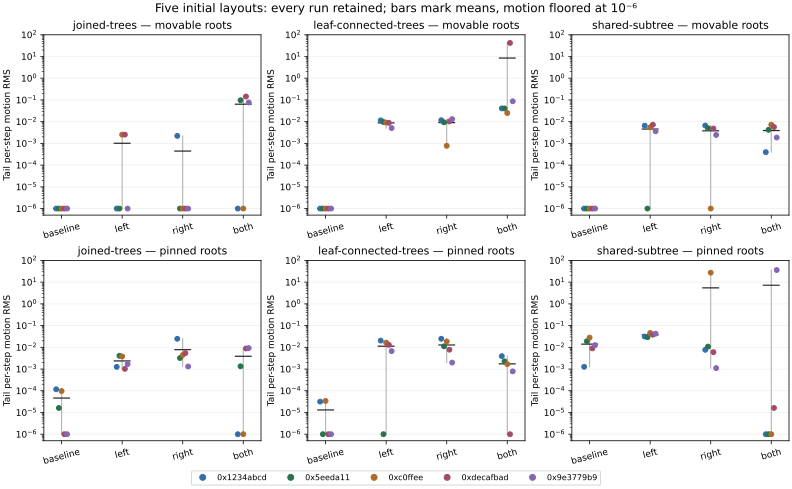

*Figure 11. Tail motion across all 120 runs: five initializations per topology, root condition and activation mode. Points identify seeds, vertical lines span the observed range and horizontal bars mark arithmetic means. Actual per-step RMS is measured over the final 100 steps; values below 10⁻⁶ are floored for display. The clipped-motion outliers remain visible. Zero motion may reflect inherited cooling with residual geometric error.*

These are small, synthetic tree experiments, with additional semantic leaf links in Experiment D. DAG layouts, cluster selection quality, exclusion regions, label collisions, perceptual readability and large graphs are not evaluated. No setting was retuned after seeing a failed seed. The following companion experiments compare adaptive damping and lower rigidity on these same starts, then extend evaluation to importance and compact clusters. They retain the fixed-force records above.

### 6.6 Companion experiments F–H: motion, balance, importance and shape

The [follow-up reports](../experiments/rfc-followup/README.md) add **780 declared runs**, each 4000 integrations, over the same five seeds. All runs completed without nonfinite failures. Eight SVG/PDF/PNG diagrams, complete condition tables, initial/final geometry and sampled motion traces accompany the reports. Their geometry proxies are physical straight edges and member centers, not browser label measurements. Original Experiments A–E and their eleven drawings remain unchanged.

**F — damping versus global rigidity (240 runs).** The three multiple-tree topologies are crossed with free/pinned roots, rigidity 1/0.5/0.25/0.1 and local damping off/on. Queued rigidity is primed on an empty graph so it applies from the first measured step. In addition to motion and length error, a final-coordinate probe clears momentum, disables local attenuation, prevents motion, and evaluates the existing TG+RFC callbacks. Force RMS on free coordinates is divided by rigidity to compare balance independently of the common force scale.

On movable-root leaf-linked trees, mean large-step count is 5.0 with damping at rigidity 1, but common length RMS is 15.60 and normalized force RMS 12.61. Rigidity 0.1 without local damping gives 3.8 large steps, length RMS 8.60 and force RMS 0.108. Lower rigidity is therefore a useful alternative on these starts; it is not simply another name for local damping. Global scale preserves relative force strengths, whereas local attenuation/cooling can stop an unbalanced layout. On the pinned shared-subtree seed 0x9e3779b9, rigidity 0.25 reaches normalized force RMS below $10^{-12}$ while length RMS remains 54.12, above the feasibility lower bound 47.96. A balanced compromise can retain substantial infeasible target error. These observations distinguish dynamic instability, force imbalance and geometric incompatibility.

**G — nonuniform node/link importance (300 runs).** Two tree topologies use ten importance/edit schedules and three modes: plain TG, RFC with damping off, and RFC with damping on. The mapping is $s(w;d)=2w/(w+d)$ and relation coefficient $q_e=\sqrt{s_u}\sqrt{s_v}s_e$, with defaults node 1 and relation 10. Here $q_e$ is distinct from the global rigidity $q$ used in the preceding force equations. Selected nodes/relations receive moderate, saturating, tiny-positive or zero weights. The common error always includes the original twelve tree edges; a separate importance-weighted error is retained. On leaf-linked trees with damping off, the coupled 9/30 profile improves selected-link RMS from 10.57 to 4.16 and common RMS from 13.02 to 7.70. In contrast, exact zero gives weighted RMS 3.17 while common RMS is 43.34: excluding low-priority terms can conceal substantial distortion.

Exact zero removes angular branches; a positive epsilon retains their slots. Transition runs change neutral→zero→epsilon after batches 100/200, with paired neutral controls receiving identical damper resets. The wake-only control itself can excite persistent movement, so edit effects cannot be inferred from an unmatched before/after trace. All plain-TG coordinates are exactly equal across static weight profiles and across the paired wake schedules. Saturation bounds coefficients, not nonlinear trajectory sensitivity, total coupled stiffness or perceptual cost.

**H — compact clusters and tree projections (240 runs).** Separate/shared square cliques and sparse rings are crossed with weak/strong boundary loads, a plain-TG baseline, perimeter spanning-tree RFC, cluster rigidity 0/0.25/1/2 and two damped cluster controls. All modes retain the complete semantic graph. Comparisons measure all internal link targets and all member-pair distances relative to a declared analytic shape, plus extent, overlap, boundary tension proxies, straight crossings and close node pairs. Projection and cluster angular/length objectives differ; the common observables do not change with their activation. The cluster's one-sided length cap at 120 remains active alongside semantic targets of 170 for diagonals and 240 for diameters. These long links therefore face competing objectives; the analytic reference does not minimize every term simultaneously, and residual deformation cannot be attributed solely to solver error or sparse flexibility.

Under strong load, separate-clique pair deformation RMS falls from 85.46 with plain TG and 94.88 with tree projection to 8.66 with cluster rigidity 2. The latter nevertheless has a mean 2014 large transient steps; adaptive damping reduces that to 4.8 with deformation 8.71. Sparse rings expose the limitation of link stiffness: increasing rigidity from 1 to 2 lowers common link RMS from 25.24 to 16.94 but increases all-pairs deformation from 30.76 to 35.74; the damped rigidity-2 deformation is 47.01. Sparse clusters remain flexible rather than becoming rigid bodies. Preserving the square reference can also increase straight crossings because both diagonals are retained. These studies support distinct structural primitives and explicit trade-offs, not a universal readability claim.

The present experimental round is complete for the implemented tree/importance/cluster mechanisms. Hybrid filtering, DAG comparison, broader datasets and human evaluation remain open. F–H do not modify production forces, rendering or defaults; a subsequent optional exclusion extension is described in §7.1.

## 7. Interaction and implementation boundaries

Freshmind's RFC module registers additional forces through a generic TouchGraph hook before integration. Semantic graph data never gains artificial constraint edges. A focal star deduplicates parallel/reciprocal relations using stable IDs, while the baseline still simulates every semantic edge. This policy is deterministic but introduces dependence on the chosen representative edge's physical parameter when attraction reinforcement is used.

RFC focus is separate from selection, viewing-lens focus and neighborhood origin. Once RFC is enabled, a second Return or double-click on an already centered node replaces all RFC centers with that node and wakes the layout. Shift+Enter or Shift+double-click instead toggles one center while keeping the others; removing the last turns RFC off. The first such command on another node centers it normally. Hidden centers suspend reinforcement; graph replacement clears it. Soft yellow halos behind focal nodes and their reinforced relations identify active membership without obscuring labels or changing picking. This visual cue is an interface choice whose perceptual benefit remains untested.

Weighted geometry is complementary to these interaction rules. Equal weighted angles produce an ellipse, not equal physical angles. Neither an ellipse nor a target radius guarantees separation of labels of varying dimensions. Earlier comparisons leave exclusion disabled. The following optional point-exclusion extension can reduce context intrusion, but does not guarantee label separation or empty areas.

### 7.1 Optional exclusion and Experiment I

The 2005 paper exempts focal vertices from ordinary context repulsion but excludes non-shared members from intersecting focal regions. The new [exclusion contract](../rfc-exclusion.md) reconstructs that policy with explicit geometry and force choices. Implicit stars use their root as center; stored trees/DAGs/clusters use an importance-weighted centroid. A circle in weighted coordinates encloses eligible visible member centers with padding; it becomes an ellipse in physical coordinates. Ellipses may still overlap, and point fitting does not measure rendered labels.

Rather than sum potentially canceling forces from multiple ellipses, sample escape rays from the applicable foreign-region union. Circle intervals include regions entered later along the ray, so an escape does not merely move the node into another focus. With physical escape distance $d$, the additional force magnitude is $q k d/(1+d/L)$, bounded by $q k L$ for nonnegative rigidity. Root/centroid anchors receive opposite reactions before inherited mobility adaptations. The region is refitted per integration; maximum-radius derivatives are omitted, so this is not claimed as a conservative energy gradient or a hard collision solver. A shared node is exempt from direct exclusion by its own regions, although other intruders can still produce centroid reactions on it.

[Experiment I](../experiments/rfc-exclusion/README.md) retains 100 matched runs: fixed single-region, shared-foci, cross-pressure and cluster-region fixtures, five starts and five modes (TG, RFC only, context exclusion, overlap exclusion and stronger exclusion). It holds global rigidity at 0.1 and local damping off, recording common region-fitting metrics even in the controls. Movable context penetration, non-shared exposure over all 4000 integrations, pinned intruders, region size, link error, actual motion and final force balance are separate observables. Three companion SVG/PDF/PNG drawings include initial added forces and individual startup steps.

For fixed single-region geometry, mean context depth RMS falls from 29.06 under RFC alone to 7.81 with default exclusion and 2.40 with stronger exclusion. Cluster-region depth is 17.22, 0.00 and 1.49 respectively: stronger force is not uniformly better within the fixed computation budget. The pinned interior pressure anchor remains an intruder by design. The existing RFC constraints already clear final non-shared overlap on these starts; the additional overlap rule therefore has direct force/edge-case tests and small transient differences, without demonstrated additional final-quality benefit in this study. Neither zero motion nor zero point penetration establishes readability.

Exclusion remains off by default and does not change Experiments A–H. Its controls and physical boundary display are reusable source features. With optional damping also enabled, nearby context candidates join the observation/attenuation union using a conservative watch margin, retaining motion history during ordinary boundary crossings. This remains an experiment rather than a general stability guarantee. Hybrid filtering and its matched comparison are described next.

### 7.2 Structural aggregation and hybrid views

A subsequent [structural view](../structural-focus-context.md) implements the discrete hybrid mechanism described in §2.3/Figure 3 of the 2005 paper. Configured lower-detail types aggregate only when they are semantic leaves with one distinct complete-graph neighbor and a retained attachment. Parallel/reciprocal relations count as one leaf; bridges, cycles, self-loops and ambiguous two-leaf components are retained. The pass is nonrecursive and records typed counts on existing parents. It neither changes semantic labels nor invents quotient relations or aggregate masses.

The neighborhood and its manual hides remain owned by TouchGraph. A derived membership index supplies the common graph for ordinary forces, RFC, picking and rendering. The viewing lens then acts on its physical coordinates. Positive eligible focal membership is computed before aggregation, so activating a stored tree/DAG/cluster can restore its detail without a visibility feedback loop. Selected nodes/relation endpoints, neighborhood origin and a configurable hop radius around viewing/RFC centers also retain detail. Explicit type filters take precedence and can suspend hidden focal centers. All complete-graph nodes, relations and stored definitions remain available in YAML; view rules and reveal exceptions are transient.

A synthetic 13-node/13-relation example demonstrates all three mechanisms together, with a shared collaborator that remains a bridge. Hiding leaves removes their ordinary and RFC interactions while retaining their stored coordinates; visible parents are not assigned their mass, momentum or repulsion. Consequently the equilibria and reinforced branch degrees can change.

[Experiment J](../experiments/rfc-hybrid/README.md) records 160 matched conditions: a Project A star or stored A detail tree, four structural views (full, Person/Paper aggregation, Person filtering, Authored-relation filtering), TG/RFC, lens 0/60 and five seeded starts. Each receives 4000 integrations at rigidity 0.1 with local damping and exclusion off. Both force controls retain the same nominated focal detail; only the added RFC force callback differs. This deliberately isolates force from protection, whereas simply turning RFC off in the browser also releases protected detail. All 80 lens pairs have identical physical trajectories. Full/reduced comparisons score the same retained radial IDs, branch sets, point pairs and semantic edges; nominal/retained degrees and denominators remain in the records. A retained-subset angular score uses the retained degree and must not be mistaken for the full star's original objective.

With aggregation, mean star RFC length RMS changes 3.64→0.54, retaining all three focal links. For stored A detail, it changes 2.11→1.94 while retaining all five. Filtering Person or Authored drops two of those five links, so reporting only the reduced graph's own error would omit changed objectives. Authored filtering also leaves four isolated paper endpoints. Every condition has zero motion during its final 100 integrations under global cooling; stored-tree RFC's remaining unit-rigidity force RMS is about 0.003 with all relations and 0.663 after that relation filter. This is a further example of quiet motion without force equilibrium. Point pairs below 30 units and proper straight-edge crossings are zero in every final condition and cannot discriminate quality here. Three companion drawings and complete mean/range tables retain all starts, failed-run accounting and force/motion limits. These small synthetic comparisons establish neither general convergence nor perceptual benefit; original-figure reproduction is outside scope.

### 7.3 Displaying importance independently of reinforcement

A subsequent [browser display](../rfc-importance.md#node-importance-display) maps node importance to bounded body and label sizes around the default weight of one. The normalized value $q=2w/(w+1)$ interpolates between separate lower and upper draw-scale bounds, with exact identity at $w=1$. Default linear scales range from 0.85 to 1.5; this is a presentation choice rather than a proportional-area encoding or a force equation. Configured type/item styles can select uniform or legacy-halo modes, and optional exact values supplement size when intrinsic labels differ. Yellow reinforcement halos continue to indicate membership.

The renderer measures intrinsic text before applying its display transform, then uses the scaled body consistently for picking, focus, curve clipping and group outlines. Display changes do not modify point coordinates, mass, repulsion or RFC stiffness, and do not wake the integrator. These functional properties distinguish the new display from Experiment G's force-weight comparisons. Body size still does not establish label clearance or perceptual benefit; a readability study remains necessary.

## 8. Discussion and next experiments

The reconstruction supports a narrower, reproducible reading of the original proposal: a locally regular structural primitive can coexist with competing ordinary graph forces. The extension makes two objectives explicit. Angular reinforcement distributes branches; a preferred-length spring keeps them near a chosen focal radius. Their interaction depends on context, metric and solver dynamics. The unequal-radius chord calculation and discrete stability bound provide explanations that were absent from the original presentation.

The single-star evidence uses degree six and three designed starting configurations. The additional tree experiments vary initialization over five seeded perturbations, activation and root constraints, but retain small, designed topologies and a fixed computation budget. We have not measured task completion, comprehension, actual browser label overlap, mental-map preservation or large-graph performance. F–H add limited straight-segment crossing and close-center proxies, which do not measure routed curves or human readability. Moving-center runs also change the layout's orientation and position, so lower errors are not solely evidence of a better solver. Clipped-motion outliers and the shared-root feasibility calculation further limit any universal claim for the default preset.

Next steps are broader exclusion/overlap cases, shape-aware label handling and interaction evaluation. The planned RFC mechanism/comparison milestone is complete within its agreed scope, with LDA-based graph visual search next in the implementation roadmap. Experiments F–H establish small, reproducible comparisons of damping/rigidity, importance and cluster shape. Importance, mass and spring strength should remain separate concepts: changing mass changes dynamics, while changing force weights changes equilibrium and curvature. The final-coordinate force probe supplements motion and target-error diagnostics; no one metric replaces the others. Further evaluation should vary degree and label dimensions, compare alternative integrators, and compare direct angular moments with both original and corrected chord constraints. A user study is needed before treating numerical regularity as evidence of intelligibility.

The accompanying implementation stores overlapping tree/DAG/cluster memberships, reinforces deeper tree neighborhoods and layered DAG templates, and supports center toggling through Shift+Enter/Shift+double-click. Connected components and Louvain communities create stored cluster definitions directly, with optional spanning-tree conversion. Cluster forces reinforce internal links and apply soft compactness about a weighted centroid without angular targets; their contract is specified in the [cluster design](../rfc-clusters.md) and evaluated on manual synthetic memberships in Experiment H. These additions do not alter the single-star numerical path used above. Their [companion design and functional example](../rfc-substructures.md) specify ownership, shared-constraint normalization and lifecycle. DAG templates have functional checks only; community-detection quality, hard region separation and label collision handling remain unevaluated or incomplete. The subsequent browser importance display (§7.3) has functional verification; its perceptual effect remains unevaluated by these comparisons.

## Reproducibility and references

Run `just rfc-experiment`, `just rfc-multifocus-experiment`, `just rfc-plot`, and `just rfc-figures` from the repository root. `just rfc-paper` regenerates those original artifacts and renders this draft to PDF. `just rfc-exclusion-experiment` regenerates Experiment I and its native inputs/report/figures. `just rfc-hybrid-experiment` regenerates Experiment J, its native input, numeric records, report, tables and three drawings; `just rfc-hybrid-figures` redraws/reports from those records without rerunning layout. `just layout-damping-experiment` regenerates Experiment K, its report and Figure 12 without replacing historical records; it uses a frozen v2 detector reference from `43fea7a` and the current general layout controller. `just rfc-followup-experiment` separately regenerates F–H; its record-only runner, [shared protocol](../../scripts/lib/rfc-comparison.mjs), [reports](../../scripts/rfc-followup-report.py) and [eight further diagrams](../../scripts/rfc-followup-figures.py) retain their own inputs. The scripts use only synthetic graphs and analytical equations. The original force comparisons and the multi-focus experiments keep the separate adaptive-damping experiment disabled. No proprietary example data or reconstructed screenshots from the 2005 paper are used. Figures are supplied as SVG, PDF and PNG; [stability-calculations.json](figures/rfc/stability-calculations.json) records eigenvalue checks. The [main figure source](../../scripts/rfc-paper-figures.py), [multi-focus figures](../../scripts/rfc-multifocus-figures.py), [single-star fixture](../../tests/fixtures/rfc.mjs), [multi-focus fixture](../../tests/fixtures/rfc-multifocus.mjs), and [implementation design](../rfc-design.md) specify the remaining details. The pre-extension implementation was checkpointed as `8414b9a`; the recorded results describe the revised sources supplied with this draft.

1. Gregor Heinrich. **Reinforcement Focus+Context.** 2005. [Original six-page paper](../literature/rfc@3ia05compact.pdf).
2. Thomas M. J. Fruchterman and Edward M. Reingold. **Graph drawing by force-directed placement.** *Software: Practice and Experience* 21(11), 1129–1164, 1991. [DOI](https://doi.org/10.1002/spe.4380211102).
3. David Harel and Yehuda Koren. **Drawing Graphs with Non-Uniform Vertices.** *AVI 2002*. [Author-hosted paper](https://www.weizmann.ac.il/math/harel/sites/math.harel/files/users/user56/non_uniform_avi_acm.pdf).

This draft and its drawings were prepared by Gregor Heinrich with assistance from Codex GPT-6.1. Analytical extensions and experimental conclusions require author review before publication.
