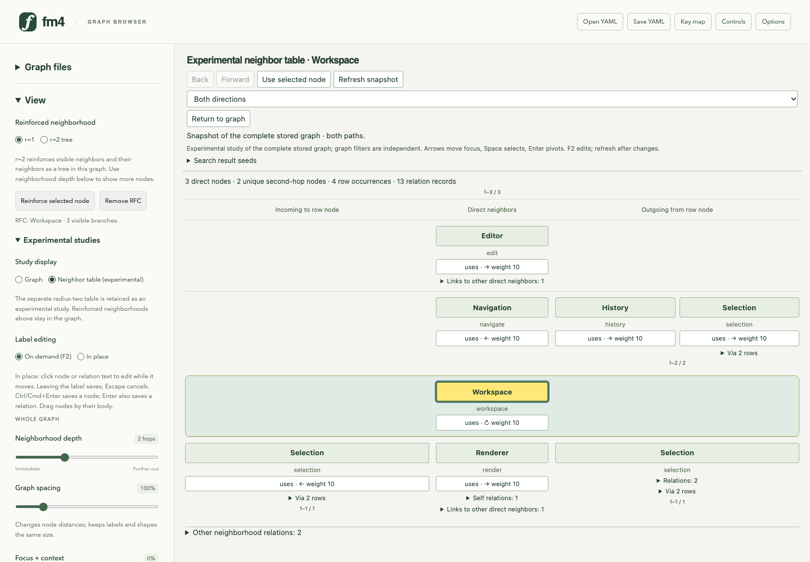
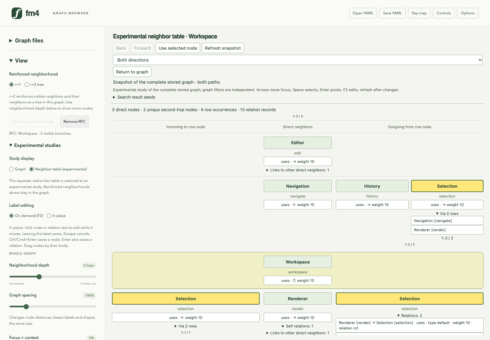
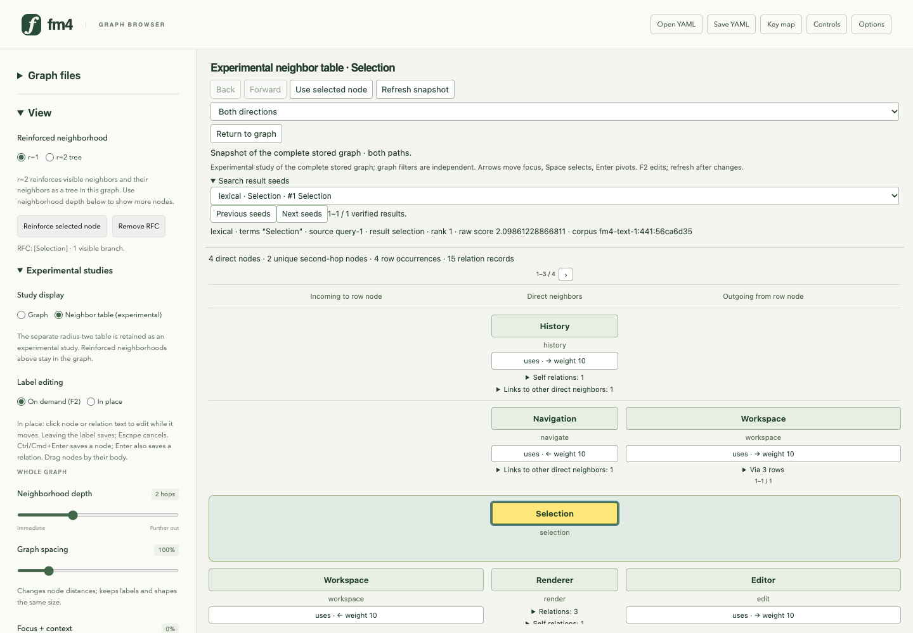

# Freshmind 4 experimental neighbor-table study

Generated by `just radius-two-flipbook` from [the tour](../../scripts/flipbook/radius-two.mjs). Edit the tour to change the steps and captions, then regenerate.

[Open the HTML flipbook](index.html). Three production-browser views retain the **experimental neighbor-table study**, with fixed-space adjacency, shared canonical identities, exact relation records and an accepted lexical result as the center. The main graph offers **View → Reinforced neighborhood → r=2 tree**. The graph here is fictional; this is functional evidence, not the public dependency pilot or a usability comparison. [Study guide](../radius-two-browser.md) · [native fixture and provenance](../../examples/radius-two/README.md).

## 1. A radius-two neighborhood without drawn links

Workspace has three direct neighbors on the vertical spine and two unique second-hop nodes across four occurrences. Incoming and outgoing wings retain real direction. The six-node, thirteen-relation graph includes loops, a reciprocal pair, cross-links and a zero-weight parallel relation. Selection and History remain hidden in the force view; this mode explicitly inspects the complete stored graph.

## 2. Shared identity and exact relation records

Selection appears in three cells bound to one canonical node. Selecting or focusing one occurrence highlights its siblings and witness rows. Expanded records retain both parallel relations, including weight zero, and name the actual endpoints. Inspecting a hidden node changes selection without revealing it in the original force locality.

## 3. Enter a neighborhood from an accepted search result

A real local lexical query for Selection creates the ordinary query/result records. The accepted result becomes the radius-two center and selected node, with its source, rank, raw score and corpus provenance retained. Seeding adds no further graph records and does not change positions or force-view visibility. LDA seeding uses the same adapter and is covered by real-worker browser checks.
