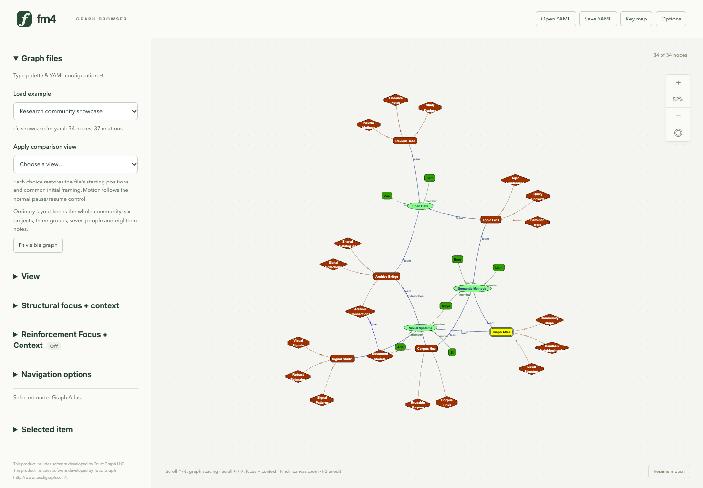
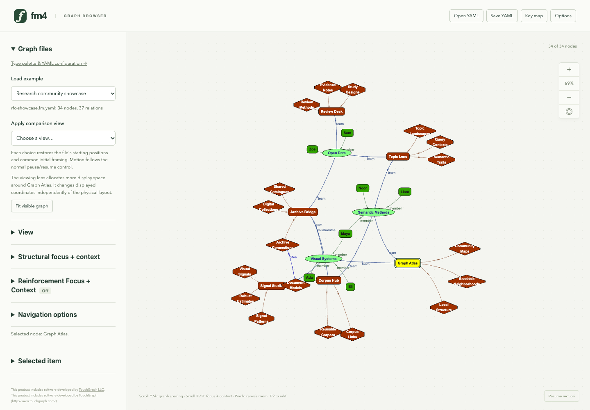
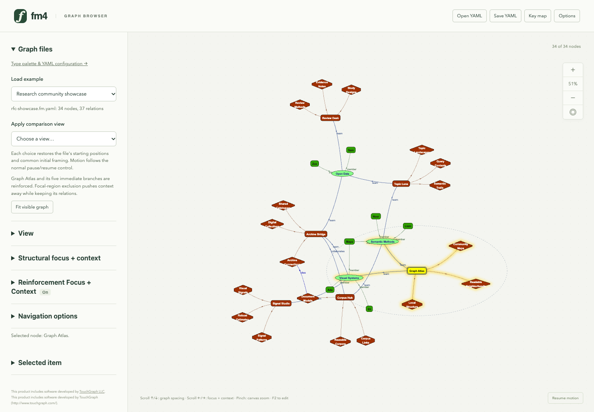
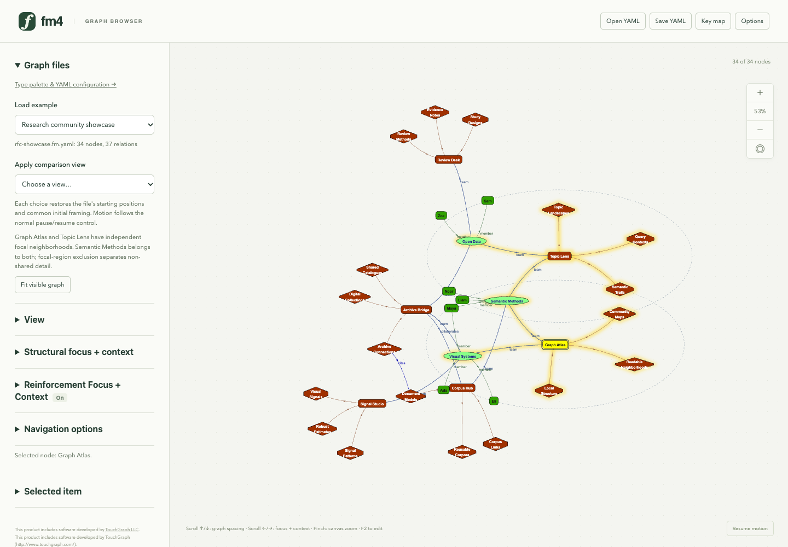
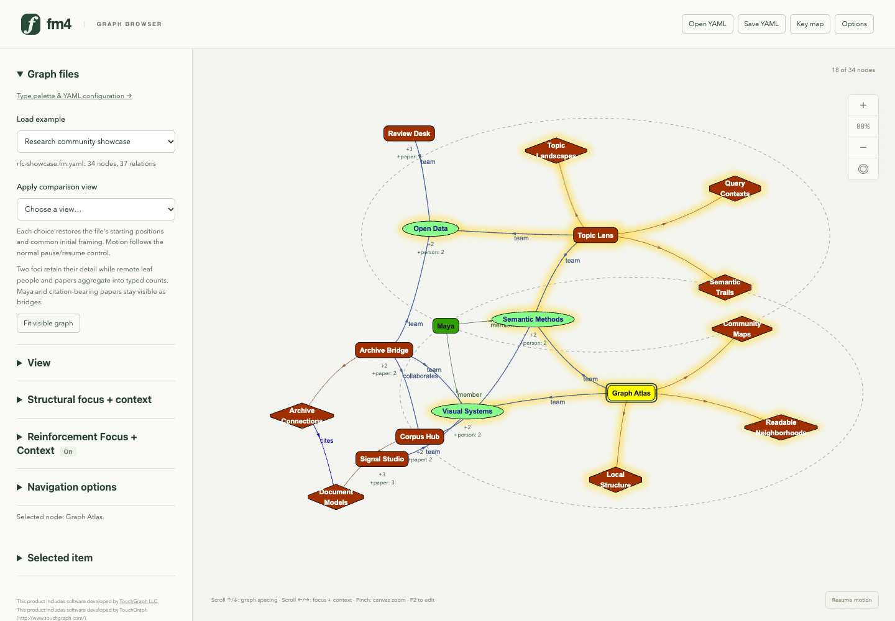
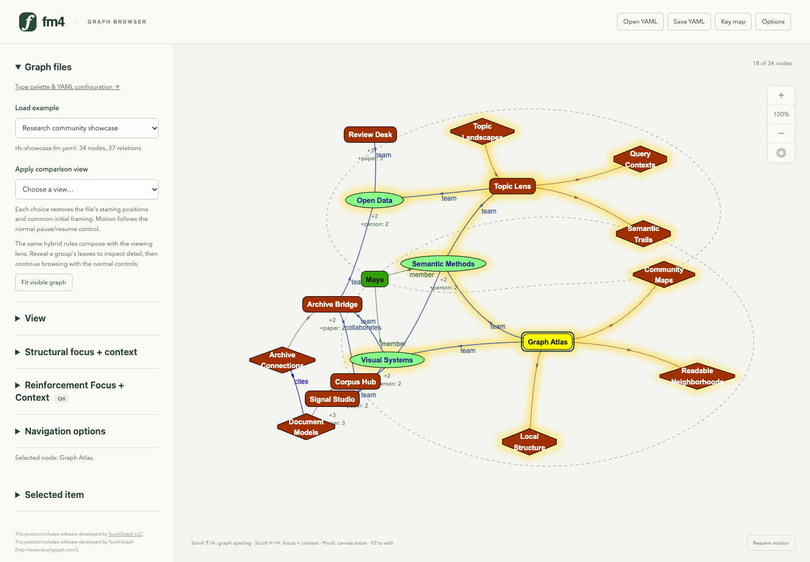

# Freshmind 4 RFC and hybrid showcase

Generated by `just rfc-showcase` from [the tour](../../scripts/flipbook/rfc-showcase.mjs). Edit the tour to change the steps and captions, then regenerate.

[Open the HTML flipbook](index.html). Six views of the new synthetic research community use identical starting coordinates and 160 layout batches at rigidity 0.1. RFC views use target length 160, coordinate weights (0.25, 1) and soft context/overlap exclusion (strength 1, padding 50). Each view is fitted separately with canvas transforms; these production-browser screenshots at 1440 × 1000 demonstrate interaction and retained detail, without a numerical quality ranking. [Showcase guide](../rfc-showcase.md) · [native graph](../../examples/rfc/research-community.fm.yaml).

## 1. Plain community graph

The whole synthetic research community contains 34 typed nodes and 37 relations: six projects, three groups, seven people and eighteen notes. Project collaboration, shared group membership and a citation connect the surrounding context.

## 2. Viewing focus + context

The viewing lens enlarges the area around Graph Atlas while retaining distant context. It transforms display positions independently of physical layout. This scene starts from the same saved coordinates and runs the same number of layout batches as the plain view.

## 3. One reinforced neighborhood

Graph Atlas has five reinforced branches: two groups and three notes. Target-length and angular reinforcement use horizontally weighted coordinates; soft focal-region exclusion pushes context away. Complete semantic graph data remains unchanged.

## 4. Two independent RFC foci

Graph Atlas and Topic Lens have separate focal neighborhoods, with Semantic Methods shared between them. Halos identify their eleven distinct members, and dashed boundaries follow the current viewing transform. Soft context/non-shared exclusion complements reinforcement; surrounding semantic relations remain present.

## 5. RFC with structural aggregation

The two foci retain their detail while sixteen remote leaf people and papers aggregate into typed parent counts. Eighteen of 34 nodes and 21 of 37 relations remain visible. The shared group, Maya's two-group collaboration and the citation-bearing context papers remain explicit. Reveal a parent's leaves to inspect its detail.

## 6. Hybrid focus + context with the viewing lens

The viewing lens composes with the same two focal neighborhoods and reversible aggregation rules. All 34 nodes, 37 relations and two stored focal definitions remain available for browsing, editing and YAML export. The showcase demonstrates the original tasks with a new graph and the current implementation; it makes no general readability or convergence claim.
