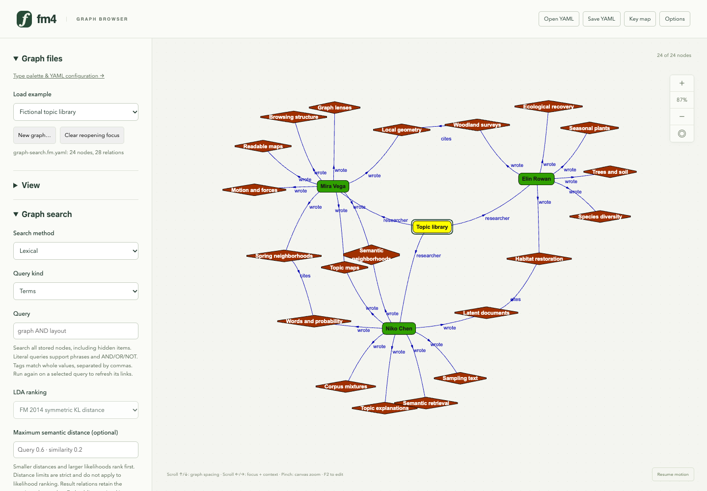
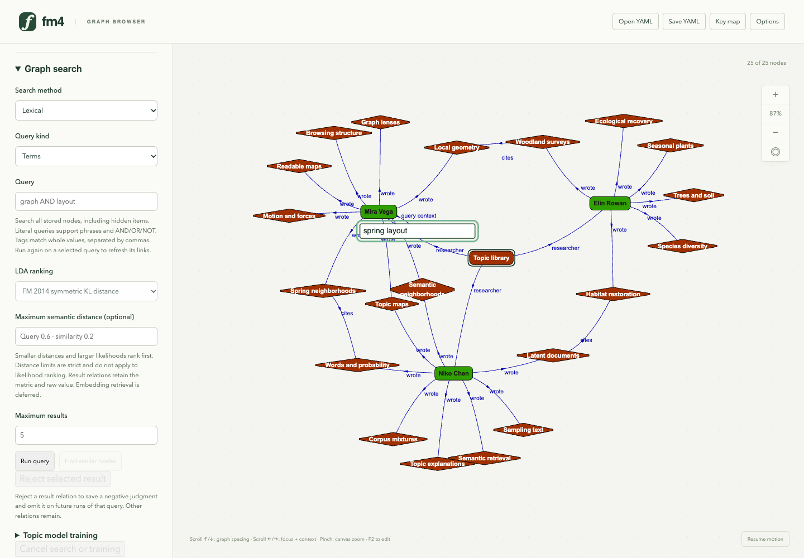
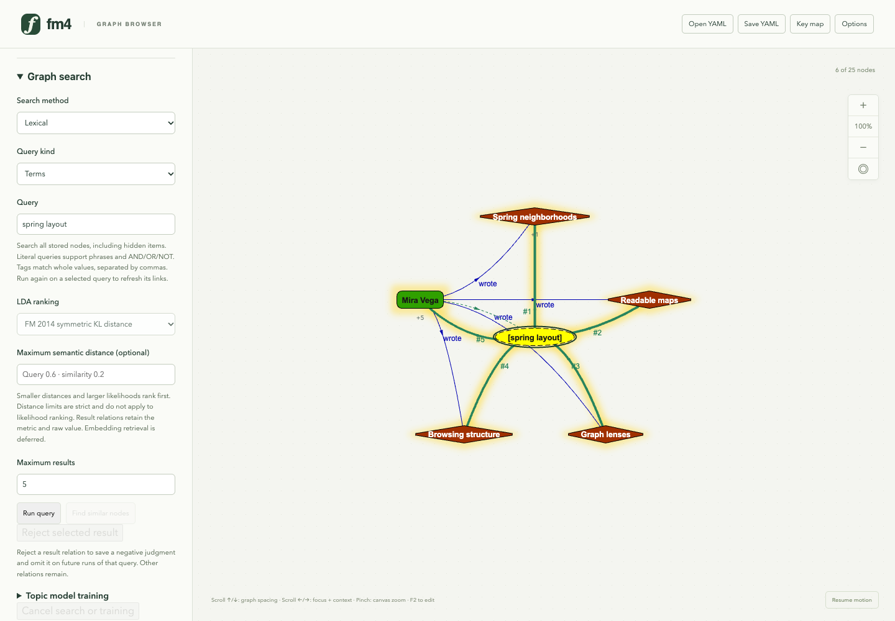
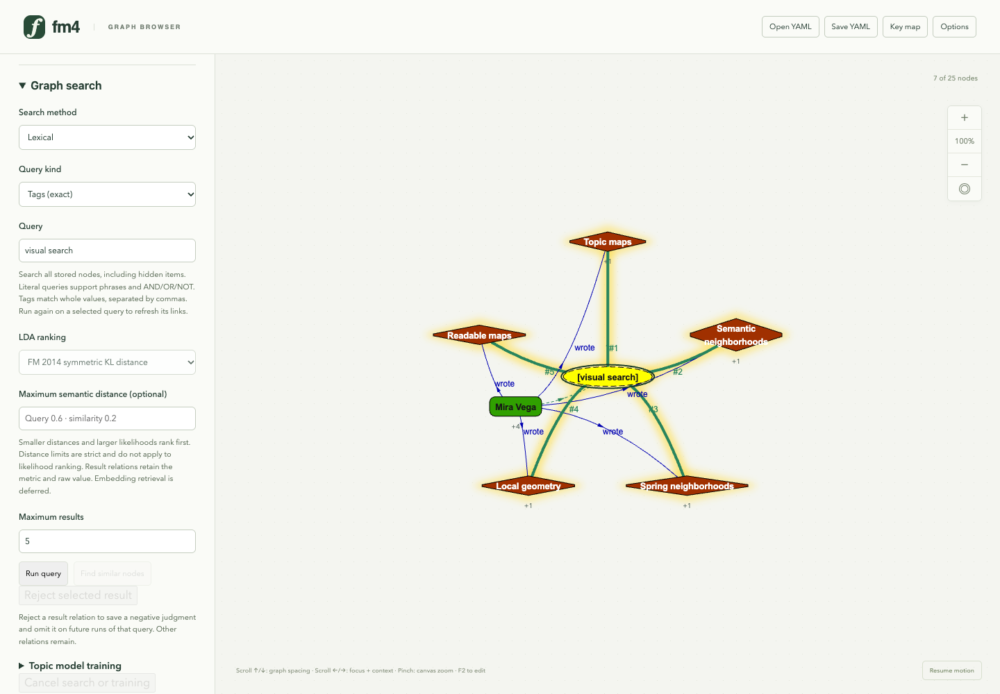
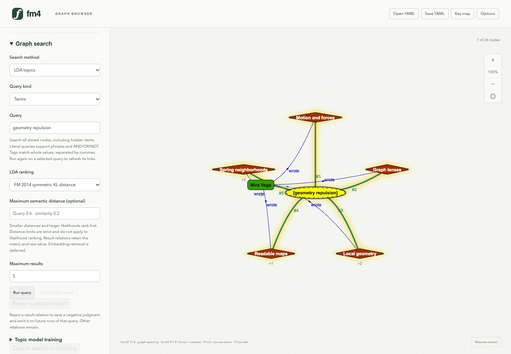
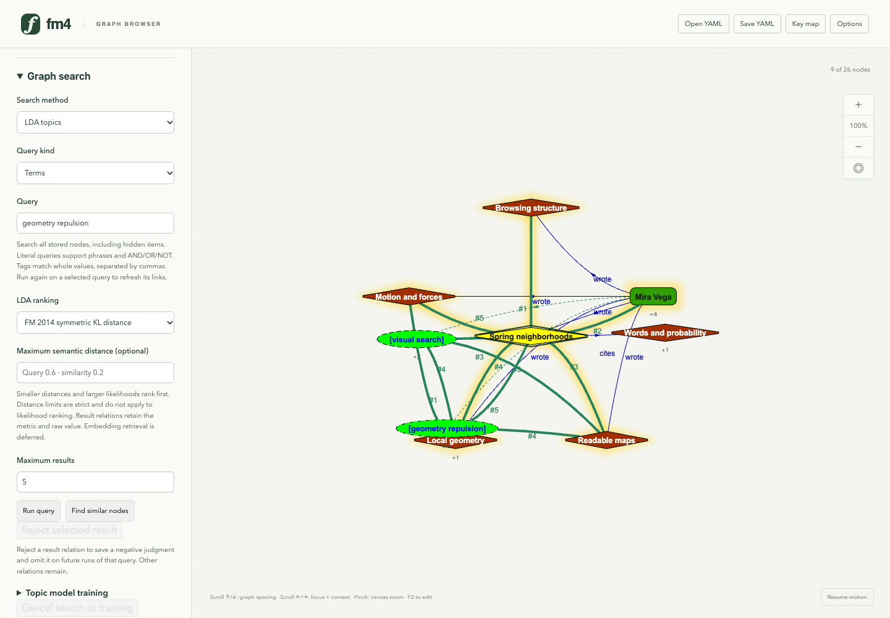
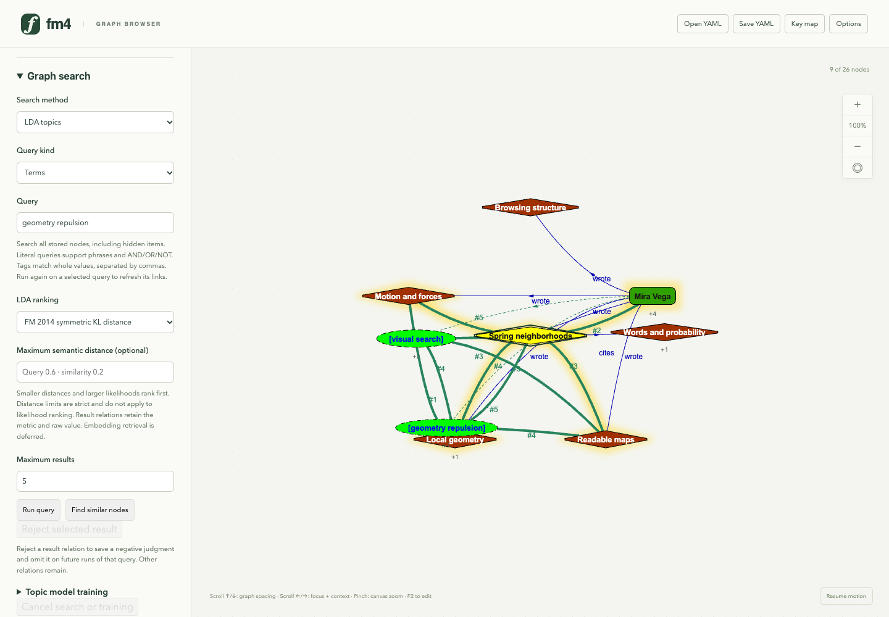
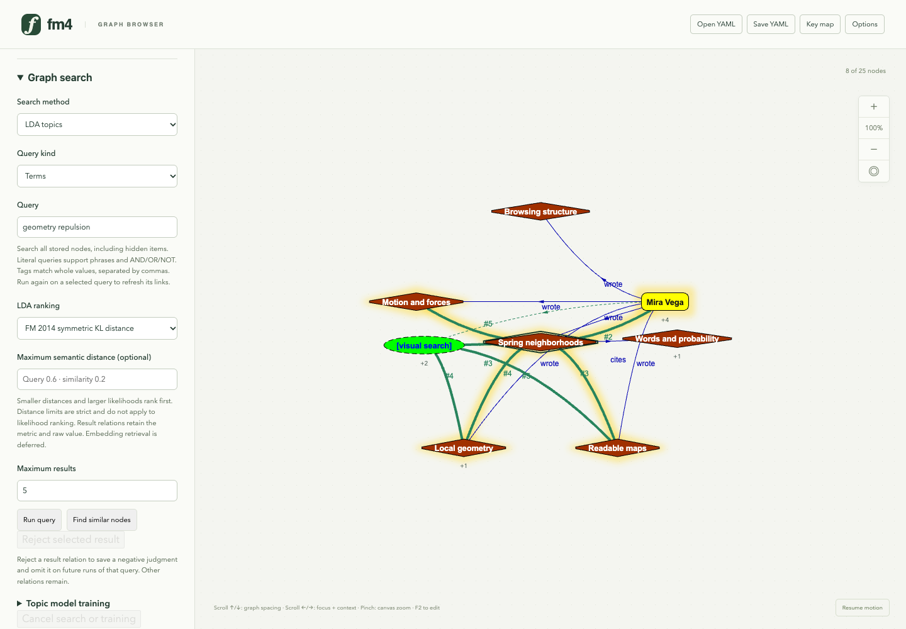

# Freshmind 4 graph search walkthrough

Generated by `just search-flipbook` from [the tour](../../scripts/flipbook/search.mjs). Edit the tour to change the steps and captions, then regenerate.

[Open the HTML flipbook](index.html). 9 production-browser views at 1440 × 1000 follow a complete search workflow: Ctrl+F query entry on the graph, literal/tag results, local topic training, Ctrl+Shift+F LDA retrieval, existing-node similarity, rejection feedback and query deletion. The same sequence appears near the start of the [main flipbook](../flipbook/index.html#search-library). Layout is paused and advanced by fixed batches for capture; canvas fitting changes only view transforms. The opening library has RFC off; successful searches activate reinforcement around the query or similarity source. Compact green rank links keep scores available on hover. [Search guide](../graph-search.md) · [native data and provenance](../../examples/search/README.md) · [FM 2014 parity](../fm2014-retrieval-parity.md) · [historical prototype comparisons](../experiments/search/README.md).

## 1. A searchable research library

This fictional graph contains 24 nodes and 28 semantic relations: three researchers, eighteen papers, two bridge papers and a collection. Labels, annotations and exact tags are searchable, including hidden items. The library starts without reinforcement; successful searches activate RFC and an invisible result disk around their query or similarity source.

## 2. Start a search directly on the graph

Select Mira Vega and press Ctrl+F. A query node appears immediately, linked to Mira as context, with its text editor on the graph. Type spring layout and press Enter to retrieve. The empty draft is excluded from the search corpus; ordinary typing and text deletion keep their normal meaning.

## 3. A term query joins its context

Enter runs the literal query. Ranked results settle around an invisible disk centered on the query; other node bodies clear its interior. This one-hop view retains the context and all stored graph data. Solid green links show compact ranks (#1, #2, …); the dashed green link identifies context. Blue semantic relations remain. Hover a result for the exact engine/score. F2 edits and reruns the query without duplicating it.

## 4. Whole-tag retrieval

The same query node now retrieves exact visual search tags. Tags are explicit metadata and work without topic training. The query replaces its earlier result links while retaining context and manual semantic relations.

## 5. Train and inspect topics

Three topics are trained locally for 200 serial Gibbs passes with seed 4357, alpha 0.1, beta 0.01 and minimum document frequency 2. Separate local JSON files can save/reload the model and its corpus. The most probable words make the fitted topics inspectable. This deliberately separated synthetic corpus does not establish general retrieval quality.

## 6. Retrieve by inferred topics

Ctrl+Shift+F starts a separate LDA query. The empty field says Type a semantic query. Enter submits geometry repulsion and moves RFC and the invisible result disk to this query. Green rank labels stay short; hovering reveals symmetric KL distance in bits (lower is better, default limit 0.6). The earlier tag query stays available. Relevance does not change node importance or RFC stiffness.

## 7. Use an existing paper as the query

Select Spring neighborhoods and press Ctrl+Shift+R to retrieve topic similarities and reinforce a neighborhood around this paper. Ctrl+R provides literal similarity. Compact green ranked links stay distinct from existing blue authored/citation relations. No separate results page is needed.

## 8. Retain a negative judgment

Rejecting a selected green result relation removes that link and saves its source, target, query, engine and corpus provenance. Repeating the same query omits that item. Native YAML saves queries, remaining links and feedback; model JSON is saved separately through the training controls. Feedback learning remains future work.

## 9. Remove a query and keep the source graph

Select the LDA text-query node and press Ctrl+Backspace (or Ctrl+Delete) while graph focus is active. Only that query and its incident associations disappear; retrieved papers, original semantic relations, the earlier tag query and the paper-based similarity search remain. Native YAML can retain the queries and rejection judgments you choose to keep.
