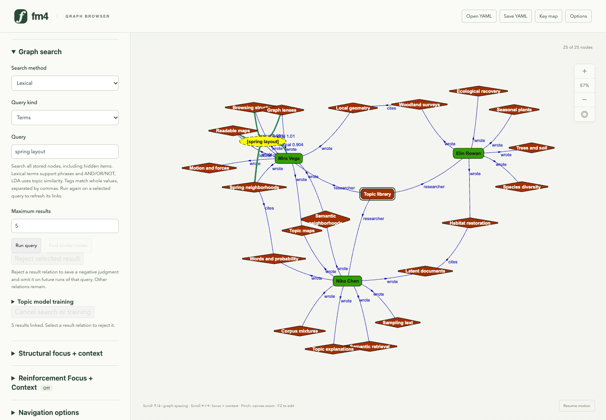
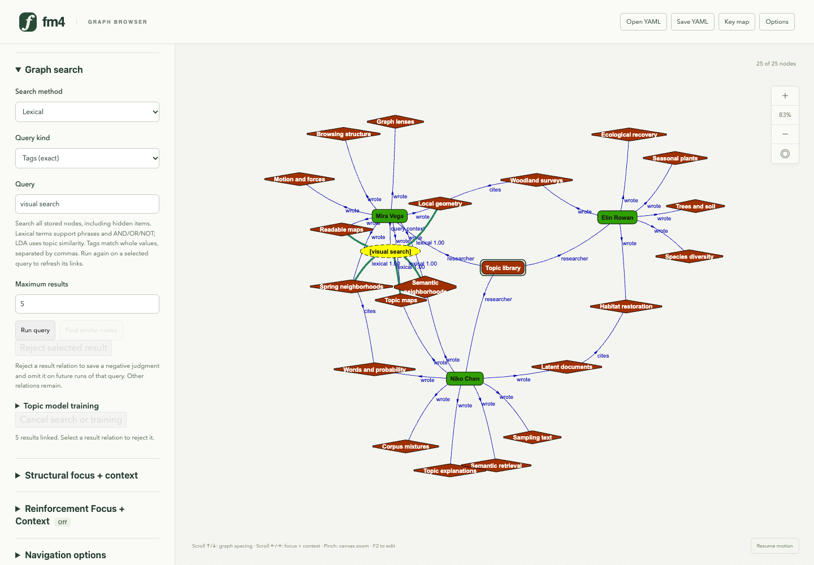
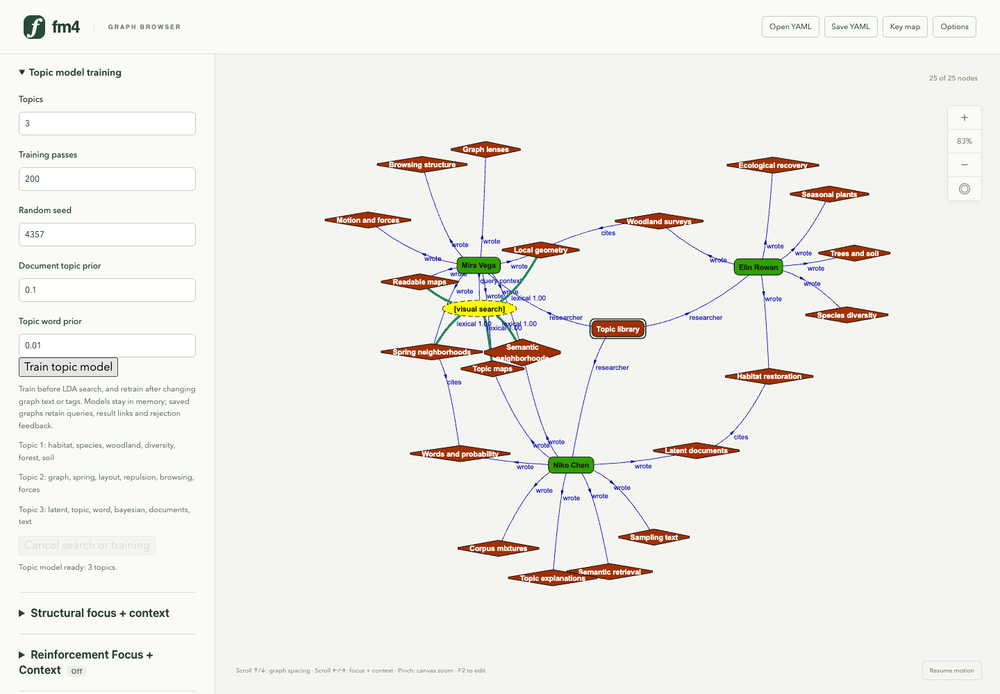
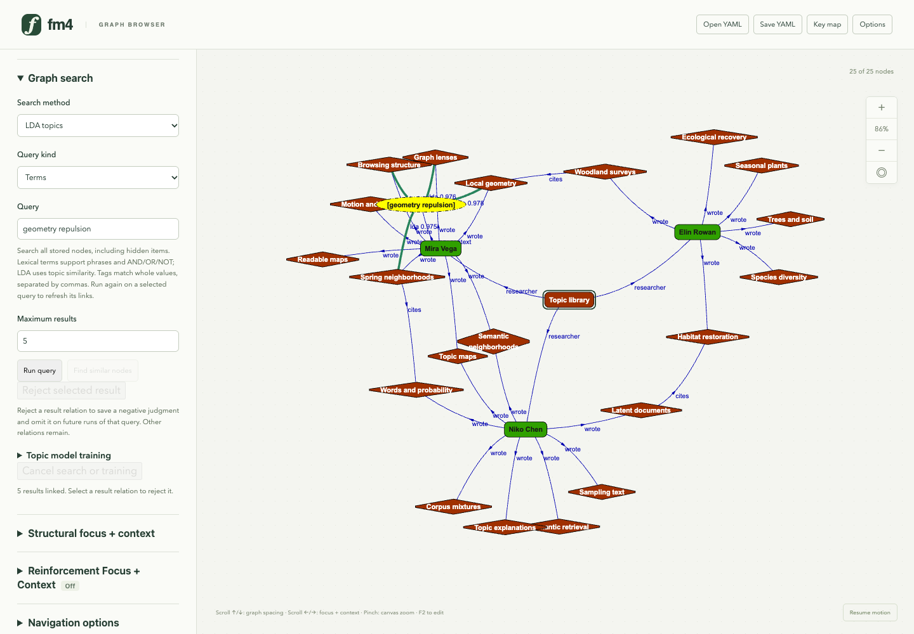
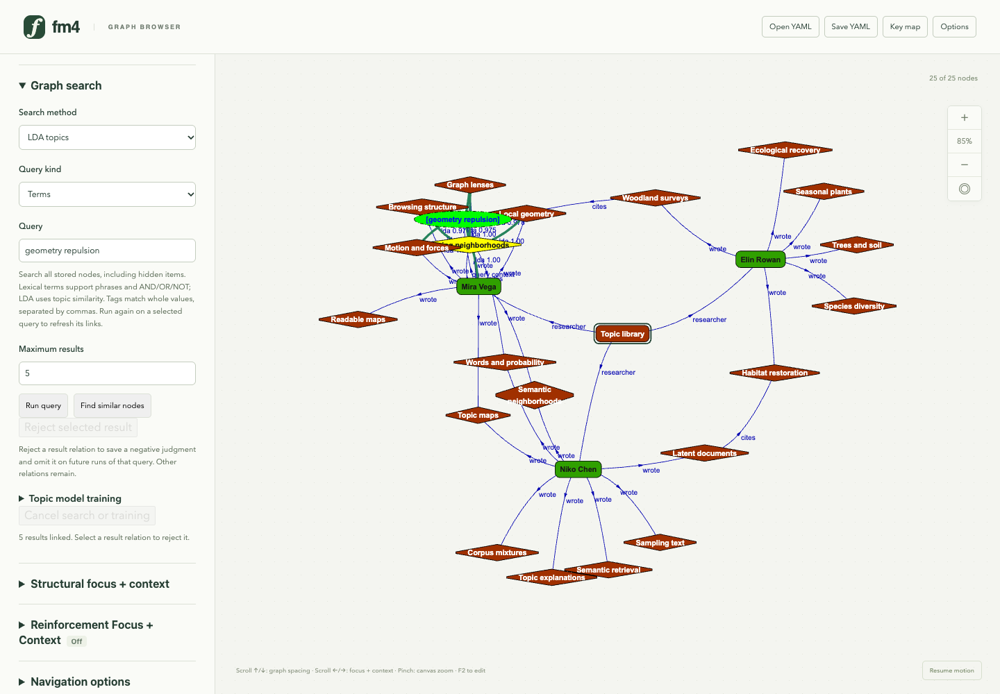
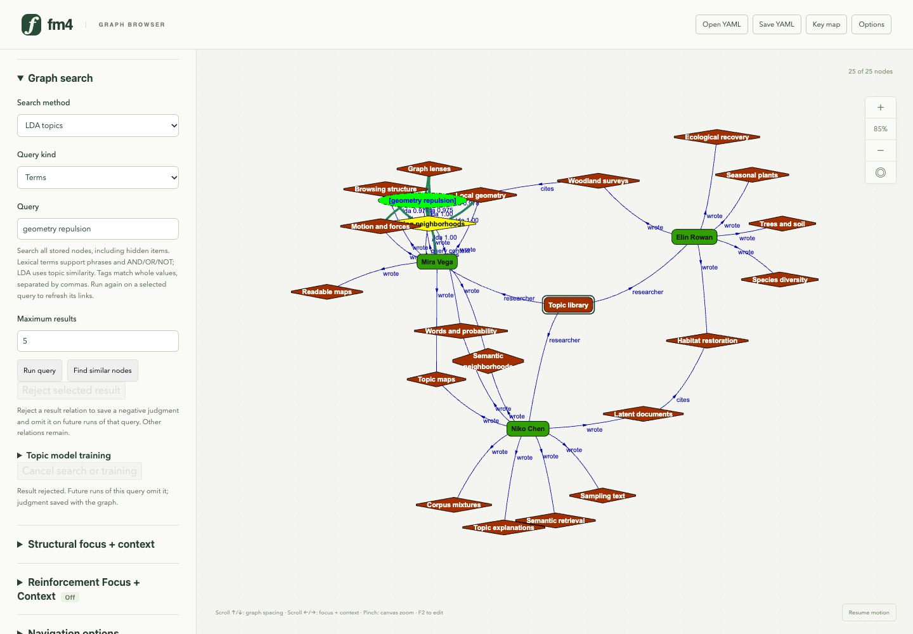

# Freshmind 4 graph search walkthrough

Generated by `just search-flipbook` from [the tour](../../scripts/flipbook/search.mjs). Edit the tour to change the steps and captions, then regenerate.

[Open the HTML flipbook](index.html). Seven production-browser views at 1440 × 1000 demonstrate the new fictional topic library: term/tag queries, local topic training, LDA retrieval, existing-node similarity and rejection feedback. Layout is paused and advanced by fixed batches for capture; canvas fitting changes only view transforms. RFC is cleared through its ordinary control for this walkthrough. [Search guide](../graph-search.md) · [native data and provenance](../../examples/search/README.md) · [numerical comparisons](../experiments/search/README.md).

## 1. A searchable research library

This new fictional graph contains 24 nodes and 28 semantic relations: three researchers, eighteen papers, two bridge papers and a collection. Labels, annotations and exact tags are searchable, including currently hidden items. RFC and the viewing lens remain independent controls.

## 2. A term query joins its context

A lexical query for spring layout is attached to Mira Vega as context. Green relations carry ranked relevance; existing authored and citation relations remain. The query node can be selected and rerun without duplicating it.

## 3. Whole-tag retrieval

The same query node now retrieves exact visual search tags. Tags are explicit metadata and work without topic training. The query replaces its earlier result links while retaining context and manual semantic relations.

## 4. Train and inspect topics

Three topics are trained locally for 200 serial Gibbs passes with seed 4357, alpha 0.1 and beta 0.01. The most probable words make the fitted topics inspectable. This deliberately separated synthetic corpus does not establish general retrieval quality.

## 5. Retrieve by inferred topics

The text query geometry repulsion is folded into the fixed topic model. Document topic distributions determine bounded Jensen–Shannon similarity. Switching the selected query to LDA replaces its prior links and updates its query type; scores are separate from node importance and RFC physics.

## 6. Use an existing paper as the query

Spring neighborhoods retrieves similar graph items directly from its own topic mixture, excluding itself. Existing authored/citation relations remain. The result links expand ordinary graph browsing without requiring a separate results page.

## 7. Retain a negative judgment

Rejecting a selected green result relation removes that link and saves its source, target, query, engine and corpus provenance. Repeating the same query omits that item. Native YAML saves queries, remaining links and feedback; the trained model stays in memory. Feedback learning remains future work.
