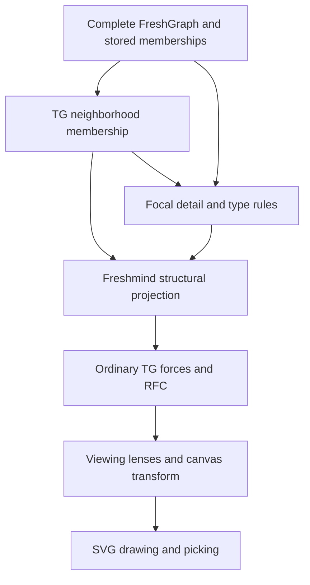

# Structural focus + context

Task **3.2.6** adds reversible type filters and leaf aggregation alongside RFC and the viewing lens. It follows the hybrid example in §2.3/Figure 3 of the [2005 paper](literature/rfc@3ia05compact.pdf): lower-detail people/content can disappear into their parents away from focal detail, with a count recording what was aggregated. The implementation is a rule-based reconstruction, not a port of a complete Java algorithm or a reconstruction of the original figure.

## Try it

For a larger, ready-to-explore demonstration, load **RFC → Research community showcase**. Its [six comparison views](rfc-showcase.md) cover ordinary layout, the viewing lens, one/two RFC centers and hybrid aggregation on a 34-node typed community. Hybrid mode retains 18 nodes, with typed counts for sixteen aggregated leaves, shared focal detail and explicit semantic bridges. The smaller fixture below remains the functional/numerical reference.

1. Load **RFC → Structural focus + context**. This synthetic graph contains 13 nodes, 13 relations and two saved detail trees. Pause motion to compare membership without changing positions.
2. Open **Structural focus + context** in the sidebar. Select **Person (person)** and **Paper (paper)** under **Aggregate leaf types**, then enable the structural view. With the initial Project A star and detail radius 1, six nodes remain visible and seven leaves aggregate. The shared collaborator stays visible because it has two distinct semantic neighbors.
3. Select Group Alpha or Group Beta and click **Reveal selected parent’s leaves**, or press **E**. Expanding also reveals newly discovered leaves on its first invocation. A reveal exception lasts until the rules or document change.
4. Under **RFC → Substructures**, reinforce **A: stored detail**. Nine nodes are visible. Add **B: stored detail** through the API below to retain all 13. Stored tree/DAG/cluster memberships protect eligible detail before aggregation; simple stars protect their eligible one-hop branches. A detail radius also keeps graph hops around the viewing focus and RFC roots.
5. Adjust the lens, graph spacing, rotation and canvas zoom. Geometry changes independently of these discrete rules. The exclusion option can remain enabled; its regions use the resulting visible memberships.
6. **Type filters** explicitly hide selected node/relation types, including in focal structures. Reset restores the current neighborhood. Loading another document clears document-specific structural rules; showing the whole graph enlarges the underlying neighborhood while retaining the rules.

The type lists support multiple selection. Use Ctrl/Command to toggle individual types. Configured type definitions, unknown semantic IDs present in the graph and IDs in active rules are available. Type filters work without any aggregate types. Hiding a relation leaves its endpoints visible unless another rule removes them.

```ts
const view = panel.getStructuralView();
view.configure({enabled: true, aggregateTypes: ["person", "paper"], detailRadius: 1});
panel.getRfc().activateSubstructure("a-detail");
panel.getRfc().activateSubstructure("b-detail", true);
view.configure({hiddenRelationTypes: ["authored"]});
view.reveal("beta");
console.log(view.getState()); // detached settings, groups, IDs and source counts
view.configure({enabled: false}); // restore the current neighborhood, including its explicit hides
```

`just structural-example` regenerates [the native input](../examples/rfc/structural-focus-context.fm.yaml) from [its source](../scripts/structural-view-example.mjs). Neither YAML nor `captureDocument()` saves these transient rules, reveal exceptions or RFC activations. Saving retains every complete-graph node, relation, type and stored membership.

## Rules and limits

Settings default to `enabled: false`, three empty type lists and `detailRadius: 1`. Lists contain exact, nonempty semantic type IDs; duplicate IDs are removed. Unknown IDs are valid. Radius is an integer from 0 through 6. Updates validate atomically, copy their arrays, clear reveal exceptions and wake the layout. Repeating an identical configuration is a no-op.

Aggregation runs once over the current neighborhood after explicit type filters. A node qualifies only if its type is selected, it has exactly one distinct neighbor in the **complete semantic graph**, has no self-loop, and has a retained attachment relation to a retained parent. Parallel/reciprocal attachments to the same parent count as one neighbor and one aggregated node. A bridge remains a bridge even if one neighbor is outside the neighborhood or filtered. Cycles and loop-bearing nodes stay visible. A two-node component whose two leaves are both eligible has no unambiguous parent and is retained.

Rules do not recursively collapse branches, invent representative nodes, reroute relations or combine weights. They hide qualifying leaves and their incident relations, and group their IDs by retained parent and semantic type. Each leaf belongs to one group. Parent labels, annotations, importance, physical coordinates and semantic adjacency remain unchanged. Counts such as `+person: 2` appear in a sibling decoration layer, outside the node body and focus frame. The existing `+N` badge still counts hidden relation incidences; typed aggregation counts nodes, so parallel relations need not give equal totals.

The selected node, selected relation endpoints and neighborhood origin are protected from **aggregation**. Viewing/RFC centers also retain detail within the configured hop radius. RFC protection is computed from the unaggregated neighborhood and positive eligible memberships, so activating a stored structure can restore its previously aggregated members. It is deliberately conservative before explicit type filters, avoiding an aggregation feedback loop. Explicit filters take precedence, can hide protected items, and may suspend an RFC center. Removing the filter resumes an existing activation when its root returns.

Revealed nodes remain subject to explicit type filters and neighborhood limits. A reset restores the current neighborhood rather than the complete graph; use **Show whole graph** to enlarge that neighborhood. Manual node/relation hides, collapse/pruning and later neighborhood requests alter the source membership, so disabling the rules cannot resurrect nodes from a previous view. Hidden nodes keep their stored coordinates/momentum; they receive neither ordinary nor RFC integration while hidden. Once layout runs, visible parents may move independently of their hidden leaves. There is no aggregate mass, repulsion or momentum roll-up.

## Ownership and implementation



`src/fm/structure-view/` contains the headless projection, controller and membership index; `src/fm/ui/structural-view.ts` binds application-owned controls. `fm4/fm/structure-view` exports the controller, pure projection/validation helpers and types. The main browser supplies elements; the behavior is available from the library.

The existing TG locality remains the authoritative neighborhood for `LocalityUtils` and serialized asynchronous traversal. The presented `StructuralLocality` holds references to existing nodes/edges. It forwards public locality mutations to that source and recomputes actual visibility flags/incidence counts, including loop incidence twice. Forwarding keeps reference cleanup/rendering at the usual repaint boundary, so compound edits do not expose half-applied panel state. Relation reconnection uses source membership to retain attachments even when a structural rule hides the new endpoint. It does not own adjacency. `getUnfilteredLocality()` exposes source membership through a read-only TypeScript contract; shared node/edge visibility flags describe the presented view.

TGPanel's existing virtual `getGES()` now supplies presentation membership consistently for rendering, bounds, draw coordinates, picking, visible counts and reference cleanup, as it already did for physics. Its source mutations and locality queue keep their owners. With ordinary TGPanel or the structural view disabled, the getter returns the original locality and numerical paths remain unchanged. Graph replacement clears structural rules before installing the new source. Direct semantic/topology edits use the existing repaint/reset-damper convention.

Pending complete-graph selections retain the existing queue cleanup timing while their neighborhoods arrive; the node-content popup continues to navigate hidden links with these rules enabled or disabled. The controller returns detached state snapshots and listener disposers. Its source UI handles type lists, atomic validation, paused updates, selected-parent reveal, reset, document changes and listener cleanup. It does not introduce another selection model, keyboard map or persistent file-format field. E composes with the existing expansion command.

## Verification and evaluation

Thirteen core checks cover conservative leaf/bridge/cycle/loop rules, detail radius and explicit precedence, parallel relation counts, detached/atomic settings, source order and explicit hides, expansion and queued neighborhood replacement, reference cleanup, multiple foci, complete YAML capture, fixed coordinates/lenses, visibility flags, hidden-node integration, exact example regeneration and atomic relation reconnection to aggregated targets. Four new Chrome checks exercise controls, type lists, counts, E/reveal, multiple stored foci, exclusion/lenses, validation, graph replacement, actual relation editing and disposal. The existing content-link check now runs with structural view both enabled and disabled.

The subsequent [Experiment J](experiments/rfc-hybrid/README.md) completes **3.4.2** with 160 matched star/stored-tree, structural-rule, TG/RFC and lens conditions. Force controls retain identical nominated focal detail; full/reduced comparisons use the same retained constraints and point sets, with nominal/retained degrees and visible graph sizes recorded. All 80 lens pairs have identical physical trajectories. Lower radial error after aggregation coexists with changed force balance; relation filtering can leave isolated repelling endpoints. Zero final motion under global cooling is distinct from force equilibrium. Use `just rfc-hybrid-experiment` to regenerate records/report/figures and `just rfc-hybrid-figures` to redraw them.

Reproduction of the original Figures 1–3 is outside the agreed scope. These functional checks and small synthetic comparisons do not establish perceptual improvement or general convergence. General subtree/community aggregation, automatic type priorities, aggregate-force roll-up and label-clearance guarantees are outside this implementation.
